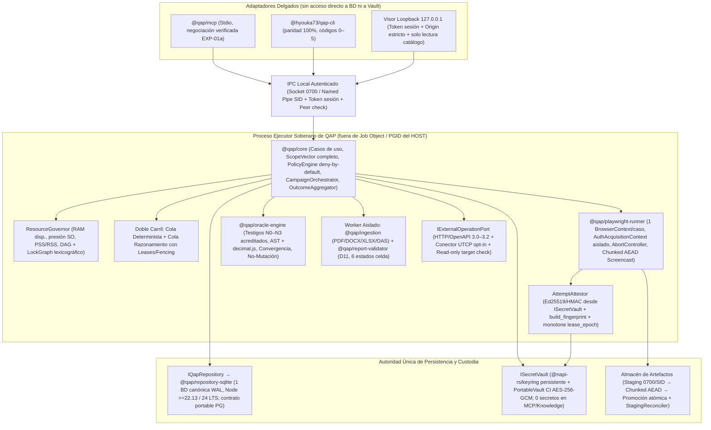

# QAP — Revisión Técnica Independiente Final de la Arquitectura

**Rol:** Auditor Técnico Independiente de QAP (bajo dirección del Orquestador Principal)  
**Fecha:** 24 de noviembre de 2026  
**Repositorio:** `Hyouka73/QAMCP` · **Rama auditada:** `origin/develop`  
**SHA verificado:** `ea804a5b141659c68cd85305ca4bbaeeb431bc0e` *(lectura directa sobre el almacén de objetos Git sin modificar worktrees ni cambios locales; nota operativa: el worktree local `QAMCP-develop-docs` apunta a `a927bfb7`, por lo que toda verificación de código y documentación se ejecutó estrictamente sobre `ea804a5b141659c68cd85305ca4bbaeeb431bc0e` y los 5 commits archivados por SHA exacto)*  
**Informe auditado:** [auditoria_final_qap_gemini_neon.md](auditoria-neon.md)  
**Naturaleza de la intervención:** 100 % solo lectura e investigación. Cero cambios de código, dependencias, configuración, ramas, worktrees o sistemas externos.

---

## 1. Dictamen ejecutivo independiente

**Dictamen:** **`APROBABLE CON CORRECCIONES`**

Coincido con la conclusión general de que el expediente consolidado en `ea804a5b` proporciona una línea normativa completa (**D01–D21**), recupera sin pérdidas los **87 IDs base** (82 originales + 5 añadidos) y las **11 ampliaciones**, y acierta en la arquitectura macro (autoridad única, núcleo `@qap/core` con adaptadores delgados MCP/CLI, ejecutor soberano con doble carril, oráculos con independencia de testigo y publicación atómica).

Sin embargo, **el informe de Gemini Neon no puede aprobarse tal cual como línea base para redactar el plan maestro definitivo y el WBS**. Esta auditoría independiente identificó:

1. **Inconsistencias técnicas y de diseño no resueltas frente a las objeciones vinculantes (`O-01`–`O-10`):**
   - **Taxonomía contradictoria (`O-05`):** Neon ratifica 6 veredictos cerrados en `REQ-ORA-001.1`, pero introduce un 7.º valor (`PASS_STRUCTURAL`) en la Sec. 6.E y `DP-04`.
   - **Brecha criptográfica en autenticidad del runner (`O-04`):** Neon conserva SHA-256 como acreditación de origen de intento (`REQ-IA-001.5`), lo cual solo prueba integridad, no autenticidad frente a falsificación o *replay*.
   - **Captura privada insuficientemente deslindada (`O-01`):** mezcla prevención real, contención, detección heurística y descarte posterior; omite el diseño concreto de cifrado autenticado por bloques (AEAD *chunked*) compatible con `HTTP Range` (`206`/`416`) y recuperación tras caída.
   - **Evaluación de fórmulas Excel con riesgo IEEE-754 (`O-03`):** proponer evaluadores JS permisivos sin deslindar 6 estados de celda y sin aritmética decimal exacta contradice la detección de 1 centavo de `D11`/`REQ-ORA-001.4`.
   - **Perfilado de recursos estático e incompleto (`O-06`):** su fórmula de RAM confunde `RSS` con `PSS`, ignora RAM disponible vs. instalada, presión de memoria del SO y picos p99/max.
   - **Métricas vulnerables a gaming (`O-07`):** omite tasa máxima de abstención (`INDETERMINATE`), medición de falsos `FAIL` y separación formal entre cumplimiento obligatorio de requisitos vs. generalización sobre corpus ciego.
   - **Ubicación errónea de la validación empresarial (`O-08`):** diferir toda validación operativa empresarial autorizada hasta *después* de G6 deja el lanzamiento oficial sin verificación operativa real previa.
2. **Errores fácticos y omisiones verificadas en `HN-01`–`HN-09` sobre `ea804a5b`:**
   - **`HN-09` es parcialmente incorrecto:** `.codex-r2-concurrency-evidence/typescript-r3-final-diff.json` no registra «93 diagnósticos» sino **93 identidades agrupadas cuya suma de `.count` es exactamente 142 diagnósticos** (no existe contradicción con los 142 de `catalogo-requisitos.md`).
   - **`HN-06` tiene el piso de Node equivocado:** `node:sqlite` dejó de requerir `--experimental-sqlite` en **Node `22.13.0`**, no en `22.12.0`. Declarar `>=22.12.0` fallaría en `22.12.x`.
   - **`HN-03` omite resolución real en `pnpm-lock.yaml` y riesgos de SDK v2:** en el lockfile real `playwright-core` resuelve a **3 copias** (`1.62.1`, `1.63.0` y `1.63.0-alpha-2026-08-31` arrastrada por `@playwright/mcp@0.0.80`), `@modelcontextprotocol/sdk` resuelve a **2 copias** (`1.30.0` y `1.30.1`), y Neon asume migración directa a SDK v2 (`2026-07-28`) en G1 sin validar antes en G0 la negociación real y el *sibling process probe* en `stdio` sobre los 4 hosts.
   - **`HN-04` subestima el estado real de `keytar`:** no solo aparece en documentación previa; está declarado en `optionalDependencies` de `packages/auth` y `packages/cli`, resuelto en `pnpm-lock.yaml` (`keytar@7.9.0`) e importado dinámicamente en `packages/auth/src/providers.ts:30`.
   - **`HN-05` presenta `scalar#9694` como defecto abierto** cuando ya fue corregido en versiones posteriores de `@scalar/openapi-parser`/`@scalar/openapi-upgrader`.
3. **Hallazgos nuevos críticos no detectados por Neon (`HA-01`–`HA-06`):**
   - `packages/reporter/src/server/server.ts` expone **`DELETE /api/runs/:runId` sin autenticación con CORS `*`** (permite borrado cross-origin de historial), **doble `decodeURIComponent`** en `/api/reports/:executionId/:format` (traversal codificado) y exfiltración cross-origin de `/api/graph`, `/api/runs` y `/api/reports`.
   - **`@qap/mcp` no es empaquetable limpiamente para `npx`:** publica como `public` pero declara 7 paquetes `"private": true` en `dependencies` como `workspace:*` sin `noExternal` en `packages/mcp/tsup.config.ts`; además ambos `tsup.config.ts` compilan con `target: 'node18'` y ni `@qap/mcp` ni `@hyouka73/qap-cli` declaran `"license"` ni `"engines"`.
   - **Código reutilizable omitido** en `packages/playwright-adapter/src/reconnaissance/transport.ts`, `network-observer/privacy.ts`, `packages/mcp/src/application/scoped-rule-resolver.ts`, `lineaged-case.ts`, `safe-storage.ts`, `packages/auth/src/secure-files.ts`, `packages/knowledge/src/graph/cycle-detector.ts`, `hasher/semantic-hasher.ts` y `packages/mcp/tsup.config.ts` (huella de build).

Incorporando las correcciones de las Secciones 2–10 de este informe al expediente objetivo, el proyecto queda habilitado para iniciar el plan maestro definitivo y el WBS.

---

## 2. Verificación de los 92 elementos normativos

### 2.1 Auditoría aritmética y trazabilidad 1-a-1 (contra `catalogo-requisitos.md` en `ea804a5b`)

Se ejecutó comparación exhaustiva entre los encabezados `### REQ-*` / `### CAND-*` de `docs/qap-architecture/catalogo-requisitos.md` (`ea804a5b`) y la tabla de la Sección 2.3 de Neon:

| Bloque normativo | En `catalogo-requisitos.md` (`ea804a5b`) | En propuesta de Neon (Sec. 2.3) | Resultado de verificación |
|---|---:|---:|---|
| Requisitos originales recuperados | 82 | 82 | **Preservación 100 %** (0 faltantes, 0 duplicados) |
| Requisitos añadidos en línea base | 5 (`REQ-XINST-001`, `REQ-QA-001..003`, `REQ-AGT-001`) | 5 | **Preservación 100 %** |
| Ampliaciones integradas (`REQ-AGT-002`, `REQ-ONB-001`, `REQ-OPT-001`, `REQ-OPT-002`, `REQ-E2E-001`, `UTCP/OpenAPI`, `M1`–`M5`) | 11 | 11 (mapeo exacto a los IDs padre declarados en el catálogo) | **Integración completa** (con observaciones semánticas abajo) |
| Candidatos promovidos (`CAND-REP-001`, `CAND-RUN-001`, `CAND-SEG-001`) | 3 candidatos | `REQ-AUTREP-001`, `REQ-RUN-002.1`, `REQ-SEG-002.3` + `POL-CAP-001` | **Promovidos sin duplicidad**, con enmiendas puntuales |
| Políticas adicionales formalizadas | 2 (Captura privada, Historial y retención) | `POL-CAP-001` (absorbe captura), `POL-RET-001` | **Formalizadas**, con enmienda de precedencia/permisos (`O-10`) |
| Cobertura `D01`–`D21` | 21 decisiones | 21/21 trazadas | **Completa**, salvo ajuste en `D17` (`ScopeVector`), `D18` (`O-01`), `D12` (`O-05`), `D21` (`O-07`/`O-08`) |
| **Total normativo** | **87 base + 3 CAND + 2 Pol.** | **92 IDs únicos (0 duplicados)** | **Cómputo íntegro** |

### 2.2 Verificación individual de los 5 elementos incorporados

| ID incorporado | Evaluación independiente | Enmienda requerida antes de congelar especificación |
|---|---|---|
| **`REQ-AUTREP-001`** *(de `CAND-REP-001`)* | **Correcto y necesario.** Cubre D11 de forma autónoma sin diluirlo en ingesta (`REQ-DOC-001.1`) ni reportes internos (`REQ-REP-001.x`). | Incorporar la distinción obligatoria en 6 estados de celda/fórmula (`O-03`) y exigir aritmética decimal exacta en el evaluador acotado. |
| **`REQ-RUN-002.1`** *(de `CAND-RUN-001`)* | **Adecuado con cautela semántica.** Mezcla dos obligaciones de naturaleza distinta: (a) preferencias conversacionales del usuario (D15) y (b) invariante no negociable de fidelidad de renderizado/recursos del AUT (D15). | Separar explícitamente en el contrato dos cláusulas con criterios independientes (`REQ-RUN-002.1a` preferencias persistidas; `REQ-RUN-002.1b` invariante de fidelidad y `resource_degradation_event`), para evitar que fidelidad se trate como preferencia desactivable. |
| **`REQ-SEG-002.3`** *(de `CAND-SEG-001`)* | **Correcto.** Aísla correctamente los controles técnicos verificables de custodia (cifrado desde primera escritura, temporales, catálogo, supresión *fail-closed*). | Exigir cifrado autenticado por bloques (AEAD *chunked*) compatible con `Range`, aislamiento de perfiles temporales/descargas/trazas/logs y separación prevención vs. contención (`O-01`). |
| **`POL-CAP-001`** *(de `CAND-SEG-001` + Pol. Adic. 1)* | **Correcto.** Elimina la duplicidad entre `CAND-SEG-001` y la política adicional de captura. | Distinguir explícitamente vigencia de **captura** (≤30 días) vs. vigencia de **conservación**, detallar los 4 permisos independientes (`capture`, `access`, `retain`, `export`) y explicitar que QAP no puede revocar copias ya exportadas (`O-10`). |
| **`POL-RET-001`** *(de Pol. Adic. 2)* | **Correcto.** Integra la regla de precedencia (`HN-08`), pero deja abiertos detalles de cuota/disco lleno. | Formalizar comportamiento ante almacenamiento lleno/cuota al 80 %–95 % sin corromper veredictos ni SQLite (`O-10`) y preservar el estatus ratificado (90 d detalle, historial permanente, knowledge sin caducidad) separado de los TTL aún pendientes de ratificación empresarial (24 h / 72 h / 14 d). |

### 2.3 Crítica a la reconstrucción analítica 60 / 20 / 7 y pérdidas semánticas detectadas

La clasificación `60 RF / 20 RNF / 7 POL` es una reconstrucción analítica (confirmado en `evidencia-archivada.md:64` que el mapeo individual original no existe en el repositorio). **Neon forzó al menos dos asignaciones para cuadrar exactamente el 20/7:**

1. **`REQ-QA-003` (Auditoría de accesibilidad) clasificado como RNF (20/20):** Es un **error taxonómico**. Ejecutar auditorías automatizadas de accesibilidad sobre el AUT y registrar chequeos manuales pendientes es una **capacidad funcional de QA** (al igual que `REQ-QA-001` i18n y `REQ-QA-002` contratos API), no un atributo no funcional del runtime de QAP.
2. **`REQ-MEM-002.1` (Vector de alcance) como RNF vs. `REQ-SEG-002.1` (Secretos fuera de MCP/chat) como RNF:** `REQ-MEM-002.1` es un requisito funcional/estructural del modelo de dominio; en cambio `REQ-SEG-002.1` es simultáneamente una política dura de seguridad y un control técnico.
3. **Recomendación taxonómica (sin forzar 60/20/7):** Dado que el número por categoría no es un objetivo artificial, se recomienda reclasificar **`REQ-QA-003` como RF** y etiquetar los requisitos con **clase primaria + etiqueta de cumplimiento** (`RF` / `RNF` / `POL`), resultando en **63 RF · 20 RNF · 9 POL = 92 elementos normativos** (o mantener un registro de mapeo informativo al 60/20/7 solo como referencia histórica).
4. **Pérdidas / insuficiencias semánticas detectadas en el texto resumido de Neon:**
   - **`REQ-MEM-002.1` (`ScopeVector`):** Neon añade `profile_ref` y `visual_variant`, pero **omite `locale`, `timezone` y `currency`**, exigidos por `REQ-QA-001` / `D17` para congelar expectativas regionales sin colisión entre variantes.
   - **`REQ-IA-001.5`:** Mantener «Verificación criptográfica SHA-256 de origen de intento» reduce el requisito de **autenticidad del ejecutor** a mera integridad de digest (`O-04`).
   - **`REQ-ORA-001.1`:** Queda contradicho por `PASS_STRUCTURAL` en Sec. 6.E (`O-05`).
   - **`REQ-RUN-001.3`:** Correctamente actualizado de tripartito a **cuatripartito** por `D12`, pero debe alinearse con los estados completos de `evidence_health` (`EXPIRED_PRUNED`, `TAMPERED`, etc.).

---

## 3. Evaluación individual de los hallazgos HN-01 a HN-09

| ID | Clasificación | Requisito(s) | Severidad ajustada | Evidencia verificada (código / lockfile / docs / licencias) | Consecuencia y resolución propuesta |
|---|---|---|---|---|---|
| **HN-01** | **CONFIRMADO** *(con ampliación)* | `REQ-AUTREP-001` (D11), `REQ-DOC-001.1–001.2` (D10) | **Crítica** | Verificado: `ExcelJS` (MIT) lee fórmulas y valores cacheados `<v>`, pero **no recalcula** fórmulas. `HyperFormula` exige **GPLv3 o licencia comercial**, incompatible con la distribución permisiva `ISC` declarada en `package.json:19` sin cumplir obligaciones copyleft de GPLv3 o adquirir licencia comercial. **Ampliación detectada:** ni `packages/mcp/package.json` ni `packages/cli/package.json` declaran el campo `"license"`; y las librerías JS permisivas (`fast-formula-parser` MIT, `hot-formula-parser` MIT) operan en **IEEE-754**, con riesgo de deriva frente a la regla de 1 centavo. | **Consecuencia:** Imposibilidad legal de incluir `HyperFormula` en núcleo `ISC` y falsos `PASS`/errores de redondeo si se evalúan fórmulas financieras en IEEE-754. **Resolución:** Declarar `"license"` en todos los paquetes publicados; aplicar el contrato de 6 estados de celda (`O-03`) usando `exceljs` + evaluador propio/acotado en aritmética decimal exacta (`decimal.js`) para el subconjunto financiero/agregación + motor externo aislado opt-in (LibreOffice Calc headless) + `INDETERMINATE` explícito para fórmulas fuera de cobertura sin caché válida. |
| **HN-02** | **CONFIRMADO** | `REQ-SEG-002.3`, `POL-CAP-001` (D18), `REQ-RUN-002.1` (D14) | **Crítica** | Verificado contra documentación oficial de Playwright y commit archivado `AS-04` (`463b5566`, `docs/qap-architecture/insumos/as04-estado-integracion.md`): `CDPSession` es exclusiva de Chromium; `page.screencast` en Firefox/WebKit tiene techo nativo de 25 fps sin hooks CDP de compositor; `AS-04` probó fuga real SPA→MFA sin tráfico HTTP en Chromium 153 / Playwright 1.63 con canario visible en WebM; OOPIF y popups no están cubiertos. | **Consecuencia:** Prometer exclusión preventiva uniforme multi-motor o certificar Chromium solo por tener CDP es técnicamente falso. **Resolución:** Ver `O-01`: matriz de capacidades verificables por motor y superficie; ni siquiera Chromium queda certificado por tener CDP — la prevención real en login/MFA/SSO exige `AuthAcquisitionContext` sin grabación, y en superficies dinámicas no instrumentables aplica `MANDATORY_SUPPRESSION`. |
| **HN-03** | **CONFIRMADO PARCIALMENTE** *(matices fácticos y riesgo no evaluado)* | `REQ-INT-001.2` (D13/D14), `REQ-AGT-001`, `REQ-IA-001.1` | **Alta** | **Verificado en `ea804a5b` (`package.json` y `pnpm-lock.yaml`):** 1) `playwright-core` **declarado** tiene 4 especificadores: `^1.49.0` (`playwright-adapter`), `^1.62.1` (`auth`, `mcp`, `playwright-runner`), `^1.63.0` (raíz — **no `1.63.0` exacto** como indicó Neon) y `1.63.0` (`cli`). **Resuelto** en `pnpm-lock.yaml` produce **3 versiones**: `1.62.1` (para `auth`, `mcp`, `playwright-adapter`, `playwright-runner`), `1.63.0` (raíz y `cli`) y **`1.63.0-alpha-2026-08-31`** (transitiva de `@playwright/mcp@0.0.80`, omitida por Neon). 2) `@playwright/mcp@0.0.80` tiene **0 imports** en `src/`. 3) `@modelcontextprotocol/sdk` está resuelto en **2 versiones distintas** (`1.30.0` en `mcp`/`playwright-adapter` y `1.30.1` en raíz/`cli`). 4) Documentación oficial confirma que `@modelcontextprotocol/server` v2 implementa la especificación `2026-07-28` (stateless, `server/discover`) y soporta compatibilidad legacy (`2025-11-25`) pero introduce **sondeo por proceso hermano (*sibling process probe*)** en `StdioClientTransport` y elimina server-to-client requests en modo moderno. | **Consecuencia:** Doble descarga de binarios, inconsistencia de APIs (`page.screencast` ≥1.59, `ariaSnapshotJSON` ≥1.63), y **riesgo de incompatibilidad real** si se migra a ciegas a SDK v2 en G1 antes de comprobar qué protocolo negocian Antigravity, Codex, Claude Code y Gemini CLI y cómo interactúa el *sibling probe* con el arranque del ejecutor soberano. **Resolución:** En G0, unificar `playwright-core` vía `pnpm` catalog a una sola versión exacta (≥1.63.0), retirar `@playwright/mcp`, y ejecutar un *spike* **EXP-01a en G0** sobre los 4 hosts reales antes de fijar v2 vs. dual-era en G1. |
| **HN-04** | **CONFIRMADO** *(con severidad/evidencia corregida)* | `REQ-SEG-002.1` (D20), `REQ-INT-001.2` (D14) | **Alta** | Verificado: `github/node-keytar` está archivado y deprecado. **Corrección a Neon:** `keytar` no es solo una mención documental en `gemini-neon-etapa-3.md:695`; está **declarado en `optionalDependencies`** de `packages/auth/package.json:22` y `packages/cli/package.json:44`, **resuelto como `keytar@7.9.0`** en `pnpm-lock.yaml:2065` e **importado dinámicamente en producción** en `packages/auth/src/providers.ts:30`. Verificado también en docs de `@napi-rs/keyring`: en Linux cae silenciosamente de `secret-service` a `keyutils` en memoria no persistente, evitable pasando `{ linux: { store: 'secret-service' } }`. | **Consecuencia:** Dependencia nativa abandonada en ruta de producción actual y pérdida silenciosa de secretos en Linux headless/CI si se usa `@napi-rs/keyring` con defaults. **Resolución:** Retirar `keytar` de `packages/auth` y `packages/cli`; implementar `ISecretVault` con `@napi-rs/keyring` forzando backend persistente (`store: 'secret-service'` en Linux, sin fallback silencioso a memoria) + `PortableCredentialVault` endurecida (AES-256-GCM con KEK externa) para CI/headless sin keyring de escritorio. |
| **HN-05** | **CONFIRMADO PARCIALMENTE** | `REQ-DOC-001.1` (D10), `REQ-DAT-001.2` / `REQ-QA-002` (D08) | **Alta** *(preventiva)* | 1) **CVE-2025-11849 en `mammoth`:** **CONFIRMADO** (directory traversal vía `r:link` en imágenes externas en `< 1.11.0`, parcheado desde `1.11.0`; `1.13.0` está libre). **Matiz crítico:** `mammoth` **no está instalado ni resuelto en `ea804a5b`**; es un riesgo preventivo de selección de dependencia, no una vulnerabilidad explotable hoy en `develop`. 2) **`@scalar/openapi-parser` (`scalar#9694`):** **INCORRECTO calificarlo como defecto aún abierto sin verificar versión**; el issue `#9694` sobre `nullable: true` en `$ref`/`allOf` al convertir OAS 3.0→3.1 ya fue atendido en parches posteriores (licencia MIT confirmada). Falta verificación empírica de **OpenAPI 3.2** sobre fixtures reales. | **Consecuencia:** Tratar riesgos preventivos como vulnerabilidades actuales distorsiona prioridades de G0; depender de un solo parser sin normalizador ni pruebas 3.0/3.1/3.2 puede romper contratos corporativos. **Resolución:** Fijar `mammoth >= 1.13.0` en worker aislado sin acceso a red ni resolución de rutas externas (deshabilitando `r:link` y aplicando límites anti-ZIP-bomb/XXE); incluir suite de regresión OAS 3.0 (`nullable`/`allOf`/`$ref`), 3.1 y 3.2 en **EXP-05** antes de congelar el conector. |
| **HN-06** | **CONFIRMADO PARCIALMENTE** *(versión mínima errónea en Neon)* | `REQ-MEM-003.6` (D02), `REQ-INT-001.2` (D14) | **Alta** | Verificado en `ea804a5b`: `node:sqlite` se importa en **47 archivos** bajo `packages/` (**10 archivos de producción** y 37 de pruebas); `package.json` raíz y los paquetes publicados carecen de `"engines"`; `AGENTS.md:12` dice `node -v # >= 18 (recomendado 20 LTS)`; `packages/mcp/tsup.config.ts:79` y `packages/cli/tsup.config.ts:124` compilan con `target: 'node18'`; `packages/engine/package.json:19` declara `@types/node: ^20.0.0`. **Error fáctico de Neon:** `node:sqlite` se habilitó sin flag `--experimental-sqlite` en **Node `22.13.0`**, **NO** en `22.12.0` (`22.12.x` falla sin flag). | **Consecuencia:** Declarar `>=22.12.0` provocaría fallos inmediatos en usuarios con Node `22.12.x` vía `npx`. **Resolución:** Declarar `"engines": { "node": ">=22.13.0" }` (recomendando **Node 24 LTS** para estabilidad plena sin `ExperimentalWarning`), actualizar `target: 'node22'` en `tsup`, alinear `@types/node`, corregir `AGENTS.md` y validar en `qap doctor`. Encapsular `node:sqlite` tras `IQapRepository`. |
| **HN-07** | **CONFIRMADO** *(e incompleto — ver `HA-01`)* | `REQ-REP-001.1`, `REQ-SEG-001.1` (D18/D20) | **Alta** *(elevada por `HA-01`)* | Verificado en `packages/reporter/src/server/server.ts:315`: `'Cache-Control': 'public, max-age=3600'` sobre `/artifacts/*`, junto con `Access-Control-Allow-Origin: *` (`server.ts:59`) e `isAbsolute(safePath)` (`server.ts:277`). | **Consecuencia:** Evidencias privadas o revocadas pueden quedar cacheadas en navegador/proxies locales incluso tras revocación. **Resolución:** Imponer `Cache-Control: private, no-store` (y `Vary: Authorization` / token de sesión) en evidencias y APIs de runs/reportes; aplicar conjuntamente la remediación integral de `HA-01` en G0. |
| **HN-08** | **CONFIRMADO** | `REQ-MEM-003.5`, `POL-RET-001`, `POL-CAP-001` (D18/D19) | **Media-Alta** | Verificado en `acta-decisiones.md:455,497-498` y `catalogo-requisitos.md:916-917`: D19 propone conservar evidencias de fallos ≥14 días y proteger defectos abiertos, mientras D18 impone vigencia ≤30 días y revocación inmediata sin regla explícita de colisión entre ambas normas. | **Consecuencia:** Ambigüedad legal/operativa que permitiría retener media privada revocada por existir un defecto abierto. **Resolución:** Fijar en `POL-CAP-001`/`POL-RET-001` la regla de precedencia dura: **expiración o revocación de conservación privada prevalece siempre sobre retención de defectos abiertos**, purgando los bytes privados y conservando veredicto, hash histórico y `prune_event` (`O-10`). |
| **HN-09** | **CONFIRMADO PARCIALMENTE** *(premisa numérica incorrecta)* | `REQ-INT-001.2` (D14) | **Media** | Verificado leyendo `.codex-r2-concurrency-evidence/typescript-r3-final-diff.json` en `ea804a5b`: el arreglo `baseline` y `current` tiene **93 entradas (identidades únicas agrupadas)**, cuya **suma de `.count` es exactamente 142 diagnósticos** (`baseline sum=142, current sum=142, added=[], removed=[]`). **Neon confundió `.length` (93) con el total de diagnósticos (142).** Además, `144` corresponde a la rama separada `Recovery`/`Hydrogen R2` (`a78322f8`), no a `develop` (ya aclarado en `cuestiones-abiertas.md:57`). Sí se confirma que `package.json` carece de script `typecheck` y `scripts/release-check.mjs` no ejecuta `tsc --noEmit`. | **Consecuencia:** No hay contradicción entre `typescript-r3-final-diff.json` y los 142 diagnósticos de `catalogo-requisitos.md`, aunque sí falta una medición vigente de todo el monorepo (ese archivo cubre el grafo de `@qap/mcp`). **Resolución:** En G0, añadir `typecheck` al `package.json` raíz y `release-check.mjs`, ejecutar `tsc --noEmit` sobre todos los paquetes en `ea804a5b`, congelar la línea base exacta (identidades + total) y exigir 0 errores en todo paquete nuevo desde G1. |

---

## 4. Resolución individual de las objeciones vinculantes O-01 a O-10

### O-01 — Captura preventiva y custodia de evidencia privada

Neon acierta al reconocer que detener la grabación tras renderizar no demuestra prevención, pero vuelve a mezclar en Sec. 6.F prevención con detección heurística + descarte posterior. Se establece una **separación estricta de cinco capas** (ninguna puede sustituir a la anterior):

| Capa | Definición operativa | Qué demuestra / Qué NO demuestra |
|---|---|---|
| **1. Prevención real (*pre-paint exclusion*)** | Impedir que bytes sensibles lleguen jamás al codificador de video, PNG, traza, log o staging. | Solo demostrable mediante: **(a)** aislamiento de contexto sin grabador activo (`AuthAcquisitionContext` para login/MFA/SSO) o **(b)** exclusión determinista antes del primer cuadro verificada con canario sintético *pre-paint* en el motor y superficie exactos. |
| **2. Contención de evidencia privada** | Capturar bajo autorización explícita (`PRIVATE_AUTHORIZED`) manteniendo confidencialidad criptográfica desde la primera escritura, aislamiento de directorios temporales (`0700`/ACL SID) y prohibición de exportación por defecto. | Reduce exposición en reposo y tránsito local; **no equivale a prevención de captura**. |
| **3. Detección posterior (*post-render / heuristic*)** | Observadores DOM/URL/red o detección de patrones sensibles que disparan parada de grabación y cuarentena/descarte del staging. | Es una **barrera secundaria de mitigación de daños**, jamás prueba de prevención. Si se dispara en modo `VERIFIED_STRICT`, exige abortar promoción y registrar incidente + transición a `MANDATORY_SUPPRESSION`. |
| **4. Eliminación lógica verificable** | Desenlace del índice/catálogo, revocación/destrucción de clave por artefacto (*crypto-shredding*), borrado de staging y registro de `prune_event`. | Garantiza inaccesibilidad lógica desde QAP y claves irrecuperables; **no promete borrado físico en sectores SSD, wear-leveling, swap ni snapshots/backups del SO**. |
| **5. Riesgo residual declarado** | Exposición inevitable fuera del control del proceso QAP (memoria RAM del proceso navegador, pagefile/swap, snapshots APFS/VSS/ZFS, volumen host sin cifrado de disco, copias exportadas). | Debe constar expresamente en el acta de autorización de `POL-CAP-001`, sin reclamar garantías inexistentes. |

- **Análisis por superficie y artefacto (prohibido certificar Chromium solo por tener CDP):**
  - *Login / MFA / SSO (incluido redirect IdP):* siempre en **`AuthAcquisitionContext` sin grabación ni trace**; la sesión autenticada se transfiere (cifrada) al contexto de prueba solo al completar autenticación.
  - *Transición SPA sin tráfico HTTP hacia MFA/sensible (`AS-04`):* una guarda de red o CDP `Fetch` **no basta**; sin cooperación determinista del AUT (ruta/estado anunciado antes del render o contenedor aislado), solo existe mitigación post-render → si el modo es `VERIFIED_STRICT` y no hay contrato preventivo acreditado, aplica `MANDATORY_SUPPRESSION` en ese flujo.
  - *Iframes fuera de proceso (OOPIF) y ventanas emergentes (`popup`/`target=_blank`):* en Chromium, los OOPIF corren en procesos de renderizado distintos; un `addInitScript` no garantizado en todos los orígenes/targets o una ventana popup creada antes de adjuntar hooks puede pintar cuadros sensibles. Cualquier evento `page`/`frameattached` de origen no verificado en `VERIFIED_STRICT` debe suspender la grabación de forma *fail-closed* antes de habilitar promoción. **Tener CDP no certifica a Chromium**: la certificación exige superar `EXP-06` con canarios *first-paint* en documento principal, SPA same-document, OOPIF y popup.
  - *Perfiles temporales, PNG, WebM, trazas (`trace.zip`), logs y archivos descargados:*
    - `userDataDir`, `downloadsPath`, `tracesDir` y staging deben vivir bajo una raíz privada por intento con ACL restringida al usuario OS (`0700` / SID) y limpieza en salida + `StagingReconciler` al arrancar.
    - En `MANDATORY_SUPPRESSION`: se suprimen WebM, PNG y snapshots DOM de `trace.zip` (se conservan únicamente metadatos estructurales saneados y veredicto).
    - Logs de red/consola aplican redacción estructural de headers (`Authorization`, `Cookie`, `Set-Cookie`), tokens y campos sensibles antes de persistir.
    - Descargas del AUT (p. ej. reportes PDF/Excel de D11) heredan la clasificación de privacidad del alcance y se almacenan cifradas cuando el alcance sea `PRIVATE_AUTHORIZED`.
- **Diseño de cifrado en flujo, autenticación por segmentos, recuperación ante caídas y `HTTP Range`:**
  - **Problema técnico de cifrar WebM como un solo bloque AEAD:** un único tag GCM al final del archivo impide servir `HTTP Range` (`206 Partial Content`) sin descifrar el archivo completo en memoria y rompe la verificación de integridad si el proceso cae a mitad de escritura.
  - **Solución canónica — Contenedor cifrado por bloques (*Chunked AEAD*, p. ej. bloques de 64 KiB):**
    1. *Jerarquía de claves:* clave maestra del vault (`KEK`) envuelve una clave de datos única por artefacto (`DEK` de 256 bits) almacenada envuelta en el registro del catálogo SQLite (permite *crypto-shredding* instantáneo al revocar).
    2. *Formato de flujo:* cabecera autenticada (`magic`, `version`, `artifact_id`, `chunk_size = 65536`, `salt`, `mime = video/webm`, `created_at`) seguida de segmentos cifrados con **AES-256-GCM** donde cada segmento $i$ usa:
       - Nonce determinista único: `HKDF(DEK, salt, "nonce" || i)` (12 bytes; jamás reutilizado).
       - AAD (*Additional Authenticated Data*): `(artifact_id || chunk_index || is_final_flag || plain_chunk_len)`. Esto impide criptográficamente reordenamiento, duplicación, inserción o truncamiento silencioso de segmentos.
    3. *Escritura desde el primer byte:* cuando se use `page.screencast({ onFrame })` (o pipe de muxer WebM en memoria hacia el escritor *chunked*), el archivo en disco nace ya cifrado bloque a bloque. Donde Playwright exija ruta de archivo temporal propia del navegador/códec antes del cierre, ese temporal se considera **staging no cifrado de riesgo residual acotado** (restringido a `0700`/SID + volumen cifrado recomendado/exigible según `DE-02`), se ingesta al contenedor *chunked* antes de publicar y se elimina lógicamente de inmediato (documentando honestamente esa ventana hasta que `EXP-06` acredite *pipe* 100 % en memoria).
    4. *Recuperación ante caídas:* todo staging sin fila `COMMITTED` en SQLite (o sin chunk `is_final = true`) es detectado por `StagingReconciler` al iniciar el ejecutor y purgado lógicamente (destruyendo su `DEK`), sin promover jamás artefactos incompletos.
    5. *Reproducción `HTTP Range` (`206` / `416`):* conociendo `plaintext_size` (en catálogo) y `chunk_size` fijo, una solicitud `Range: bytes=start-end` se mapea en $O(1)$ a los bloques $\lfloor \text{start}/65536 \rfloor \dots \lfloor \text{end}/65536 \rfloor$. El visor verifica autorización y generación de revocación **antes** de leer y **antes** de enviar el último bloque, descifra únicamente los bloques solicitados en memoria, recorta al rango exacto y devuelve `206 Partial Content` + `Content-Range` + `Cache-Control: private, no-store`.
- **Captura útil en campañas empresariales normales (equilibrio operativo):**
  - No grabar indiscriminadamente ni suprimir todo por defecto: (1) aislar autenticación en `AuthAcquisitionContext` sin video; (2) aplicar política granular por módulo/superficie (pantallas no sensibles en `VERIFIED_STRICT`, pantallas con datos de negocio en QA autorizado bajo `PRIVATE_AUTHORIZED` con captura dirigida — p. ej. *retain-on-failure* o casos críticos — y solo caer a `MANDATORY_SUPPRESSION` en superficies sensibles sin garantía técnica verificada).

### O-02 — Independencia de testigos (acreditación N0–N3 sin exigir BD del AUT)

Una recarga, un contexto limpio o una API secundaria **no son independientes por definición**. La independencia causal debe acreditarse por **procedencia y modelo de fallo**, nunca por etiqueta nominal:

| Nivel | Qué acredita | Condiciones obligatorias de acreditación | Causas que invalidan el nivel (degradan o bloquean) |
|---|---|---|---|
| **N0 (Señal técnica)** | El runner ejecutó la acción sin excepción de transporte/DOM (HTTP 2xx, clic, toast). | Ninguna sobre negocio. **Prohibido emitir `PASS` funcional o de persistencia con N0.** | Siempre insuficiente para persistencia/reglas de negocio. |
| **N1 (Estado observado mismo canal)** | Estado visible DOM/ARIA o respuesta inmediata de la vista tras la acción. | Permite solo `PASS` con `verification_scope = STRUCTURAL` en validaciones de UI/lectura no persistentes. | Nunca acredita persistencia ni efectos contables/transaccionales. |
| **N2 (Persistencia independiente)** | El efecto sobrevivió a la sesión efímera y es observable desde el estado confirmado del servidor. | Exige **todos** los criterios: (1) **Aislamiento de cliente:** nuevo `BrowserContext` limpio (cero cookies previas, cero `localStorage`/`sessionStorage`/`IndexedDB`, `serviceWorkers: 'block'`, `Cache-Control: no-cache` / bypass caché HTTP) O llamada HTTP directa sin caché; (2) **Evidencia de lectura de origen:** respuesta de red verificada (status 200 desde servidor, no `fromDiskCache`/`fromServiceWorker`, sin estado optimista local); (3) **Identidad y tenant verificados:** sesión explícitamente autenticada con el rol y `tenant_id` esperados, verificando en la respuesta el `tenant_id`/alcance real; (4) **Correlación unívoca:** la entidad observada coincide con clave de correlación (`business_key` / `client_request_id` / ID retornado + timestamp dentro de la ventana del intento) y **no preexistía** (precondición verificada antes de mutar); (5) **Declaración de no-dependencia optimista** (la vista/API de lectura consulta el registro confirmado, no un caché de sesión en memoria del cliente). | **Caché CDN/browser/proxy** que devuelve datos obsoletos o respuesta pre-mutación; **Service Worker** activo; **respuesta optimista** sin recarga real; **réplica de solo lectura con lag** sin ventana de convergencia (`REQ-ORA-001.6`); **falta de precondición limpia** (colisión con datos previos); **tenant/identidad sin verificar**; o **fuente que comparte el mismo defecto** (p. ej. el mismo BFF/caché que devuelve éxito ficticio sin persistir). |
| **N3 (Conciliación cruzada)** | Consistencia de negocio entre fuentes causalmente diferenciadas o invariante matemático/contable. | Contraste entre **≥2 fuentes con rutas de lectura distintas** (p. ej. vista operativa UI + reporte PDF/Excel generado por el AUT + regla de negocio calculada en decimal exacto; o verificación pre/post en un segundo rol/módulo consumidor del dato; o verificación pre/post de **no-mutación** en pruebas RBAC negativas). | Si ambas fuentes leen exactamente la misma vista materializada/endpoint defectuoso sin verificación independiente (fallo de causa común), se degrada a N2 y debe constar `shared_dependency_risk` en el metadato. |

- **Réplicas y consistencia eventual:** Si el AUT utiliza réplicas asíncronas o colas, el testigo N2/N3 se combina con el oráculo de convergencia (`REQ-ORA-001.6`: ventana máxima acotada + *polling* de solo lectura). Si la condición converge dentro de ventana → `PASS`; si contradice definitivamente → `FAIL`; si expira ventana sin certeza → `INDETERMINATE (eventual_consistency_timeout)`, nunca `PASS`.
- **Ausencia de testigo (sin exigir BD del AUT):** QAP jamás exige conexión directa a la BD del AUT. Si un caso mutativo no dispone de ninguna vista/API/reporte de lectura acreditable como testigo N2/N3, el evaluador **debe abstenerse** emitiendo `functional_verdict = INDETERMINATE` con código `missing_independent_witness` (jamás `PASS`).

### O-03 — Excel y reportes funcionales (D11 / `REQ-AUTREP-001`)

La existencia de un valor cacheado `<v>` en un `.xlsx` **no acredita** que la fórmula sea correcta ni que la caché esté vigente. El motor `@qap/report-validator` debe modelar explícitamente **6 conceptos distintos por celda calculada**:

1. **Valor reportado (`reported_display_value` / `cached_value`):** lo que el archivo muestra o almacena en `<v>` tras ser generado por el AUT.
2. **Fórmula declarada (`declared_formula`):** el texto exacto de la expresión en `<f>` (p. ej. `=SUM(D2:D50)`), incluyendo referencias entre hojas y celdas combinadas.
3. **Valor calculado independientemente (`independently_computed_value`):** el resultado de evaluar `declared_formula` sobre los datos crudos del libro en un motor independiente con aritmética decimal exacta.
4. **Valor esperado según regla de negocio (`business_expected_value`):** el resultado derivado del oráculo acreditado (fuente de comparación autorizada: UI secundaria, API autorizada opcional, otro documento o fórmula de negocio acreditada — p. ej. `subtotal * (1 + iva)` con política explícita de redondeo `ROUND_HALF_UP` / `ROUND_HALF_EVEN`).
5. **Caché obsoleta o ausente (`stale_cache` / `missing_cache`):**
   - *Caché ausente:* existe `<f>` pero falta `<v>` (típico de exportadores server-side).
   - *Caché obsoleta/inconsistente:* existe `<v>`, existe `<f>`, y `cached_value !== independently_computed_value` (por sí solo es un **defecto del reporte** → `FAIL (excel_stale_or_corrupt_cache)`).
6. **Fórmula no soportada (`unsupported_formula`):** `declared_formula` utiliza funciones volátiles, macros VBA, enlaces externos, matrices dinámicas o funciones Excel fuera del subconjunto certificado del evaluador.

- **Estrategia viable sin construir un clon de Excel ni violar licencias:**
  - **Capa 1 (Parser estructural, obligatorio, MIT):** `exceljs` extrae todas las hojas, formatos numéricos/moneda, rangos combinados, `<f>` y `<v>`.
  - **Capa 2 (Evaluador determinista acotado con decimal exacto, núcleo `ISC`/MIT):** en lugar de depender a ciegas de `fast-formula-parser` (MIT, ~280 funciones, pero **basado en `number` IEEE-754**, propenso a fallos de 1 centavo en sumas/porcentajes), utilizar un evaluador determinista acotado sobre **AST + `decimal.js`** para el núcleo contable/reportes (`SUM`, `SUMIF`, `SUMIFS`, `AVERAGE`, `COUNT`, `COUNTA`, `COUNTIF`, `MIN`, `MAX`, `ROUND`, `ROUNDUP`, `ROUNDDOWN`, `TRUNC`, `ABS`, `IF`, `IFS`, `IFERROR`, `AND`, `OR`, `SUBTOTAL`, operadores aritméticos y referencias A1/rango/multi-hoja). Si se usa un parser de sintaxis permisivo (MIT) para construir el AST, la **evaluación aritmética debe ejecutarse en `decimal.js`**, no en `Number` nativo.
  - **Capa 3 (Motor externo opcional aislado, opt-in):** para libros complejos fuera del subconjunto acotado (p. ej. `XLOOKUP`, `XNPV`, tablas dinámicas), soportar un conector **opcional** a **LibreOffice Calc headless** ejecutado en subproceso aislado (`--headless --convert-to xlsx`, sin red, macros deshabilitadas, directorio temporal efímero) como recálculo externo de proceso separado (sin enlazar librerías GPL/LGPL dentro del bundle `ISC` de QAP).
  - **Regla de dictamen:**
    - Si `independently_computed_value !== business_expected_value` o `cached_value !== independently_computed_value` o falta/duplica una fila o el filtro fue ignorado → **`FAIL`** con localizador exacto (`sheet!A12` o `page=3,row=14`, clave de negocio, esperado vs. observado).
    - Si `declared_formula` es `unsupported_formula` y no hay motor externo acreditado habilitado → **`INDETERMINATE (unsupported_excel_formula)`** si afecta al aserto del oráculo (nunca `PASS` por confiar ciegamente en `<v>` cuando el caso exige validar el cálculo).
    - Validación funcional **obligatoria desde lanzamiento** en PDF (reconstrucción tabular multipágina con unión de encabezados repetidos vía `pdfjs-dist` por coordenadas X/Y) y Excel (multihoja): conciliación registro a registro por clave de negocio, detección de faltantes, duplicados, filtros ignorados, totales y redondeos.

### O-04 — Autenticidad del runner y modelo de amenazas local

**SHA-256 por sí solo es insuficiente:** un agente LLM o un script externo en el workspace puede escribir un JSON fabricado, calcular su SHA-256 válido y presentarlo como si proviniera del runner canónico. Para acreditar que un intento proviene realmente del ejecutor canónico de QAP se requiere **separación entre integridad, autenticidad y confianza en el entorno**:

1. **Autoridad de emisión (`Issuer Authority`):** únicamente el **proceso ejecutor soberano de QAP** (iniciado fuera del control directo de herramientas del LLM) posee la clave de atestación del runtime (`runner_signing_key`: clave HMAC-SHA256 de 256 bits o par Ed25519 generado por instalación/ejecutor y custodiado en `ISecretVault`/keyring del SO, **jamás** escrito en `.qa/`, ni pasado al contexto MCP/prompts, ni accesible como argumento CLI).
2. **Identidad del ejecutor (`ExecutorIdentity`):** cada instancia del ejecutor registra al arrancar su identidad inmutable `(executor_instance_id, pid, process_start_time, build_fingerprint, bundle_sha256, host_os_uid)` — aprovechando el mecanismo ya existente de `buildFingerprint`/`bundleSha256` en `packages/mcp/tsup.config.ts:72-104`.
3. **Integridad del snapshot (`SnapshotBinding`):** antes de abrir el navegador, el runner recalcula el `plan_snapshot_digest` (SHA-256 canónico JCS de casos, expectativas, oráculos, adaptadores, `DataPlan` y política aplicable) y rechaza cualquier ejecución si difiere del registro confirmado en `IQapRepository`.
4. **Autenticación IPC (MCP/CLI ↔ Ejecutor soberano):**
   - Transporte local confinado al usuario OS: socket UNIX en directorio `0700` (macOS/Linux) o Windows Named Pipe con DACL restringida estrictamente al SID del usuario actual.
   - Handshake autenticado mediante token efímero de sesión (almacenado en archivo `0600` fuera del workspace o negociado vía descriptor heredado) + verificación de credenciales de peer cuando el SO lo soporte (`SO_PEERCRED` / `getpeereid` / `GetNamedPipeClientProcessId`).
5. **Protección contra falsificación y *replay*:**
   - El ejecutor emite por cada intento un **sobre de atestación (`AttemptAttestation`)** firmado con `runner_signing_key` (Ed25519 / HMAC-SHA256) sobre el payload canónico: `(attestation_version, executor_instance_id, lease_epoch, campaign_id, plan_snapshot_digest, attempt_id, attempt_seq_monotone, started_at, finished_at, result_digest, evidence_manifest_digest)`.
   - `IQapRepository` impone unicidad de `attempt_id`, monotonicidad de `lease_epoch` y `attempt_seq`, y `ReportService` (tanto en MCP como en CLI) exige firma válida + coincidencia de digests + fila `COMMITTED`. Reinyectar un intento viejo o alterar 1 byte es rechazado en ambos canales.
6. **Modelo de amenazas local (honestidad arquitectónica):**
   - **Qué sí protege:** (a) el LLM/HOST tratando de fabricar resultados sin correr QAP; (b) scripts ad-hoc ejecutados por el agente en el workspace; (c) corrupción accidental o manipulación directa de archivos `.json`/evidencias en disco; (d) otros usuarios locales en sistemas multiusuario.
   - **Qué NO puede proteger criptográficamente en modalidad local (`D02`):** un **usuario humano privilegiado o malware con el mismo UID/root** que depure el proceso del ejecutor en memoria o lea su propio keyring del SO. La arquitectura declara explícitamente esa frontera: en modo local la firma acredita **origen canónico del proceso QAP frente a agentes y artefactos externos**, no inmunidad frente al propietario administrativo del equipo (garantía que en fase futura multiusuario/CI requiere ejecución remota aislada).

### O-05 — Taxonomía única de veredictos, 4 ejes y paridad MCP/CLI

**Resolución de la inconsistencia de `PASS_STRUCTURAL`:** Neon rompe `REQ-ORA-001.1` al introducir `PASS_STRUCTURAL` como 7.º veredicto. Se corrige **manteniendo estrictamente 6 valores cerrados en `functional_verdict`** y separando el alcance de la verificación en un atributo ortogonal obligatorio:

1. **Los 4 ejes obligatorios por intento (`AttemptOutcome`, `REQ-RUN-001.3` + `D12`):**
   - `technical_status`: `OK | HTTP_ERROR | NAV_ERROR | TIMEOUT | CRASH | ABORTED`
   - `functional_verdict` (**taxonomía cerrada de exactamente 6 valores**): `PASS | FAIL | INDETERMINATE | BLOCKED | SKIPPED | ERROR`
   - `cleanup_status`: `NOT_REQUIRED | CLEANED | COMPENSATED | CONFINED | PENDING_CLEANUP | CLEANUP_FAILED`
   - `evidence_health`: `COMPLETE | DEGRADED_AUXILIARY | SUPPRESSED_BY_POLICY | EXPIRED_PRUNED | MISSING_REQUIRED | TAMPERED`
2. **Atributos ortogonales de acreditación (eliminan `PASS_STRUCTURAL` como 7.º veredicto sin perder la distinción):**
   - `verification_scope`: `STRUCTURAL | FUNCTIONAL_EFFECT | CROSS_CONCILIATED`
   - `witness_independence_level`: `N0 | N1 | N2 | N3`
   - **Regla dura:** Un aserto de lectura/UI verificado solo con N1 produce `functional_verdict = PASS` + `verification_scope = STRUCTURAL` + `witness_independence_level = N1`. En los agregados y reportes **siempre** se desglosan en contadores separados (`passed_functional` vs. `passed_structural`). Cualquier aserto que exija persistencia o regla crítica de negocio **rechaza** `STRUCTURAL`/N1: si falta N2/N3 → `INDETERMINATE`; si contradice → `FAIL`.
3. **Interacción con estados de evidencia (`EXPIRED_PRUNED`, `TAMPERED`, `SUPPRESSED_BY_POLICY`, `MISSING_REQUIRED`):**
   - `EXPIRED_PRUNED` (poda posterior autorizada): **jamás altera retroactivamente `functional_verdict`**; se conservan veredicto, hashes históricos y `prune_event`.
   - `SUPPRESSED_BY_POLICY`: si el oráculo no dependía de la media suprimida (p. ej. aserto sobre datos/API/DOM saneado), conserva el veredicto y marca `evidence_health = SUPPRESSED_BY_POLICY`; si el oráculo requería esa evidencia visual, emite `INDETERMINATE` o `BLOCKED`.
   - `MISSING_REQUIRED` (en momento de evaluación): prohíbe `PASS` → fuerza `INDETERMINATE` o `ERROR`.
   - `TAMPERED` (fallo de verificación de hash/firma tras publicación): degrada `evidence_health = TAMPERED`, invalida la acreditación del reporte y bloquea emisión de certificado `PASS` en MCP y CLI.
4. **Agregación canónica, códigos de salida CLI y paridad MCP (calculados por una única función pura en `@qap/core`):**

| Condición agregada de ejecución/campaña | `campaign_outcome` (MCP & CLI) | Código de salida CLI | Notas de paridad |
|---|---|---:|---|
| ≥1 caso con `evidence_health = TAMPERED` o fallo de integridad/atestación | `INTEGRITY_ERROR` | `5` | Nunca `0`; invalida acreditación |
| ≥1 caso con `functional_verdict = FAIL` | `FAILED` | `1` | Prioridad sobre `INDETERMINATE`/`BLOCKED`/`PASS` |
| 0 `FAIL`, ≥1 caso con `ERROR` o `cleanup_status = CLEANUP_FAILED` | `ERROR` | `2` | Fallo técnico o residuo crítico de limpieza |
| 0 `FAIL`/`ERROR`, ≥1 caso con `INDETERMINATE` o `BLOCKED` | `INCOMPLETE_OR_BLOCKED` | `3` | Impide reportar éxito ante incertidumbre/bloqueos |
| 0 casos ejecutados efectivos (selección vacía o 100 % `SKIPPED`) | `NO_ELIGIBLE_CASES` | `4` | Corrige el falso `passed` / `exitCode = 0` del CLI actual |
| ≥1 caso ejecutado, 100 % `PASS` (sin `FAIL`/`ERROR`/`INDETERMINATE`/`BLOCKED`/`TAMPERED`/`CLEANUP_FAILED`) | `PASSED` *(con desglose `passed_functional` y `passed_structural`)* | `0` | Si `passed_functional = 0` y solo hubo `passed_structural > 0`, MCP y CLI etiquetan explícitamente `structural_only: true` |

*(Los códigos `0–5` son contractuales para CI/CD y se incluyen en el payload estructurado de MCP como `cli_exit_code` para garantizar 100 % de paridad en E7.)*

### O-06 — Concurrencia, presupuesto de recursos y perfilado reproducible

- **Defectos detectados en la fórmula de Neon (Sec. 6.B):**
  1. `ceil(1.35 * RSS_p95 + base_SO)` **suma RSS de procesos Chromium**, sobreestimando severamente el consumo real porque los subprocesos renderer/GPU/utility de Chromium comparten decenas de MB de páginas binarias (debe medirse **`PSS` — Proportional Set Size** en Linux, `phys_footprint` en macOS y `Private Working Set` + `Commit Charge` en Windows, reportando **ambos**: `Private/PSS` y `RSS` del árbol completo).
  2. Usa **p95 en lugar de pico real (p99/max)**, ocultando picos transitorios de OOM durante descargas de PDF/Excel, *muxing* WebM o hidratación de SPAs pesadas.
  3. **No distingue RAM instalada vs. RAM disponible real** (en una máquina con 16 GB donde el IDE + Docker usan 12 GB, solo quedan 4 GB disponibles) ni mide **presión de memoria del SO** (Linux PSI `/proc/pressure/memory`, macOS `memory_pressure`/swapins, Windows `GlobalMemoryStatusEx` `ullAvailPhys` + `CommitLimit`).
- **Arquitectura del regulador dinámico de admisión y concurrencia:**
  - **Separación de responsabilidades (D16):** el **HOST** sugiere prioridades, agrupaciones lógicas y preferencias (`ahorro_recursos` vs. `rendimiento`); el **planificador determinista de QAP** impone límites técnicos duros no negociables.
  - **Tres filtros duros antes de despachar cada tarea al pool:**
    1. *Grafo DAG de dependencias (`depends_on`):* un caso dependiente nunca corre antes de la confirmación de su prerrequisito.
    2. *Grafo de bloqueos de recursos/entidades (`resource_lock_keys`):* toda operación sobre la misma entidad mutable, mismo tenant con límite de concurrencia o misma sesión mutable adquiere bloqueos en **orden lexicográfico canónico** (prevención de *deadlock*). Casos con claves en conflicto nunca corren en paralelo.
    3. *Concurrencia entre roles:* cada rol/sesión corre en su propio `BrowserContext` aislado con almacenamiento efímero separado; dos roles distintos pueden correr en paralelo solo si sus `resource_lock_keys` no colisionan (p. ej. rol aprobador esperando creación del solicitante queda serializado por DAG).
    4. *Regulador dinámico de admisión (`ResourceGovernor`):* calcula el presupuesto efectivo en tiempo real a partir de `avail_ram_mb - os_safety_reserve_mb` (reserva mínima ≥15 % o 1.5 GB), **presión de memoria del SO** (si entra en nivel `MEDIUM`/`HIGH`, congela nuevos workers y reduce $W \to 1$; si alcanza `CRITICAL`, pausa cola y recicla navegadores inactivos), carga de CPU sostenida y espacio libre en disco.
- **Contextos aislados, reciclaje de navegador y procesos huérfanos:**
  - *Aislamiento por defecto:* 1 `BrowserContext` limpio por caso (salvo flujos encadenados explícitos dentro del mismo rol).
  - *Reutilización y reciclaje del proceso `Browser`:* compartir un proceso `Browser` por worker para evitar el coste de arranque por caso, con **reciclaje obligatorio** cada $N$ contextos (p. ej. $N = 20$ calibrado en `EXP-03`) O cuando el `Private/PSS` del árbol del navegador supere el umbral dinámico O ante cualquier `CRASH`/`TIMEOUT` del renderer.
  - *Cero procesos huérfanos:* en Windows, asignar cada navegador y subproceso a un **Job Object** con `JOB_OBJECT_LIMIT_KILL_ON_JOB_CLOSE`; en Linux/macOS, crear grupos de procesos (`detached: true` + `kill(-pgid, SIGTERM/SIGKILL)`) y registrar `(pid, pgid, started_at, purpose)` en `IQapRepository` para barrido verificado tras caída del ejecutor.
- **Protocolo corregido para documentar hardware mínimo y recomendado (`EXP-03`):**
  - Ejecutar sobre 3 perfiles reales (p. ej. 8 GB / 4 vCPU, 16 GB / 8 vCPU, 32 GB / 12+ vCPU) en Windows, macOS y Linux con $W \in \{1, 2, 4\}$ y $N \ge 5$ corridas.
  - Medir cada 500 ms: `Private/PSS` y `RSS` del árbol completo (Node + Chromium + subprocesos), pico máximo y p99, presión de memoria / swap, CPU %, *event-loop lag*, disco temporal pico, y conteo de procesos residuales a los 5 s de cierre normal y `SIGKILL`.
  - Publicar requisitos mínimos (para $W=1$ con 0 OOM y margen ≥30 % sobre pico de `Private/PSS` + base SO) y recomendados (para $W_{\text{óptimo}}$ sin presión de memoria ni degradación p95 > 25 %).

### O-07 — Aceptación, métricas no manipulables y corpus ciego

La matriz de Neon (Sec. 10) avanza en dirección correcta, pero deja **cinco vectores de *gaming*** que deben cerrarse en el contrato de G6:

1. **Congelamiento criptográfico previo de denominadores:** antes de exponer cualquier aplicación del corpus ciego a QAP, el custodio independiente deposita un manifiesto sellado (SHA-256) con: (a) inventario completo de rutas/estados alcanzables autorizados; (b) conjunto de casos mutativos de referencia; (c) catálogo de defectos sembrados (positivos y negativos pareados); y (d) conjunto de rutas explícitamente fuera de alcance. **Prohibido excluir rutas o casos después de observar la corrida.**
2. **Penalización de bloqueos injustificados:** un `BLOCKED` solo se descuenta del denominador si coincide exactamente con una restricción pre-declarada en el manifiesto del custodio; todo bloqueo no justificado permanece en el denominador y cuenta como fallo en la tasa de bloqueos falsos (`false_block_rate ≤ 5 %`).
3. **Cota máxima de abstención (evitar «abstenerse siempre para aprobar»):** en la matriz de Neon, un motor que emitiese `INDETERMINATE` en casi todo evitaría falsos `PASS` y vetos. Se fija:
   - Todo `INDETERMINATE` en un caso con testigo válido disponible **penaliza el numerador** de verificación de efectos (≥85 % exige acreditación positiva real) y de detección de defectos (≥90 % exige `FAIL` real).
   - Se añade métrica explícita: **tasa de abstención injustificada (`unjustified_indeterminate_rate`) ≤ 5 %** sobre casos evaluables, manteniendo **100 % de abstención correcta** en controles donde deliberadamente falta fuente/testigo/caché.
4. **Medición obligatoria de falsos `FAIL` (especificidad / tasa de falsas alarmas):** Neon no mide falsos `FAIL`. Un oráculo paranoico que marque todo como `FAIL` detectaría el 100 % de defectos sembrados con cero falsos `PASS`. Se exige **control positivo sano pareado** por cada categoría (persistencia sana, cálculo exacto sano, RBAC permitido sano, reporte PDF/Excel sano) con **tasa de falsos `FAIL` ≤ 2 %** (y **0 %** en controles positivos deterministas de referencia).
5. **Separación neta entre pruebas de requisitos del producto y métricas de generalización:**
   - **Bloque A — Cumplimiento de requisitos del producto (E1–E7):** **100 % obligatorio**, binario (pasa/no pasa). **Ningún requisito obligatorio se vuelve opcional por alcanzar un promedio alto en otra dimensión.**
   - **Bloque B — Generalización sobre corpus ciego desconocido (E8 / G6):** aplica los umbrales empíricos (candidatos a ratificar en `DE-03`: ≥85 % Discovery por app y agregado, ≥85 % verificación real de efectos N2/N3, ≥90 % detección de defectos desconocidos con 100 % en críticos de persistencia/1 centavo/reportes, 100 % flujos E2E de referencia, 100 % interoperabilidad en los 4 hosts seleccionados, ≤2 % falsos `FAIL`, ≤5 % bloqueos/abstenciones injustificados) + los **5 vetos absolutos** (ampliados con **Veto 6:** falsificación o aceptación de un intento no emitido por el ejecutor canónico, y **Veto 7:** tasa de falsos `FAIL` > 5 % en controles positivos sanos).
   - Se mantiene el principio de `D21`: **jamás aprobar el producto basándose solo en suites internas o fixtures conocidos.**

### O-08 — Ubicación de la validación operativa empresarial autorizada

Neon propone en `DE-04` diferir toda validación empresarial real hasta **después de G6**. **Esta propuesta debe corregirse:**

- **Por qué no debe hacerse antes de G6:** ejecutar desarrollo o pruebas inmaduras sobre sistemas empresariales reales arriesga corrupción de datos y viola la disciplina de aislamiento (`D07`, restricción actual).
- **Por qué NO puede hacerse después del lanzamiento oficial:** liberar un producto QA empresarial sin haber superado ni una sola validación operativa controlada sobre un entorno empresarial real autorizado dejaría al primer cliente/proyecto real como entorno de pruebas de facto.
- **Ubicación correcta — Compuerta `G6.5` (Validación Operativa Empresarial Pre-Lanzamiento, entre G6 y GA):**
  1. **G0–G5:** desarrollo y pruebas estrictamente sobre fixtures controlados y laboratorios locales (cero acceso a sistemas reales).
  2. **G6 (Falsación Ciega Independiente):** evaluación sobre el corpus ciego de 4 aplicaciones desconocidas bajo custodia independiente (demuestra generalización sin sesgo de dominio).
  3. **`G6.5` (Validación Operativa Empresarial Autorizada — Pre-GA):** una vez superado G6, con autorización expresa del propietario por proyecto/entorno (`DE-04`), se ejecuta una campaña operativa acotada sobre un **entorno QA/staging empresarial real autorizado** (con tenant confinado, credenciales fuera de banda, política de lectura/escritura expresa, estrategia de compensación/limpieza aprobada y sin tocar producción mutable), verificando operación real (SSO/sesiones reales, SPAs reales, reportes PDF/Excel reales, latencia y consumo).
  4. **Lanzamiento Oficial (GA):** se emite únicamente tras aprobar **G6 + G6.5**.
- **Naturaleza de `G6.5`:** no es otro MVP ni el entregable final, ni sustituye la batería ciega de G6; es el ensayo operativo pre-producción indispensable para certificar aptitud empresarial real antes del corte comercial. En la etapa documental actual no se accede ni modifica ningún sistema real.

### O-09 — Insuficiencia de políticas basadas en HTTP/URL y defensa en profundidad

Una política de red basada en método HTTP (`GET` = seguro), URL o lista de orígenes **no garantiza ausencia de mutaciones**. Vectores concretos que la evaden:

1. **GET con efectos secundarios:** endpoints legacy (`/api/logout`, `/approve?id=123`, *one-click links*, generación de folios secuenciales en lectura).
2. **Redirecciones HTTP (`301`/`302`/`303`/`307`/`308`) y meta-refresh/JS:** pueden saltar a un origen distinto o a un endpoint con estado; las redirecciones 307/308 preservan método y cuerpo.
3. **WebSockets y SSE:** un único handshake `GET` con `Upgrade: websocket` abre un canal bidireccional por el cual la SPA puede enviar mutaciones JSON-RPC/STOMP invisibles a un filtro HTTP por método.
4. **Service Workers:** pueden interceptar `fetch`, servir respuestas cacheadas sintéticas o disparar `Background Sync` con mutaciones fuera del ciclo normal de la página.
5. **GraphQL y RPC sobre HTTP:** todas las operaciones viajan como `POST /graphql` (o *Persisted Queries* sobre `GET`), donde solo inspeccionar la operación declarada o el esquema distingue `query` de `mutation`.
6. **Canales secundarios:** `navigator.sendBeacon()`, `<form>` submit, `<a ping>`, descargas con efecto de auditoría.

- **Arquitectura obligatoria de defensa en profundidad:**
  - **Capa 1 — Autoridad real en el destino (no delegable solo a QAP):** en producción e instancias de referencia read-only (`D07`/`D09`), el **backend del AUT** debe imponer identidad/rol/token con permisos estrictamente de solo lectura. Si el destino no puede acreditar una identidad read-only real (p. ej. solo existe cuenta con privilegios de escritura), QAP aplica principio *fail-closed* y **bloquea** la operación (`BLOCKED: unverified_target_read_only_authority`), ofreciendo como alternativa únicamente exportación sanitizada offline.
  - **Capa 2 — Política semántica y de transporte en QAP:** lista positiva (*allowlist*) de operaciones de lectura acreditadas por contrato/semántica; bloqueo por defecto de `Upgrade: websocket` en modo solo-lectura salvo canal explícitamente clasificado; bloqueo de `Service Workers` (`serviceWorkers: 'block'`) en contextos de Discovery/testigos; inspección de redirecciones salto a salto validando origen efectivo y política antes de seguir; análisis semántico de operaciones GraphQL (rechazar cualquier `mutation`/`subscription` en modo lectura).
  - **Aislamiento de tenants:** cada sesión está ligada a un `tenant_id` inmutable en `ScopeVector`; las respuestas observadas y testigos validan correspondencia de tenant; cualquier redirección o respuesta de otro tenant dispara aborto + incidente de seguridad.
  - **Revocación en vuelo:** publicación durable de `policy_generation` monotónica en `IQapRepository` + señal por bus IPC al ejecutor soberano que dispara `AbortController`, cierra inmediatamente `BrowserContext`/WebSockets activos, detiene nuevas peticiones de red mediante route handler reactivo y marca cualquier mutación en vuelo como `reconciliation_required`.
  - **Documentos no confiables (`D10`/`D11`):** los parsers de PDF, DOCX, Excel y OpenAPI corren en un **worker aislado** (sin red, sin permisos de escritura fuera de su sandbox, límites estrictos de memoria, tiempo y ratio de descompresión anti-ZIP-bomb, entidades externas XML/XXE y enlaces `r:link`/PDF-JS deshabilitados).
  - **Inyección de instrucciones desde el AUT (*Prompt Injection*):** todo contenido proveniente del AUT (DOM, atributos ARIA, respuestas API, textos de PDF/DOCX/Excel, mensajes de error) se etiqueta y encapsula como **datos no confiables (`untrusted_aut_data`)** en los contratos hacia el HOST; **nunca** puede invocar herramientas, alterar `ScopeVector`, ampliar permisos, modificar expectativas acreditadas ni desactivar guardas del runner (invariante `REQ-SEG-001.2`).

### O-10 — Retención, privacidad, separación de permisos y límites honestos

1. **Separación estricta de 4 permisos independientes (`POL-CAP-001`):**
   - `capture`: autoriza generar nueva media privada (vigencia máxima **≤30 días**, renovable y revocable).
   - `access`: autoriza descifrar y visualizar en el visor local confinado (revocable independientemente).
   - `retain`: autoriza conservar los bytes cifrados durante el plazo aplicable (con fecha de caducidad propia o revocación inmediata).
   - `export`: **denegado por defecto**; requiere concesión puntual auditada, con registro inmutable de quién exportó qué artefacto y cuándo.
2. **Distinción entre expiración de captura y expiración de conservación:**
   - Al vencer `capture` (≤30 días): QAP **deja de grabar nuevos intentos privados** (cambia automáticamente a `VERIFIED_STRICT` o `MANDATORY_SUPPRESSION` según superficie), pero **no borra** evidencias ya capturadas mientras su permiso `retain` siga vigente y no revocado.
   - Al vencer o revocarse `retain`: QAP **purga lógicamente** los artefactos privados afectados (destrucción de `DEK` por artefacto + eliminación de archivos cifrados + `prune_event`), y al revocarse `access`, bloquea de inmediato la reproducción en el visor.
3. **Regla de precedencia con defectos abiertos:** la revocación o expiración de `retain` privado **prevalece siempre** sobre la protección de defectos abiertos (`HN-08`). Para evidencias **no privadas** de defectos abiertos, rige retención protegida sujeta a cuota máxima por proyecto.
4. **Evidencias previamente exportadas y respaldos (honestidad absoluta):**
   - **Copias exportadas fuera de QAP:** una vez entregada una exportación autorizada, esos archivos quedan fuera del control técnico de QAP. **QAP jamás promete su retirada remota ni destrucción posterior.** Solo garantiza: (a) exclusión automática de toda media privada en exportaciones ordinarias; (b) auditoría inmutable de cualquier exportación privada excepcional; (c) aviso explícito de responsabilidad de custodia externa.
   - **Respaldos y snapshots del SO:** el borrado es lógico + *crypto-shredding* (destrucción de `DEK` en el vault/catálogo), declarando explícitamente el riesgo residual si existen copias previas de claves/volúmenes en backups externos.
5. **Cuotas y almacenamiento lleno:**
   - Cuota configurable por proyecto (alerta preventiva al **80 %**).
   - Reserva mínima de disco libre en el volumen de trabajo (p. ej. 500 MB o 5 %): si se alcanza el umbral crítico (**95 %** de cuota o disco por debajo de reserva), QAP aplica degradación controlada *fail-closed* sobre **nueva captura multimedia pesada** (`evidence_health = SUPPRESSED_BY_POLICY` / `storage_quota_exceeded`), preservando espacio seguro para transacciones SQLite WAL y publicación de veredictos funcionales sin corromper la base de datos.
   - La poda automática (al inicio y cada 24 h) sigue orden estricto: (1) temporales/staging huérfanos no confirmados, (2) media privada revocada/expirada, (3) media exitosa vencida, (4) trazas exitosas vencidas, (5) fallos resueltos vencidos — **protegiendo siempre ejecuciones activas y publicaciones pendientes**.
6. **Preservación inmutable del historial funcional:** la poda elimina únicamente los payloads físicos pesados y cambia `evidence_health` del artefacto a `EXPIRED_PRUNED`, conservando intactos `functional_verdict`, `technical_status`, `cleanup_status`, resúmenes, manifiestos, hashes SHA-256 históricos y `prune_event`. Los reportes históricos se renderizan completamente sin requerir `trace.zip`.

---

## 5. Hallazgos adicionales realmente relevantes (no detectados por Neon)

| ID | Severidad | Requisito(s) | Evidencia verificada en `ea804a5b` | Consecuencia | Resolución propuesta |
|---|---|---|---|---|---|
| **HA-01** | **Crítica** | `REQ-SEG-001.1`, `REQ-REP-001.1` (D18/D20) | `packages/reporter/src/server/server.ts:59-60,71,112-157,160-247`: además del *path traversal* en `/artifacts/*` (`:277`), el servidor expone **`DELETE /api/runs/:runId` sin autenticación** (`:144-155`), declara `Access-Control-Allow-Origin: *` y `Access-Control-Allow-Methods: GET, HEAD, POST, PATCH, DELETE, OPTIONS` (`:59-60`), permite exfiltración cross-origin de `/api/runs`, `/api/graph`, `/api/reports` y `/api/definitions`, y ejecuta **doble `decodeURIComponent`** en `/api/reports/:executionId/:format` (`:71` y `:227`), habilitando traversal codificado [secuencia operativa omitida]. | Cualquier pestaña web maliciosa abierta en el navegador del usuario mientras corre el visor local puede leer el grafo de conocimiento/reportes y **borrar ejecuciones de SQLite** [ejemplo de llamada omitido]. | En G0 (junto con AS-01): restringir servidor a `127.0.0.1`, exigir token de sesión + verificación de `Origin` estricto en todas las rutas (incluida `/api/*`), retirar `DELETE` directo del visor (delegar toda mutación al núcleo autenticado), eliminar doble decodificación y validar `executionId` contra catálogo SQLite. |
| **HA-02** | **Alta** | `REQ-INT-001.2` (D13/D14) | `packages/mcp/package.json:25-33` declara `"publishConfig": { "access": "public" }` y depende en `"dependencies"` de 7 paquetes `"private": true` con `workspace:*` (`@qap/auth`, `@qap/engine`, `@qap/knowledge`, `@qap/playwright-adapter`, `@qap/playwright-runner`, `@qap/reporter`, `@qap/shared`), mientras `packages/mcp/tsup.config.ts:76-114` **no** incluye `noExternal: [/@qap\/.*/]` (a diferencia de `packages/cli/tsup.config.ts:133`). Además, ambos `tsup.config.ts` compilan con `target: 'node18'`, y ni `@qap/mcp` ni `@hyouka73/qap-cli` declaran `"license"` ni `"engines"`. | Publicar `@qap/mcp` a npm produciría un paquete roto en instalación limpia `npx` (intentaría resolver paquetes privados inexistentes en npm) y sin declaración explícita de licencia ni versión mínima de Node. | En G0/G1: definir una estrategia de publicación coherente (paquete público unificado con bundle interno de `@qap/*` o publicación sincronizada), alinear `target: 'node22'`, añadir `"license": "ISC"` y `"engines": { "node": ">=22.13.0" }` en todos los paquetes publicados y verificar con `npm pack` + instalación en sandbox sin monorepo (`EXP-04`). |
| **HA-03** | **Alta** | `REQ-AUTREP-001` (D11), `REQ-ORA-001.4`, `REQ-DAT-001.2` (D08) | 1) Evaluadores Excel permisivos en JS (`fast-formula-parser`, `hot-formula-parser`, MIT) usan `Number` IEEE-754 internamente. 2) El repositorio oficial `universal-tool-calling-protocol/typescript-utcp` (`@utcp/sdk`) usa licencia **`MPL-2.0`** (copyleft débil a nivel de archivo), detalle legal omitido por Neon. | 1) Usar un evaluador IEEE-754 para validar reportes financieros introduce deriva binaria y falsos `FAIL`/`PASS` en errores de 1 centavo. 2) Integrar `@utcp/sdk` sin registrar obligaciones de aviso/separación de archivos de `MPL-2.0` crea deuda de cumplimiento de licencias. | 1) Ejecutar evaluación aritmética de fórmulas sobre `decimal.js` (`O-03`). 2) En `EXP-05`, validar licencia `MPL-2.0` (compatible como dependencia sin modificar en proyecto `ISC` preservando avisos/NOTICE) junto con la alternativa de adaptador HTTP propio para manuales UTCP tras `IExternalOperationPort`. |
| **HA-04** | **Media** | `REQ-MEM-002.1` (D02/D05), `REQ-QA-001` (D17), `REQ-INT-001.2` | 1) El `ScopeVector` propuesto por Neon (`project, app, instance, env, tenant, profile_ref, role, version, config_rev, visual_variant`) **omite `locale`, `timezone` y `currency`** exigidos por `D17`/`REQ-QA-001`. 2) `packages/engine/package.json:19` fija `"@types/node": "^20.0.0"` mientras los otros 8 paquetes usan `"^26.2.0"`. | 1) Colisiones de expectativas textuales, formatos de fecha/moneda y baselines visuales al probar el mismo flujo en dos locales. 2) Inconsistencias de tipos `node:*` al habilitar `tsc --noEmit` global. | Incorporar bloque de contexto regional congelado `(locale, timezone, currency)` en `ScopeVector`/`ExecutionContext` desde G0 y unificar `@types/node` vía catálogo `pnpm` en G0. |
| **HA-05** | **Media** | `REQ-IA-001.1`, `REQ-AGT-001`, `REQ-CAM-001.4` (D03/D13) | Documentación oficial de `@modelcontextprotocol/server` v2 (`2026-07-28`): en `stdio`, la negociación automática usa un **proceso hermano efímero (*sibling process probe*)** para detectar era legacy vs. moderna y deshabilita peticiones server-to-client en era `2026-07-28`. Neon propone migrar directamente a v2 en G1 sin validar primero qué era hablan los 4 hosts objetivo (Antigravity, Codex, Claude Code, Gemini CLI) ni si el *sibling probe* dispara arranques rivales del ejecutor soberano. | Riesgo de arranques duplicados del ejecutor soberano o ruptura de *elicitation*/handshake con clientes que aún operan en `2025-11-25`. | Adelantar **EXP-01a (handshake real y protocolo soportado por los 4 hosts)** a **G0**, diseñar el adaptador `stdio` para que el arranque del ejecutor soberano sea *lazy* (nunca en la inicialización temprana vulnerable a *sibling probe*) y soportar negociación dual verificada. |
| **HA-06** | **Media** | Estrategia de migración (Sec. 5) | En `ea804a5b`, Neon no inventaría ni rescata módulos ya endurecidos y probados: `packages/playwright-adapter/src/reconnaissance/transport.ts` (HTTP sin auto-redirect, validación de IP canónica anti-SSRF, sanitización de cookies y `AbortSignal`), `network-observer/privacy.ts` (pseudonimización HMAC-SHA256), `packages/auth/src/secure-files.ts`, `packages/knowledge/src/graph/cycle-detector.ts`, `hasher/semantic-hasher.ts`, `plan/update-guard.ts`, `packages/mcp/src/application/scoped-rule-resolver.ts`, `lineaged-case.ts`, `safe-storage.ts`, y el generador de `buildFingerprint`/`bundleSha256` en `packages/mcp/tsup.config.ts`. | Riesgo de reescribir desde cero primitivas de seguridad y grafos ya maduras, aumentando coste y regresiones. | Incorporar estos módulos explícitamente a la matriz de conservación/extracción hacia `@qap/core` (Sección 8). |

---

## 6. Correcciones concretas a la propuesta de Neon

| # | Sección en Neon | Propuesta original de Neon | Corrección vinculante |
|---|---|---|---|
| **C-01** | Sec. 2.3 | Clasifica `REQ-QA-003` como RNF para cuadrar `60/20/7`; omite `locale`/`timezone`/`currency` en `REQ-MEM-002.1`; deja `REQ-IA-001.5` solo en SHA-256. | Reclasificar `REQ-QA-003` como RF (o desligarse del conteo forzado `60/20/7`); añadir dimensiones regionales a `ScopeVector`; actualizar `REQ-IA-001.5` a atestación criptográfica autenticada del ejecutor (`O-04`); deslindar preferencias vs. invariante de fidelidad en `REQ-RUN-002.1`. |
| **C-02** | Sec. 5 (`HN-01`, `HN-03`, `HN-04`, `HN-05`, `HN-06`, `HN-09`) | Node `>=22.12.0`; 93 diagnósticos `tsc`; `keytar` solo en docs; `scalar#9694` abierto; migración directa MCP SDK v2 en G1; evaluador Excel JS sin alerta IEEE-754. | Fijar Node `>=22.13.0` (recomendado 24 LTS); corregir conteo a 93 identidades / 142 diagnósticos + `tsc --noEmit` total en G0; retirar `keytar` real de `auth`/`cli`/`providers.ts`; registrar `scalar#9694` como corregido y validar OAS 3.0–3.2 en `EXP-05`; validar hosts MCP en `EXP-01a` (G0) antes de fijar v2; exigir aritmética decimal exacta en evaluador Excel (`O-03`). |
| **C-03** | Sec. 6.E y `DP-04` | Introduce `PASS_STRUCTURAL` contradiciendo los 6 veredictos cerrados de `REQ-ORA-001.1`. | Eliminar `PASS_STRUCTURAL` como veredicto; usar `functional_verdict` cerrado (6 valores) + `verification_scope` (`STRUCTURAL | FUNCTIONAL_EFFECT | CROSS_CONCILIATED`) + códigos de salida CLI `0–5` y paridad MCP (`O-05`). |
| **C-04** | Sec. 6.F | Mezcla prevención con detección heurística/descarte; omite cifrado por bloques para `Range`; no detecta `DELETE /api/runs/:runId` ni doble `decodeURIComponent` en `server.ts`. | Adoptar las 5 capas de `O-01`, contenedor *Chunked AEAD* para `Range` `206`/`416`, y parchear todas las rutas `/api/*` y `/artifacts/*` de `server.ts` en G0 (`HA-01`). |
| **C-05** | Sec. 6.B | Fórmula estática de RAM basada en `RSS_p95` y `base SO`. | Sustituir por regulador dinámico de admisión (`avail_ram`, presión de memoria SO, `Private/PSS` + `RSS`, p99/max, lock-graph lexicográfico, Job Objects/PGID) y actualizar `EXP-03` (`O-06`). |
| **C-06** | Sec. 10 | Omite cota de abstención, tasa de falsos `FAIL`, congelamiento criptográfico de denominadores y separación entre pruebas de requisitos vs. generalización. | Aplicar los 5 blindajes de `O-07` y añadir vetos de atestación falsificada y falsos `FAIL` excesivos. |
| **C-07** | Sec. 11 (`DE-04`) | Difiere toda validación empresarial real hasta después de G6. | Reubicar como compuerta pre-lanzamiento **`G6.5` (Validación Operativa Empresarial Autorizada)** entre G6 y GA (`O-08`). |
| **C-08** | Sec. 9 (`EXP-01..06`) | Coloca `EXP-01` en G1/G4, `EXP-05` al final de G0/inicio G3 y `EXP-06` en G3/G5 — demasiado tarde para contratos de G0/G1. | Dividir y adelantar los *spikes* condicionantes (`EXP-01a`, `EXP-05a`, `EXP-06a`) a **G0**, manteniendo las validaciones completas en sus compuertas respectivas (Sección 11). |

---

## 7. Arquitectura recomendada

Se ratifica la arquitectura hexagonal de autoridad única con las siguientes enmiendas estructurales:

**Invariantes no negociables de la arquitectura recomendada:**
1. **Una sola autoridad de escritura:** únicamente el ejecutor soberano escribe en `IQapRepository` y promueve artefactos; MCP, CLI y el visor son clientes IPC sin escritura directa a SQLite ni a `.qa/`.
2. **Autoridad de alcance y políticas:** `ScopeVector` incluye `(project, app, instance, env, tenant, profile_ref, role, version, config_rev, visual_variant, locale, timezone, currency)`. Toda entrada del AUT se trata como `untrusted_aut_data`.
3. **Atestación criptográfica:** solo `AttemptAttestor` dentro del ejecutor soberano firma intentos confirmados; `ReportService` rechaza en MCP y CLI cualquier resultado sin firma válida.
4. **Cero dependencias circulares:** grafo estrictamente acíclico `@qap/contracts` → `@qap/core` (puertos) ← adaptadores (`repository-sqlite`, `auth`, `playwright-*`, `ingestion`, `report-validator`, `external-ops`, `reporter`) ← ejecutables (`executor`, `mcp`, `cli`).

---

## 8. Estrategia de conservación y sustitución (auditoría de `ea804a5b`)

**Diagnóstico de acoplamientos y duplicación en `ea804a5b`:**
- **Dependencias entre paquetes:** el grafo actual de `package.json` es acíclico (0 ciclos entre paquetes), pero **`@qap/mcp` concentra el 52 % del código productivo (`38,147` LOC)** y duplica la lógica de dominio que `@hyouka73/qap-cli` (`3,630` LOC) reimplementa de forma incompatible.
- **Duplicación de persistencia confirmada:** **6 almacenes SQLite independientes** (`app-service.sqlite`, `knowledge.sqlite`, `project-operations.sqlite`, `qap.sqlite`, `interview-drafts`, `module-closures`) + archivos `.qa/` YAML/JSON, con **10 archivos de producción importando `node:sqlite`** directamente y **4 autoridades de escritura concurrentes** (`@qap/mcp`, `@qap/cli`, `@qap/playwright-runner/evidence-artifacts.ts` con DDL duplicado, y `@qap/reporter` con `DELETE /api/runs/:id`).

| Paquete en `develop` (`ea804a5b`) | LOC prod (`src`) | Decisión recomendada | Código útil a rescatar (incluye omisiones de Neon) | Acción concreta y migración segura |
|---|---:|---|---|---|
| `@qap/shared` | 5,288 | **Conservar y ampliar** *(→ `@qap/contracts`)* | `epistemic-planes.ts`, `contextual-dimensions.ts`, `invariants-validator.ts`, esquemas AJV base. | Ampliar con `ScopeVector` completo (con locale/tz/currency), 4 ejes + `verification_scope`, `AttemptAttestation`, `DataPlan`, `OperationDescriptor`. |
| `@qap/git-adapter` | 87 | **Corregir (G0)** | Interfaz base y normalización POSIX. | Aplicar el patrón defensivo de `AS-02` (`c5ac3e5e`: `execFileSync` sin shell + `git rev-parse --verify` + bloqueo de flags `--`) con pruebas negativas. |
| `@qap/auth` | 1,959 | **Reestructurar y corregir** | **`portable-vault.ts`, `secure-files.ts`, `session-store.ts`, `account-inventory.ts`**, `scoped-browser.ts`. | Retirar `keytar` (`package.json`, `providers.ts:30`), sustituir `local-secret-prompt.ts` (solo WPF Windows) por alta fuera de banda multiplataforma (TTY sin eco, loopback efímero con CSRF/Origin, CI secret provider) e implementar `ISecretVault` (`@napi-rs/keyring` persistente + CI vault). |
| `@qap/knowledge` | 7,319 | **Reestructurar (conservar algoritmos, sustituir persistencia)** | Triggers inmutables de `knowledge_revisions`, **`cycle-detector.ts`, `dependency-graph.ts`, `semantic-hasher.ts`, `update-guard.ts`, `prerequisite-evaluator.ts`, `knowledge-commit-planner.ts`, `bva-generator.ts`, `rbac-generator.ts`**, `ajv-compiler.ts`. | Extraer algoritmos puros a `@qap/core`; reemplazar `sqlite-knowledge-adapter.ts` y retirar `file-storage.ts` (`.qa/` mutable) tras corte verificado en G5/G6. Conectar `impact-analyzer.ts` e `history-manager.ts` o sustituir sus adaptadores de E/S. |
| `@qap/playwright-adapter` | 3,209 | **Corregir y sustituir extractor** | **Rescatar:** `reconnaissance/transport.ts` (HTTP anti-SSRF sin auto-redirect + `AbortSignal`), `reconnaissance/network.ts` (`canonicalIp`), `network-observer/privacy.ts` (HMAC-SHA256) y checkpoints de frontera de `crawler/service.ts`. | Eliminar `@playwright/mcp` y alinear `playwright-core`; reemplazar `crawler/dom.ts` (diccionario de 9 palabras, sin `<table>`) por extractor `ariaSnapshotJSON()` + DOM complementario; sustituir filtro destructivo `service.ts:199-214` por política de red en 2 capas; integrar `network-observer` al flujo real. |
| `@qap/playwright-runner` | 3,736 | **Reestructurar severamente** | **`provisional-execution.ts`** (patrón de publicación provisional y recuperación), `context/interpolator.ts`, acciones atómicas base (`click`, `fill`). | Corregir `runner.ts:463` (1 `BrowserContext` limpio/caso), `navigate.ts:17` (validar HTTP 4xx/5xx), `case-execution-policy.ts:5-8` (eliminar bloqueo incondicional BVA/RBAC), `evidence-artifacts.ts:881` (eliminar DDL SQLite duplicado); integrar `AbortController`, `AuthAcquisitionContext`, `page.screencast` + *Chunked AEAD* y `AttemptAttestor`. |
| `@qap/reporter` | 5,213 *(4,045 `.ts` + 1,168 `.html`)* | **Corregir seguridad en G0 y reestructurar en G1/G5** | Generadores estructurados base (`json-report.ts`, `junit-report.ts`, `markdown-report.ts`), `pruning-engine.ts` (lógica base de ventana), `regression-detector.ts`. | En **G0**: corregir `server.ts` (`HA-01`: retirar `DELETE`, fijar `127.0.0.1`, token + Origin estricto, `Cache-Control: private, no-store`, resolver por catálogo, eliminar doble decode). En **G1/G5**: retirar Tailwind CDN y `trace.mp4` (`template/index.html`), implementar *Chunked AEAD* + `HTTP Range` `206`/`416`, export offline `file://` y eliminar `QapDatabase` aislado. |
| `@qap/engine` | 4,560 | **Retirar mediante migración** *(sustituir núcleo)* | Contratos de puertos (`ports.ts`, `impact-contract.ts`) y `pregunta.ts` (validación estructurada) como referencia. | `flow-orchestrator.ts` ignora `depends_on` y timeouts; `lifecycle.ts` impone compuertas humanas contrarias a `D04`; `RunnerLifecycle` está huérfano. Reemplazar por `@qap/core` con DAG unificado y ejecutor soberano; retirar al concluir migración G5. |
| `@qap/mcp` | 38,147 | **Descomponer y adelgazar** *(→ adaptador delgado)* | **Rescatar hacia `@qap/core`:** `scoped-rule-resolver.ts`, `lineaged-case.ts`, `permission-authority.ts`, `managed-artifacts.ts`, `safe-storage.ts`, `workspace-context-manager.ts`, `initial-inventory.ts`, y **`buildFingerprint`/`bundleSha256`** (`tsup.config.ts`). | Retirar `silentBoundScope: true` (`host-composition.ts:390`), `verifyCaseApproval` bloqueante, `qap_prune` ficticio (`server.ts:4303`), `switch` legacy y acceso directo a los 6 SQLites; reconstruir como adaptador MCP delgado sobre IPC al ejecutor soberano con empaquetado limpio (`HA-02`). |
| `@hyouka73/qap-cli` | 3,630 | **Sustituir comandos por delegación a `@qap/core` / IPC** | Estructura de comandos `commander`, prompts TTY base (`@inquirer/prompts`). | Eliminar ejecución directa de `PlaywrightRunner`, falsos `passed`/`exitCode=0` (`test.ts:210,230`), reintento ciego de mutaciones y escritura a `.qa/`; delegar 100 % al mismo ejecutor/núcleo + añadir `qap doctor` y `qap setup`. |
| **Paquetes nuevos** | — | **Construir desde cero** | — | `@qap/core`, `@qap/executor` (daemon soberano + IPC + `ResourceGovernor` + `AttemptAttestor`), `@qap/repository-sqlite` (1 almacén canónico), `@qap/ingestion`, `@qap/report-validator`, `@qap/oracle-engine`, `@qap/testdata`, `@qap/external-ops` (OpenAPI/UTCP), `@qap/defects`, `@qap/regression`. |

**Transición segura y verificable (corte sin reescritura ciega):** mantener el protocolo de **importación en sombra → verificación de paridad → bloqueo exclusivo coordinado con `project-operations.sqlite` → aislamiento de escritores legacy fuera del cliente → ensayo de rollback** de `plan-maestro.md`, ejecutando el corte real de proyectos únicamente tras superar **G6 + G6.5**.

---

## 9. Cuestiones empresariales que realmente permanecen abiertas

Se depura la lista `DE-01`–`DE-05` de Neon ajustando `DE-04` por `O-08` y manteniendo estrictamente separadas las decisiones de negocio (propietario) de las decisiones técnicas (ingeniería):

| ID | Decisión empresarial pendiente | Momento límite | Recomendación (sujeta a aprobación del propietario; no constituye autorización) |
|---|---|---|---|
| **DE-01** | **Ratificación de plazos operativos y cuotas de retención (`D19` / `POL-RET-001`):** confirmar los TTL aún propuestos (multimedia exitosa ≤24 h, trazas exitosas ≤72 h, fallos ≥14 días), cuota máxima por proyecto y reserva de disco, manteniendo inmutable lo ya acordado (90 d detalle, resumen permanente, knowledge sin caducidad) y la precedencia absoluta de revocación privada (`HN-08`). | Antes de cerrar **G0** | Ratificar 24 h / 72 h / ≥14 d con cuota configurable (p. ej. 2 GB/proyecto, alerta 80 %, protección disco 95 %) y precedencia absoluta de privacidad. |
| **DE-02** | **Acta formal de riesgo residual y alcance de captura privada (`D18` / `POL-CAP-001`):** autorizar en qué tipos de entorno se permite `PRIVATE_AUTHORIZED` (p. ej. solo QA/staging designado), política de exportación privada excepcional y si el cifrado de volumen del SO (BitLocker/FileVault/LUKS) es requisito duro o recomendación fuerte mientras existan temporales de códec. | Antes de cerrar **G0** *(habilitación efectiva tras `EXP-06`)* | Permitir `PRIVATE_AUTHORIZED` solo en QA/staging designados, bloquear exportación privada por defecto, aceptar borrado lógico + *crypto-shredding* y exigir advertencia/control explícito de volumen cifrado. |
| **DE-03** | **Ratificación de umbrales comerciales, blindajes de métricas y custodio independiente (`DP-02`/`DP-10`/`D21`):** aprobar los umbrales del corpus ciego (≥85 % Discovery, ≥85 % efectos N2/N3, ≥90 % defectos desconocidos, ≤2 % falsos `FAIL`, ≤5 % bloqueos/abstenciones injustificados, 7 vetos absolutos) y designar al custodio independiente del corpus de 4 apps. | Antes de cerrar **G0** *(custodio designado a más tardar al inicio de **G5**)* | Aprobar la matriz corregida de `O-07` con denominadores sellados por SHA-256 antes de ejecutar G6. |
| **DE-04** | **Autorización de entorno empresarial QA/staging y políticas por destino para `G6.5` (`DP-05`/`DP-14`/`D07`/`D09`/`O-08`):** designar qué entorno QA/staging real autorizado, tenant confinado, roles, operaciones contables/irreversibles (`compensate`/`confine_tenant`) e instancia de referencia con solo-lectura acreditada por el destino se usarán en la compuerta pre-lanzamiento **`G6.5`**. | Planificación marco antes de **G5**; autorización operativa efectiva **solo tras aprobar G6 y antes de GA** | Aprobar la ubicación de **`G6.5`** entre G6 y GA; cero acceso a sistemas reales durante la etapa actual ni durante G0–G6. |
| **DE-05** | **Nivel de exigencia de accesibilidad (`REQ-QA-003`) en el lanzamiento:** confirmar si la auditoría automatizada (axe versionado + registro de chequeos manuales pendientes) es opt-in por campaña o compuerta obligatoria en todas las vistas críticas de G6. | Antes de cerrar **G0** | Incluir `REQ-QA-003` como capacidad funcional completa opt-in por campaña desde el lanzamiento, verificada en E5/E6 sin bloquear G6 por cobertura WCAG manual. |

---

## 10. Bloqueantes previos al WBS

**Ninguna implementación de G0 debe exigirse antes de elaborar el WBS.** Los únicos bloqueantes previos a redactar el plan maestro definitivo y el WBS son **6 enmiendas documentales/contractuales acotadas** que el Orquestador debe consolidar en la especificación objetivo (y someter al propietario donde corresponda) para evitar que el WBS nazca con contratos contradictorios:

1. **Cerrar la taxonomía de veredictos y paridad (`O-05`):** retirar `PASS_STRUCTURAL` como 7.º valor, fijar los 6 valores de `functional_verdict` + `verification_scope` + 4 ejes + códigos de salida CLI `0–5`.
2. **Corregir el contrato de autenticidad del runner (`O-04` / `REQ-IA-001.5`):** reemplazar «verificación SHA-256» por firma/MAC desde el ejecutor soberano con clave en `ISecretVault` + IPC autenticado + declaración explícita del modelo de amenazas local.
3. **Cerrar el contrato de custodia y precedencia privada (`O-01` / `O-10` / `POL-CAP-001` / `POL-RET-001`):** separar las 5 capas de captura, distinguir vigencia de captura vs. conservación, fijar *Chunked AEAD* para `HTTP Range` y establecer precedencia de revocación privada sobre defectos abiertos.
4. **Fijar la matriz de aceptación no manipulable (`O-07`) y la compuerta pre-GA `G6.5` (`O-08`):** congelamiento previo de denominadores, falsos `FAIL`, cota de abstención, separación requisitos vs. generalización y ubicación de `G6.5` antes del lanzamiento oficial.
5. **Enmendar los contratos técnicos corregidos en el expediente (`C-01`, `C-02`, `HA-01`–`HA-05`):** incluir `locale`/`timezone`/`currency` en `ScopeVector`, corregir piso Node a `>=22.13.0` (recomendado 24 LTS), incorporar la remediación completa de `server.ts` (`DELETE`, doble decode, `/api/*`) y el empaquetado de `@qap/mcp` en el alcance de G0, y adoptar los 6 estados de celda con decimal exacto para `REQ-AUTREP-001` (`O-03`).
6. **Corregir la secuencia de experimentos condicionantes (`EXP-01a`, `EXP-05a`, `EXP-06a`) en G0** antes de calendarizar G1–G3 en el WBS (ver Sección 11).

---

## 11. Cuestiones resolubles durante G0–G6 y auditoría de dependencias/experimentos

### 11.1 Revisión de dependencias `G0`–`G6`, `E1`–`E8` y reubicación de `EXP-01`–`EXP-06`

La secuencia `G0 → G1 → (G2 || G3) → G4 → G5 → G6 → G6.5 → GA` es estructuralmente viable, **pero Neon ubicó tres experimentos demasiado tarde respecto a los contratos que condicionan:**

| Experimento | Ubicación en Neon | Problema de dependencia detectado | Ubicación corregida y alcance |
|---|---|---|---|
| **EXP-01** *(MCP SDK y hosts)* | G1 y G4 | Neon ordena migrar a `@modelcontextprotocol/server` v2 en G1, **antes** de verificar qué versiones de protocolo (`2025-11-25` vs. `2026-07-28`) soportan los 4 hosts y cómo afecta el *sibling probe* en `stdio` al ejecutor soberano (`HA-05`). | **`EXP-01a` en G0** (handshake real y matriz de eras en Antigravity, Codex, Claude Code y Gemini CLI) → congela elección SDK v1/v2 y arranque *lazy* del ejecutor para G1. **`EXP-01b` en G4** (tasa de adopción con Skill/hooks y tokens). |
| **EXP-02** *(Extractor Discovery SPA)* | Inicio de G2 | **Correcto.** Condiciona `@qap/discovery` (G2) sin bloquear G0/G1. | Mantener al **inicio de G2**. |
| **EXP-03** *(Concurrencia y perfilado hardware)* | G3 | Correcto antes de activar paralelismo por defecto en G3, pero debe corregir la métrica (`Private/PSS`, p99/max, presión SO, Job Objects/PGID, `O-06`). | Mantener en **G3** con protocolo corregido (`O-06`) y repetición final en **G5** sobre paquete instalado. |
| **EXP-04** *(Empaquetado `npx` y navegadores)* | G1 y G5 | **Correcto**, siempre que G0 corrija previamente `package.json` de `@qap/mcp`, `engines >=22.13.0` y unificación de `playwright-core` (`HA-02`). | **G1** (smoke 3 SO + `npm pack` limpio) y **G5** (distribución final + Chromium completo vs. `headless-shell`). |
| **EXP-05** *(UTCP/OpenAPI y cross-instancia)* | Final de G0 / Inicio de G3 | Dividir explícitamente: la madurez, autenticación y licencia `MPL-2.0` de `@utcp/sdk` más la compatibilidad OpenAPI 3.0/3.1/3.2 condicionan `IExternalOperationPort` en G0; la reconciliación E2E con `DataPlan` corresponde a G3. | **`EXP-05a` en G0** (evaluación técnica/legal de `@utcp/sdk` + parser OAS 3.0–3.2) → **`EXP-05b` al inicio de G3** (DAG `DataPlan`, corte tras mutación, reconciliación, limpieza inversa e inmutabilidad cross-instancia). |
| **EXP-06** *(Captura preventiva, PDF/Excel, a11y)* | G3 y G5 | **Demasiado tarde para captura preventiva y extracción PDF/Excel:** esperar hasta G3 para comprobar si `page.screencast({ onFrame })` soporta *Chunked AEAD* en memoria, cómo responden OOPIF/popups y qué precisión logra `pdfjs-dist` en tablas multipágina arriesga rediseñar contratos de custodia (G0/G1) e ingesta (G2). | **`EXP-06a` al final de G0 / inicio G1** (*spike* de `page.screencast` *Chunked AEAD* + `Range` + canarios OOPIF/SPA) → **`EXP-06b` en G2** (precisión tabular PDF/Excel y evaluador decimal) → **`EXP-06c` en G3/G5** (suite completa de canarios, `MANDATORY_SUPPRESSION`, `@axe-core/playwright` y export `file://`). |

### 11.2 Tareas ejecutables dentro de G0–G6 (sin bloquear el WBS)

- **En G0:** remediación de `packages/reporter/src/server/server.ts` (`HA-01` + `HN-07`), `packages/git-adapter/src/git-adapter.ts` (`AS-02`), medición limpia `tsc --noEmit` en todo el monorepo + script `typecheck` (`HN-09`), unificación de `playwright-core` (≥1.63.0), `@types/node` y retiro de `@playwright/mcp` y `keytar` (`HN-03`/`HN-04`/`HA-04`), declaración de `engines >=22.13.0` y `license` (`HN-06`/`HA-02`), y *spikes* `EXP-01a`, `EXP-05a`, `EXP-06a`.
- **En G1–G5:** implementación de `IQapRepository` (SQLite único), `ISecretVault`, ejecutor soberano con IPC autenticado + `AttemptAttestor`, `ResourceGovernor`, `@qap/ingestion`, `@qap/report-validator`, `@qap/oracle-engine`, `@qap/testdata`, `@qap/external-ops`, adelgazamiento de `@qap/mcp` y `@hyouka73/qap-cli`, y migración en sombra con ensayo de rollback.
- **En G6 y G6.5:** falsación ciega independiente (`E8` con denominadores congelados y 7 vetos absolutos) seguida de validación operativa empresarial autorizada (`G6.5`) previa a GA y al corte por proyecto.

### 11.3 Afirmaciones no verificables estáticamente y su impacto

| Elemento no verificable en esta auditoría estática | Evidencia faltante | ¿Bloquea la planificación (WBS)? |
|---|---|---|
| Conteo exacto actual de errores `tsc --noEmit` en los 10 paquetes de `ea804a5b` (el JSON archivado cubre el grafo de `@qap/mcp`). | Ejecución limpia de `tsc --noEmit` por paquete sobre `ea804a5b`. | **No** — se incorpora como primera tarea verificable de **G0**. |
| Interoperabilidad real de `@modelcontextprotocol/server` v2 (`2026-07-28` + *sibling probe*) con las versiones exactas instaladas de Antigravity, Codex, Claude Code y Gemini CLI. | Pruebas de handshake en vivo contra los 4 hosts (`EXP-01a`). | **No** — se resuelve en **G0** antes de implementar G1. |
| Capacidad de `page.screencast({ onFrame })` en Playwright ≥1.63 para muxear WebM 100 % en memoria sin temporal en disco y su comportamiento exacto ante OOPIF/popups en los 3 SO. | Prueba empírica con canarios *first-paint* y trazado de FS (`EXP-06a`). | **No** — el contrato contempla *fail-closed* (`MANDATORY_SUPPRESSION`) y se verifica en **G0/G1**. |
| Rendimiento real de `@utcp/sdk` (manejo de auth, errores, contratos OAS 3.2) frente a adaptador HTTP propio de manuales UTCP. | Benchmark comparativo `EXP-05a`/`EXP-05b`. | **No** — ambos viven detrás del puerto `IExternalOperationPort`. |
| Mapeo primario original `60/20/7` y actas perdidas (`AS-01`, `AS-03`, Entregas 1–2 originales, F0 original). | Documentos primarios ausentes en el repositorio Git. | **No** — `D01–D21` y los 92 elementos normativos prevalecen y las brechas de código se verificaron directamente en `ea804a5b`. |
| Hardware mínimo/recomendado exacto y consumo de tokens por host. | Mediciones reproducibles `EXP-01b`, `EXP-02`, `EXP-03` en 3 SO. | **No** — se derivan empíricamente en **G2–G5** (prohibido inventar cifras antes). |

---

## 12. Dictamen final

**DICTAMEN FINAL: `APROBABLE CON CORRECCIONES`**

El expediente consolidado en `Hyouka73/QAMCP@origin/develop` (`ea804a5b141659c68cd85305ca4bbaeeb431bc0e`) y el análisis de Gemini Neon constituyen una base arquitectónica sólida y recuperan íntegramente el alcance normativo de **D01–D21**, por lo que **no corresponde emitir `NO LISTO PARA PLANIFICACIÓN`**.

Sin embargo, **no puede declararse `LISTO PARA PLANIFICACIÓN`** hasta que el Orquestador Principal consolide en la especificación objetivo (antes de redactar el WBS) las correcciones vinculantes derivadas de esta auditoría:

1. **Resolver `O-01`–`O-10` con los contratos exactos de la Sección 4:** taxonomía cerrada de 6 veredictos + `verification_scope` + códigos CLI `0–5` (`O-05`); autenticidad criptográfica del ejecutor soberano con clave fuera del LLM/workspace (`O-04`); 5 capas de captura + *Chunked AEAD* para `HTTP Range` (`O-01`); acreditación causal N0–N3 sin BD del AUT (`O-02`); 6 estados de celda Excel + aritmética decimal exacta (`O-03`); regulador dinámico de admisión basado en `Private/PSS`, RAM disponible y presión de memoria del SO (`O-06`); métricas no manipulables con falsos `FAIL` y cota de abstención (`O-07`); compuerta operativa pre-GA **`G6.5`** (`O-08`); defensa en profundidad más allá de HTTP/URL con autoridad real del destino y aislamiento frente a *prompt injection* (`O-09`); y separación de permisos/expiración de captura vs. conservación con precedencia de privacidad (`O-10`).
2. **Corregir las imprecisiones fácticas de `HN-01`–`HN-09` e incorporar `HA-01`–`HA-06` en el alcance de G0/G1:** remediación completa de `packages/reporter/src/server/server.ts` (`DELETE /api/runs/:id`, doble decode, `/api/*`), empaquetado público limpio de `@qap/mcp`, piso de Node **`>=22.13.0`** (recomendado 24 LTS), retiro real de `keytar` y `@playwright/mcp`, alineación exacta de `playwright-core` y `@types/node`, dimensiones regionales en `ScopeVector`, y rescate de los módulos reutilizables ya existentes en `develop`.
3. **Adelantar los *spikes* condicionantes (`EXP-01a`, `EXP-05a`, `EXP-06a`) a G0** para que los contratos de G1–G3 se congelen sobre evidencia empírica y no sobre supuestos.
4. **Someter únicamente las 5 decisiones empresariales genuinas (`DE-01`–`DE-05` corregidas)** a ratificación expresa del propietario en sus hitos correspondientes.

Con estas enmiendas incorporadas al dictamen consolidado del Orquestador y aprobadas por el propietario, QAP quedará listo para elaborar el plan maestro definitivo y el WBS.