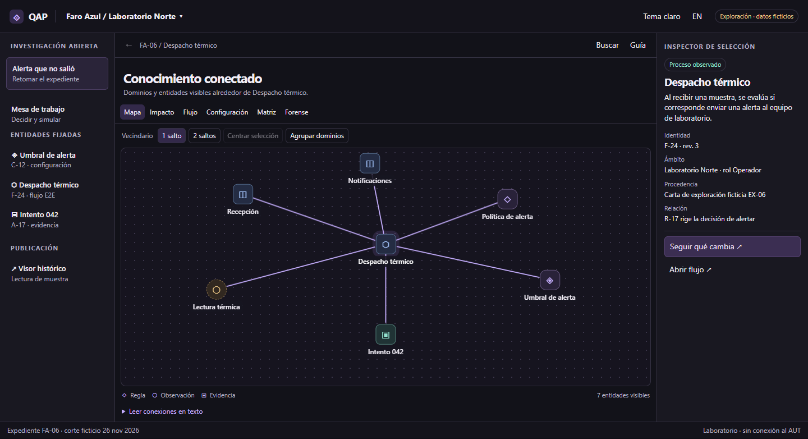
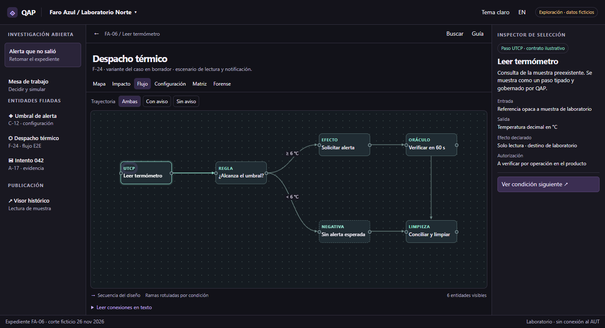
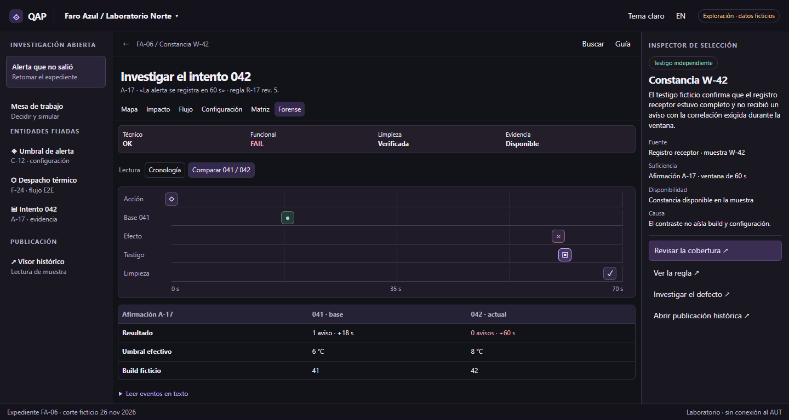

# Capturas del prototipo conceptual

Escenas tomadas del [HTML final](prototipo.html) a 1440 px en navegador local. La galería contiene únicamente el caso ficticio Faro Azul.

| Vista | Imagen |
|---|---|
| Mapa de conocimiento | [Mapa](capturas/mapa.png) |
| Ruta de impacto | [Impacto](capturas/impacto.png) |
| Elaboración E2E y paso UTCP | [Flujo](capturas/flujo.png) |
| Diferencia de configuración | [Configuración](capturas/configuracion.png) |
| Cobertura por obligación e instancia | [Matriz](capturas/matriz.png) |
| Conciliación en simulación | [Operación](capturas/operacion.png) |
| Cronología y contraste forense | [Forense](capturas/forense.png) |
| Publicación de lectura | [Histórico](capturas/historico.png) |
| Tema claro | [Flujo en tema claro](capturas/claro.png) |

