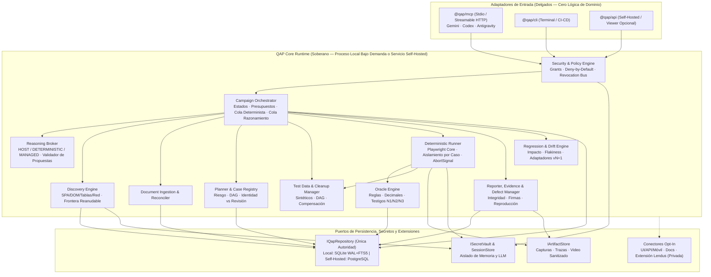
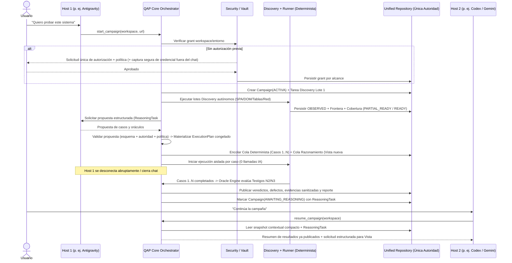
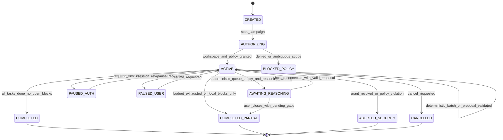

> **PROPUESTA PENDIENTE DE APROBACIÓN** — Documento de referencia de Gemini Neon.

# QAP — Etapa 3: Diseño de Arquitectura Objetivo y Plan Maestro de Reconstrucción

**Repositorio:** `Hyouka73/QAMCP`  
**Línea base técnica:** rama `develop`, commit `30fb3a2492f9edb4f96b3b0328635ca66401c119`  
**Línea base funcional:** Especificación Funcional Maestra (Entregas 1–2) y Adenda de Consolidación (82 requisitos funcionales atómicos)  
**Estatus:** Documento consolidado de diseño y planificación (Entregas 1, 2 y 3 integradas). Ninguna tecnología, motor o decisión de conservación/reconstrucción se considera aprobada únicamente por haber sido propuesta; toda decisión técnica marcada como `[PROPUESTA]` o en `DP-01`–`DP-10` permanece sujeta a ratificación del propietario. No se ha iniciado `G1` ni modificado el código del repositorio.

## Entregable 1: Matriz de confrontación de los 82 requisitos contra `develop`

*Regla de evaluación:* se evalúan garantías reales en código, contratos y consumidores en runtime (sin usar LOC ni cantidad de tests como criterio de calidad). Clasificación: **Completo**, **Parcial**, **Ausente**, **Incompatible**, **No verificable**.

### 1.1 Memoria y Knowledge (15 requisitos)

| ID | Componentes en `develop` | Comportamiento real y garantías ausentes/contradictorias | Compatibilidad | Clasificación | Archivos / funciones relevantes | Capacidades adicionales necesarias |
|---|---|---|---|---|---|---|
| **REQ-MEM-001.1** | `SqliteKnowledgeAdapter`, `AppServiceSqliteStore`, `FileSystemStorage` | `knowledge.sqlite` aplica 4 planos (`EpistemicPlane`), pero `.qa/` YAML y partes de `app-service.sqlite` no exigen plano epistémico unificado. | Parcial | **Parcial** | `shared/src/domain/epistemic-planes.ts:14`, `knowledge/src/storage/knowledge-shape.ts:31-66` | Imponer plano obligatorio en un único almacén canónico para toda entidad. |
| **REQ-MEM-001.2** | `KnowledgeCommitPlanner`, `CanonicalCoverageService`, `ScopedRuleResolver` | Bloquea promoción de `crawler`/`active_probe` en cobertura canónica, pero `qap_rules_set` legacy y CLI `rules.yaml` no imponen esta invariante. | Parcial | **Parcial** | `mcp/src/handlers/canonical-coverage-service.ts:141-156`, `knowledge/src/storage/file-storage.ts:449-504` | Regla invariante en la capa de dominio/repositorio aplicable a MCP y CLI. |
| **REQ-MEM-001.3** | `knowledge-sqlite-schema.ts`, `AppServiceSqliteStore` | `knowledge_revisions` tiene triggers `BEFORE UPDATE/DELETE` inmutables; pero `app-service.sqlite` (`projects`, `modules`, `service_test_cases`) y `.qa/` mutan in-place. | Parcial | **Parcial** | `knowledge/src/storage/knowledge-sqlite-schema.ts:37-54`, `mcp/src/application/app-service-store.ts:303-326` | Versionado inmutable uniforme de entidades de conocimiento y casos en un solo modelo. |
| **REQ-MEM-001.4** | `UpdateGuard` (`isProtected`), `epistemic-planes.ts` | `UpdateGuard` bloquea sobreescritura de casos `manually_edited` en CLI, pero no existe transición automática a `pending_review` ante drift ni trazabilidad `legacy_manual_edit` en producción. | Parcial | **Parcial** | `knowledge/src/plan/update-guard.ts:11-66` | Máquina de estados de revisión para ediciones manuales disparada por drift/conflicto. |
| **REQ-MEM-002.1** | `AppServiceSqliteStore`, `SqliteKnowledgeAdapter`, `FileSystemStorage` | `app-service.sqlite` tiene `project_id`/`env`/`tenant_id`/`role`; `knowledge.sqlite` carece de `tenant_id` (solo `application_id` en PK); `.qa/` no separa tenant ni rol; faltan `instance_id`, `product_version` y `visual_variant` como claves de primera clase. | Incompatible | **Incompatible** | `knowledge/src/storage/knowledge-sqlite-schema.ts:16-35`, `mcp/src/application/app-service-store.ts:394-496` | Vector de alcance completo `(project, app, instance, env, tenant, role, version, config_rev)` en todo el almacenamiento. |
| **REQ-MEM-002.2** | `WorkspaceContextManager`, `DiscoveryHandler` | `WorkspaceContextManager` bloquea workspaces ambiguos y `DiscoveryHandler` valida `tenant_id`, pero CLI opera directo en `process.cwd()` sin validar alcance ni tenant. | Parcial | **Parcial** | `mcp/src/workspace-context-manager.ts:706-718`, `mcp/src/handlers/discovery.handler.ts:232-239` | Validador único de alcance obligatorio en el núcleo compartido por MCP y CLI. |
| **REQ-MEM-002.3** | `AppServiceSqliteStore` (`tasks`), `FlowContextStore`, `SqliteInterviewDraftStore` | Existen `tasks.recovery_cursor_json` y `initial-inventory`, pero no hay cola persistente separada de tareas deterministas vs cola de razonamiento pendiente; `InterviewDraftStore` está inalcanzable por `host-composition.ts:413`. | Parcial | **Parcial** | `mcp/src/application/app-service-store.ts:104-120`, `mcp/src/host-composition.ts:413` | Persistencia unificada de estado de campaña, frontera, cola determinista y cola de razonamiento. |
| **REQ-MEM-002.4** | `StatusHandler`, `WorkspaceContextManager`, `QapEventLog` | Permite retomar workspace en otro chat, pero el contexto está repartido en 6 SQLite + `.qa/` y no existe generador de paquete de re-hidratación compacto multi-host con cola de razonamiento. | Parcial | **Parcial** | `mcp/src/handlers/status.handler.ts:465-689` | Servicio de snapshot contextual determinista para re-hidratar cualquier host/modelo. |
| **REQ-MEM-002.5** | `ManagedArtifactStore`, `SessionStore`, `contextual-dimensions.ts` | Sesiones separadas de `knowledge.sqlite`, pero `qap clean`/`ProjectReset` y `.qa/cache/` mezclan artefactos locales en el mismo árbol `.qa/`. | Parcial | **Parcial** | `shared/src/domain/contextual-dimensions.ts:94-106`, `mcp/src/application/managed-artifacts.ts:54-71` | Separación física y lógica estricta entre memoria de conocimiento y almacén efímero de sesiones/caché. |
| **REQ-MEM-003.1** | `ScopedRuleResolver`, `AppServiceSqliteStore` (`context_discrepancies`) | Detecta contradicciones entre reglas de negocio (`equal_authority_contradiction`), pero no existe tabla/flujo unificado para contradicciones entre observación y regla en todas las entidades. | Parcial | **Parcial** | `mcp/src/application/scoped-rule-resolver.ts:968-992`, `app-service-store.ts:227-239` | Registro único de contradicciones tipadas con estado de resolución y bloqueo de oráculo. |
| **REQ-MEM-003.2** | `SemanticHasher`, `ImpactAnalyzer`, `PlanHandler` | `PlanHandler` detecta obsolescencia de `plan.json` vía `cases_fingerprint`; `ImpactAnalyzer` existe en `@qap/knowledge` pero tiene **0 consumidores** en MCP/CLI. | Parcial | **Parcial** | `knowledge/src/impact/impact-analyzer.ts`, `mcp/src/handlers/plan.handler.ts:195-224` | Motor activo de propagación de `stale` por grafo de dependencias conectado al núcleo. |
| **REQ-MEM-003.3** | `Block3ExecutionRepo`, `HistoryManager` | Guarda intentos y resultados, pero `HistoryManager.recordExecution()` no se llama en producción y no existe aprendizaje automático de firmas de fallo, flakiness ni latencias hacia memoria. | Ausente | **Ausente** | `knowledge/src/history/history-manager.ts:72`, `mcp/src/application/block3-execution-repo.ts` | Pipeline post-ejecución que alimenta firmas, flakiness y observaciones sin tocar requisitos. |
| **REQ-MEM-003.4** | `legacy-qa-importer.ts` | Solo existe importador legacy de `.qa/`; no existe exportación/importación portable versionada del conocimiento completo con sanitización de secretos. | Ausente | **Ausente** | `mcp/src/application/legacy-qa-importer.ts` | Exportador/importador de paquetes portables versionados con filtro estricto anti-secretos. |
| **REQ-MEM-003.5** | `ProjectReset`, `PruningEngine`, `cli/commands/prune.ts`, `server.ts:qap_prune` | CLI poda `.qa/executions/` y `qap.sqlite`, pero `qap_prune` en MCP tiene `dryRun` ficticio (ceros fijos), fuga de handle SQLite y no poda `.qa/executions/`. | Incompatible | **Incompatible** | `mcp/src/server.ts:4303-4350`, `cli/src/commands/prune.ts:198-420` | Motor único de retención y borrado aislado por proyecto usado por MCP y CLI. |
| **REQ-MEM-003.6** | `AppServiceSqliteStore`, `SqliteKnowledgeAdapter` | Acoplamiento directo a `node:sqlite` en 6 archivos SQLite locales sin puerto de repositorio común para modalidad self-hosted concurrente (PostgreSQL). | Ausente | **Ausente** | `knowledge/src/storage/sqlite-knowledge-adapter.ts:83`, `mcp/src/application/app-service-store.ts:549` | Puerto de persistencia único con adaptador local (SQLite) y contrato listo para adaptador concurrente (PostgreSQL). |

### 1.2 Discovery (8 requisitos)

| ID | Componentes en `develop` | Comportamiento real y garantías ausentes/contradictorias | Compatibilidad | Clasificación | Archivos / funciones relevantes | Capacidades adicionales necesarias |
|---|---|---|---|---|---|---|
| **REQ-DIS-001.1** | `DiscoveryHandler`, `BlackBoxCrawler`, `initial-inventory.ts` | Soporta lotes solo para `inventario-provisional`; requiere invocaciones repetidas del agente y no encadena lotes autónomamente en segundo plano. | Parcial | **Parcial** | `mcp/src/handlers/discovery.handler.ts:632-668`, `playwright-adapter/src/crawler/service.ts:119-145` | Bucle autónomo de lotes controlado por el orquestador hasta `READY` o presupuesto. |
| **REQ-DIS-001.2** | `initial-inventory.ts`, `DiscoveryDossierCanonical` | Separa `visited`, `candidate`, `blocked`, `out_of_scope` y calcula `READY`/`PARTIAL_READY`/`BLOCKED` en inventario inicial; no aplica igual en módulos nombrados ni en CLI. | Parcial | **Parcial** | `mcp/src/application/initial-inventory.ts:87-115`, `discovery.handler.ts:662,788` | Modelo uniforme de frontera y cobertura para toda exploración (inicial y focalizada). |
| **REQ-DIS-001.3** | `crawler/dom.ts`, `crawler/service.ts` | **Severamente limitado:** descarta etiquetas fuera de un diccionario de 9 palabras, omite texto de encabezados, **no analiza `<table>`** y en modo `inventory` aborta `fetch`/`xhr`. | Incompatible | **Incompatible** | `playwright-adapter/src/crawler/dom.ts:13-71`, `crawler/service.ts:199-214` | Extractor DOM profundo para SPAs: etiquetas reales (ARIA/texto), tablas, filtros, paginación, formularios, validaciones y estados. |
| **REQ-DIS-001.4** | `NetworkTrafficObserver`, `ReconnaissanceService` | Existen en `packages/playwright-adapter` pero tienen **0 invocaciones en producción**; además `NetworkTrafficObserver` recorta queries a 5 claves y rutas a 12 palabras. | Ausente | **Ausente** | `playwright-adapter/src/network-observer/service.ts:25`, `reconnaissance/service.ts:15` | Observador de tráfico de lectura integrado al crawler con correlación vista ↔ endpoint API. |
| **REQ-DIS-001.5** | `DiscoveryHandler`, `discovery_revisions` | Soporta un perfil por corrida, pero no compara visibilidad multi-rol ni cruza configuraciones efectivas (`es_contable`, etc.) de forma sistemática. | Parcial | **Parcial** | `mcp/src/handlers/discovery.handler.ts:528-568` | Matriz diferencial de visibilidad por rol, tenant y configuración efectiva. |
| **REQ-DIS-001.6** | `crawler/service.ts`, `ModuleObservationBridge` | Registra `link_candidate`/`http_redirect` separados en dossier, pero no existe grafo de dependencias de negocio acreditadas conectado al crawler/planner. | Parcial | **Parcial** | `playwright-adapter/src/crawler/service.ts:367-393` | Grafo dual explícito: aristas de navegación vs dependencias de negocio acreditadas. |
| **REQ-DIS-001.7** | `initial-inventory.ts`, `discovery.handler.ts` | Checkpoints reanudables solo existen para `inventario-provisional`; módulos nombrados no guardan frontera ni soportan descubrimiento incremental por delta. | Parcial | **Parcial** | `mcp/src/handlers/discovery.handler.ts:662,788` | Checkpoints por alcance para todo Discovery y refresco incremental guiado por drift. |
| **REQ-DIS-001.8** | `DiscoveryHandler` | Ejecuta únicamente de forma síncrona dentro de una llamada MCP; si el host se desconecta, se detiene el proceso de lotes. | Ausente | **Ausente** | `mcp/src/handlers/discovery.handler.ts` | Ejecución de lotes desacoplada en worker/orquestador soberano de QAP. |

### 1.3 Ingesta documental (4 requisitos)

| ID | Componentes en `develop` | Comportamiento real y garantías ausentes/contradictorias | Compatibilidad | Clasificación | Archivos / funciones relevantes | Capacidades adicionales necesarias |
|---|---|---|---|---|---|---|
| **REQ-DOC-001.1** | `qap_context_ingest`, `scoped-rule-resolver.ts`, `app-service-store.ts` | Ingiere texto/Markdown en `ingested_documents` y extrae reglas vía regex de viñetas `- [RULE ...]`; `docPath` está bloqueado en MCP (`direct_document_path_unavailable`). | Parcial | **Parcial** | `mcp/src/server.ts:890-892,2854`, `mcp/src/application/scoped-rule-resolver.ts:444-600` | Pipeline de ingesta estructurada por adaptadores de formato con localizador (sección/página/versión). |
| **REQ-DOC-001.2** | `scoped-rule-resolver.ts` | No registra secciones, tablas o páginas no legibles ni emite brechas explícitas de extracción. | Ausente | **Ausente** | `mcp/src/application/scoped-rule-resolver.ts:444` | Registro explícito de cobertura de extracción y fragmentos omitidos/no legibles. |
| **REQ-DOC-001.3** | `scoped-rule-resolver.ts`, `discovery.handler.ts` | Resuelve reglas contra el alcance del dossier, pero no produce la matriz completa de reconciliación (coincidente / documentado no observado / observado no documentado / contradicción real). | Parcial | **Parcial** | `mcp/src/handlers/discovery.handler.ts:879-890` | Motor de reconciliación bidireccional documento ↔ observación con los 4 estados exactos. |
| **REQ-DOC-001.4** | `scoped-rule-resolver.ts` | Distingue `accredited` vs `unaccredited` y `confirmed_requirement` vs `ingested_doc`, bloqueando ambigüedades; falta cobertura uniforme fuera de `discovery_revisions`. | Parcial | **Parcial** | `mcp/src/application/scoped-rule-resolver.ts:4-15,931-1101` | Regla transversal de autoridad documental aplicada a todo diseño de casos y oráculos. |

### 1.4 Inteligencia y agentes (6 requisitos)

| ID | Componentes en `develop` | Comportamiento real y garantías ausentes/contradictorias | Compatibilidad | Clasificación | Archivos / funciones relevantes | Capacidades adicionales necesarias |
|---|---|---|---|---|---|---|
| **REQ-IA-001.1** | `server.ts`, `guidance.ts`, `tool-catalog.ts` | Opera en modo `HOST` sobre MCP Stdio usando el modelo del cliente, pero sin contratos de propuestas uniformes (mezcla `ToolDispatcher` con `switch` legacy). | Parcial | **Parcial** | `mcp/src/server.ts:699-906`, `mcp/src/guidance.ts:208-786` | Protocolo limpio de solicitudes/propuestas estructuradas entre núcleo QAP y host. |
| **REQ-IA-001.2** | `PlaywrightRunner`, `cli/commands/test.ts`, `TestHandler` | Ejecución Playwright no llama a modelos por paso; sin embargo, no existe un modo `DETERMINISTIC` unificado de campaña/regresión sin host. | Parcial | **Parcial** | `playwright-runner/src/runner.ts:587-936` | Modo `DETERMINISTIC` formal en el orquestador para repetición y regresión autónoma. |
| **REQ-IA-001.3** | `ToolDispatcher`, `guardPregunta`, `lineaged-case.ts` | Valida argumentos, preguntas y casos con linaje, pero varias tools legacy (`server.ts:1906-5900`) omiten `ToolDispatcher`. | Parcial | **Parcial** | `mcp/src/dispatcher.ts:48-117`, `engine/src/pregunta.ts:330` | Validador único de propuestas estructuradas (escenarios, oráculos, diagnósticos, reparaciones). |
| **REQ-IA-001.4** | Ninguno | No existe cola persistente de tareas de razonamiento ni continuación automática de tareas deterministas al desconectarse el host. | Ausente | **Ausente** | N/A | Motor de campaña con separación de colas determinista vs razonamiento y handoff multi-host. |
| **REQ-IA-001.5** | `TestHandler`, `ReportHandler`, `provisional-execution.ts` | `ReportHandler` exige `result_digest` + `hasCommittedRun` + `trace.zip` en MCP, pero CLI `qap report` acepta JSON sin verificar integridad ni origen canónico. | Parcial | **Parcial** | `mcp/src/handlers/report.handler.ts:175-190`, `cli/src/commands/report.ts:93-183` | Verificación criptográfica/integridad única de origen de intento en MCP y CLI. |
| **REQ-IA-001.6** | Ninguno | No existe modo `MANAGED` ni abstracción de proveedor de razonamiento gestionado. | Ausente | **Ausente** | N/A | Puerto `IReasoningProvider` opcional (implementable en fase posterior según `DP-06`). |

### 1.5 Planner (6 requisitos)

| ID | Componentes en `develop` | Comportamiento real y garantías ausentes/contradictorias | Compatibilidad | Clasificación | Archivos / funciones relevantes | Capacidades adicionales necesarias |
|---|---|---|---|---|---|---|
| **REQ-PLN-001.1** | `qap_session_plan`, `plan.handler.ts`, `cli/commands/plan.ts` | Existen dos planes desconectados (`session.plan` en `lifecycle.json` y `plan.json` por módulo) y **no existe plan de datos**. | Incompatible | **Incompatible** | `mcp/src/server.ts:3399`, `mcp/src/handlers/plan.handler.ts:44-58` | Modelo unificado de 4 entidades: `CampaignPlan`, `ExecutionPlan`, `DataPlan`, `TestCase`. |
| **REQ-PLN-001.2** | `plan.handler.ts`, `status.handler.ts` | Permite planificar sobre vistas inspeccionadas en inventario inicial, pero el flujo legacy bloquea mientras existan compuertas de entrevista/scoping. | Parcial | **Parcial** | `mcp/src/handlers/plan.handler.ts:645-690` | Planificador incremental que genera bloques ejecutables desde `PARTIAL_READY`. |
| **REQ-PLN-001.3** | `candidate-generator.ts`, `qap_session_plan` | Priorización rudimentaria/manual sin modelo de riesgo por cambio, criticidad ni historial de defectos. | Ausente | **Ausente** | `knowledge/src/candidate-generator.ts:53` | Motor de priorización por riesgo (criticidad, drift, defectos previos, presupuesto). |
| **REQ-PLN-001.4** | `DependencyGraphResolver`, `CycleDetector`, `FlowOrchestrator` | DAG funciona a nivel de casos dentro de un módulo (`plan.handler.ts:94`), pero **`FlowOrchestrator` ignora `depends_on`** entre módulos (`flow-orchestrator.ts:371,402`) y `qap_flow_run` está deshabilitado en MCP. | Incompatible | **Incompatible** | `engine/src/flow-orchestrator.ts:371-402`, `knowledge/src/graph/dependency-graph.ts` | Resolvedor DAG unificado multi-caso y multi-módulo con bloqueo ante ciclos. |
| **REQ-PLN-001.5** | `plan.handler.ts` (`inspectPlanVigencia`, `verifyPlanIntegrity`) | Verifica `checksum` y `cases_fingerprint` en MCP; ausente en CLI `qap test`. | Parcial | **Parcial** | `mcp/src/handlers/plan.handler.ts:195-226,431-513` | Congelamiento inmutable de `ExecutionPlan` verificado por el runner en todo canal. |
| **REQ-PLN-001.6** | Ninguno | No existe replanificación dinámica ante hallazgos o bloqueos de prerrequisitos durante una campaña. | Ausente | **Ausente** | N/A | Reevaluador de grafo de campaña tras fallo de prerrequisito o hallazgo crítico. |

### 1.6 Generación de casos (5 requisitos)

| ID | Componentes en `develop` | Comportamiento real y garantías ausentes/contradictorias | Compatibilidad | Clasificación | Archivos / funciones relevantes | Capacidades adicionales necesarias |
|---|---|---|---|---|---|---|
| **REQ-CAS-001.1** | `case-workflow.ts`, `conversational-case-workflow.ts`, `test.handler.ts` | **Contradicción directa con la visión vigente:** exige aprobación humana de casos (`verifyCaseApproval`, `case_approval_unavailable`) antes de ejecutar en `TestHandler`. | Incompatible | **Incompatible** | `mcp/src/handlers/case-workflow.ts:41`, `mcp/src/handlers/test.handler.ts:484-486` | Elegibilidad automática basada en política y fuente acreditada (0 aprobaciones humanas por caso en ruta ordinaria). |
| **REQ-CAS-001.2** | `CaseGenerator`, `bva-generator.ts`, `rbac-generator.ts` | CLI genera BVA y RBAC, pero `case-execution-policy.ts:5-8` **los bloquea incondicionalmente** como `blocked_missing_oracle`; MCP solo genera casos smoke/básicos. | Incompatible | **Incompatible** | `knowledge/src/plan/bva-generator.ts:688`, `rbac-generator.ts:309`, `playwright-runner/src/case-execution-policy.ts:5-8` | Generación multi-técnica (positivos, negativos, BVA, estados, RBAC, cálculos) enlazada a oráculos acreditados. |
| **REQ-CAS-001.3** | `lineaged-case.ts`, `tc-case.schema.json` | `LineagedCaseDocument` versiona el caso, pero mezcla pasos/localizadores concretos dentro del mismo registro sin entidad separada de adaptador de UI/variante visual. | Parcial | **Parcial** | `mcp/src/application/lineaged-case.ts:181-213` | Separación explícita `TestCaseIdentity` (funcional) vs `TestCaseRevision` (ejecutable + adaptador). |
| **REQ-CAS-001.4** | `test.handler.ts:375-376`, `CanonicalCoverageService` | Bloquea `missing_oracle` y distingue aplicabilidad en cobertura, pero no evalúa aplicabilidad automática de casos por `config_revision` (p. ej. `es_contable`). | Parcial | **Parcial** | `mcp/src/handlers/test.handler.ts:375-376`, `canonical-coverage-service.ts` | Evaluador de aplicabilidad condicional sobre casos por `(env, tenant, role, config)`. |
| **REQ-CAS-001.5** | `CaseGenerator` (UUID determinista), `lineaged-case.ts` (`execution_key`) | Deduplica por `execution_key` en `service_test_cases`, pero no detecta duplicados semánticos ni marca obsolescencia automática ante drift de vista. | Parcial | **Parcial** | `mcp/src/application/lineaged-case.ts:261`, `app-service-store.ts:514` | Deduplicación semántica/estructural y propagación automática de obsolescencia. |

### 1.7 Oráculos y validación funcional (7 requisitos)

| ID | Componentes en `develop` | Comportamiento real y garantías ausentes/contradictorias | Compatibilidad | Clasificación | Archivos / funciones relevantes | Capacidades adicionales necesarias |
|---|---|---|---|---|---|---|
| **REQ-ORA-001.1** | `runner.ts`, `test.handler.ts`, `cli/commands/test.ts`, `block3-execution-repo.ts` | Taxonomías inconsistentes entre capas (`passed/failed/partial/error/not_run` vs `PASS/FAIL/technical_error/human_accepted`); **`cli/commands/test.ts:206-230` reporta `not_run` como `passed` (`exitCode=0`)**. | Incompatible | **Incompatible** | `cli/commands/test.ts:206-230`, `playwright-runner/src/runner.ts:204,312`, `app-service-store.ts:355` | Taxonomía única de 6 veredictos (`PASS`, `FAIL`, `INDETERMINATE`, `BLOCKED`, `SKIPPED`, `ERROR`) en todo el sistema. |
| **REQ-ORA-001.2** | `actions/navigate.ts`, `actions/assert.ts`, `runner.ts`, `execution-evidence.ts` | `navigate` ignora HTTP 4xx/5xx; `screenshot` atrapa errores y emite `passed`; `assert` sin tipo asume `visible`; no bloquea falsos `PASS` por respuesta superficial en mutaciones. | Incompatible | **Incompatible** | `playwright-runner/src/actions/navigate.ts:12-18`, `runner.ts:1345-1388`, `actions/assert.ts:25` | Evaluador de oráculos independiente que rechace señales Nivel 0/1 como prueba de persistencia. |
| **REQ-ORA-001.3** | Ninguno | No existen niveles de independencia de testigos ni verificación post-recarga/lectura secundaria obligatoria para operaciones mutativas. | Ausente | **Ausente** | N/A | Motor de testigos Nivel 1/2/3 (recarga en contexto limpio, consulta API/vista secundaria, conciliación). |
| **REQ-ORA-001.4** | `actions/assert.ts`, `scoped-rule-resolver.ts` | Solo soporta 8 aserciones DOM simples (`visible`, `contains`, `equals`, `count`, `attribute`, etc.); `RuleAssertType` declara `'text'` no soportado; cero soporte de cálculos decimales ni conciliaciones. | Ausente | **Ausente** | `playwright-runner/src/actions/assert.ts:24-180`, `scoped-rule-resolver.ts:14` | Evaluador tipado de reglas de negocio, precisión monetaria (decimal exacto), tolerancias y conciliaciones. |
| **REQ-ORA-001.5** | `rbac-generator.ts` (bloqueado en runner) | No existe comprobación post-denegación de ausencia de efectos colaterales en estado subyacente. | Ausente | **Ausente** | `knowledge/src/plan/rbac-generator.ts:309`, `case-execution-policy.ts:5-8` | Oráculo de no-mutación (snapshot de estado antes/después de intento denegado). |
| **REQ-ORA-001.6** | `actions/wait-for.ts` | Solo ofrece espera fija o `waitForSelector`; no distingue convergencia eventual, estado intermedio atascado ni timeout técnico en procesos asíncronos. | Ausente | **Ausente** | `playwright-runner/src/actions/wait-for.ts:7-22` | Oráculo de convergencia asíncrona con ventana temporal y condición de estado final. |
| **REQ-ORA-001.7** | `execution-evidence.ts` | No clasifica independencia del testigo ni etiqueta limitaciones cuando la única evidencia proviene del componente bajo prueba. | Ausente | **Ausente** | `mcp/src/handlers/execution-evidence.ts:51-67` | Metadato `witness_independence_level` obligatorio en cada evaluación (configurable según `DP-04`). |

### 1.8 Runner y ejecución (6 requisitos)

| ID | Componentes en `develop` | Comportamiento real y garantías ausentes/contradictorias | Compatibilidad | Clasificación | Archivos / funciones relevantes | Capacidades adicionales necesarias |
|---|---|---|---|---|---|---|
| **REQ-RUN-001.1** | `PlaywrightRunner` (`runner.ts`), `RunnerLifecycle` (`lifecycle.ts`) | **`RunnerLifecycle` está huérfano**; `runner.ts:463,542,587-936` reutiliza un **único `BrowserContext` y una única `Page`** para todos los casos del plan, filtrando cookies/storage/DOM. | Incompatible | **Incompatible** | `playwright-runner/src/runner.ts:463,542,587-936`, `lifecycle.ts:31-134` | Contexto limpio por caso por defecto; compartición explícita y trazada solo en flujos encadenados. |
| **REQ-RUN-001.2** | `PlaywrightRunner`, `TestHandler` | Ejecuta deterministamente sin IA; pero la verificación de integridad del snapshot vive solo en `TestHandler` (no en el runner ni en CLI). | Parcial | **Parcial** | `playwright-runner/src/runner.ts:354`, `mcp/src/handlers/test.handler.ts:388-406` | Verificación de huella de snapshot integrada en el propio motor Runner. |
| **REQ-RUN-001.3** | `PlaywrightRunner`, `TestHandler` | No existe estado de limpieza separado; éxito técnico y funcional se mezclan en `ExecutionResult.result`. | Ausente | **Ausente** | `playwright-runner/src/runner.ts:1098-1170` | Estructura tripartita obligatoria: `technical_status`, `functional_verdict`, `cleanup_status`. |
| **REQ-RUN-001.4** | `cli/commands/test.ts`, `PlaywrightRunner` | Sin reintentos en Runner/MCP; CLI `--retries` reintenta ciegamente casos `failed` sin reconciliación de estado en mutaciones. | Incompatible | **Incompatible** | `cli/commands/test.ts:182-204`, `playwright-runner/src/runner.ts` | Política de reintento por idempotencia + protocolo obligatorio de reconciliación previa en mutaciones. |
| **REQ-RUN-001.5** | `PlaywrightRunner`, `TestHandler`, `cli/commands/test.ts` | Ejecución estrictamente secuencial; `TestHandler` no propaga `AbortSignal` al navegador cuando se revoca un permiso en vuelo; `FlowOrchestrator` ignora `execution_timeout_ms`. | Parcial | **Parcial** | `mcp/src/handlers/test.handler.ts:880-913`, `engine/src/flow-orchestrator.ts:378` | Cancelación activa (`AbortController`) cableada a revocación + pool acotado de workers paralelos aislados. |
| **REQ-RUN-001.6** | `provisional-execution.ts`, `application-service.ts` | Publicación provisional atómica y recuperación ante corte implementadas en MCP; pero DDL duplicado en `evidence-artifacts.ts:881-908` omite 3 columnas de `QapDatabase`. | Parcial | **Parcial** | `playwright-runner/src/provisional-execution.ts:175-534`, `evidence-artifacts.ts:881-908` | Unificar publicación atómica sobre el almacén único eliminando DDL duplicados. |

### 1.9 Datos de prueba y limpieza (4 requisitos)

| ID | Componentes en `develop` | Comportamiento real y garantías ausentes/contradictorias | Compatibilidad | Clasificación | Archivos / funciones relevantes | Capacidades adicionales necesarias |
|---|---|---|---|---|---|---|
| **REQ-DAT-001.1** | Ninguno (solo `interpolator.ts` en memoria) | No existe generador/gestor de datasets sintéticos con ámbito, procedencia, caducidad ni protección anti-PII de producción. | Ausente | **Ausente** | `playwright-runner/src/context/interpolator.ts:3-52` | Subsistema `TestDataManager` con sintetizadores, etiquetas de ejecución, caducidad y filtro anti-PII. |
| **REQ-DAT-001.2** | Ninguno | No existe preparación ni limpieza por grafo DAG de entidades del AUT (solo backup de sesiones locales en `FlowOrchestrator`). | Ausente | **Ausente** | `engine/src/flow-orchestrator.ts:391-393` | Ejecutor de `DataPlan` con creación topológica y limpieza inversa idempotente. |
| **REQ-DAT-001.3** | `TestHandler` (`READ_ONLY_STEPS`), `scoped-browser.ts` | En MCP bloquea todas las mutaciones sin permitir siquiera entornos expresamente autorizados; en CLI permite todas sin política ni bloqueo. | Incompatible | **Incompatible** | `mcp/src/handlers/test.handler.ts:45,488-496`, `auth/src/scoped-browser.ts:7-31` | Motor de política por entorno que bloquee producción/no-autorizados (`SKIPPED_BY_POLICY`) y habilite mutaciones controladas en staging/fixtures autorizados. |
| **REQ-DAT-001.4** | Ninguno | No existe verificación de efectos residuales ni compensación/confinamiento para registros inmutables. | Ausente | **Ausente** | N/A | Verificador post-limpieza y estrategias configurables (`delete`, `compensate`, `confine_tenant`, según `DP-05`). |

### 1.10 Orquestación y campañas (5 requisitos)

| ID | Componentes en `develop` | Comportamiento real y garantías ausentes/contradictorias | Compatibilidad | Clasificación | Archivos / funciones relevantes | Capacidades adicionales necesarias |
|---|---|---|---|---|---|---|
| **REQ-CAM-001.1** | `server.ts` (`qap_start`), `guidance.ts`, `lifecycle.ts` | `qap_start` solo inicia inventario inicial y devuelve `siguiente_accion`; depende del LLM en cada turno y está frenado por compuertas humanas de `lifecycle.ts` y `test.handler.ts`. | Incompatible | **Incompatible** | `mcp/src/server.ts:1556-1809`, `mcp/src/guidance.ts:208-786` | Orquestador de campaña autónomo que encadene A→B→C tras autorización inicial. |
| **REQ-CAM-001.2** | `TestHandler`, `DiscoveryHandler` | Un bloqueo en un caso o falta de regla bloquea frecuentemente todo el lote o impide avanzar la fase en `lifecycle.ts`. | Parcial | **Parcial** | `engine/src/lifecycle.ts:487-548`, `mcp/src/handlers/test.handler.ts:485-496` | Motor de tareas con grafo de estados que aísle bloqueos locales sin detener ramas independientes. |
| **REQ-CAM-001.3** | `BlackBoxCrawler` (límites de crawl) | Solo existen presupuestos locales en el crawler; no hay presupuestos globales de campaña (tiempo total, ejecuciones, llamadas de inferencia). | Parcial | **Parcial** | `playwright-adapter/src/crawler/service.ts:18-21` | Controlador central de presupuestos de campaña con cierre `COMPLETADA_PARCIAL`. |
| **REQ-CAM-001.4** | `QapApplicationService` (`reconcileCommittedProjectExecutions`) | Recupera publicaciones pendientes tras reinicio, pero no continúa tareas deterministas al desconectarse el host ni conserva cola de razonamiento. | Ausente | **Ausente** | `mcp/src/application/application-service.ts:4201-4330` | Runtime soberano de campaña desacoplado de la conexión del cliente MCP. |
| **REQ-CAM-001.5** | `CampaignRecord` (`mode`) | El campo `mode` existe en `app-service.sqlite`, pero no hay transición operativa fluida ni integración con los estados `ONBOARDING/SCOPING/WORKING/WRAP_UP`. | Parcial | **Parcial** | `shared/src/domain/application-contracts.ts:172-185` | Modos de intención como política de prioridad sobre un estado de campaña continuo. |

### 1.11 Evidencias, reportes y defectos (4 requisitos)

| ID | Componentes en `develop` | Comportamiento real y garantías ausentes/contradictorias | Compatibilidad | Clasificación | Archivos / funciones relevantes | Capacidades adicionales necesarias |
|---|---|---|---|---|---|---|
| **REQ-REP-001.1** | `evidence-artifacts.ts`, `ReportHandler`, `Block3ExecutionRepo` | Captura screenshots, video, `trace.zip` sanitizado y `result_digest` SHA-256 en MCP; sin embargo `evidence-artifacts.ts` duplica DDL incompleto y CLI omite verificación de integridad. | Parcial | **Parcial** | `playwright-runner/src/evidence-artifacts.ts:420-990`, `mcp/src/handlers/report.handler.ts:175-190` | Servicio único de evidencias e integridad consumido por MCP y CLI. |
| **REQ-REP-001.2** | `reporter/generators/*`, `regression-detector.ts`, `canonical-session-report.ts` | Generadores HTML/JSON/JUnit/MD existen, pero `regression-detector.ts` solo corre en CLI, `graph-builder.ts` lee campos inexistentes (`execData.status`), y no existe consulta unificada de historial (`qap_history`). | Parcial | **Parcial** | `reporter/src/manifest/regression-detector.ts:67`, `reporter/src/graph/graph-builder.ts:247,316` | Repositorio único de reportes, comparativas entre ejecuciones e historial unificado. |
| **REQ-REP-001.3** | `taxonomy.ts` (`classifyError`) | **No existe ninguna entidad, tabla ni gestor de defectos** en todo el repositorio; `classifyError` usa regex simples con fallback ciego a `assertion_failed`. | Ausente | **Ausente** | `reporter/src/taxonomy.ts:26-62`, `playwright-runner/src/runner.ts:50-72` | Subsistema `DefectManager` con taxonomía D-014 (`indeterminate`), deduplicación por firma y paquete reproducible. |
| **REQ-REP-001.4** | Ninguno | No existe flujo formal de reproducción (`REPRODUCIDO`/`NO_REPRODUCIDO`/`BLOQUEADO`) ni seguimiento de verificación de corrección (`retest`). | Ausente | **Ausente** | N/A | Máquina de estados de defecto integrada con modo `INVESTIGAR_BUG` y comparativa de intentos. |

### 1.12 Regresión y evolución (3 requisitos)

| ID | Componentes en `develop` | Comportamiento real y garantías ausentes/contradictorias | Compatibilidad | Clasificación | Archivos / funciones relevantes | Capacidades adicionales necesarias |
|---|---|---|---|---|---|---|
| **REQ-REG-001.1** | `GitAdapter`, `ImpactAnalyzer`, `SemanticHasher` | `GitAdapter` solo corre en CLI (`test.ts:3`) con `execSync` inseguro; `ImpactAnalyzer` está desconectado de MCP/CLI; sin detección automática de drift DOM/API/configuración. | Parcial | **Parcial** | `git-adapter/src/git-adapter.ts:26-84`, `knowledge/src/impact/impact-analyzer.ts` | Motor de detección de drift multi-señal + selector de suite de regresión por impacto y riesgo. |
| **REQ-REG-001.2** | Ninguno | No existe detección ni registro de `flakiness` en historial. | Ausente | **Ausente** | N/A | Analizador estadístico de oscilación `PASS`/`FAIL` sobre intentos del mismo snapshot/versión. |
| **REQ-REG-001.3** | Ninguno | No existe propuesta controlada de nueva revisión de adaptador/localizador ante cambios de UI. | Ausente | **Ausente** | N/A | Flujo de reparación acotada que crea `TestCaseRevision N+1` manteniendo inmutable la expectativa y el `FAIL` original. |

### 1.13 Seguridad, permisos y privacidad (5 requisitos)

| ID | Componentes en `develop` | Comportamiento real y garantías ausentes/contradictorias | Compatibilidad | Clasificación | Archivos / funciones relevantes | Capacidades adicionales necesarias |
|---|---|---|---|---|---|---|
| **REQ-SEG-001.1** | `PermissionAuthority`, `*-authorizer.ts`, `reconnaissance/network.ts` | Implementado en MCP con doble persistencia (SQLite + archivos JSON) y auto-aprobación silenciosa en `silentBoundScope`; **completamente ausente en CLI**; `reporter/server.ts:277` tiene vulnerabilidad con `/artifacts//...` y `git-adapter.ts:26` inyección de comando en `baseBranch`. | Parcial | **Parcial** | `mcp/src/application/permission-authority.ts:84`, `reporter/src/server/server.ts:277`, `git-adapter/src/git-adapter.ts:26` | Motor único de políticas deny-by-default aplicado a MCP, CLI y servidores auxiliares. |
| **REQ-SEG-001.2** | `DiscoveryHandler`, `TestHandler`, `scoped-browser.ts` | Aplica verificación de origen y política en MCP; sin protección equivalente en CLI ni `PlaywrightAdapter`. | Parcial | **Parcial** | `mcp/src/handlers/discovery.handler.ts:158-394`, `auth/src/scoped-browser.ts:4-34` | Invariante de alcance en el motor central imposible de alterar desde prompts, DOM o redirecciones. |
| **REQ-SEG-001.3** | `PermissionAuthority`, `TestHandler` | Revoca en SQLite y bloquea la siguiente llamada o la publicación final, pero **no cancela activamente un navegador/ejecución en vuelo**. | Parcial | **Parcial** | `mcp/src/application/permission-authority.ts`, `mcp/src/handlers/test.handler.ts:880-913` | Bus de eventos de revocación conectado a `AbortController` de Discovery y Runner activos. |
| **REQ-SEG-002.1** | `KeychainCredentialProvider`, `PortableCredentialVault`, `server.ts`, `host-composition.ts` | **Contradicción crítica:** `host-composition.ts:390` activa `silentBoundScope: true` por defecto, habilitando `allowScopedCredentials` (`server.ts:744-756`) que expone contraseñas en texto plano en argumentos MCP; además diálogos GUI solo existen en Windows (`powershell.exe`). | Incompatible | **Incompatible** | `mcp/src/host-composition.ts:390`, `mcp/src/server.ts:378-380,744-756`, `auth/src/portable-vault.ts` | Canal de captura de secretos multiplataforma 100 % fuera del LLM/chat; eliminación de bypass (sujeto a `DP-03`). |
| **REQ-SEG-002.2** | `SessionStore`, `DiscoveryHandler`, `TestHandler`, `session-resolver.ts` | MCP bloquea sin degradar a anónimo (`downgraded_to_anonymous: false`), pero `runner.ts:338` degrada silenciosamente a anónimo con `console.warn` si no se pasó `options.profile` explícito. | Parcial | **Parcial** | `playwright-runner/src/runner.ts:335-342`, `auth/src/session-store.ts` | Prohibición uniforme de degradación a anónimo cuando el alcance requiere sesión autenticada. |

### 1.14 Interfaces, portabilidad, despliegue y extensibilidad (4 requisitos)

| ID | Componentes en `develop` | Comportamiento real y garantías ausentes/contradictorias | Compatibilidad | Clasificación | Archivos / funciones relevantes | Capacidades adicionales necesarias |
|---|---|---|---|---|---|---|
| **REQ-INT-001.1** | `packages/mcp`, `packages/cli` | **Divergencia estructural severa:** CLI y MCP usan distintos motores de Discovery, Planner, Políticas, Persistencia, Reportes y Poda; `qap test` emite falsos `PASS`; `qap runner` falla contra `QAPEngine`. | Incompatible | **Incompatible** | `packages/cli/src/commands/*`, `packages/mcp/src/server.ts` | Núcleo de aplicación único (`@qap/core`) con MCP, CLI y CI como adaptadores delgados. |
| **REQ-INT-001.2** | `packages/mcp`, `packages/cli`, `scripts/*.ps1` | Diálogos interactivos dependen de Windows PowerShell; `host-composition.ts:413` deshabilita manifiesto; 142 errores `tsc` ocultos por `tsup`; `AGENTS.md` contradice requisito de Node 22+ (`node:sqlite`). | Incompatible | **Incompatible** | `mcp/src/discovery-authorizer.ts:324`, `mcp/src/host-composition.ts:413`, `.codex-r2-concurrency-evidence/typescript-r3-final-diff.json` | Empaquetado limpio multiplataforma (`npx`-first), cero dependencias exclusivas de `win32` en ruta ordinaria y verificación estricta `tsc` en CI. |
| **REQ-INT-001.3** | Ninguno | Solo existe operación local acoplada a archivos SQLite en disco; sin modo self-hosted ni servicio concurrente multiusuario. | Ausente | **Ausente** | N/A | Abstracción de almacenamiento/colas que permita despliegue self-hosted sin cambiar la lógica del núcleo. |
| **REQ-INT-001.4** | `@qap/engine` (`ports.ts`), `@qap/shared` | Declara puertos teóricos (`IReporter`, `IActionTargetSearch`), pero `@qap/mcp` acopla clases concretas (`AppServiceSqliteStore`, `BlackBoxCrawler`, `PlaywrightRunner`); `@playwright/mcp` figura en `package.json` sin uso. | Parcial | **Parcial** | `engine/src/ports.ts`, `mcp/src/application/application-service.ts` | Sistema formal de registro de conectores/plugins opt-in (interfaz, documentos, bóveda, extensiones de dominio). |

### Resumen cuantitativo verificado (82 requisitos)
- **Completo:** **0**
- **Parcial:** **41**
- **Incompatible:** **16**
- **Ausente:** **25**
- **Total:** **82**

## Entregable 2: Arquitectura objetivo integral

### 2.1 Principios estructurales y modelo de dominios
La arquitectura objetivo reemplaza la dualidad actual (`.qa/` CLI vs monolito `@qap/mcp`) por una **arquitectura hexagonal por dominios con un único núcleo soberano (`QAP Core Runtime`)**:

1. **Una sola fuente de autoridad (Zero Dual-Authority Rule):**
   - Toda mutación de estado, validación de política, consulta de conocimiento, planificación, ejecución y publicación de veredictos pasa **exclusivamente** por `QAP Core Runtime`.
   - **MCP, CLI y CI son adaptadores de entrada delgados** sin lógica de negocio, sin acceso directo a tablas SQL ni escrituras paralelas en `.qa/`.
   - Las proyecciones legibles (`.qa/discovery/*.md`, reportes HTML/JUnit/Markdown) son **vistas derivadas de solo lectura** generadas desde el almacén canónico; jamás actúan como fuente de verdad.
2. **Soberanía frente al Host / Agente de IA:**
   - El motor de campañas y las colas de ejecución viven dentro de `QAP Core Runtime` (proceso local bajo demanda en modo local, o servicio persistente en modo self-hosted), **desacoplados del ciclo de vida de la conexión Stdio/MCP del cliente**.
   - Un host (Gemini, Codex, Antigravity) se conecta como proveedor de intención y razonamiento; si se desconecta, el runtime continúa ejecutando todas las tareas deterministas autorizadas y conserva en cola las tareas que exigen razonamiento.
3. **Separación en 6 dominios acotados (Bounded Contexts):**
   - **Seguridad y Políticas (`Security & Policy`):** identidades de alcance, grants por capacidad, revocación en tiempo real (`AbortController` bus), bóveda de secretos y aislamiento de sesiones.
   - **Memoria Epistemológica (`Unified Knowledge & State Store`):** único almacén lógico unificado para los 4 planos epistemológicos, estado operativo de campañas/tareas, casos, intentos y defectos.
   - **Adquisición (`Discovery & Document Ingestion`):** exploración web/SPA/API reanudable, ingesta documental por adaptadores y reconciliación documento ↔ observación.
   - **Orquestación e Inteligencia (`Campaign Orchestrator & Reasoning Broker`):** máquina de estados soberana, colas separadas (determinista vs razonamiento), presupuestos, modo `HOST`/`DETERMINISTIC`/`MANAGED` y validador de propuestas.
   - **Diseño y Verificación (`Planner, Case Registry, Test Data & Oracle Engine`):** planes de campaña/ejecución/datos, generación multi-técnica, datasets sintéticos con DAG y limpieza, y evaluador independiente de oráculos (Niveles 1–3).
   - **Ejecución, Evidencia y Evolución (`Runner, Reporter, Defect & Regression Engine`):** ejecución aislada en Playwright, evidencias sanitizadas con integridad, defectos deduplicados y regresión por drift/impacto.

### 2.2 Evaluación tecnológica fundamentada (requisitos, garantías y alternativas)

| Decisión técnica | Requisitos y garantías exigidas | Alternativas analizadas | Propuesta recomendada (pendiente de aprobación) |
|---|---|---|---|
| **Almacén canónico unificado (local y self-hosted)** | Transacciones ACID, consultas relacionales + búsqueda textual, concurrencia multiproceso, zero-config local (D-009), modalidad self-hosted concurrente (D-005), sin doble autoridad. | *(A)* Mantener 6 SQLite + YAML `.qa/`; *(B)* Solo PostgreSQL (rompe D-009 local zero-config); *(C)* Puerto `IQapRepository` único con adaptador **SQLite (WAL + FTS5)** para local y adaptador **PostgreSQL** para self-hosted, con mismo esquema lógico y pruebas de contrato idénticas. | **Alternativa C (`[PROPUESTA]`):** alineada con D-005 y D-009; pendiente fijar driver SQLite (`node:sqlite` Node 22+ vs alternativa para Node 20 LTS). |
| **Motor de automatización de navegador** | Aislamiento estricto por contexto, intercepción HTTP/CDP para políticas read-only y observación de red, trazas/video/screenshots nativos, multiplataforma. | *(A)* `@playwright/mcp` (diseñado para control por LLM paso a paso, viola Principio 4); *(B)* `playwright-core` directo encapsulado en adaptador oficial de QAP. | **Alternativa B (`playwright-core`, `[PROPUESTA]`):** cumple ejecución determinista sin modelo por paso y control CDP. Eliminar dependencia muerta `@playwright/mcp`. |
| **Control de procesos para autonomía sin host** | Continuidad de tareas deterministas al desconectar Stdio/MCP, cancelación por revocación en vuelo, sin exigir daemon permanente con navegadores abiertos (RNF-02). | *(A)* Todo en proceso Stdio efímero (muere al cerrar chat); *(B)* Orquestador en proceso hijo/worker local persistente bajo demanda que se auto-apaga al quedar inactivo (con navegadores efímeros) + cola durable en el repositorio unificado. | **Alternativa B (`[PROPUESTA]`):** garantiza autonomía tras desconexión del host y cero consumo en reposo. |
| **Motor de oráculos y cálculos monetarios** | Precisión decimal exacta (sin errores de punto flotante IEEE 754 en finanzas/crédito), evaluación determinista sin `eval()` inseguro, representación tipada auditable. | *(A)* `new Function`/JS float (inseguro e impreciso en dinero); *(B)* AST declarativo tipado de predicados + aritmética decimal exacta + testigos Nivel 1/2/3. | **Alternativa B (`[PROPUESTA]`):** elimina falsos `PASS`, inyección de código y errores de redondeo monetario. |
| **Bóveda de secretos y captura fuera de banda** | Multiplataforma (Windows, Linux, macOS), sin secretos en chat/prompts, sin dependencia exclusiva de PowerShell ni compilación C++ obligatoria en `npx`. | *(A)* Solo `keytar` + PowerShell (falla en Linux/macOS/CI y exige build nativo); *(B)* Cadena de proveedores: OS Keychain cuando disponible + `PortableCredentialVault` (scrypt + AES-256-GCM) + canal local multiplataforma (flujo local efímero `127.0.0.1` con token de un solo uso o CLI TTY seguro) fuera del LLM. | **Alternativa B (`[PROPUESTA]`):** captura segura multiplataforma sin pasar contraseñas por el LLM (`DP-03`). |
| **Integridad de artefactos y compilación** | Hashes verificables de snapshots/evidencias/reportes; cero errores de tipos ocultos en build. | *(A)* Solo `tsup` sin `tsc`; *(B)* `tsc --noEmit` obligatorio en cada paquete + build + CI automatizado + digests SHA-256 verificados en lectura/publicación. | **Alternativa B (`[PROPUESTA]`).** |

### 2.3 Reglas arquitectónicas anti-doble-autoridad y fronteras de paquetes
1. **Prohibición de acceso directo a almacenamiento desde interfaces:** ni `@qap/mcp` ni `@qap/cli` pueden abrir conexiones SQLite, leer `.qa/` para estado operativo ni escribir archivos de resultados directamente; invocan únicamente casos de uso de `@qap/core`.
2. **Prohibición de DDL duplicado:** un único módulo de migraciones versionadas gestiona el esquema completo (eliminando los 6 esquemas dispersos y el DDL duplicado de `evidence-artifacts.ts`).
3. **Prohibición de evaluación de veredictos en adaptadores:** el cálculo de `PASS`/`FAIL`/`INDETERMINATE`/`BLOCKED`/`SKIPPED`/`ERROR` ocurre exclusivamente en `OracleEngine` + `ExecutionService`; CLI y MCP solo serializan el veredicto oficial.
4. **Grafo de dependencias estrictamente acíclico (DAG):** `contracts` → `storage-port` / `security` → `knowledge` / `oracle` / `testdata` → `discovery` / `ingestion` / `planner` / `runner` / `reporter` / `regression` → `orchestrator` (`@qap/core`) → adaptadores de entrada (`@qap/mcp`, `@qap/cli`, `@qap/api` opcional) y conectores opt-in (`@qap/plugin-*`, p. ej. extensión privada Lendus).

## Entregable 3: Especificación detallada de los 14 subsistemas

*(Cada subsistema cubre explícitamente los 14 puntos obligatorios. Máxima profundidad en Memoria, Orquestación, Discovery, Planner, Oráculos y Runner.)*

### 3.1 Subsistema 1 — Memoria y Knowledge (`@qap/knowledge-core` + `@qap/repository-*`) `[PRIORITARIO]`
1. **Responsabilidad exacta:** Única fuente de autoridad para el almacenamiento, versionado, consulta, invalidación, aprendizaje y portabilidad de conocimiento (4 planos) y estado operativo de QAP.
2. **Garantías obligatorias:** ACID por unidad de trabajo; inmutabilidad de revisiones y evidencias; 0 autopromociones epistémicas; aislamiento estricto por `ScopeVector`; 0 secretos/sesiones en memoria ni exportaciones; CAS optimista (`expected_revision`).
3. **Modelo de datos:** Esquema lógico del Entregable 4 (`scopes`, `knowledge_entities`, `knowledge_revisions`, `knowledge_links`, `knowledge_fts`, `contradictions`, `campaigns`, `campaign_tasks`, `reasoning_queue`, `execution_plans`, `execution_attempts`, `defects`, `drift_events`).
4. **Interfaces y contratos:** `IQapRepository`, `IUnitOfWork`, `IKnowledgeQueryService`, `IPortabilityService`.
5. **Operaciones:** `commitRevision`, `linkRevisions`, `recordContradiction`, `propagateStale`, `queryContextPacket`, `searchFullText`, `exportPortableBundle`, `importPortableBundle`, `pruneByPolicy`, `deleteProjectIsolated`.
6. **Estados y transiciones:** Revisión: `active -> conflicted | stale -> superseded | archived` (terminales históricos siguen legibles). Contradicción: `open -> resolved | deferred`.
7. **Dependencias:** Depende solo de `@qap/contracts` y `IPolicyEngine`; es consumido por todos los demás subsistemas.
8. **Seguridad:** Validación de `scope_id` en toda consulta; rechazo de claves sensibles (`password`, `token`, `cookie`, `authorization`, `storageState`) antes de confirmar transacción; verificación de integridad de paquetes importados.
9. **Recuperación:** WAL + `synchronous=FULL` en adaptador local SQLite (`[PROPUESTA]`); `integrity_check` y `foreign_key_check` al arranque; reconciliación de leases expirados al iniciar.
10. **Manejo de errores:** Errores tipados `ConflictRevisionError` (CAS), `EpistemicViolationError`, `CrossScopeDeniedError`, `StorageCorruptedError`, `SecretDetectedError`.
11. **Estrategia de pruebas:** Suite de contrato ejecutable contra SQLite y (futuro) PostgreSQL; pruebas de concurrencia multiproceso; pruebas negativas de fuga cruzada A↔B, autopromoción y secretos en exportación.
12. **Criterios técnicos de aceptación:** 100 % pruebas de contrato en verde; 0 escrituras fuera de `IQapRepository`; 0 fugas entre tenants; re-hidratación contextual < 200 ms en proyectos locales típicos.
13. **Relación con requisitos:** `REQ-MEM-001.1` a `REQ-MEM-003.6`.
14. **Diferencias frente a `develop`:** Sustituye 6 bases SQLite independientes + `.qa/` YAML por un solo esquema lógico con `tenant_id`/`instance_id`/`product_version`/`config_revision` de primera clase, cola de razonamiento y exportación portable real.

### 3.2 Subsistema 2 — Orquestación y Campañas (`@qap/orchestrator`) `[PRIORITARIO]`
1. **Responsabilidad exacta:** Conducir de forma soberana el ciclo A→B→C de campañas autónomas, gestionar dependencias de tareas, presupuestos, checkpoints, doble carril (determinista vs razonamiento) y continuidad ante desconexión o cambio de host.
2. **Garantías obligatorias:** 0 intervenciones rutinarias tras autorización inicial; 100 % continuación de tareas deterministas sin host; aislamiento de bloqueos locales; cancelación inmediata ante revocación global; idempotencia de transiciones.
3. **Modelo de datos:** `campaigns`, `campaign_tasks` (con `lane`, `lease_owner`, `lease_expires_at`, `depends_on_json`), `reasoning_queue`, `campaign_checkpoints`.
4. **Interfaces y contratos:** `ICampaignOrchestrator` (`startCampaign`, `resumeCampaign`, `pauseCampaign`, `cancelCampaign`, `switchIntentMode`, `getCampaignSnapshot`).
5. **Operaciones:** Despacho de workers deterministas, encolado de tareas de razonamiento, evaluación de presupuestos, aislamiento de fallos locales, reconciliación tras reinicio y auto-apagado limpio tras inactividad en modo local (`[PROPUESTA]`).
6. **Estados y transiciones:** Máquina de estados de Campaña del Entregable 5 (`CREATED`, `AUTHORIZING`, `ACTIVE`, `AWAITING_REASONING`, `PAUSED_AUTH`, `PAUSED_USER`, `COMPLETED`, `COMPLETED_PARTIAL`, `ABORTED_SECURITY`, `CANCELLED`). Tareas: `pending -> running -> completed | failed | blocked_dependency | skipped_policy | cancelled`.
7. **Dependencias:** `IPolicyEngine`, `IQapRepository`, `IReasoningBroker`, Discovery, Ingestion, Planner, Runner, Reporter, Regression.
8. **Seguridad:** Suscrito a `IPolicyEngine.subscribeRevocation`; al revocarse un grant de proyecto/entorno dispara `AbortController` global de la campaña y transita a `ABORTED_SECURITY`.
9. **Recuperación:** Al iniciar, recupera tareas con `lease_expires_at < now`, reconcilia publicaciones pendientes y verifica estado real antes de reintentar tareas marcadas `non_idempotent`.
10. **Manejo de errores:** Clasifica errores en `local_task_block` (aísla tarea y dependientes, continúa ramas independientes) vs `global_campaign_stop` (seguridad, sesión única expirada, presupuesto agotado).
11. **Estrategia de pruebas:** Pruebas de simulación de desconexión del host en medio de lotes/ejecuciones; pruebas de reinicio abrupto (`SIGKILL`); pruebas de cambio de host A→B; pruebas de agotamiento de presupuesto.
12. **Criterios técnicos de aceptación:** 100 % de tareas deterministas completadas sin host; 0 duplicación de tareas ya completadas tras reinicio; 0 bloqueos globales por fallo local.
13. **Relación con requisitos:** `REQ-CAM-001.1` a `REQ-CAM-001.5`, `REQ-IA-001.4`.
14. **Diferencias frente a `develop`:** Reemplaza `QAPEngine` (roto), `FlowOrchestrator` (solo CLI sin `depends_on` ni timeouts) y la orquestación dispersa en `server.ts` (6,119 líneas) y `lifecycle.ts` (compuertas humanas P0).

### 3.3 Subsistema 3 — Discovery (`@qap/discovery`) `[PRIORITARIO]`
1. **Responsabilidad exacta:** Explorar de forma autónoma y segura aplicaciones web, SPA y tráfico API de lectura, produciendo conocimiento estructurado `OBSERVED` con frontera reanudable y cobertura verificable.
2. **Garantías obligatorias:** Separación estricta de estados de ruta; 0 mutaciones durante exploración read-only; etiquetas/tablas/formularios/SPA reales (sin truncamiento a 9 palabras); reanudación exacta para todo alcance; ejecución autónoma por lotes sin host.
3. **Modelo de datos:** `discovery_frontiers`, `discovery_route_states`, `knowledge_revisions` (`OBSERVED`: `view`, `control`, `form`, `table`, `api_read_endpoint`, `navigation_edge`, `role_visibility_diff`).
4. **Interfaces y contratos:** `IDiscoveryEngine` (`runBatch`, `resumeFrontier`, `runIncrementalDelta`, `getCoverageSummary`), `IUiProbeAdapter` (extensible para web/API/móvil).
5. **Operaciones:** Reconocimiento HTTP seguro (DNS pinning, anti-SSRF), navegación SPA autenticada con sesión aislada, extracción DOM enriquecida (ARIA, labels reales, tablas/filtros/paginación, validaciones de formularios, modales/wizards), observación pasiva de `fetch`/`xhr` GET dentro de origen autorizado y comparación diferencial multi-rol.
6. **Estados y transiciones:** Frontera: `initialized -> exploring -> batch_paused -> ready | partial_ready | blocked_auth | blocked_policy`. Ruta: `detected -> pending -> inspected | blocked | out_of_scope`.
7. **Dependencias:** `IPolicyEngine`, `ISessionStore`, `IQapRepository`, `playwright-core` (`[PROPUESTA]`).
8. **Seguridad:** Bloqueo anti-SSRF (IPs privadas/metadata cloud), denylist de verbos destructivos, intercepción CDP permitiendo solo `GET`/`HEAD` (salvo endpoints de lectura explícitamente autorizados), sanitización de PII en payloads antes de persistir.
9. **Recuperación:** Cada vista inspeccionada actualiza `discovery_route_states` y `knowledge_revisions` en una transacción atómica; un corte pierde como máximo la página en curso.
10. **Manejo de errores:** `401/403`/redirect a login pausa frontera como `blocked_auth` sin degradar a anónimo ni borrar checkpoint; timeouts de página aislada marcan ruta `blocked_timeout` y siguen con el resto del lote.
11. **Estrategia de pruebas:** Pruebas contra fixtures web tradicionales, SPAs React/Vue con `fetch` paginado, tablas con filtros y apps multi-rol; pruebas negativas SSRF y de rutas destructivas.
12. **Criterios técnicos de aceptación:** Captura 100 % de etiquetas visibles, encabezados, tablas y formularios en fixtures ciegos; 0 mutaciones emitidas en modo read-only; reanudación con 0 re-inspecciones de vistas vigentes.
13. **Relación con requisitos:** `REQ-DIS-001.1` a `REQ-DIS-001.8`.
14. **Diferencias frente a `develop`:** Supera las limitaciones críticas de `BlackBoxCrawler` (`dom.ts` limitado a 9 palabras, sin `<table>`, abortando `fetch`/`xhr` en inventario, sin checkpoints para módulos nombrados), consolida los módulos desconectados (`ReconnaissanceService`, `NetworkTrafficObserver`) y elimina la divergencia con `PlaywrightAdapter` en CLI.

### 3.4 Subsistema 4 — Planner (`@qap/planner`) `[PRIORITARIO]`
1. **Responsabilidad exacta:** Traducir objetivos de campaña, conocimiento vigente, riesgos y restricciones en planes congelados y verificables de campaña, ejecución (DAG) y datos.
2. **Garantías obligatorias:** Separación de `CampaignPlan`, `ExecutionPlan`, `DataPlan` y `TestCase`; 100 % orden DAG sin ciclos; planificación incremental desde `PARTIAL_READY`; huella inmutable de snapshot verificable; invalidación automática ante drift/cambio de reglas.
3. **Modelo de datos:** `campaign_plans`, `execution_plans` (`plan_hash`, `ordered_case_revisions_json`, `status`), `data_plans` (`dataset_specs_json`, `dependency_order_json`).
4. **Interfaces y contratos:** `IPlanner` (`buildCampaignPlan`, `freezeExecutionPlan`, `replanOnFinding`, `selectRegressionPlan`, `verifyPlanIntegrity`).
5. **Operaciones:** Scoring de riesgo (criticidad negocio + drift reciente + historial defectos), resolución topológica DAG multi-caso y multi-módulo, evaluación de aplicabilidad por `(env, tenant, role, config_revision)`, ajuste a presupuestos y congelamiento con SHA-256.
6. **Estados y transiciones:** `draft -> frozen -> executed | stale | superseded`; transición a `blocked_cycle` si se detecta ciclo en dependencias.
7. **Dependencias:** `IQapRepository`, `IPolicyEngine`, `ICaseRegistry`, `ITestDataManager`.
8. **Seguridad:** Filtra automáticamente casos que requieran capacidades no autorizadas en el entorno (p. ej. `execute_mutation` en entorno read-only), marcándolos `SKIPPED_BY_POLICY` en el plan en lugar de fallar toda la planificación.
9. **Recuperación:** Planes congelados son inmutables; la replanificación crea un nuevo `plan_id` enlazado a `parent_plan_id`.
10. **Manejo de errores:** `DependencyCycleError` (con traza exacta del ciclo), `EmptyEligibleScopeError`, `StalePlanError`.
11. **Estrategia de pruebas:** Pruebas de ordenamiento DAG multi-módulo, detección de ciclos, invalidación ante cambio de regla, exclusión por política read-only y planificación desde `PARTIAL_READY`.
12. **Criterios técnicos de aceptación:** 100 % orden topológico válido; 100 % rechazo de planes alterados o `stale`; soporte nativo de dependencias inter-módulo.
13. **Relación con requisitos:** `REQ-PLN-001.1` a `REQ-PLN-001.6`.
14. **Diferencias frente a `develop`:** Elimina la fractura entre `session.plan` (`lifecycle.json`), `plan.json` (por módulo) y `FlowOrchestrator` (que ignoraba `depends_on`), incorpora `DataPlan` y unifica planificación entre MCP y CLI.

### 3.5 Subsistema 5 — Oráculos (`@qap/oracle-engine`) `[PRIORITARIO]`
1. **Responsabilidad exacta:** Evaluar de forma determinista e independiente las evidencias recogidas frente a expectativas estructurales y de negocio acreditadas, emitiendo uno de los 6 veredictos canónicos y el nivel de independencia del testigo.
2. **Garantías obligatorias:** Taxonomía cerrada (`PASS`, `FAIL`, `INDETERMINATE`, `BLOCKED`, `SKIPPED`, `ERROR`); 0 falsos `PASS` por `HTTP 2xx` o ausencia de excepción en mutaciones; exigencia de testigo Nivel >= 2 para persistencia; precisión decimal exacta en cálculos monetarios; exclusión estricta de `INDETERMINATE` del `PASS rate`.
3. **Modelo de datos:** `OracleSpec` (AST declarativo tipado: `structural`, `business_rule`, `persistence_witness`, `decimal_calculation`, `reconciliation`, `rbac_no_effect`, `async_convergence`), `oracle_evaluations` (`verdict`, `witness_level`, `expected_json`, `observed_json`, `rule_revision_refs`).
4. **Interfaces y contratos:** `IOracleEngine` (`validateOracleAuthority`, `evaluate`), `IWitnessCollector` (recarga limpia, lectura API/vista secundaria, consulta de conciliación).
5. **Operaciones:** Verificación previa de autoridad del oráculo (rechaza `OBSERVED` como fuente de negocio), ejecución de testigos independientes post-acción, evaluación aritmética decimal exacta con tolerancia declarada, verificación de inmutabilidad tras `403` y polling acotado de convergencia asíncrona.
6. **Estados y transiciones:** `unverified_spec -> authorized_spec | rejected_no_authority`; evaluación: `evaluating -> PASS | FAIL | INDETERMINATE | BLOCKED | SKIPPED | ERROR`.
7. **Dependencias:** `IQapRepository` (para verificar revisión/autoridad de reglas), `IWitnessCollector`, `@qap/contracts`.
8. **Seguridad:** Prohibido `eval()` o `new Function()` sobre expresiones arbitrarias; solo predicados declarativos tipados.
9. **Recuperación:** Evaluación pura/idempotente sobre evidencia inmutable; si falla la persistencia del resultado, puede re-evaluarse deterministamente sin reejecutar mutaciones.
10. **Manejo de errores:** Falta de fuente acreditada o conflicto abierto → `INDETERMINATE`; caída del testigo de lectura → `ERROR` (nunca `PASS`); contradicción con expectativa → `FAIL`.
11. **Estrategia de pruebas:** Pruebas adversariales «HTTP 201 sin guardado» (debe dar `FAIL`), cálculos con redondeos bancarios/centavos, `403` con mutación oculta (debe dar `FAIL`), convergencia asíncrona y testigo Nivel 1 (configurable según `DP-04`).
12. **Criterios técnicos de aceptación:** 0 % falsos `PASS` en batería adversarial; 100 % exactitud decimal en 1,000 casos sintéticos de amortización/intereses; soporte completo de los 7 tipos de oráculo.
13. **Relación con requisitos:** `REQ-ORA-001.1` a `REQ-ORA-001.7`.
14. **Diferencias frente a `develop`:** En `develop` no existe motor de oráculos independiente (solo 8 aserciones DOM en `actions/assert.ts`, sin testigos Nivel 2–3, sin decimales, sin conciliación, con `navigate` ignorando 4xx/5xx y `screenshot` devolviendo `passed` al fallar).

### 3.6 Subsistema 6 — Runner (`@qap/runner`) `[PRIORITARIO]`
1. **Responsabilidad exacta:** Ejecutar de forma determinista, aislada y reproducible los `FrozenExecutionPlan` sobre el AUT, recolectar evidencias sanitizadas, ejecutar testigos de lectura y coordinar limpieza/reconciliación.
2. **Garantías obligatorias:** Aislamiento estricto por caso (nuevo `BrowserContext` + `Page` por caso salvo flujo encadenado explícito); 0 llamadas a IA por paso; verificación de huella del snapshot antes de abrir navegador; cancelación activa inmediata vía `AbortSignal`; separación de `technical_status`, `functional_verdict` y `cleanup_status`; 0 reintentos ciegos en mutaciones.
3. **Modelo de datos:** `execution_attempts`, `case_attempts`, `step_attempts`, `artifacts` (sanitizados), estado de reconciliación pre-reintento.
4. **Interfaces y contratos:** `ITestRunner`, `IStepExecutor` (adaptadores web Playwright, API HTTP), `IEvidenceSanitizer`, `IReconciliationHook`.
5. **Operaciones:** Verificación de integridad de snapshot, resolución de sesión aislada (sin degradar a anónimo), preparación de `DataPlan`, ejecución de pasos tipados (incluyendo validación de HTTP status en `navigate` y registro explícito de fallo en `screenshot`), ejecución de testigos Nivel 2/3, sanitización de `trace.zip`/capturas/video y publicación atómica.
6. **Estados y transiciones:** Intento: `prepared -> running -> evaluating -> cleaning -> published | aborted_revocation | failed_infra | pending_recovery`.
7. **Dependencias:** `IPolicyEngine`, `ISessionStore`, `ITestDataManager`, `IOracleEngine`, `IQapRepository`, `IArtifactStore`, `playwright-core` (`[PROPUESTA]`).
8. **Seguridad:** Aplica restricciones de red/origen y CDP `GET/HEAD` en modos read-only; enmascara DOM y reescribe trazas antes de escribir a disco; aborta navegador en vuelo al dispararse revocación.
9. **Recuperación:** Write-ahead log de mutaciones en `dataset_entities` y publicación transaccional en `IQapRepository`; tras corte, ejecuta reconciliación antes de decidir reintento o marcar `INDETERMINATE`/`ERROR`.
10. **Manejo de errores:** Clasifica fallos de infraestructura (browser crash, DNS, timeout de runner) como `ERROR`, nunca como `FAIL` de producto; un fallo de `screenshot` registra `artifact_degraded` sin enmascarar ni falsificar el resultado.
11. **Estrategia de pruebas:** Pruebas de aislamiento (caso A deja cookie/localStorage y caso B verifica estado limpio); pruebas de revocación en vuelo (`AbortSignal`); pruebas de corte tras mutación verificando reconciliación sin duplicación; pruebas de paralelismo acotado.
12. **Criterios técnicos de aceptación:** 100 % aislamiento entre casos; 0 degradaciones silenciosas a anónimo; 0 efectos duplicados tras corte; paridad absoluta al invocarse desde MCP o CLI.
13. **Relación con requisitos:** `REQ-RUN-001.1` a `REQ-RUN-001.6`.
14. **Diferencias frente a `develop`:** Reconstruye `PlaywrightRunner` (que hoy comparte una sola `Page`/`BrowserContext` entre casos, deja `RunnerLifecycle` huérfano, ignora HTTP status en `navigate`, degrada a anónimo en `runner.ts:338` y carece de cancelación en vuelo, paralelismo y reconciliación de mutaciones).

### 3.7 Subsistema 7 — Inteligencia y Agentes (`@qap/reasoning-broker`)
1. **Responsabilidad exacta:** Mediar todas las solicitudes de razonamiento y validar soberanamente las propuestas de `HOST`, `MANAGED` o desactivarlas en `DETERMINISTIC`.
2. **Garantías obligatorias:** Validación estricta de esquema, política y evidencia soporte en cada propuesta; 0 dependencia de historial de chat; transferencia fluida entre hosts distintos; rechazo absoluto de `PASS` externos.
3. **Modelo de datos:** `reasoning_queue`, `proposal_audit` (aceptadas/rechazadas con motivo).
4. **Interfaces y contratos:** `IReasoningBroker`, `IProposalValidator`, `IReasoningProvider` (puerto opcional para modo `MANAGED`).
5. **Operaciones:** Empaquetado de contexto compacto por tarea, asignación por lease a host conectado, validación de propuestas (escenarios, extracción documental, diagnóstico, adaptadores), devolución a cola si el host se desconecta.
6. **Estados y transiciones:** `queued -> leased -> validated_accepted | rejected_invalid | returned_on_disconnect | expired`.
7. **Dependencias:** `IQapRepository`, `IPolicyEngine`, `@qap/contracts`.
8. **Seguridad:** Filtra secretos/PII antes de armar `compactContext`; nunca ejecuta código arbitrario sugerido por el modelo.
9. **Recuperación:** Expiración automática de lease devuelve la tarea a `queued` para otro host.
10. **Manejo de errores:** Propuesta inválida genera feedback estructurado acotado (máx. N reintentos antes de marcar tarea `blocked_invalid_proposal`).
11. **Estrategia de pruebas:** Pruebas con host simulado que desconecta, devuelve JSON malformado, intenta fabricar oráculos o cambia de host en vuelo.
12. **Criterios técnicos de aceptación:** 100 % propuestas sin sustento rechazadas; 100 % tareas recuperadas por segundo host tras desconexión.
13. **Relación con requisitos:** `REQ-IA-001.1` a `REQ-IA-001.6`.
14. **Diferencias frente a `develop`:** Nuevo subsistema; hoy el razonamiento está mezclado con `guidance.ts` y llamadas ad-hoc sin cola persistente ni multi-host.

### 3.8 Subsistema 8 — Ingesta Documental (`@qap/ingestion`)
1. **Responsabilidad exacta:** Adquirir fuentes documentales autorizadas mediante adaptadores de formato, extraer afirmaciones trazables y reconciliarlas contra observaciones reales.
2. **Garantías obligatorias:** Localizador exacto (archivo, sección/página, versión, vigencia); registro explícito de fragmentos no legibles; matriz de reconciliación de 4 estados; 0 edición automática de manuales originales.
3. **Modelo de datos:** `primary_sources`, `document_extractions` (`locator_json`, `unreadable_segments_json`), `knowledge_revisions` (`INFERRED` o `EXPECTED_REQUIREMENT` según acreditación), `contradictions`.
4. **Interfaces y contratos:** `IDocumentIngestionService`, `IDocumentFormatAdapter` (texto/Markdown en Ola 1; PDF/DOCX/OpenAPI opt-in según `DP-08`), `IDocumentReconciler`.
5. **Operaciones:** Ingesta con hash SHA-256, extracción estructurada (determinista para OpenAPI/frontmatter + asistida vía `ReasoningBroker` para prosa), reporte de brechas de lectura y reconciliación contra `OBSERVED`.
6. **Estados y transiciones:** `ingested -> extracted | partial_extraction -> reconciled | conflict_open`.
7. **Dependencias:** `IPolicyEngine`, `IQapRepository`, `IReasoningBroker`.
8. **Seguridad:** Requiere capacidad `read_docs` dentro de rutas autorizadas; sanitización de entradas.
9. **Recuperación:** Idempotencia por `(source_ref, sha256)`; re-ingesta de versión nueva crea nueva revisión sin borrar la anterior.
10. **Manejo de errores:** Formatos no soportados o tablas ilegibles emiten `partial_extraction` con inventario exacto de páginas/secciones omitidas.
11. **Estrategia de pruebas:** Pruebas con manuales sintéticos versionados, reglas contradictorias, tablas omitidas y cruce contra vistas observadas/no visibles por rol.
12. **Criterios técnicos de aceptación:** 100 % afirmaciones con localizador y versión; 0 elementos no observados marcados como eliminados.
13. **Relación con requisitos:** `REQ-DOC-001.1` a `REQ-DOC-001.4`.
14. **Diferencias frente a `develop`:** Reemplaza el parser regex estrecho de `scoped-rule-resolver.ts:444` y levanta el bloqueo artificial de ingesta autorizada manteniendo `read_docs` seguro.

### 3.9 Subsistema 9 — Generación y Gestión de Casos (`@qap/case-registry`)
1. **Responsabilidad exacta:** Gestionar la identidad funcional, revisiones ejecutables, generación multi-técnica, elegibilidad automática, aplicabilidad y deduplicación de casos reutilizables.
2. **Garantías obligatorias:** 0 aprobaciones humanas por caso en ruta ordinaria; identidad separada de revisión/adaptador; generación multi-técnica (positivos, negativos, BVA, estados, RBAC, cálculos) solo con oráculo válido; abstención honesta (`INDETERMINATE`) si falta autoridad.
3. **Modelo de datos:** `test_case_identities` (`case_id`, `objective`, `requirement_refs`, `oracle_semantics`, `applicability_expr`), `test_case_revisions` (`revision`, `steps_json`, `adapter_ref`, `oracle_spec_json`, `content_digest`, `eligibility_status`).
4. **Interfaces y contratos:** `ICaseRegistry` (`proposeAndMaterialize`, `createAdapterRevision`, `evaluateApplicability`, `deduplicate`, `markObsolete`).
5. **Operaciones:** Compilación de propuestas validadas a revisiones ejecutables, chequeo de elegibilidad (política + autoridad de oráculo), evaluación condicional por `config_revision`/`role`/`tenant`, deduplicación por firma semántica.
6. **Estados y transiciones:** `candidate -> eligible | indeterminate_no_oracle | not_applicable -> obsolete | superseded`.
7. **Dependencias:** `IQapRepository`, `IOracleEngine`, `IReasoningBroker`.
8. **Seguridad:** Bloquea pasos prohibidos o expresiones inseguras al materializar.
9. **Recuperación:** Revisiones inmutables permiten repetir cualquier versión histórica sin pérdida.
10. **Manejo de errores:** Oráculo no acreditado no lanza error fatal: clasifica el caso `indeterminate_no_oracle` y permite continuar.
11. **Estrategia de pruebas:** Generación sin `elicitation`; pruebas de evolución de localizador (`v1 -> v2` preservando identidad); pruebas de aplicabilidad por flag `es_contable`.
12. **Criterios técnicos de aceptación:** 0 aprobaciones humanas rutinarias; 0 duplicados al replanificar; 100 % casos `eligible` con oráculo trazable.
13. **Relación con requisitos:** `REQ-CAS-001.1` a `REQ-CAS-001.5`.
14. **Diferencias frente a `develop`:** Sustituye las 3 rutas divergentes (`cli/plan.ts` + `case-workflow.ts` + `conversational-case-workflow.ts`) y elimina la contradicción de `bva-generator`/`rbac-generator` bloqueados en runtime.

### 3.10 Subsistema 10 — Datos de Prueba y Limpieza (`@qap/testdata`)
1. **Responsabilidad exacta:** Sintetizar, provisionar en orden DAG, aislar por ejecución y limpiar/compensar datos de prueba verificando ausencia de residuos.
2. **Garantías obligatorias:** 0 PII real de producción; claves únicas trazables por `attempt_id`; creación topológica y limpieza inversa idempotente; bloqueo preventivo (`SKIPPED_BY_POLICY`) en entornos sin permiso de escritura.
3. **Modelo de datos:** `synthetic_datasets`, `dataset_entities` (write-ahead log de recursos creados), `cleanup_records` (`strategy`, `status`, `residual_check_passed`).
4. **Interfaces y contratos:** `ITestDataManager` (`prepareDataset`, `cleanupDataset`, `verifyNoResiduals`), `IDomainDataConnector` (puerto opt-in para recetas privadas como extensión Lendus).
5. **Operaciones:** Generación sintética determinista, provisión vía API/UI autorizada, limpieza inversa, compensación funcional o confinamiento en tenant desechable (`DP-05`), verificación post-limpieza.
6. **Estados y transiciones:** `planned -> provisioning -> active -> cleaning -> cleaned | cleanup_failed_residual | confined`.
7. **Dependencias:** `IPolicyEngine`, `IQapRepository`, conectores opt-in.
8. **Seguridad:** Exige capacidad `manage_test_data` y `execute_mutation`; filtro anti-PII en clonadores de configuración.
9. **Recuperación:** El write-ahead log en `dataset_entities` permite reanudar limpieza de datasets huérfanos tras caída del proceso.
10. **Manejo de errores:** Fallo de limpieza emite `cleanup_status='failed'` y alerta operativa sin corromper `functional_verdict`.
11. **Estrategia de pruebas:** Pruebas de limpieza idempotente (2x), orden inverso DAG, bloqueo en entorno read-only y detección de registros residuales.
12. **Criterios técnicos de aceptación:** 0 mutaciones en entornos no autorizados; 0 PII de producción; 100 % entidades sintéticas registradas antes de crearse.
13. **Relación con requisitos:** `REQ-DAT-001.1` a `REQ-DAT-001.4`.
14. **Diferencias frente a `develop`:** Subsistema completamente nuevo (inexistente en `develop`).

### 3.11 Subsistema 11 — Seguridad, Permisos y Secretos (`@qap/security`)
1. **Responsabilidad exacta:** Gobernar autorización inicial y granular (8 capacidades), aislamiento de secretos/sesiones, revocación inmediata en vuelo y auditoría.
2. **Garantías obligatorias:** Deny-by-default; 0 escalación por DOM/URL/prompt; revocación activa inmediata en memoria y persistencia; 0 secretos en prompts, memoria, logs o reportes; multiplataforma sin dependencia exclusiva de PowerShell.
3. **Modelo de datos:** `permission_grants`, `security_audit_log` (en repositorio); `ISecretVault` y `ISessionStore` cifrados (fuera del repositorio y del control de versiones).
4. **Interfaces y contratos:** `IPolicyEngine`, `ISecretVault`, `ISessionStore`, `IOutOfBandAuthChannel`.
5. **Operaciones:** Concesión/consulta/expiración/revocación de grants, publicación de eventos de revocación, captura fuera de banda de credenciales (Keychain / `PortableCredentialVault` scrypt+AES-256-GCM / flujo local multiplataforma `[PROPUESTA]`), validación de sesión sin degradación a anónimo.
6. **Estados y transiciones:** Grant: `active -> expired | revoked`. Sesión: `valid -> expired | revoked | invalidated`.
7. **Dependencias:** `@qap/contracts`, `IQapRepository` (para grants/auditoría), proveedores de bóveda del SO.
8. **Seguridad:** `0o600`/`0o700`, bloqueo de symlinks/path traversal, enmascaramiento de secretos, validación estricta de origen/red.
9. **Recuperación:** Reconciliación de revocaciones y credenciales rotadas al arranque.
10. **Manejo de errores:** Cualquier fallo de autorización/sesión falla cerrado (`fail-closed`), nunca degradando a anónimo ni a acceso amplio.
11. **Estrategia de pruebas:** Pruebas negativas de SSRF, escalación por prompt, revocación durante ejecución activa, ausencia de secretos en artefactos y pruebas en Windows/Linux/macOS.
12. **Criterios técnicos de aceptación:** 0 acciones fuera de alcance; 0 credenciales en transporte MCP/chat (sujeto a `DP-03`); cancelación activa verificada en < 1 s tras revocación.
13. **Relación con requisitos:** `REQ-SEG-001.1` a `REQ-SEG-002.2`.
14. **Diferencias frente a `develop`:** Elimina la doble persistencia (SQLite + 4 JSONs), elimina el bypass `allowScopedCredentials` por defecto, corrige `reporter/server.ts:277` y `git-adapter.ts:26`, añade revocación en vuelo y aplica seguridad idéntica al CLI.

### 3.12 Subsistema 12 — Reporter, Evidencias y Defectos (`@qap/reporter` + `@qap/defects`)
1. **Responsabilidad exacta:** Gestionar artefactos sanitizados con integridad, generar reportes auditables multi-formato, mantener historial unificado y operar el ciclo completo de defectos.
2. **Garantías obligatorias:** Trazabilidad 100 % caso/revisión/intento/oráculo/evidencia; 0 secretos en artefactos; comunicación honesta de cobertura incompleta; deduplicación de defectos por firma; clasificación D-014 (`indeterminate` ante ambigüedad).
3. **Modelo de datos:** `artifacts` (`sha256`, `sanitized`), `report_publications`, `defects`, `defect_occurrences`.
4. **Interfaces y contratos:** `IReporterService` (`generateReport`, `compareRuns`, `queryHistory`), `IDefectManager` (`recordFromFailure`, `classifyRootCause`, `reproduceTicket`, `verifyFix`).
5. **Operaciones:** Sanitización y verificación SHA-256 de artefactos, renderizado HTML/JSON/JUnit/Markdown como vistas derivadas, comparación histórica de ejecuciones, deduplicación por firma de fallo y gestión de reproducción/retest.
6. **Estados y transiciones:** Defecto: `open -> reproduced | not_reproduced | blocked -> verified_fixed -> regressed`.
7. **Dependencias:** `IQapRepository`, `IArtifactStore`, `IPolicyEngine`.
8. **Seguridad:** Contención estricta de rutas de artefactos (eliminando bug de doble barra `/artifacts//...`), redacción obligatoria de PII/tokens.
9. **Recuperación:** Recuperación idempotente de publicaciones parciales por formato mediante verificación SHA-256; si falta un artefacto (p. ej. video), conserva veredicto marcando `artifact_degraded`.
10. **Manejo de errores:** Evidencia alterada (mismatch SHA-256) es rechazada explícitamente con `ArtifactTamperedError`.
11. **Estrategia de pruebas:** Pruebas de alteración deliberada de JSON/capturas, deduplicación de fallos repetidos, reproducción `REPRODUCIDO`/`NO_REPRODUCIDO`/`BLOQUEADO` y consulta histórica tras reinicio.
12. **Criterios técnicos de aceptación:** 100 % rechazo de artefactos alterados; 0 secretos en reportes; 100 % paridad de reportes entre MCP y CLI.
13. **Relación con requisitos:** `REQ-REP-001.1` a `REQ-REP-001.4`.
14. **Diferencias frente a `develop`:** Elimina el DDL duplicado de `.qa/runtime/qap.sqlite`, corrige `graph-builder.ts`, retira `TelemetryServer` desconectado, añade `DefectManager` completo y consulta unificada de historial.

### 3.13 Subsistema 13 — Regresión y Evolución (`@qap/regression`)
1. **Responsabilidad exacta:** Detectar cambios (drift) en aplicaciones conocidas, calcular impacto, seleccionar suites mínimas de regresión, rastrear flakiness y proponer reparaciones controladas de adaptadores.
2. **Garantías obligatorias:** Selección sin redescubrimiento total; ejecución en modo `DETERMINISTIC` (0 inferencia en casos vigentes); 0 alteración silenciosa de expectativas funcionales; preservación del intento `FAIL` original ante toda reparación.
3. **Modelo de datos:** `drift_events`, `flakiness_stats`, aristas de impacto en `knowledge_links`.
4. **Interfaces y contratos:** `IRegressionEngine` (`detectDrift`, `computeImpact`, `selectRegressionSuite`, `updateFlakiness`, `proposeAdapterRepair`).
5. **Operaciones:** Ingesta de señales de cambio (git diff seguro con `execFileSync` sin shell, cambios DOM/API/config/reglas), recorrido del grafo de impacto, selección por riesgo, cálculo de tasa de oscilación y encolado de `propose_adapter_revision` en `ReasoningBroker`.
6. **Estados y transiciones:** Drift: `detected -> impact_computed -> suite_scheduled -> resolved`. Adaptador: `proposed -> validated_on_replay -> promoted_new_revision | rejected`.
7. **Dependencias:** `IQapRepository`, `IPlanner`, `IReasoningBroker`, conectores opcionales (Git).
8. **Seguridad:** Ejecución de comandos externos sin interpolación de shell (`execFileSync` con array de argumentos); una reparación jamás modifica `oracle_spec_json`.
9. **Recuperación:** Estado de drift y estadísticas persistidos transaccionalmente.
10. **Manejo de errores:** Si no existe mapa de impacto acreditado, cae limpiamente a suite crítica base reportando limitación de cobertura.
11. **Estrategia de pruebas:** Pruebas con cambio de localizador (crea `v2` sin tocar oráculo), cambio de regla (detecta `FAIL` sin auto-reparar) y caso oscilante (etiquetado `flaky`).
12. **Criterios técnicos de aceptación:** >= 90 % reutilización de vistas vigentes (`[PROPUESTA]` calibrable); 0 modificaciones silenciosas de expectativas.
13. **Relación con requisitos:** `REQ-REG-001.1` a `REQ-REG-001.3`.
14. **Diferencias frente a `develop`:** Conecta el motor de impacto (hoy huérfano en `@qap/knowledge`), sanea `@qap/git-adapter` y añade drift, flakiness y reparación versionada (inexistentes en `develop`).

### 3.14 Subsistema 14 — MCP, CLI y Distribución (`@qap/mcp`, `@qap/cli`, `@qap/plugin-sdk`)
1. **Responsabilidad exacta:** Exponer interfaces delgadas, coherentes y multiplataforma hacia clientes MCP, terminal CLI, CI/CD y conectores opt-in sobre la única autoridad de `QAP Core Runtime`.
2. **Garantías obligatorias:** Paridad 100 % de políticas, veredictos y memoria entre MCP y CLI; 0 lógica de negocio en adaptadores; 0 herramientas muertas o esquemas divergentes; distribución local `npx`-first multiplataforma y compatibilidad con modo self-hosted futuro.
3. **Modelo de datos:** Solo DTOs de transporte y esquemas de validación de entrada/salida (`@qap/contracts`).
4. **Interfaces y contratos:** Superficie MCP consolidada (sin `switch` legacy ni tools muertas), comandos CLI delegando 1:1 a casos de uso de `@qap/core`, y `@qap/plugin-sdk` para conectores opt-in (UI, API, docs, bóvedas, extensiones de dominio privadas como Lendus).
5. **Operaciones:** Traducción de invocaciones al `CampaignOrchestrator`, suscripción a eventos de progreso, entrega de `ReasoningTask` y recepción de `StructuredProposal` cuando el cliente es un host de IA.
6. **Estados y transiciones:** Sin estado de negocio propio (stateless respecto a dominio; solo estado de transporte/sesión de conexión).
7. **Dependencias:** Únicamente `@qap/core` y `@qap/contracts`.
8. **Seguridad:** Toda invocación entra primero por `IPolicyEngine`; prohibida inyección dinámica de campos `password` en schemas MCP (sujeto a `DP-03`).
9. **Recuperación:** Reconexión transparente de transporte contra el runtime local/self-hosted sin perder estado de campaña.
10. **Manejo de errores:** Códigos de error públicos sanitizados y consistentes en MCP y CLI; códigos de salida CLI (`exitCode`) estrictamente alineados a los 6 veredictos (`FAIL`/`ERROR`/`BLOCKED` nunca retornan `0` como `PASS`).
11. **Estrategia de pruebas:** Pruebas de paridad E2E ejecutando el mismo snapshot por MCP y CLI; pruebas Stdio con múltiples clientes; verificación `tsc --noEmit` + lint + build en CI para el 100 % de paquetes.
12. **Criterios técnicos de aceptación:** 100 % paridad MCP/CLI; 0 errores `tsc`; 0 herramientas bloqueadas/muertas en catálogo; arranque limpio en Windows, Linux y macOS.
13. **Relación con requisitos:** `REQ-INT-001.1` a `REQ-INT-001.4`.
14. **Diferencias frente a `develop`:** Desmantela el monolito `server.ts` (6,119 líneas), elimina la divergencia total del CLI, retira tools bloqueadas (`qap_validate`, `qap_server`, `qap_flow_run`) y huérfanas, y corrige el falso `PASS` de `cli/commands/test.ts:206-230`.

## Entregable 4: Modelo lógico unificado de datos y autoridad de la memoria

Toda la persistencia de dominio y operación se consolida bajo un **único modelo lógico relacional** expuesto mediante `IQapRepository`.

### 4.1 Vector de alcance obligatorio (`ScopeVector`)
Toda entidad operativa o de conocimiento lleva una clave de alcance normalizada `scope_id` (FK a `scopes`), calculada deterministamente sobre:
`scope_hash = SHA256(canonical_json({ project_id, application_id, instance_id, env_id, tenant_id, role_id, product_version, visual_variant, config_revision }))`
donde `tenant_id` y `role_id` son explícitos (`'__single_tenant__'`, `'__anonymous__'` o el ID acreditado; jamás `NULL` ambiguo).

### 4.2 Entidades lógicas, claves, índices e invariantes transaccionales

| Grupo | Entidad lógica | Clave primaria y claves únicas | Relaciones (FK) e índices clave | Reglas de inmutabilidad / transacción |
|---|---|---|---|---|
| **Alcance y Seguridad** | `projects`, `applications`, `instances`, `environments`, `scopes` | `project_id`, `scope_id` (`UNIQUE(scope_hash)`) | `scopes.project_id -> projects`, `scopes.env_id -> environments`; idx `(project_id, env_id, tenant_id)` | `scopes` es append-only; un cambio de configuración o versión crea nuevo `scope_id`. |
| **Autorización** | `permission_grants`, `security_audit_log` | `grant_id`, `audit_id` | `permission_grants(project_id, scope_id, capability, status)`; idx `(project_id, capability, status)` | `security_audit_log` es estrictamente append-only; revocación actualiza `status='revoked'` + emite evento en bus de cancelación dentro de la misma unidad de trabajo. |
| **Conocimiento (4 Planos)** | `knowledge_entities`, `knowledge_revisions`, `knowledge_links`, `knowledge_fts` | `entity_id`; `PK(entity_id, revision)`; `PK(src_entity, src_rev, rel_type, dst_entity, dst_rev)` | `knowledge_revisions(scope_id, epistemic_plane, entity_type, status, provenance_json, content_hash)`; índice FTS sobre `searchable_text` | **Invariante 1:** `knowledge_revisions` rechaza `UPDATE`/`DELETE` sobre contenido. **Invariante 2:** `epistemic_plane IN ('OBSERVED','INFERRED','EXPECTED_REQUIREMENT','ASSESSMENT')`. **Invariante 3:** `OBSERVED` y `ASSESSMENT` son `revision=1` append-only. **Invariante 4:** CAS optimista con `expected_revision` en toda escritura. |
| **Fuentes y Conflictos** | `primary_sources`, `document_extractions`, `contradictions` | `source_id`, `extraction_id`, `contradiction_id` | `contradictions(scope_id, left_rev_ref, right_rev_ref, conflict_type, status)` | Conservar ambas revisiones en conflicto; prohibido sobrescribir; `status='open'` bloquea compilación de oráculo para esa regla. |
| **Discovery** | `discovery_frontiers`, `discovery_route_states` | `frontier_id`; `PK(frontier_id, canonical_route_hash)` | `discovery_frontiers(scope_id, status, budget_json, cursor_json)`; `route_states(state IN ('detected','inspected','pending','blocked','out_of_scope'))` | Transición atómica `pending -> inspected` únicamente al registrar la `knowledge_revision` (`OBSERVED`) correspondiente en la misma transacción. |
| **Orquestación** | `campaigns`, `campaign_tasks`, `reasoning_queue`, `campaign_checkpoints` | `campaign_id`, `task_id`, `reasoning_id`, `checkpoint_id` | `campaign_tasks(campaign_id, kind, lane IN ('deterministic','reasoning'), status, depends_on_json, lease_owner, lease_expires_at)` | Adquisición de tareas mediante lease atómico (`status='pending' -> 'running'`); `reasoning_queue` guarda `context_digest`, `prompt_payload_json`, `status`. |
| **Diseño y Casos** | `campaign_plans`, `execution_plans`, `data_plans`, `test_case_identities`, `test_case_revisions` | `plan_id`, `case_id`, `PK(case_id, revision)` | `execution_plans(campaign_id, scope_id, plan_hash, status IN ('draft','frozen','stale'))`; `test_case_revisions(case_id, oracle_spec_json, steps_json, adapter_ref, applicability)` | `execution_plans` en estado `frozen` es inmutable; cualquier cambio en requisito o caso referenciado marca `stale` vía propagación transaccional. |
| **Datos y Limpieza** | `synthetic_datasets`, `dataset_entities`, `cleanup_records` | `dataset_id`, `PK(dataset_id, entity_seq)`, `cleanup_id` | `dataset_entities(dataset_id, entity_type, external_ref, depends_on_seq, cleanup_state)` | Registro obligatorio antes de crear entidad en el AUT (write-ahead) para garantizar limpieza/reconciliación tras corte. |
| **Ejecución y Evidencia** | `execution_attempts`, `case_attempts`, `step_attempts`, `oracle_evaluations`, `artifacts` | `attempt_id`, `case_attempt_id`, `evaluation_id`, `artifact_id` | `case_attempts(attempt_id, case_id, case_revision, technical_status, functional_verdict, cleanup_status, witness_level, result_digest)`; `artifacts(artifact_id, sha256, sanitized)` | Publicación atómica: `artifacts` sanitizados + `oracle_evaluations` + `case_attempts` se confirman en una sola transacción; `functional_verdict` restringido a los 6 valores canónicos. |
| **Defectos y Regresión** | `defects`, `defect_occurrences`, `drift_events`, `flakiness_stats` | `defect_id`, `PK(defect_id, case_attempt_id)`, `drift_id` | `defects(scope_id, signature_hash, root_cause, severity, status)`; `UNIQUE(scope_id, signature_hash)` para deduplicación | Un fallo repetido agrega fila a `defect_occurrences` sin duplicar `defects`; jamás altera veredictos históricos. |

**Segregación estricta fuera de `IQapRepository`:** las credenciales y sesiones autenticadas residen exclusivamente en `ISecretVault` y `ISessionStore` cifrados locales/del host, referenciados en el repositorio únicamente mediante `profile_ref` opaco.

## Entregable 5: Modelo de orquestación y autonomía inicial/continua

El `CampaignOrchestrator` ejecuta un bucle soberano de despacho sobre dos carriles persistentes:
1. **Carril Determinista (`lane = 'deterministic'`):** lotes de Discovery dentro de frontera autorizada, reconciliación de reglas, congelamiento de planes, preparación de datasets sintéticos, ejecución en Playwright, evaluación de oráculos, limpieza y publicación de reportes. **Requiere 0 conectividad con el host y 0 llamadas a IA.**
2. **Carril de Razonamiento (`lane = 'reasoning'`):** interpretación de vistas recién descubiertas, extracción asistida de documentos ambiguos, propuesta de nuevos escenarios, diagnóstico de fallos inesperados y propuesta de adaptador `vN+1` ante drift de UI.

**Continuidad ante desconexión del host:** al perderse la conexión MCP o agotarse la cuota, las tareas en curso del carril de razonamiento vuelven a `awaiting_host` sin perder contexto, mientras el carril determinista continúa ejecutando todas las tareas listas hasta agotarlas o alcanzar presupuesto. Al reconectarse cualquier host compatible (Gemini, Codex, Antigravity o un proveedor `MANAGED`), `resume_campaign` entrega un `CampaignContextPacket` compacto más la siguiente `ReasoningTask` pendiente sin re-onboarding ni redescubrimiento.

## Entregable 6: Contratos públicos entre componentes

```ts
// 1. Alcance y seguridad
export interface ScopeVector {
  projectId: string; applicationId: string; instanceId: string;
  envId: string; tenantId: string; roleId: string;
  productVersion: string; visualVariant: string; configRevision: string;
}
export type Capability =
  | 'workspace_access' | 'observe_origin' | 'authenticate' | 'read_docs'
  | 'execute_readonly' | 'execute_mutation' | 'manage_test_data' | 'delete_qap_data';

export interface IPolicyEngine {
  authorize(scope: ScopeVector, capability: Capability, resource?: string): Promise<PolicyDecision>;
  revoke(grantId: string, reason: string): Promise<void>;
  subscribeRevocation(scopeHash: string, onRevoke: (ev: RevocationEvent) => void): () => void;
}

// 2. Memoria unificada (única autoridad)
export type EpistemicPlane = 'OBSERVED' | 'INFERRED' | 'EXPECTED_REQUIREMENT' | 'ASSESSMENT';
export interface IQapRepository {
  withTransaction<T>(fn: (tx: IUnitOfWork) => Promise<T>): Promise<T>;
  commitRevision(tx: IUnitOfWork, write: KnowledgeRevisionWrite): Promise<KnowledgeRevision>;
  queryByScope(scope: ScopeVector, filter: KnowledgeFilter): Promise<PagedResult<KnowledgeRevision>>;
  exportPortableBundle(projectId: string): Promise<PortableKnowledgeBundle>;
  importPortableBundle(bundle: PortableKnowledgeBundle, targetProjectId: string): Promise<ImportReport>;
}

// 3. Broker de razonamiento (HOST / DETERMINISTIC / MANAGED)
export type ReasoningMode = 'HOST' | 'DETERMINISTIC' | 'MANAGED';
export interface ReasoningTask {
  reasoningId: string; campaignId: string; scope: ScopeVector;
  kind: 'propose_scenarios' | 'interpret_doc' | 'diagnose_failure' | 'propose_adapter_revision';
  contextDigest: string; compactContext: Record<string, unknown>;
  evidenceRefs: string[]; schemaVersion: string;
}
export interface IReasoningBroker {
  enqueue(task: ReasoningTask): Promise<void>;
  claimNext(campaignId: string, hostId: string): Promise<ReasoningTask | null>;
  submitProposal(reasoningId: string, proposal: StructuredProposal): Promise<ProposalValidationResult>;
}

// 4. Oráculos y Runner
export type FunctionalVerdict = 'PASS' | 'FAIL' | 'INDETERMINATE' | 'BLOCKED' | 'SKIPPED' | 'ERROR';
export type WitnessLevel = 0 | 1 | 2 | 3;
export interface IOracleEngine {
  evaluate(input: OracleEvaluationInput): Promise<{
    verdict: FunctionalVerdict; witnessLevel: WitnessLevel;
    expected: unknown; observed: unknown; reasonCode: string;
    evidenceRefs: string[];
  }>;
}
export interface ITestRunner {
  executePlan(plan: FrozenExecutionPlan, opts: RunnerOptions, signal: AbortSignal): Promise<ExecutionAttemptResult>;
}
```

## Entregable 7: Diagramas arquitectónicos, de secuencia y de estados

### 7.1 Arquitectura objetivo integral



### 7.2 Secuencia de autonomía inicial, desconexión del host y continuidad multi-host



### 7.3 Máquina de estados de campaña



## Entregable 8: Matriz de reutilización, modificación, rediseño, reconstrucción y eliminación

| Componente actual en `develop` | Clasificación técnica | Justificación objetiva basada en requisitos y contratos | Destino en arquitectura objetivo |
|---|---|---|---|
| `packages/auth/src/portable-vault.ts`, `secure-files.ts`, `session-store.ts`, `modes/{auto,handoff}-login.ts`, `scoped-browser.ts` | **Reutilizable con modificaciones delimitadas** | Criptografía sólida (`scrypt` + AES-256-GCM, `0o600`/`0o700`, `O_EXCL`, CDP `GET/HEAD`). Requieren eliminar degradación a anónimo, desacoplar `process.cwd()` y añadir canal de captura fuera de banda multiplataforma. | Base de `@qap/security` (`ISecretVault`, `ISessionStore`). |
| `packages/playwright-runner/src/evidence-artifacts.ts` (sanitizador DOM y reescritura `trace.zip`) | **Reutilizable con modificaciones delimitadas** | El enmascaramiento CSS/DOM y la sanitización binaria de `trace.zip` satisfacen `REQ-SEG-002.1` y `REQ-REP-001.1`, pero su DDL duplicado de `qap.sqlite` (`875-956`) debe eliminarse para delegar persistencia en `IQapRepository`. | Módulo `IEvidenceSanitizer` dentro de `@qap/runner` / `@qap/reporter`. |
| `packages/reporter/src/generators/{html,json,junit,markdown}-report.ts` y `pruning/pruning-engine.ts` | **Reutilizable con modificaciones delimitadas** | Generadores puros y lógica de retención TTL/LRU útiles; requieren consumir `IQapRepository` (como vistas derivadas), añadir taxonomía de 6 veredictos y exponer `dryRun` real unificado. | Vistas de salida de `@qap/reporter`. |
| `packages/knowledge/src/graph/{dependency-graph,cycle-detector}.ts`, `impact/impact-analyzer.ts`, `hasher/semantic-hasher.ts` | **Reutilizable con modificaciones delimitadas** | Algoritmos puros de grafo DAG, detección de ciclos, análisis de impacto y hash semántico; hoy subutilizados o desconectados. Requieren adaptarse a `ScopeVector` y `IQapRepository`. | Integrados en `@qap/planner` y `@qap/regression`. |
| `packages/playwright-adapter/src/reconnaissance/{network,transport}.ts` | **Reutilizable con modificaciones delimitadas** | Implementan DNS pinning, anti-SSRF y bloqueo de rangos privados/metadata cloud (`REQ-SEG-001.1`). Deben integrarse al transporte del nuevo Discovery Engine. | Capa de red segura de `@qap/discovery`. |
| `packages/mcp/src/dispatcher.ts`, `qap-event-log.ts` | **Reutilizable con modificaciones delimitadas** | `ToolDispatcher` provee validación de contrato y sanitización de errores; `QapEventLog` provee pseudonimización SHA-256. Se simplifican para el adaptador delgado `@qap/mcp`. | Adaptador `@qap/mcp` y auditoría. |
| `packages/shared/src/domain/*` y `packages/shared/src/schemas/*` | **Requiere rediseño interno** | Coexisten 26 esquemas con duplicaciones (`flow` vs `flow-definition`, `repo-map` vs `module-repo-map`, `profiles` vs `auth-profiles`) y contratos v2.1 junto a vNext; faltan `ScopeVector` completo, `OracleSpec`, `Defect` y `ReasoningTask`. | Consolidado en `@qap/contracts` (fuente única sin duplicados). |
| `packages/mcp/src/application/scoped-rule-resolver.ts`, `lineaged-case.ts`, `discovery-dossier.ts`, `initial-inventory.ts` | **Requiere rediseño interno** | Contienen reglas valiosas (precedencia, detección de contradicciones, deduplicación por `content_hash`, linaje), pero están acoplados a `AppServiceSqliteStore`, parser regex estrecho y compuertas humanas P0. | Rediseñados e integrados en `@qap/ingestion`, `@qap/case-registry` y `@qap/discovery`. |
| `packages/git-adapter/src/git-adapter.ts` | **Requiere rediseño interno** | Solo 84 líneas y contiene inyección de shell en `execSync(\`git diff ... ${this.baseBranch}\`)`. Debe pasar a `execFileSync` seguro e integrarse como conector opt-in de `@qap/regression`. | Conector opcional `@qap/plugin-git`. |
| **Persistencia y Knowledge** (`sqlite-knowledge-adapter.ts`, `app-service-store.ts`, `block3-execution-repo.ts`, `file-storage.ts`, `sqlite-client.ts`, `interview-draft-store.ts`, `module-closure-store.ts`) | **Requiere reconstrucción completa** | 6 esquemas SQLite independientes + `.qa/` YAML con autoridad conflictiva, ausencia de `tenant_id`/`instance_id`/`product_version` en `knowledge.sqlite`, sin colas de autonomía continua ni puerto `IQapRepository` compatible con local + self-hosted. | Nuevo `@qap/knowledge-core` + `@qap/repository-sqlite` (y puerto listo para `@qap/repository-pg`). |
| **Orquestación y Campañas** (`packages/engine/src/{engine,flow-orchestrator,lifecycle}.ts` y `packages/mcp/src/server.ts` 6,119L) | **Requiere reconstrucción completa** | `QAPEngine` roto, `FlowOrchestrator` ignora `depends_on`/timeouts, `lifecycle.ts` impone compuertas humanas obsoletas y `server.ts` acopla transporte MCP con orquestación síncrona (muere al desconectar el host). | Nuevo `@qap/orchestrator` soberano con doble carril (determinista vs razonamiento) y `@qap/reasoning-broker`. |
| **Discovery** (`packages/playwright-adapter/src/crawler/{service,dom}.ts`, `adapter.ts`, `discovery.handler.ts`) | **Requiere reconstrucción completa** | `dom.ts` limita etiquetas a 9 palabras, omite `&lt;table&gt;` y textos de encabezados; `service.ts` aborta `fetch`/`xhr` en inventario; sin checkpoints para módulos nombrados ni continuación sin host; CLI y MCP usan motores distintos. | Nuevo `@qap/discovery` (reutilizando capa anti-SSRF `network`/`transport`). |
| **Planner y Generación de Casos** (`plan.handler.ts`, `case-workflow.ts`, `conversational-case-workflow.ts`, `cli/commands/plan.ts`, `bva-generator.ts`, `rbac-generator.ts`) | **Requiere reconstrucción completa** | 3 rutas divergentes; BVA/RBAC bloqueados en runtime; sin `DataPlan`, sin priorización por riesgo, sin separación `Identity` vs `Revision` + adaptador, y acoplado a aprobaciones humanas por caso. | Nuevos `@qap/planner` y `@qap/case-registry`. |
| **Oráculos** (`actions/assert.ts`, `execution-evidence.ts`) | **Requiere reconstrucción completa** | No existe motor de oráculos independiente: solo 8 aserciones DOM simples, sin testigos Nivel 2/3, sin cálculos decimales exactos, sin conciliaciones, sin RBAC no-efecto ni asíncronos. | Nuevo `@qap/oracle-engine` con AST tipado y testigos N1/N2/N3. |
| **Runner** (`packages/playwright-runner/src/{runner,lifecycle,case-execution-policy}.ts`, `actions/*`) | **Requiere reconstrucción completa** | Comparte una sola `Page`/`BrowserContext` entre todos los casos, `RunnerLifecycle` huérfano, `navigate` ignora HTTP 4xx/5xx, `screenshot` retorna `passed` al fallar, sin cancelación activa en vuelo, sin paralelismo ni reconciliación de mutaciones. | Nuevo `@qap/runner` (reutilizando sanitizador de evidencias). |
| **Datos de Prueba, Defectos y Regresión** | **Construcción nueva (ausentes en `develop`)** | No existen en `develop` (`TestDataManager`, `DefectManager`, `Drift/Flakiness/AdapterRepair`). | Nuevos `@qap/testdata`, `@qap/defects`, `@qap/regression`. |
| **Adaptadores `@qap/mcp` y `@qap/cli`** (`server.ts`, `commands/*`) | **Requiere reconstrucción completa como adaptadores delgados** | Divergencia estructural total entre MCP y CLI, `qap test` emite falsos `PASS` con `not_run`, bypass de credenciales en claro en `server.ts`, y `host-composition.ts:413` roto. | Adaptadores delgados delegando 100 % a `@qap/core`. |
| **Componentes muertos / duplicados** (`QAPEngine`, `RunnerLifecycle`, `TelemetryServer`, `IndexManager`, `HistoryManager.recordExecution`, `qap_validate`, `qap_server`, `qap_flow_run`, `tools/{flow,interview,gap-report}-tools.ts`, `actions/intercept-network.ts`, `ActiveObservationProbe` desconectado, dependencia `@playwright/mcp`, `host-composition.ts:413-531`) | **Eliminar o consolidar** | Duplican responsabilidades o son código inalcanzable/muerto que confunde contratos y mantenimiento. | Retiro controlado en fase de corte de migración. |

## Entregable 9: Estrategia de migración y coexistencia

### 9.1 Inventario de almacenes existentes y mapeo hacia el esquema lógico objetivo

| Almacén actual en `develop` | Contenido real | Destino en `IQapRepository` / Vault | Regla de migración y preservación |
|---|---|---|---|
| `app-service.sqlite` (26 tablas) | Proyectos, entornos, perfiles, módulos, campañas, tareas, grants, `discovery_revisions`, `scoped_business_rules`, `rule_confirmation_decisions`, `service_test_cases`, `execution_attempts`, `report_publications`. | `projects`, `environments`, `scopes`, `permission_grants`, `knowledge_revisions`, `test_case_identities`/`revisions`, `execution_attempts`, `case_attempts`, `report_publications`. | Migración determinista por `project_id`; los `scope` sin `instance_id`/`product_version` se importan con marcadores explícitos `'__legacy_default__'` (nunca `NULL`). |
| `knowledge.sqlite` (2 ubicaciones: `workspaces/<key>` y `projects/<id>`) | Revisiones inmutables v2 (`application`, `environment`, `role`, `observation`, `inference`, `requirement`, `assessment`, `view`, `action_target`, `relation`). | `knowledge_entities`, `knowledge_revisions`, `knowledge_links`, `knowledge_fts`. | Deduplicación por `(application_id, kind, id, revision)` y `content_hash`; conservación íntegra de `epistemic_plane` y `provenance_json`. |
| `.qa/project/*` y `.qa/modules/*` (`FileSystemStorage`) | `context.yaml`, `environments.yaml`, `lifecycle.json`, `rules.yaml`, `tests/*.yaml`, `plan.json`, `executions/*.json`. | `scopes`, `knowledge_revisions` (`source='legacy_qa_import'`), `test_case_*`, `case_attempts`. | Entidades con `manually_edited: true` migran con `source='legacy_manual_edit'` y `status='pending_review'` (D-012). Tras migración, `.qa/` deja de ser fuente de escritura operativa. |
| `.qa/runtime/qap.sqlite` + `.qa/runtime/runs/<id>/` | `runs`, `step_results`, `run.json`, `timeline.json`, screenshots/video/trace. | `execution_attempts`, `case_attempts`, `step_attempts`, `artifacts` (en `IArtifactStore` con SHA-256). | Lectura defensiva tolerando las 3 columnas ausentes del DDL de `evidence-artifacts.ts`. |
| `~/.qap/*-authorizations.json` | Grants de workspace, discovery, auth y test en JSON. | `permission_grants` + `security_audit_log`. | Consolidación única en `permission_grants`; los archivos JSON se archivan como solo lectura. |
| `interview-draft.sqlite`, `module-closure.sqlite`, `.qa/cache/{history,manifest,flow_states}` | Snapshots cifrados (si existen), JSONL de historial, `manifest.json` de regresiones. | Historial importado como solo lectura en `execution_attempts` / `security_audit_log`; caches efímeros descartados. | Ninguna pérdida de historial de veredictos; los cachés volátiles se regeneran. |
| Credenciales (`keytar`, `PortableCredentialVault`) y sesiones (`.qa/cache/sessions/`, `ManagedArtifactStore/sessions/`) | Secretos y `StorageState` cifrados. | Permanecen en `ISecretVault` / `ISessionStore` (fuera de `IQapRepository`). | Re-vinculación exclusiva por `profile_ref` opaco; cero migración de secretos hacia la BD principal. |

### 9.2 Coexistencia, prevención de doble autoridad, puntos de corte y rollback
1. **Regla estricta anti-doble-autoridad durante la transición:** en ningún momento un mismo proyecto puede tener escrituras activas simultáneas desde el motor legacy y el motor objetivo. Cada proyecto tiene una bandera de versión de formato (`schema_generation: 'legacy_v2' | 'unified_v3'`) verificada antes de cualquier escritura.
2. **Migración reversible (Snapshot-Before-Cutover):** antes de migrar un proyecto a `unified_v3`, el migrador genera un respaldo inmutable con manifiesto SHA-256 de los almacenes previos (`app-service.sqlite`, `knowledge.sqlite`, `.qa/`, `*-authorizations.json`), ejecuta la transformación en una nueva base `qap-unified.sqlite`, valida paridad de conteos e integridad (`PRAGMA integrity_check`, conteo de revisiones/casos/intentos, 0 secretos filtrados) y solo entonces cambia el puntero atómico del proyecto.
3. **Criterio de rollback:** si la validación de integridad falla o el operador decide revertir antes de escribir nuevas campañas en `unified_v3`, basta con restaurar el puntero al snapshot respaldado sin pérdida de datos. Una vez ejecutadas campañas nuevas en `unified_v3`, el rollback hacia legacy ya no es automático (solo vía exportación portable o respaldo previo).
4. **Retirada de componentes heredados:** se retiran exclusivamente al superar la compuerta de paridad MCP/CLI y la batería de validación independiente (Entregable 11), evitando borrar funcionalidad operativa durante fases intermedias.

## Entregable 10: Plan maestro de implementación (Fases, tareas, dependencias y compuertas)

*Nota: las compuertas distinguen explícitamente hitos de **Arquitectura (G-ARC)**, **Implementación (G-IMP)**, **Integración (G-INT)**, **Validación Independiente (G-VAL)** y **Aceptación de Producto (G-ACC)**. No se inicia `G1` en esta etapa.*

| Fase y Hito | Objetivo funcional | Componentes | Dependencias | Tareas técnicas implementables concretas | Pruebas obligatorias y criterios de cierre |
|---|---|---|---|---|---|
| **Fase 0 — G0 (Arquitectura y Saneamiento Base)** *(Hito G-ARC)* | Fijar contratos públicos, eliminar deuda bloqueante de compilación/CI y ratificar `DP-01`–`DP-10`. | `@qap/contracts`, configuración monorepo/CI | Ratificación del propietario sobre `DP-01`–`DP-05` | 1) Crear `@qap/contracts` con `ScopeVector`, `EpistemicPlane`, `OracleSpec`, `FunctionalVerdict`, `ReasoningTask`, `IQapRepository`, `IPolicyEngine`. 2) Configurar `tsc --noEmit` obligatorio por paquete + pipeline CI (lint, typecheck, tests). 3) Resolver o aislar los 142 errores `tsc` existentes. 4) Cerrar vulnerabilidades críticas (`reporter/server.ts:277`, `git-adapter.ts:26`). | `tsc --noEmit` = 0 errores en paquetes nuevos; contratos congelados y versionados; 0 ambigüedades en `DP-01`–`DP-05`. **Cierre:** acta de aprobación de contratos. |
| **Fase 1 — G1 (Seguridad y Memoria Unificada)** *(Hito G-IMP)* | Establecer la única fuente de autoridad (`IQapRepository`) y el motor de seguridad/secretos multiplataforma. | `@qap/security`, `@qap/knowledge-core`, `@qap/repository-sqlite` | Fase 0 (`G0`) | 1) Implementar esquema lógico unificado y migraciones v1 (`scopes`, `knowledge_*`, `permission_grants`, `campaigns`, `campaign_tasks`, `reasoning_queue`, `execution_*`, `defects`). 2) Implementar `IQapRepository` en SQLite WAL+FTS5 con invariantes epistémicas y CAS. 3) Implementar `IPolicyEngine` con bus de revocación `AbortController`. 4) Implementar `ISecretVault` + canal fuera de banda multiplataforma (sin secretos en chat). 5) Implementar exportador/importador portable sin secretos. | Suite de contrato de `IQapRepository`; pruebas negativas de fuga cruzada A↔B, autopromoción epistémica, revocación y 0 secretos en exportaciones. **Cierre:** 100 % contrato memoria/seguridad en verde. |
| **Fase 2 — G2 (Discovery Profundo e Ingesta Documental)** *(Hito G-IMP)* | Lograr comprensión real de apps web/SPA/tablas/APIs y reconciliación documental trazable. | `@qap/discovery`, `@qap/ingestion` | Fase 1 (`G1`) | 1) Implementar `DiscoveryEngine` sobre `playwright-core` + capa anti-SSRF con extractor DOM real (ARIA/labels, `<table>`, filtros, paginación, formularios, wizards). 2) Integrar observador pasivo de red GET correlacionado a vistas. 3) Implementar frontera reanudable por alcance (inicial y módulos) y diferencial multi-rol. 4) Implementar `DocumentIngestionService` con localizadores, reporte de brechas de extracción y reconciliador de 4 estados. | Pruebas sobre fixtures SPA con tablas/filtros/auth y manuales con contradicciones y tablas omitidas; pruebas negativas SSRF y rutas destructivas. **Cierre:** cobertura verificada en fixtures sin pérdida de etiquetas/tablas. |
| **Fase 3 — G3 (Oráculos, Datos Sintéticos y Runner Aislado)** *(Hito G-IMP)* | Garantizar ejecución determinista aislada, testigos Nivel 1–3, cálculos exactos y datos sintéticos con limpieza. | `@qap/oracle-engine`, `@qap/testdata`, `@qap/runner` | Fase 1 (`G1`) | 1) Implementar `OracleEngine` con AST tipado, aritmética decimal exacta, testigos Nivel 1/2/3, verificación RBAC sin mutación y convergencia asíncrona. 2) Implementar `TestDataManager` con generador sintético anti-PII, DAG de creación/limpieza y estrategias de compensación/confinamiento. 3) Implementar `Runner` con `BrowserContext` limpio por caso, validación HTTP en `navigate`, `AbortSignal` por revocación, paralelismo acotado, reconciliación pre-reintento y publicación atómica. | Prueba adversarial «HTTP 201 sin guardado» → `FAIL`; prueba de aislamiento entre casos; prueba de revocación en vuelo; prueba de corte en mutación con 0 duplicaciones; 1,000 casos decimales exactos. **Cierre:** 0 % falsos `PASS` y 100 % aislamiento. |
| **Fase 4 — G4 (Planner, Casos, Orquestador Soberano y Broker IA)** *(Hito G-INT)* | Habilitar autonomía inicial y continua end-to-end y continuidad ante desconexión del host. | `@qap/planner`, `@qap/case-registry`, `@qap/orchestrator`, `@qap/reasoning-broker` | Fases 2 y 3 (`G2`, `G3`) | 1) Implementar `CaseRegistry` (identidad vs revisión, generación multi-técnica sin aprobación humana rutinaria, deduplicación, aplicabilidad por config). 2) Implementar `Planner` (riesgo, DAG multi-módulo, `DataPlan`, snapshot congelado, replanificación). 3) Implementar `CampaignOrchestrator` soberano con doble carril (determinista vs razonamiento), presupuestos y auto-apagado local. 4) Implementar `ReasoningBroker` (modos `HOST`/`DETERMINISTIC`, validador de propuestas, handoff multi-host). | Prueba de desconexión del host en medio de campaña (100 % cola determinista completada); prueba de cambio de host A→B; prueba DAG multi-módulo; 0 intervenciones ordinarias. **Cierre:** ciclo autónomo A→B→C integrado en `@qap/core`. |
| **Fase 5 — G5 (Reporter, Defectos, Regresión, Paridad MCP/CLI y Migración)** *(Hito G-INT)* | Unificar MCP y CLI sobre `@qap/core`, habilitar defectos/regresión y ejecutar corte migratorio seguro. | `@qap/reporter`, `@qap/defects`, `@qap/regression`, `@qap/mcp`, `@qap/cli`, `@qap/plugin-sdk` | Fase 4 (`G4`) | 1) Implementar `DefectManager` (taxonomía D-014, firmas, deduplicación, reproducción/retest) y `ReporterService` con verificación SHA-256. 2) Implementar `RegressionEngine` (drift, impacto, flakiness, adaptadores `vN+1` sin alterar oráculos). 3) Reconstruir `@qap/mcp` y `@qap/cli` como adaptadores delgados con paridad 100 %. 4) Implementar herramienta de migración reversible desde `develop` y retirar módulos muertos/duplicados. | Pruebas de paridad 100 % MCP vs CLI; rechazo de artefactos alterados; migración + rollback sobre snapshots reales de `develop`; pruebas en Windows/Linux/macOS. **Cierre:** cero doble autoridad y 100 % paridad. |
| **Fase 6 — G6 (Validación Independiente, Aceptación y Escalado Opcional)** *(Hitos G-VAL y G-ACC)* | Falsar la arquitectura en aplicaciones ciegas y habilitar extensiones/self-hosted según ratificación. | Sistema completo + conectores opt-in (`@qap/repository-pg`, `MANAGED`, extensión privada Lendus fuera del núcleo) | Fase 5 (`G5`) | 1) Ejecutar las 16 pruebas de falsación del Entregable 11 bajo custodia ciega independiente. 2) Calibrar métricas empíricas (latencia, memoria, reutilización, detección de mutaciones). 3) *(Opcional post-aceptación según `DP-06`/`DP-07`)* Implementar adaptador PostgreSQL self-hosted, proveedor `MANAGED` y conectores opt-in. | 16/16 pruebas de falsación aprobadas sin intervención ordinaria ni escapes externos; aceptación formal del propietario sobre umbrales ratificados (`DP-02`). |

**Riesgos principales del plan maestro:**
- **R-PM-1:** Inicio de implementación antes de ratificar `DP-01`–`DP-05` (generaría retrabajo en seguridad y oráculos). *Control:* compuerta obligatoria `G0`.
- **R-PM-2:** Coexistencia prolongada de código legacy con el núcleo nuevo provocando doble autoridad. *Control:* `schema_generation` por proyecto y retiro completo en `G5`.
- **R-PM-3:** Rendimiento de Chromium con contexto limpio por caso. *Control:* paralelismo acotado y medición empírica en `G3`/`G6` (D-020: no optimizar especulativamente antes de medir).

## Entregable 11: Estrategia de validación independiente (16 pruebas de falsación)

*Reglas de integridad de validación:* ninguna prueba se considera aprobada por haberse ejecutado antes en ramas experimentales; los criterios de **descubrimiento ciego** (referencia histórica: 80 %) y los de **verificación funcional de efectos/cambios de estado** (referencia histórica: 75 %, preservando su definición exacta sin reconvertirla en otra métrica) se miden y reportan **por separado**.

| # | Prueba de falsación | Escenario controlado y criterio de falsación (qué haría fallar el diseño) |
|---|---|---|
| **V-01** | **Custodia ciega en apps desconocidas (3 perfiles)** | Ejecutar QAP sin conocimiento previo ni pistas sobre 3 apps desconocidas diseñadas por un evaluador independiente (web clásica con formularios/tablas, SPA autenticada asíncrona, app multi-rol multi-paso). *Falla si* requiere intervención por módulo/paso, no alcanza el umbral de descubrimiento ratificado (ref. 80 % de rutas alcanzables autorizadas) o produce solo 1–2 pruebas triviales. |
| **V-02** | **Inicio autónomo desde lenguaje natural** | Iniciar únicamente con «Quiero probar este sistema» + autorización inicial única de workspace/entorno. *Falla si* emite `elicitation` rutinario, pide elegir módulos antes del reconocimiento o exige aprobación humana por caso. |
| **V-03** | **Continuación sin host (tareas deterministas)** | Desconectar abruptamente el host MCP con 2 lotes de Discovery y 10 casos materializados en cola. *Falla si* se detiene el carril determinista o se pierden evidencias/reportes. |
| **V-04** | **Recuperación y cambio de host (A → B)** | Iniciar campaña en Host A (p. ej. Antigravity), cerrar sesión y reanudar desde Host B (p. ej. Codex/Gemini). *Falla si* repite onboarding, redescubre vistas vigentes o pierde la cola de razonamiento pendiente. |
| **V-05** | **Memoria persistente sin contaminación multi-tenant** | Operar Tenant A y Tenant B con reglas y perfiles distintos en la misma app y ejecutar pruebas negativas cruzadas `A↔B`. *Falla si* existe cualquier lectura, sesión, regla o resultado cruzado. |
| **V-06** | **Descubrimiento profundo de SPA** | Explorar SPA con enrutamiento cliente, `fetch` paginado, tablas filtrables, modales y formularios dinámicos. *Falla si* pierde etiquetas reales, ignora tablas o aborta lecturas API autorizadas. |
| **V-07** | **Planificación multi-módulo DAG** | Planificar flujo de 3 módulos con dependencias `M1 -> M2 -> M3` y un caso con ciclo `M1 -> M2 -> M1`. *Falla si* viola orden topológico o no bloquea el ciclo antes de abrir navegador. |
| **V-08** | **Ejecución aislada por caso** | Caso 1 escribe cookie/localStorage y muta estado visual; Caso 2 (independiente) verifica estado limpio inicial. *Falla si* Caso 2 observa cualquier residuo de Caso 1. |
| **V-09** | **Escrituras autorizadas y bloqueo en entorno restringido** | Ejecutar la misma suite con casos de lectura y escritura en staging mutable (autorizado) y en entorno read-only. *Falla si* ejecuta cualquier escritura en read-only o bloquea las lecturas por culpa de los casos mutativos. |
| **V-10** | **Caso «HTTP 201 sin persistencia»** | Endpoint sembrado devuelve `HTTP 201` y muestra toast de éxito pero no guarda el registro en BD. *Falla si* QAP emite `PASS` (debe emitir `FAIL` mediante testigo Nivel >= 2). |
| **V-11** | **Oráculos de cálculo monetario, conciliación y 75 % de efectos** | Suite empresarial sintética (estilo crédito/amortización/pagos/contabilidad) con defecto sembrado de 1 centavo, descuadre contable y `403` con mutación oculta. *Falla si* no detecta cada defecto como `FAIL` o no acredita por separado el porcentaje de casos con verificación real de efectos/cambios de estado (ref. histórica: 75 %). |
| **V-12** | **Cortes externos y reconciliación en mutación** | Terminar abruptamente el proceso (`SIGKILL`) tras enviar una operación mutativa y durante publicación. *Falla si* al recuperar duplica la operación en el AUT o pierde el intento confirmado. |
| **V-13** | **Regresión basada en impacto y reparación controlada** | Modificar 1 selector UI y 1 regla de negocio en un módulo conocido. *Falla si* redescubre toda la app, usa inferencia en casos vigentes no afectados, altera la expectativa del oráculo o convierte el `FAIL` original en `PASS`. |
| **V-14** | **Paridad estricta MCP / CLI** | Ejecutar el mismo snapshot congelado (incluyendo casos `PASS`, `FAIL`, `BLOCKED`, `INDETERMINATE`, `SKIPPED`) por MCP y por CLI. *Falla si* difiere cualquier veredicto, política, persistencia o código de salida (en particular, `not_run`/`BLOCKED` nunca es `PASS`). |
| **V-15** | **Rechazo de artefactos alterados y revocación en vuelo** | Alterar 1 byte de un resultado/evidencia antes de reportar, y revocar un permiso mientras corre Playwright. *Falla si* publica reporte sin `ArtifactTamperedError` o si el navegador no aborta y llega a publicar. |
| **V-16** | **Cero intervenciones rutinarias y cero secretos expuestos** | Auditar bitácora completa, tráfico MCP, memoria, trazas, capturas y paquete exportado de una campaña autenticada completa. *Falla si* aparece alguna credencial/token en claro o alguna intervención humana no autorizada en ruta ordinaria. |

## Entregable 12: Registro de riesgos técnicos y matriz de decisiones abiertas (`DP-01` a `DP-10`)

### 12.1 Registro de riesgos técnicos clave

| ID | Riesgo | Impacto | Mitigación arquitectónica |
|---|---|---|---|
| **RT-01** | Incompatibilidad de driver SQLite (`node:sqlite` requiere Node 22.5+, incompatible con Node 20 LTS). | Alto | Encapsular acceso detrás de `IQapRepository`; validar matriz Node 22 LTS vs adaptador alternativo en `G0`. |
| **RT-02** | Consumo de RAM/CPU al aislar `BrowserContext` por caso en ejecución paralela. | Medio-Alto | Concurrencia acotada configurable + cierre determinista de contextos y medición empírica en `G3`/`G6`. |
| **RT-03** | Complejidad de reconciliación idempotente cuando el AUT no provee claves de idempotencia ni API de consulta. | Alto | Declarar explícitamente capacidad de testigo del entorno; si no puede reconciliarse, bloquear reintento automático y emitir `INDETERMINATE`/`ERROR` sin duplicar. |
| **RT-04** | Fricción del canal de captura de credenciales fuera de banda en Linux/macOS/CI. | Medio | Soportar múltiples mecanismos seguros (`ISecretVault` + TTY CLI + página efímera `127.0.0.1` con token de un solo uso `[PROPUESTA]`) sin depender de PowerShell. |

### 12.2 Matriz de decisiones abiertas (`DP-01` a `DP-10`)

| ID | Decisión abierta | Alternativas técnico-funcionales | Consecuencias | Propuesta justificada `[PROPUESTA]` | Impacto en avance (¿bloquea diseño?) | Estatus |
|---|---|---|---|---|---|---|
| **DP-01** | Derogación de aprobación humana por caso en ruta ordinaria | *(A)* Mantener aprobación por caso (P0 histórico); *(B)* Autonomía por política + fuentes acreditadas (0 aprobaciones por caso, intervención solo en conflictos). | *(A)* Impide autonomía TestSprite; *(B)* Cumple `QAP-VISION-AUTONOMIA.md` manteniendo rigor epistémico. | **Alternativa B.** | **Condiciona `G0`/`G4`** (no detiene diseño; modelable vía política de elegibilidad). | Pendiente ratificación |
| **DP-02** | Aplicación y denominador de umbrales 80 % descubrimiento y 75 % verificación de efectos | *(A)* Obligatorios desde `G6` sobre batería ciega/staging mutable autorizado (separados entre sí); *(B)* Solo orientativos en `G6` y obligatorios en Ola 2. | *(A)* Máximo rigor desde primera aceptación; *(B)* Acelera cierre inicial pero pospone verificación profunda. | **Alternativa A** con denominadores explícitos (rutas navegables autorizadas para 80 %; casos con efecto/cambio de estado en entornos mutables autorizados para 75 %), sin mezclar ambas métricas. | **No detiene diseño**; condiciona compuerta `G6`. | Pendiente ratificación |
| **DP-03** | Prohibición absoluta de credenciales en argumentos MCP/chat | *(A)* Prohibición absoluta sin bypass en todos los entornos; *(B)* Prohibición por defecto con flag explícito solo para fixtures locales desechables. | *(A)* Máxima seguridad; *(B)* Menor fricción en desarrollo local pero mantiene superficie de fuga. | **Alternativa A** (con canal fuera de banda multiplataforma ágil). | **Condiciona `G1`** (interfaz de `@qap/security` y `@qap/mcp`). | Pendiente ratificación |
| **DP-04** | Clasificación de casos verificados solo por testigo Nivel 1 (mismo componente) | *(A)* Emitir `PASS` estructural explícitamente etiquetado (`witness_level=1`, separado de negocio/persistencia); *(B)* Emitir siempre `INDETERMINATE`. | *(A)* Permite valor inmediato en apps desconocidas sin mentir sobre persistencia; *(B)* Más estricto pero reduce señales útiles en smoke estructural. | **Alternativa A** para aserciones estructurales; **Alternativa B (`INDETERMINATE`/`FAIL`)** para mutaciones y negocio crítico. | **No detiene diseño** (variante configurable en `OracleEngine`). | Pendiente ratificación |
| **DP-05** | Estrategia de limpieza en registros inmutables (tipo contabilidad/LENDUS) | *(A)* Compensación funcional autorizada; *(B)* Confinamiento en tenant/entorno desechable; *(C)* Ambas seleccionables por política de entorno. | *(A)* o *(B)* solas limitan compatibilidad con ciertos ERPs/cores; *(C)* cubre todos los sistemas financieros. | **Alternativa C** (`delete` / `compensate` / `confine_tenant` configurable por entorno). | **No detiene diseño** (modelado como estrategia en `@qap/testdata`). | Pendiente ratificación |
| **DP-06** | Prioridad del modo `MANAGED` (inteligencia desatendida) | *(A)* En Fase 6 / Ola 3 (manteniendo `HOST` + `DETERMINISTIC` en Fases 1–5); *(B)* Desde Fase 4 para campañas nocturnas CI. | *(A)* Evita costo de API adicional temprano (Principio 8); *(B)* Habilita descubrimiento nocturno desatendido antes. | **Alternativa A**, dejando el puerto `IReasoningProvider` listo desde Fase 4. | **No detiene diseño**; condiciona alcance de Fase 4 vs Fase 6. | Pendiente ratificación |
| **DP-07** | Momento de entrega de modalidad self-hosted concurrente (PostgreSQL) | *(A)* Puerto `IQapRepository` desde Fase 1, adaptador PostgreSQL en Fase 6/Ola 3; *(B)* Adaptador PostgreSQL desde Fase 1 en paralelo con SQLite. | *(A)* Minimiza riesgo inicial y garantiza portabilidad; *(B)* Duplica esfuerzo temprano de infraestructura. | **Alternativa A** (alineada con D-005 y D-009). | **No detiene diseño**; condiciona cronograma de Fase 6. | Pendiente ratificación |
| **DP-08** | Lectura nativa PDF/DOCX con tablas en primera entrega | *(A)* Texto/Markdown + OpenAPI en Fase 2 y adaptadores PDF/DOCX opt-in en Fase 6; *(B)* PDF/DOCX nativos desde Fase 2. | *(A)* Acota complejidad inicial con reporte honesto de formatos; *(B)* Cubre manuales corporativos desde el primer corte a mayor costo. | **Alternativa A** si los manuales iniciales pueden exportarse a Markdown; **Alternativa B** si el manual corporativo prioritario existe solo en PDF/DOCX. | **No detiene diseño** (resuelto por `IDocumentFormatAdapter`). | Pendiente ratificación |
| **DP-09** | Precedencia para acreditar identidad de `tenant_id` | *(A)* Observable en perfil/API → declaración explícita del operador → bloqueo si es requerido y desconocido; *(B)* Exigir siempre declaración explícita al iniciar campaña. | *(A)* Minimiza fricción manteniendo cero suposiciones; *(B)* Añade una pregunta extra aun cuando el perfil ya fija tenant. | **Alternativa A.** | **No detiene diseño**; se implementa en el resolvedor de `ScopeVector`. | Pendiente ratificación |
| **DP-10** | Composición de la batería ciega de referencia y baselines de calibración | *(A)* 3 apps ciegas distintas (web clásica, SPA asíncrona, multi-rol multi-paso) + calibración empírica de reutilización (>= 90 %) y mutaciones sembradas; *(B)* Solo fixture único + staging. | *(A)* Acredita universalidad real estilo TestSprite; *(B)* Corre riesgo de sobreajuste a un fixture conocido. | **Alternativa A.** | **No detiene diseño**; condiciona preparación de `G6`. | Pendiente ratificación |
