# QAMCP vNext — Arquitectura Objetivo y Contratos Propuestos

- **Documento:** `02_ARQUITECTURA_OBJETIVO_Y_CONTRATOS.md`
- **Rama:** `feat/qap-vnext-architecture`
- **Autor / Rol:** Principal Software Architect y Teamwork Lead
- **Fecha:** Octubre 2026 (Revisión Arquitectónica Profunda — Etapa 0 Corregida)
- **Estado:** Especificación Técnica Formal Actualizada (Autorización Condicionada VNEXT-001)
- **Referencias:** Decisiones D-001 a D-015 en `docs/vnext/REQUISITOS_Y_DECISIONES.md`.

---

## 1. El Ciclo Completo de QA Autónomo como Eje Arquitectónico

La arquitectura de QAMCP vNext se articula alrededor del **Ciclo Continuo de Aseguramiento de Calidad Autónomo**. Cada subsistema, puerto y adaptador existe para dar soporte a las etapas de este ciclo, garantizando que el sistema pueda operar sin código fuente, generar memoria confiable, asesorar al desarrollador y ejecutar pruebas sin intervención humana innecesaria.

```mermaid
flowchart TD
    subgraph CICLO COMPLETO DE QA AUTÓNOMO QAMCP
        A["1. ENTRADA Y POLÍTICA<br/>(URL Base, Entorno, Roles, Permisos)"] --> B["2. DESCUBRIMIENTO BLACK-BOX<br/>(Reconocimiento Pasivo, Crawler DOM, Red/XHR)"]
        B --> C["3. GENERACIÓN DE HIPÓTESIS<br/>(Inferencias con Puntuación de Confianza)"]
        C --> D["4. OBSERVACIÓN ACTIVA Y CONSISTENCIA<br/>(Sondas Seguras No Destructivas: valida reproducibilidad empírica)"]
        D --> E{"¿Incertidumbre o Requisito No Especificado?"}
        E -->|Sí| F["5. ENTREVISTA ESTRUCTURADA<br/>(Human-in-the-Loop: 1 pregunta/turno para fijar Requisito Esperado)"]
        E -->|No| G["6. MEMORIA RELACIONAL Y GRAFO DAG<br/>(Persistencia Unificada SQLite WAL / FTS5)"]
        F --> G
        G --> H["7. ASESORÍA INTERACTIVA QA (QA Advisor)<br/>(Blast Radius, Diálogo con Dev, Selección de Alcance)"]
        H --> I["8. PLANIFICACIÓN Y ORQUESTACIÓN (DAG)<br/>(Resolución de Prerrequisitos, Políticas de Limpieza de Navegador)"]
        I --> J["9. EJECUCIÓN AUTÓNOMA (PlaywrightRunner)<br/>(Orquestación Híbrida sin LLM por paso)"]
        J --> K["10. CONFORMIDAD Y DIAGNÓSTICO DE DEFECTOS<br/>(Admite 'indeterminate'; no concluye solo por HTTP status)"]
        K --> L["11. PROPUESTA DE SOLUCIÓN Y TELEMETRÍA<br/>(Reportes HTML/JUnit/JSON, Evidencia Multimodal Enmascarada)"]
        L --> M["12. MONITOREO INCREMENTAL Y DRIFT<br/>(Hashes Semánticos, Re-evaluación Continua)"]
        M -.->|Cambios Detectados en UI/API| B
    end
```



---

## 2. Subsistema de Adquisición de Conocimiento (Black-Box First)

Conforme a la decisión **D-006** y a la separación epistemológica **D-011**, el agente adquiere conocimiento a partir de la interacción con la aplicación en ejecución distinguiendo formalmente lo observado de lo inferido y de lo requerido:

### 2.1 Fases Detalladas de Adquisición
1. **Reconocimiento Pasivo HTTP:** Sonda inicial sin autenticación para registrar headers de seguridad (CSP, HSTS, CORS), cookies iniciales, certificados SSL, rutas estándar (`robots.txt`, `sitemap.xml`) y tecnologías de cliente detectadas en scripts o meta-tags. Produce `ApplicationObservation`.
2. **Exploración Visual y de Red (Crawler Controlado):**
   - Navega el DOM en una sesión de navegador limpia (`incognito`).
   - Mapea elementos interactivos (botones, enlaces, selectores, formularios, tablas, modales).
   - Intercepta tráfico XHR/Fetch de fondo, asociando endpoints de API a las vistas que los disparan.
   - Respeta estrictamente la política de entorno (D-003): prohíbe acciones de envío destructivo en entornos no autorizados.
3. **Generación de Hipótesis e Inferencias del Agente:**
   - Agrupa vistas en módulos lógicos mediante heurísticas de rutas y menús de navegación.
   - Infiere campos obligatorios (asteriscos `*`, etiquetas `required`, atributos ARIA).
   - Asigna a cada inferencia su estado inicial (`inferred`) y un índice de confianza preliminar (`confidence_score: 0.0` a `1.0`) con justificación. Produce `AgentInference`.
4. **Validación Activa No Destructiva (Sondas de Consistencia Observacional):**
   - Ejecuta acciones seguras para contrastar hipótesis (ej. presionar botón de submit con formulario vacío para verificar qué mensajes de validación se despliegan en el DOM).
   - **Regla Estricta (D-011):** La sonda activa verifica la *consistencia y reproducibilidad del comportamiento observado en la aplicación actual*. **NUNCA promueve una regla de negocio a `confirmed`**. Que la app actual responda de una manera no implica que esa respuesta sea el requisito de negocio esperado (podría ser un bug preexistente en producción).
5. **Entrevista Estructurada al Desarrollador (Fijación de Requisitos Esperados):**
   - Solo se activa ante ambigüedades críticas que no pueden resolverse mediante inspección (ej. "En el módulo de Cobranza, ¿un contrato exento de IVA se calcula con tasa 0% o sin desglose?").
   - Regla estricta: Una sola pregunta focalizada por turno, con opciones múltiples claras y justificación contextual (`pregunta.ts`).
   - El resultado genera formalmente un `ExpectedRequirement` con estado `confirmed` y procedencia `developer_interview`.
6. **Monitoreo Incremental y Detección de Cambios (Drift):**
   - Generación de hashes semánticos SHA-256 sobre la estructura de cada vista y formulario.
   - Si en ejecuciones posteriores la UI cambia (nuevos botones, campos modificados, rutas alteradas), las entidades afectadas se marcan como `pending_review` preservando el historial anterior.

---

## 3. Modelo Lógico de Memoria Unificada (Modelo de Dominio Evolutivo)

Conforme a las decisiones **D-005**, **D-011**, **D-012** y **D-013**, el modelo de dominio no es un esquema plano de archivos YAML, sino un **modelo de entidades ricas con separación epistemológica y soporte contextual multidimensional**.

### 3.1 Los Cuatro Planos Epistemológicos del Conocimiento

```
┌────────────────────────────────────────────────────────────────────────┐
│ 1. OBSERVACIÓN (ApplicationObservation)                                │
│    - Lo que la app hace empíricamente (DOM, HTTP, telemetría, logs).   │
│    - Status: observed. Siempre ligado a evidencia cruda.               │
├────────────────────────────────────────────────────────────────────────┤
│ 2. INFERENCIA (AgentInference)                                         │
│    - Lo que el agente deduce o conjetura (hipótesis, selectores).      │
│    - Status: inferred | pending_review. Puntaje de confianza 0.0-1.0.  │
├────────────────────────────────────────────────────────────────────────┤
│ 3. REQUISITO ESPERADO (ExpectedRequirement)                            │
│    - Lo que el negocio/desarrollador estipula que DEBE ocurrir.        │
│    - Status: confirmed (vía dev/doc) | pending_specification.          │
├────────────────────────────────────────────────────────────────────────┤
│ 4. CONFORMIDAD (ConformityAssessment)                                  │
│    - Comparación entre Observación y Requisito Esperado.               │
│    - Verdict: pass | fail | indeterminate | contradiction.             │
└────────────────────────────────────────────────────────────────────────┘
```

### 3.2 Dimensiones Contextuales de Conocimiento

Toda entidad de conocimiento se vincula formalmente con sus dimensiones operativas:
- **`application_id` / `subsystem`:** Aislamiento multi-aplicación.
- **`environment_id` / `policy`:** Políticas de ejecución segura (dev, staging, prod).
- **`role_scope` / `required_permissions`:** Control de acceso basado en roles (RBAC).
- **`prerequisites`:** Dependencias de datos, estados previos y autenticación.
- **`session_ref`:** Referencia segura a sesión activa, sin secretos en la memoria.
- **`cleanup_policy`:** Política de limpieza (`clear_cache_only`, `fresh_context`, `retain_session`, `isolated_storage`).
- **`multimodal_evidence`:** Capturas con PII enmascarada, trazas HAR, snippets DOM.

### 3.3 Contrato de Persistencia (`IKnowledgeStore`)

```typescript
export interface IKnowledgeStore {
  // Ciclo de Vida y Migración DDL
  initialize(): Promise<void>;
  close(): Promise<void>;
  runMigrations(): Promise<void>;

  // Gestión de Aplicaciones, Entornos y Políticas
  getApplication(appId: string): Promise<ApplicationContext | null>;
  saveApplication(app: ApplicationContext): Promise<void>;
  getEnvironments(appId: string): Promise<EnvironmentPolicy[]>;
  saveEnvironment(env: EnvironmentPolicy): Promise<void>;

  // Observaciones e Inferencias
  recordObservation(obs: ApplicationObservation): Promise<void>;
  getObservations(filter: ObservationFilter): Promise<ApplicationObservation[]>;
  recordInference(inf: AgentInference): Promise<void>;
  getInferences(filter: InferenceFilter): Promise<AgentInference[]>;

  // Requisitos Esperados y Reglas de Negocio
  saveExpectedRequirement(req: ExpectedRequirement): Promise<void>;
  getExpectedRequirements(filter: RequirementFilter): Promise<ExpectedRequirement[]>;

  // Evaluaciones de Conformidad
  recordConformityAssessment(assessment: ConformityAssessment): Promise<void>;
  getConformityHistory(requirementId: string): Promise<ConformityAssessment[]>;

  // Módulos, Vistas y Selectores (Resolución O(1) con Búsqueda Léxica)
  saveModule(module: DomainModule): Promise<void>;
  getModule(appId: string, moduleKey: string): Promise<DomainModule | null>;
  saveView(view: DomainView): Promise<void>;
  getViewsByModule(moduleId: string): Promise<DomainView[]>;
  saveActionTargets(targets: ActionTarget[]): Promise<void>;
  searchActionTargets(appId: string, query: string, limit?: number): Promise<ActionTarget[]>;

  // Flujos de Prueba y Grafo de Dependencias (DAG)
  saveFlow(flow: FlowScenario): Promise<void>;
  getFlows(appId: string, filter?: FlowFilter): Promise<FlowScenario[]>;
  getDependencyDAG(appId: string): Promise<DependencyDAG>;
  recordDependency(dep: DependencyEdge): Promise<void>;

  // Telemetría y Ejecución de Pruebas
  recordTestRun(run: TestRun): Promise<void>;
  recordStepExecution(step: TestStepExecution): Promise<void>;
  getExecutionHistory(flowId: string, limit?: number): Promise<TestStepExecution[]>;

  // Defectos e Incidentes (Admite Indeterminados)
  recordDefect(defect: DefectRecord): Promise<void>;
  updateDefectStatus(defectId: string, status: DefectStatus, notes?: string): Promise<void>;
  listDefects(appId: string, filter?: DefectFilter): Promise<DefectRecord[]>;

  // Portabilidad, Respaldo y Snapshot
  exportSnapshot(appId: string): Promise<KnowledgeSnapshot>;
  importSnapshot(snapshot: KnowledgeSnapshot, options?: ImportOptions): Promise<void>;
}
```

### 3.4 Motor Local de Persistencia: `SqliteKnowledgeAdapter`
- Implementado sobre `node:sqlite` (`DatabaseSync`), disponible en Node.js >= 22.5.0 LTS.
- Modo WAL (`Write-Ahead Logging`) para concurrencia limpia entre lecturas y escrituras.
- Tabla virtual FTS5 (`action_targets_fts`) para indexación léxica de selectores y etiquetas UI.
- Despliegue self-hosted con PostgreSQL como adaptador opcional para organizaciones con equipos concurrentes centralizados (D-005).

---

## 4. Bóveda Criptográfica Escalonada de Credenciales (Tiered Vault)

Conforme a la decisión **D-007**, las credenciales de acceso se desacoplan estrictamente de la memoria del conocimiento de la aplicación:

```
┌────────────────────────────────────────────────────────────────────────┐
│             ESTRATEGIA ESCALONADA DE GESTIÓN DE SECRETOS               │
├────────────────────────────────────────────────────────────────────────┤
│ TIER 1: Keychain del SO (Keytar Opcional)                              │
│         - Windows Credential Manager, macOS Keychain, Linux SecretServ │
│         - Máxima seguridad y comodidad cuando está disponible.         │
├────────────────────────────────────────────────────────────────────────┤
│ TIER 2: Bóveda Cifrada Portable (AES-256-GCM + PBKDF2)                 │
│         - Para entornos headless, Docker, servidores CI/CD sin UI.     │
│         - Cifrado en .qamcp/vault.enc con salt aleatorio y tag auth.   │
│         - Clave derivada de variable de entorno (QAP_VAULT_PASSPHRASE).│
├────────────────────────────────────────────────────────────────────────┤
│ TIER 3: Memoria Efímera de Sesión (In-Memory)                          │
│         - Para ejecuciones npx puntuales o pruebas ad-hoc.             │
│         - Las credenciales se solicitan interactivamente en memoria y  │
│           se destruyen al finalizar el proceso (cero rastro en disco). │
└────────────────────────────────────────────────────────────────────────┘
```

> [!NOTE]
> La implementación de la bóveda escalonada está registrada para el Hito 1 (VNEXT-005) y sujeta a verificación empírica previa en entornos sin keychain. No se implementa en VNEXT-001.

---

## 5. Motor de Asesoría Interactiva de QA (QA Advisor)

Conforme a la decisión **D-008**, QAMCP actúa como un **consultor experto interactivo** antes de disparar ejecuciones automáticas.

### 5.1 Capacidades Consultivas del QA Advisor
1. **Análisis de Blast Radius:** Dado un cambio en una vista, ruta o regla, calcula los módulos y flujos dependientes que requieren re-verificación mediante ordenamiento topológico en el DAG.
2. **Recomendación Contextual de Pruebas:** Propone combinaciones de pruebas funcionales, de límites, regresión, seguridad básica (RBAC/inyecciones en formularios) o UX según la criticidad del componente.
3. **Clasificación Rigurosa de Defectos (D-014):**
   - **Regla Estricta:** Prohibido diagnosticar de forma concluyente basándose únicamente en el código de estado HTTP.
   - Categorías admitidas:
     - `product_bug`: Violación verificada de un `ExpectedRequirement` o excepción no controlada en la lógica de negocio.
     - `environment_error`: Infraestructura caída o inalcanzable confirmada por múltiples sondas de conectividad.
     - `automation_flakiness`: Demora transitoria de renderizado resuelta en reintento idéntico.
     - `blocked_flow`: Falla de un prerrequisito previo en el grafo DAG.
     - **`indeterminate` / `inconclusive`:** La evidencia técnica (ej. HTTP 500 ambiguo, timeout aislado o respuesta opaca de CDN) no permite determinar si la causa es producto o entorno. Requiere inspección o confirmación por el desarrollador.

---

## 6. Distribución `npx-first` (Producto Principal)

Conforme a la decisión **D-009**, la experiencia final de usuario se centra en `npx`:

- **Comando único de ejecución:**
  ```bash
  npx @hyouka73/qap-mcp
  ```
- **Configuración en clientes MCP (Claude Desktop, Cursor, Antigravity):**
  ```json
  {
    "mcpServers": {
      "qamcp": {
        "command": "npx",
        "args": ["-y", "@hyouka73/qap-mcp"]
      }
    }
  }
  ```
- **Requisitos de verificación previa (no implementados aún):**
  - Matriz de runtime Node.js >= 22 LTS con `node:sqlite`.
  - Estrategia de descarga o reutilización de navegadores Playwright en entornos limpios.
  - Arranque zero-config sin dependencias nativas compiladas en tiempo de instalación.

---

## 7. Criterios de Aceptación Reproducibles sobre Escenarios de QA

En sustitución de microbenchmarks arbitrarios, el sistema se evalúa mediante **criterios operativos en escenarios de prueba reales**:

1. **Escenario A — Aplicación Desconocida:** QAP recibe solo una URL y descubre módulos, vistas, elementos interactivos y formularios, distinguiendo formalmente observaciones empíricas, inferencias preliminares y requisitos de negocio pendientes de especificación (`pending_specification`).
2. **Escenario B — Módulo Nuevo:** Ante una funcionalidad nueva agregada por el desarrollador, QAP identifica dependencias en el grafo DAG, formula preguntas contextuales necesarias y recomienda pruebas funcionales, de reglas, seguridad, UI/UX y regresión según criticidad y riesgo.
3. **Escenario C — Autenticación y Caché:** Procedimientos con inicio de sesión por rol y contexto limpio de navegador recuerdan precondiciones y flujos sin guardar contraseñas en memoria de conocimiento ni borrar dicha memoria al purgar la caché del navegador, gestionando invalidaciones sin perder trazabilidad histórica.
