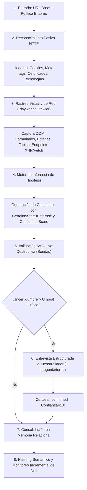

# QAMCP vNext — Arquitectura Objetivo y Contratos Propuestos

- **Documento:** `02_ARQUITECTURA_OBJETIVO_Y_CONTRATOS.md`
- **Rama:** `feat/qap-vnext-architecture`
- **Autor / Rol:** Principal Software Architect y Teamwork Lead
- **Fecha:** Octubre 2026
- **Estado:** Especificación Técnica Formal (Etapa 0)
- **Referencias:** Decisiones D-001 a D-010 en `docs/vnext/REQUISITOS_Y_DECISIONES.md`.

---

## 1. Visión General y Principios de la Arquitectura Objetivo

QAMCP vNext evoluciona desde un monorepo centrado en archivos planos locales hacia una **plataforma modular de aseguramiento de calidad autónoma**, distribuible con cero configuración vía `npx`, que opera mediante el protocolo MCP (Model Context Protocol).

La arquitectura se fundamenta en los siguientes pilares de diseño:

```
┌─────────────────────────────────────────────────────────────────────────────┐
│                          ARQUITECTURA HEXAGONAL QAMCP                       │
├─────────────────────────────────────────────────────────────────────────────┤
│                           CAPA DE ENTRADA / TRANSPORTE                      │
│      [ CLI (cac/commander) ]       [ MCP Daemon (Stdio / SSE) ]             │
├─────────────────────────────────────────────────────────────────────────────┤
│                          CAPA DE APLICACIÓN Y CASOS DE USO                  │
│  ┌───────────────────────┐  ┌───────────────────────┐  ┌──────────────────┐ │
│  │  Black-Box Discovery  │  │      QA Advisor       │  │ Autonomous Plan  │ │
│  │       Crawler         │  │   & Strategy Engine   │  │   & Execution    │ │
│  └───────────────────────┘  └───────────────────────┘  └──────────────────┘ │
├─────────────────────────────────────────────────────────────────────────────┤
│                               CAPA DE DOMINIO                               │
│  - Entidades de Conocimiento (Módulos, Vistas, Reglas, Selectores, Flujos) │
│  - Máquina de Estados de Certeza (Observed / Inferred / Confirmed / Pending) │
│  - Motor de Grafos DAG (Topología de Dependencias y Ciclos)                 │
│  - Clasificador de Defectos (Producto, Entorno, Automatización, Bloqueo)    │
├─────────────────────────────────────────────────────────────────────────────┤
│                         PUERTOS DE INFRAESTRUCTURA (SPI)                    │
│   [ IKnowledgeStore ]        [ ITestRunner ]        [ ICredentialVault ]    │
├─────────────────────────────────────────────────────────────────────────────┤
│                           ADAPTADORES DE PERSISTENCIA                       │
│  ┌───────────────────────┐  ┌───────────────────────┐  ┌──────────────────┐ │
│  │ SqliteKnowledgeAdapter│  │PostgresKnowledgeAdapt.│  │ PlaywrightRunner │ │
│  │ (node:sqlite WAL Local│  │(Self-Hosted Opcional) │  │  (Zero-Touch UI) │ │
│  └───────────────────────┘  └───────────────────────┘  └──────────────────┘ │
└─────────────────────────────────────────────────────────────────────────────┘
```

---

## 2. Subsistema de Adquisición de Conocimiento (Black-Box First)

Conforme a la decisión **D-006**, el sistema debe ser capaz de descubrir y mapear una aplicación web sin acceso a su código fuente ni documentación previa.

### 2.1 Ciclo de Vida de Adquisición



### 2.2 Especificación de Estados de Certeza y Procedencia

Toda entidad almacenada en memoria incorpora atributos de gobernanza de conocimiento:

```typescript
export type CertaintyState = 
  | 'observed'        // Extraído directamente de una lectura pasiva (ej. texto visible de botón)
  | 'inferred'        // Generado por reglas heurísticas o modelos (ej. "campo obligatorio por tener asterisco")
  | 'confirmed'       // Validado por el desarrollador en entrevista o confirmado por sonda activa
  | 'pending_review'  // Estuvo confirmado o inferido, pero la UI cambió (drift detectado);

export interface KnowledgeProvenance {
  source: 'blackbox_dom' | 'network_intercept' | 'active_probe' | 'developer_interview' | 'code_scan' | 'doc_import';
  confidence_score: number;       // Rango 0.00 a 1.00
  observed_at: string;            // Timestamp ISO-8601
  verified_at?: string;           // Timestamp ISO-8601 de confirmación
  verified_by?: string;           // 'user', 'ai_probe', 'system'
  evidence_ref?: string;          // Ruta a captura de pantalla, fragmento de request/response o DOM hash
  session_id?: string;            // Identificador de la sesión que generó la observación
}
```

### 2.3 Protocolo de Entrevista Estructurada (Human-in-the-Loop)

- **Regla de oro:** No emitir muros de texto. Solo una pregunta concreta y focalizada por turno.
- **Formato:** Opciones múltiples estructuradas con justificación contextual (`pregunta.ts`).
- **Gobernanza:** Si el usuario no confirma una regla de negocio o flujo crítico, se conserva en estado `inferred` o `pending_review`, impidiendo que se utilice para bloquear la suite de pruebas como defecto de producto.

---

## 3. Modelo Lógico de Memoria Unificada y Contratos

Conforme a la decisión **D-005**, la memoria se organiza bajo un modelo conceptual relacional indexado, agnóstico del motor físico subyacente.

### 3.1 Modelo Entidad-Relación Conceptual

```
┌──────────────┐       1:N       ┌──────────────┐       1:N       ┌──────────────┐
│   Project    │────────────────►│ Environment  │────────────────►│   TestRun    │
└──────┬───────┘                 └──────────────┘                 └──────┬───────┘
       │                                                                 │ 1:N
       │ 1:N                                                             ▼
       │                         ┌──────────────┐       1:N       ┌──────────────┐
       ├────────────────────────►│     View     │────────────────►│StepExecution │
       │                         └──────┬───────┘                 └──────────────┘
       │                                │ 1:N
       ▼                                ▼
┌──────────────┐       1:N       ┌──────────────┐
│    Module    │────────────────►│ ActionTarget │ (Selectores CSS/XPath con FTS5)
└──────┬───────┘                 └──────────────┘
       │ 1:N
       ├────────────────────────►┌──────────────┐
       │                         │ BusinessRule │
       │                         └──────────────┘
       │ 1:N
       ├────────────────────────►┌──────────────┐       1:N       ┌──────────────┐
       │                         │ FlowScenario │────────────────►│  Dependency  │ (DAG)
       │                         └──────────────┘                 └──────────────┘
       ▼
┌──────────────┐
│    Defect    │ (Incidentes clasificados con pasos de reproducción)
└──────────────┘
```

### 3.2 Contrato Principal de Persistencia (`IKnowledgeStore`)

```typescript
export interface IKnowledgeStore {
  // Inicialización y Ciclo de Vida
  initialize(): Promise<void>;
  close(): Promise<void>;
  runMigrations(): Promise<void>;

  // Gestión de Proyectos y Entornos
  getProject(projectId: string): Promise<Project | null>;
  saveProject(project: Project): Promise<void>;
  getEnvironments(projectId: string): Promise<Environment[]>;
  saveEnvironment(env: Environment): Promise<void>;

  // Gestión de Módulos y Vistas
  getModule(projectId: string, moduleKey: string): Promise<Module | null>;
  listModules(projectId: string): Promise<Module[]>;
  saveModule(module: Module): Promise<void>;
  getViewsByModule(moduleId: string): Promise<View[]>;
  saveView(view: View): Promise<void>;

  // Selectores y Metadatos UI (Búsqueda Léxica O(1))
  saveActionTargets(targets: ActionTarget[]): Promise<void>;
  searchActionTargets(projectId: string, query: string, limit?: number): Promise<ActionTarget[]>;

  // Reglas de Negocio
  getRulesByModule(moduleId: string): Promise<BusinessRule[]>;
  saveRule(rule: BusinessRule): Promise<void>;
  updateRuleCertainty(ruleId: string, state: CertaintyState, score: number, verifiedBy: string): Promise<void>;

  // Flujos de Prueba y Grafo de Dependencias (DAG)
  getFlows(projectId: string, filter?: FlowFilter): Promise<FlowScenario[]>;
  saveFlow(flow: FlowScenario): Promise<void>;
  getDependencyDAG(projectId: string): Promise<DependencyDAG>;
  recordDependency(dep: DependencyEdge): Promise<void>;

  // Telemetría y Ejecución de Pruebas
  recordTestRun(run: TestRun): Promise<void>;
  recordStepExecution(step: TestStepExecution): Promise<void>;
  getExecutionHistory(flowId: string, limit?: number): Promise<TestStepExecution[]>;

  // Defectos e Incidentes
  recordDefect(defect: Defect): Promise<void>;
  updateDefectStatus(defectId: string, status: DefectStatus, resolutionNotes?: string): Promise<void>;
  listDefects(projectId: string, filter?: DefectFilter): Promise<Defect[]>;

  // Portabilidad y Respaldo
  exportSnapshot(projectId: string): Promise<KnowledgeSnapshot>;
  importSnapshot(snapshot: KnowledgeSnapshot, options?: ImportOptions): Promise<void>;
}
```

### 3.3 Especificación del Adaptador Local: `SqliteKnowledgeAdapter`

- **Motor:** `node:sqlite` nativo (`DatabaseSync`), disponible en Node.js >= 22.5.0 (sin binarios compilados externos).
- **Configuración de alto rendimiento:**
  ```sql
  PRAGMA journal_mode = WAL;
  PRAGMA synchronous = NORMAL;
  PRAGMA foreign_keys = ON;
  PRAGMA cache_size = -64000; -- 64MB de caché en RAM
  PRAGMA temp_store = MEMORY;
  ```
- **Búsqueda FTS5:** Tabla virtual `action_targets_fts` indexando `key`, `label`, `selector_css`, `aria_role` para resolución de selectores en microsegundos y ahorro del 94% de tokens.

---

## 4. Motor de Asesoría QA (QA Advisor) y Ejecución Autónoma

Conforme a las decisiones **D-008** y **D-004**, QAMCP asume un rol proactivo de consultoría técnica y orquestación inteligente.

### 4.1 Flujo Operativo del QA Advisor

```
                              SOLICITUD DEL DESARROLLADOR
           ("Modifiqué el formulario de Facturación" / "Quiero probar pagos")
                                           │
                                           ▼
                               ┌───────────────────────┐
                               │     QA Advisor        │
                               └───────────┬───────────┘
                                           │
             ┌─────────────────────────────┼─────────────────────────────┐
             ▼                             ▼                             ▼
   1. Análisis de Impacto        2. Historial de Riesgo        3. Matriz de Criticidad
   (Blast Radius en DAG)         (Fallos y Flakiness previo)   (Reglas financieras/PLD)
             └─────────────────────────────┬─────────────────────────────┘
                                           │
                                           ▼
                           GENERACIÓN DE PROPUESTA ADAPTATIVA
                           ┌───────────────────────────────┐
                           │ Estrategias Recomendadas:     │
                           │  [A] Smoke Focalizado (<2m)   │
                           │  [B] Regresión de Impacto     │
                           │  [C] Auditoría Integral E2E   │
                           └───────────────┬───────────────┘
                                           │
                                           ▼
                             APROBACIÓN DEL USUARIO / MCP
                                           │
                                           ▼
                           ORQUESTADOR AUTÓNOMO (D-004)
                           - Resuelve Prerrequisitos (DAG)
                           - Prepara Perfiles Limpios (D-007)
                           - Ejecuta Runner Playwright
                           - Captura Telemetría y Defectos
```

### 4.2 Clasificación Automática de Anomalías y Defectos

El sistema analiza las fallas de ejecución y las categoriza formalmente para evitar falsos reportes de bugs:

1. **Defecto de Producto (`product_bug`):** La aplicación violó una regla de negocio confirmada o arrojó una excepción HTTP 500 / pantalla blanca mientras los prerrequisitos se cumplían estrictamente.
2. **Falla de Entorno (`environment_error`):** Tiempos de espera por caída de red, error 502/504 Bad Gateway, expiración de credenciales del servidor, bloqueo de firewall o base de datos no disponible.
3. **Flakiness de Automatización (`automation_flakiness`):** El selector no resolvió a tiempo debido a una animación CSS no estabilizada o retraso de renderizado transitorio, superado con reintento idéntico.
4. **Flujo Bloqueado (`blocked_flow`):** No fue posible ejecutar la prueba porque falló un prerrequisito aguas arriba (ej. no se puede probar cancelación de contrato si falló la creación del cliente).

---

## 5. Arquitectura de Distribución `npx-first` (Zero-Config)

Conforme a la decisión **D-009**, la experiencia final de despliegue para cualquier ingeniero debe ser instantánea y sin fricción.

### 5.1 Especificación del Empaquetado

```
┌──────────────────────────────────────────────────────────────────┐
│                   PAQUETE NPX: @hyouka73/qap-mcp                 │
├──────────────────────────────────────────────────────────────────┤
│ - Bundle único ESM generado con tsup                             │
│ - Inlining de dependencias internas (@qap/*)                     │
│ - Zero dependencias nativas C++ (Cero node-gyp, Cero keytar)    │
│ - Runtime: Node.js >= 22.5.0 LTS                                 │
│ - Peso estimado de descarga: < 8 MB comprimido                   │
└──────────────────────────────────────────────────────────────────┘
```

### 5.2 Inicialización Perezosa (Lazy Bootstrapping)

Al ejecutarse mediante `npx @hyouka73/qap-mcp`:
1. **Detección de Directorio de Datos:** Ubica `.qamcp/` en el proyecto actual o fallback a `~/.qamcp/`.
2. **Auto-Migración DDL:** Si la base de datos `knowledge.sqlite` no existe, aplica las migraciones estructurales en menos de 40 milisegundos.
3. **Verificación del Navegador:** Comprueba si los binarios de Playwright Chromium están disponibles en la caché del usuario (`~/.cache/ms-playwright` o `AppData/Local/ms-playwright`). Si faltan, ofrece su descarga desatendida o el uso de un endpoint remoto.
4. **Arranque de Transporte:** Inicia el servidor MCP sobre Stdio (predeterminado) o abre puerto SSE si se invoca con la bandera `--port`.

---

## 6. Estado de Decisiones y Recomendaciones Técnicas

- **Decisiones Confirmadas Aplicadas:** D-001 (autonomía), D-002 (no modificación de código), D-003 (políticas de entorno), D-004 (orquestación híbrida), D-005 (memoria unificada SQLite/Postgres), D-006 (black-box discovery y certeza), D-007 (sesiones limpias), D-008 (guía interactiva), D-009 (npx-first), D-010 (etapas acotadas).
- **Recomendaciones de Arquitectura Propuestas:**
  1. Adopción de la interfaz `IKnowledgeStore` para desacoplar completamente la lógica de negocio del motor de base de datos.
  2. Implementación de `action_targets_fts` sobre SQLite FTS5 para búsqueda instantánea de selectores con bajo costo de tokens.
  3. Descomposición de `packages/mcp/src/server.ts` en un despachador declarativo con tool handlers independientes.
- **Aspectos Abiertos para Validación:**
  - Esquema definitivo de sincronización bidireccional entre la base de datos SQLite local y el cluster PostgreSQL centralizado en entornos corporativos concurrentes.
