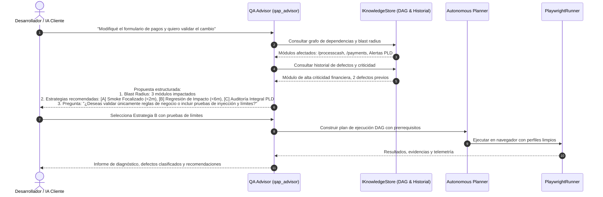

# QAMCP vNext — Arquitectura Objetivo y Contratos Propuestos

- **Documento:** `02_ARQUITECTURA_OBJETIVO_Y_CONTRATOS.md`
- **Rama:** `feat/qap-vnext-architecture`
- **Autor / Rol:** Principal Software Architect y Teamwork Lead
- **Fecha:** Octubre 2026 (Revisión Arquitectónica Profunda)
- **Estado:** Especificación Técnica Formal Actualizada (Etapa 0)
- **Referencias:** Decisiones D-001 a D-010 en `docs/vnext/REQUISITOS_Y_DECISIONES.md`.

---

## 1. El Ciclo Completo de QA Autónomo como Eje Arquitectónico

La arquitectura de QAMCP vNext se articula alrededor del **Ciclo Continuo de Aseguramiento de Calidad Autónomo**. Cada subsistema, puerto y adaptador existe para dar soporte a las etapas de este ciclo, garantizando que el sistema pueda operar sin código fuente, generar memoria confiable, asesorar al desarrollador y ejecutar pruebas sin intervención humana innecesaria.

```mermaid
flowchart TD
    subgraph CICLO COMPLETO DE QA AUTÓNOMO QAMCP
        A["1. ENTRADA Y POLÍTICA<br/>(URL Base, Entorno, Permisos)"] --> B["2. DESCUBRIMIENTO BLACK-BOX<br/>(Reconocimiento Pasivo, Crawler DOM, Red/XHR)"]
        B --> C["3. MOTOR DE HIPÓTESIS Y CERTEZA<br/>(Inferencia de Módulos, Reglas, Selectores)"]
        C --> D["4. VALIDACIÓN ACTIVA NO DESTRUCTIVA<br/>(Sondas Seguras, Detección de Errores)"]
        D --> E{"¿Incertidumbre Irreducible?"}
        E -->|Sí| F["5. ENTREVISTA ESTRUCTURADA<br/>(Human-in-the-Loop: 1 pregunta/turno)"]
        E -->|No| G["6. MEMORIA RELACIONAL Y GRAFO DAG<br/>(Persistencia Unificada SQLite WAL / FTS5)"]
        F --> G
        G --> H["7. ASESORÍA INTERACTIVA QA (QA Advisor)<br/>(Blast Radius, Diálogo con Dev, Selección de Alcance)"]
        H --> I["8. PLANIFICACIÓN Y ORQUESTACIÓN (DAG)<br/>(Resolución de Prerrequisitos, Perfiles Limpios)"]
        I --> J["9. EJECUCIÓN AUTÓNOMA (PlaywrightRunner)<br/>(Orquestación Híbrida sin LLM por paso)"]
        J --> K["10. DIAGNÓSTICO Y REPRODUCCIÓN DE DEFECTOS<br/>(Clasificación: Producto vs Entorno vs Flakiness)"]
        K --> L["11. PROPUESTA DE SOLUCIÓN Y TELEMETRÍA<br/>(Reportes HTML/JUnit/JSON, Evidencia Enmascarada)"]
        L --> M["12. MONITOREO INCREMENTAL Y DRIFT<br/>(Hashes Semánticos, Re-evaluación Continua)"]
        M -.->|Cambios Detectados en UI/API| B
    end
```



---

## 2. Subsistema de Adquisición de Conocimiento (Black-Box First)

Conforme a la decisión **D-006**, el agente adquiere conocimiento a partir de la interacción con la aplicación en ejecución:

### 2.1 Fases Detalladas de Adquisición
1. **Reconocimiento Pasivo HTTP:** Sonda inicial sin autenticación para registrar headers de seguridad (CSP, HSTS, CORS), cookies iniciales, certificados SSL, rutas estándar (`robots.txt`, `sitemap.xml`) y tecnologías de cliente detectadas en scripts o meta-tags.
2. **Exploración Visual y de Red (Crawler Controlado):**
   - Navega el DOM en una sesión de navegador limpia (`incognito`).
   - Mapea elementos interactivos (botones, enlaces, selectores, formularios, tablas, modales).
   - Intercepta tráfico XHR/Fetch de fondo, asociando endpoints de API a las vistas que los disparan.
   - Respeta estrictamente la política de entorno (D-003): prohíbe acciones de envío destructivo en entornos no autorizados.
3. **Generación de Hipótesis y Asignación de Certeza:**
   - Agrupa vistas en módulos lógicos mediante heurísticas de rutas y menús de navegación.
   - Identifica campos obligatorios (asteriscos `*`, etiquetas `required`, atributos ARIA).
   - Asigna a cada entidad su estado de certeza inicial (`inferred`) y un índice de confianza preliminar.
4. **Validación Activa No Destructiva (Sondas Seguras):**
   - Ejecuta acciones seguras para validar hipótesis (ej. presionar botón de submit con formulario vacío para verificar qué mensajes de validación se despliegan en el DOM).
   - Promueve la confianza de la hipótesis si la respuesta del sistema coincide con el comportamiento esperado.
5. **Entrevista Estructurada al Desarrollador (Human-in-the-Loop):**
   - Solo se activa ante ambigüedades críticas que no pueden resolverse mediante inspección (ej. "En el módulo de Cobranza, ¿un contrato exento de IVA se calcula con tasa 0% o sin desglose?").
   - Regla estricta: Una sola pregunta focalizada por turno, con opciones múltiples claras y justificación contextual (`pregunta.ts`).
6. **Monitoreo Incremental y Detección de Cambios (Drift):**
   - Generación de hashes semánticos SHA-256 sobre la estructura de cada vista y formulario.
   - Si en ejecuciones posteriores la UI cambia (nuevos botones, campos modificados, rutas alteradas), las entidades afectadas se marcan como `pending_review` y se alerta al QA Advisor.

---

## 3. Modelo Lógico de Memoria Unificada (Modelo en Validación Empírica)

Conforme a las decisiones **D-005** y la directiva de no fijar prematuramente tipos estáticos sin validación empírica, el modelo de memoria se estructura como un **modelo de dominio evolutivo**, diseñado para ser contrastado contra aplicaciones reales durante la fase de descubrimiento.

### 3.1 Entidades del Dominio de Conocimiento

```
┌──────────────┐       1:N       ┌──────────────┐       1:N       ┌──────────────┐
│   Project    │────────────────►│ Environment  │────────────────►│   TestRun    │
└──────┬───────┘                 └──────────────┘                 └──────┬───────┘
       │                                                                 │ 1:N
       │ 1:N                                                             ▼
       │                         ┌──────────────┐       1:N       ┌──────────────┐
       ├────────────────────────►│     View     │────────────────►│StepExecution │
       │                         └──────┬───────┘                 └──────────────┘
       │                                │ 1:N
       ▼                                ▼
┌──────────────┐       1:N       ┌──────────────┐
│    Module    │────────────────►│ ActionTarget │ (Selectores CSS/XPath con FTS5)
└──────┬───────┘                 └──────────────┘
       │ 1:N
       ├────────────────────────►┌──────────────┐
       │                         │ BusinessRule │ (Reglas con certeza y procedencia)
       │                         └──────────────┘
       │ 1:N
       ├────────────────────────►┌──────────────┐       1:N       ┌──────────────┐
       │                         │ FlowScenario │────────────────►│  Dependency  │ (DAG)
       │                         └──────────────┘                 └──────────────┘
       ▼
┌──────────────┐
│    Defect    │ (Incidentes clasificados con pasos de reproducción y evidencia)
└──────────────┘
```

### 3.2 Estados de Certeza y Gobernanza de Conocimiento

```typescript
export type CertaintyState = 
  | 'observed'        // Extraído directamente de una lectura pasiva (ej. texto visible de botón)
  | 'inferred'        // Generado por reglas heurísticas o modelos (ej. "campo obligatorio por tener asterisco")
  | 'confirmed'       // Validado por el desarrollador en entrevista o confirmado por sonda activa
  | 'pending_review'  // Estuvo confirmado o inferido, pero la UI cambió (drift detectado);

export interface KnowledgeProvenance {
  source: 'blackbox_dom' | 'network_intercept' | 'active_probe' | 'developer_interview' | 'code_scan' | 'doc_import';
  confidence_score: number;       // Rango 0.00 a 1.00
  observed_at: string;            // Timestamp ISO-8601
  verified_at?: string;           // Timestamp ISO-8601 de confirmación
  verified_by?: string;           // 'user', 'ai_probe', 'system'
  evidence_ref?: string;          // Ruta a captura de pantalla, fragmento de request/response o DOM hash
  session_id?: string;            // Identificador de la sesión que generó la observación
}
```

### 3.3 Contrato de Persistencia (`IKnowledgeStore`)

```typescript
export interface IKnowledgeStore {
  // Ciclo de Vida y Migración DDL
  initialize(): Promise<void>;
  close(): Promise<void>;
  runMigrations(): Promise<void>;

  // Gestión de Proyectos y Entornos
  getProject(projectId: string): Promise<Project | null>;
  saveProject(project: Project): Promise<void>;
  getEnvironments(projectId: string): Promise<Environment[]>;
  saveEnvironment(env: Environment): Promise<void>;

  // Gestión de Módulos y Vistas
  getModule(projectId: string, moduleKey: string): Promise<Module | null>;
  listModules(projectId: string): Promise<Module[]>;
  saveModule(module: Module): Promise<void>;
  getViewsByModule(moduleId: string): Promise<View[]>;
  saveView(view: View): Promise<void>;

  // Selectores y Metadatos UI (Resolución O(1) con Búsqueda Léxica)
  saveActionTargets(targets: ActionTarget[]): Promise<void>;
  searchActionTargets(projectId: string, query: string, limit?: number): Promise<ActionTarget[]>;

  // Reglas de Negocio
  getRulesByModule(moduleId: string): Promise<BusinessRule[]>;
  saveRule(rule: BusinessRule): Promise<void>;
  updateRuleCertainty(ruleId: string, state: CertaintyState, score: number, verifiedBy: string): Promise<void>;

  // Flujos de Prueba y Grafo de Dependencias (DAG)
  getFlows(projectId: string, filter?: FlowFilter): Promise<FlowScenario[]>;
  saveFlow(flow: FlowScenario): Promise<void>;
  getDependencyDAG(projectId: string): Promise<DependencyDAG>;
  recordDependency(dep: DependencyEdge): Promise<void>;

  // Telemetría y Ejecución de Pruebas
  recordTestRun(run: TestRun): Promise<void>;
  recordStepExecution(step: TestStepExecution): Promise<void>;
  getExecutionHistory(flowId: string, limit?: number): Promise<TestStepExecution[]>;

  // Defectos e Incidentes
  recordDefect(defect: Defect): Promise<void>;
  updateDefectStatus(defectId: string, status: DefectStatus, resolutionNotes?: string): Promise<void>;
  listDefects(projectId: string, filter?: DefectFilter): Promise<Defect[]>;

  // Portabilidad y Respaldo
  exportSnapshot(projectId: string): Promise<KnowledgeSnapshot>;
  importSnapshot(snapshot: KnowledgeSnapshot, options?: ImportOptions): Promise<void>;
}
```

### 3.4 Motor Local de Persistencia: `SqliteKnowledgeAdapter`
- Implementado sobre `node:sqlite` (`DatabaseSync`), disponible nativamente en Node.js >= 22.5.0.
- Modo WAL (`Write-Ahead Logging`) para concurrencia limpia entre lecturas y escrituras.
- Tabla virtual FTS5 (`action_targets_fts`) para indexación léxica de selectores y etiquetas UI.
- Despliegue self-hosted con PostgreSQL como adaptador opcional para organizaciones con equipos concurrentes centralizados (D-005).

---

## 4. Bóveda Criptográfica Escalonada de Credenciales (Tiered Vault)

Conforme a la decisión **D-007**, las credenciales de acceso se desacoplan estrictamente de la memoria del conocimiento de la aplicación.

```
┌────────────────────────────────────────────────────────────────────────┐
│             ESTRATEGIA ESCALONADA DE GESTIÓN DE SECRETOS               │
├────────────────────────────────────────────────────────────────────────┤
│ TIER 1: Keychain del SO (Keytar Opcional)                              │
│         - Windows Credential Manager, macOS Keychain, Linux SecretServ │
│         - Máxima seguridad y comodidad cuando está disponible.         │
├────────────────────────────────────────────────────────────────────────┤
│ TIER 2: Bóveda Cifrada Portable (AES-256-GCM + PBKDF2)                 │
│         - Para entornos headless, Docker, servidores CI/CD sin UI.     │
│         - Cifrado en .qamcp/vault.enc con salt aleatorio y tag auth.   │
│         - Clave derivada de variable de entorno (QAP_VAULT_PASSPHRASE).│
├────────────────────────────────────────────────────────────────────────┤
│ TIER 3: Memoria Efímera de Sesión (In-Memory)                          │
│         - Para ejecuciones npx puntuales o pruebas ad-hoc.             │
│         - Las credenciales se solicitan interactivamente en memoria y  │
│           se destruyen al finalizar el proceso (cero rastro en disco). │
└────────────────────────────────────────────────────────────────────────┘
```

---

## 5. Motor de Asesoría Interactiva de QA (QA Advisor)

Conforme a la decisión **D-008**, QAMCP actúa como un **consultor experto interactivo** antes de disparar ejecuciones automáticas.



### 5.1 Capacidades Consultivas del QA Advisor
1. **Análisis de Blast Radius:** Dado un cambio en una vista, ruta o regla, calcula los módulos y flujos dependientes que requieren re-verificación.
2. **Recomendación Contextual de Pruebas:** Propone combinaciones de pruebas funcionales, de límites, regresión, seguridad básica (RBAC/inyecciones en formularios) o UX según la criticidad del componente.
3. **Clasificación Formal de Defectos:** Ante una falla, analiza logs de red, consola y estados de prerrequisitos para categorizar la anomalía en:
   - `product_bug`: Violación de regla confirmada o excepción 500 del servidor.
   - `environment_error`: Caída de servicio, error 502/504 o expiración de red.
   - `automation_flakiness`: Demora transitoria de renderizado resuelta en reintento.
   - `blocked_flow`: Falla de un prerrequisito previo en el grafo DAG.

---

## 6. Distribución `npx-first` (Producto Principal)

Conforme a la decisión **D-009**, la experiencia final de usuario se centra en `npx`:

- **Comando único de ejecución:**
  ```bash
  npx @hyouka73/qap-mcp
  ```
- **Configuración en clientes MCP (Claude Desktop, Cursor, Antigravity):**
  ```json
  {
    "mcpServers": {
      "qamcp": {
        "command": "npx",
        "args": ["-y", "@hyouka73/qap-mcp"]
      }
    }
  }
  ```
- **Cero dependencias nativas:** Al no requerir compilación C++ en la máquina cliente, el arranque se completa de forma transparente.
- **Auto-preparación desatendida:** Inicialización perezosa de la base de datos local y detección automática de los binarios del navegador.
- **Despliegue self-hosted:** Se mantiene como un adaptador complementario para PostgreSQL, sin penalizar ni sobrecargar la distribución local de `npx`.

---

## 7. Criterios de Aceptación Reproducibles sobre Escenarios de QA

En sustitución de microbenchmarks arbitrarios, el sistema se evalúa mediante **criterios operativos en escenarios de prueba reales**:

1. **Escenario de Resolución de Selectores:** En una suite con más de 100 selectores y vistas complejas, la búsqueda de selectores mediante FTS5 y la resolución de contexto deben completarse sin introducir demoras perceptibles en la interacción con el navegador (< 50 ms por consulta).
2. **Escenario de Consulta MCP:** En turnos conversacionales donde el LLM solicita el estado o selectores de un módulo, la carga útil devuelta debe restringirse a los elementos requeridos (< 500 tokens), evitando transferencias masivas de archivos de configuración.
3. **Escenario E2E de Descubrimiento:** Sobre una aplicación web con al menos 3 vistas y formularios interactivos, el crawler black-box debe descubrir la topología, identificar campos obligatorios y generar el grafo de navegación de forma desatendida sin disparar excepciones no controladas.
4. **Escenario de Coexistencia:** Proyectos con datos existentes en `.qa/` deben ser leídos e indexados en SQLite en la primera ejecución sin modificar ni borrar los archivos planos originales.
