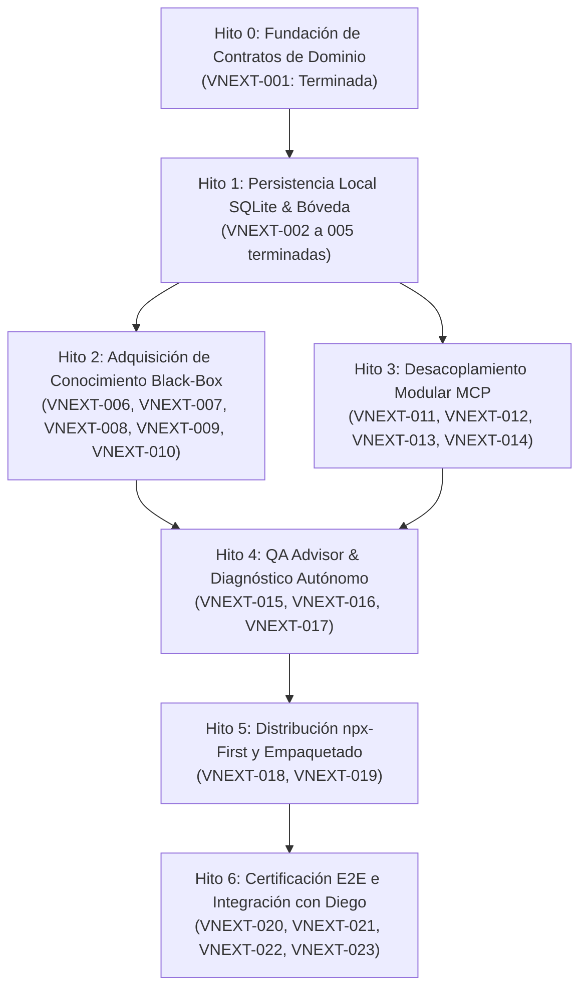

# QAMCP vNext — Backlog Preliminar y WBS Desglosado

- **Documento:** `04_BACKLOG_Y_WBS_PRELIMINAR.md`
- **Rama:** `feat/qap-vnext-architecture`
- **Autor / Rol:** Principal Software Architect y Teamwork Lead
- **Fecha:** Octubre 2026 (Revisión Arquitectónica Profunda — Etapa 0 Corregida)
- **Estado actual (2026-11-05):** VNEXT-014 NO-GO. R4-R7 auditado: 407 PASS y 55 FAIL de 462 MCP, lint global 34 errores/28 warnings. R4-R7-A01: la autorización diferida cambiaba digest por timestamp; R4-R8 corrige la identidad de reintento, guarda tiempo real y agrega tres regresiones; no auditada físicamente. Closed, waiver, reporte y replanificación pendientes. VNEXT-015 sin iniciar.
- **Referencias:** D-010 (Evolución documentada por etapas), D-001 a D-015.

---

## 1. Estructura General y Dependencias Reales entre Hitos

Conforme a la directiva **D-010** y la corrección de inconsistencias de numeración del WBS, el trabajo se organiza en **7 Hitos Secuenciales (Hito 0 a Hito 6)** numerados de forma estrictamente continua (**VNEXT-001 a VNEXT-023**).

> [!IMPORTANT]
> **Estado de Autorización:** Solicitudes del 2026-10-30 autorizaron VNEXT-007 y posteriormente VNEXT-008, implementadas y verificadas con los límites documentados. Autorización posterior del 2026-10-30 incluye únicamente VNEXT-009, implementada con límites explícitos. Detener tras VNEXT-009; VNEXT-010 y posteriores requieren autorización nueva. Continuidad: [STATE.md](STATE.md).
> Una autorización posterior del mismo día incluye exclusivamente VNEXT-010, implementada
> y verificada con límites explícitos. Detener tras publicar VNEXT-010; VNEXT-011 y
> posteriores requieren autorización nueva. No se reescriben los cierres históricos.
> Autorización posterior del mismo día incluye exclusivamente VNEXT-011, completada
> con limitaciones de ESLint/tipos legacy documentadas. Detener tras publicarla;
> VNEXT-012 y posteriores requieren autorización nueva.

---

## 2. Catálogo Detallado de Micro-Tareas (WBS)

### Hito 0: Fundación de Contratos de Dominio

#### `VNEXT-001` — Definición del Modelo de Dominio y Contratos de Conocimiento en Validación Empírica
- **Estado:** Terminada previamente (commit base ffb5031); contratos canónicos presentes y 145 tests shared verificados durante VNEXT-002.
- **Paquetes afectados:** `@qap/shared`.
- **Dependencias:** Ninguna (Fundacional).
- **Riesgo:** Bajo.
- **Alcance:** Definir los contratos de dominio TypeScript y esquemas de validación necesarios para:
  1. Distinguir formalmente cuatro planos epistemológicos: `ApplicationObservation` (lo observado), `AgentInference` (lo inferido), `ExpectedRequirement` (el requisito esperado) y `ConformityAssessment` (la verificación de conformidad).
  2. Modelar dimensiones contextuales ricas: aplicaciones, entornos, roles y permisos (RBAC), prerrequisitos, sesiones activas, políticas de limpieza del navegador (`clean_cache`, `fresh_context`, `retain_session`) y evidencias multimodales enmascaradas.
  3. Prohibir la promoción automática de reglas de negocio a `confirmed` mediante sondas de aplicación.
  4. Admitir explícitamente resultados `indeterminate` / `inconclusive`.
  5. Soportar los escenarios reales de QA: Escenario A (App desconocida), Escenario B (Módulo nuevo) y Escenario C (Autenticación y caché).
- **Mecanismo de verificación:** `pnpm --filter @qap/shared test`, pruebas de contratos válidos, inválidos y contradictorios, compilación y pruebas de consumidores relevantes.
- **Criterios de aceptación:**
  - Tipos exportados formalmente en `@qap/shared` sin romper compatibilidad existente.
  - Cero dependencias nativas o binarias.

---

### Hito 1: Persistencia Local SQLite y Bóveda Criptográfica

#### `VNEXT-002` — Contrato Formal `IKnowledgeStore` y Puerto de Persistencia
- **Estado:** Terminada (2026-10-28); contrato y doble en memoria verificados, sin persistencia física.
- **Paquetes afectados:** `@qap/engine` (puerto y pruebas); reutiliza entidades de `@qap/shared` sin modificarlas.
- **Dependencias:** `VNEXT-001`.
- **Riesgo:** Bajo.
- **Alcance realizado:** `packages/engine/src/knowledge-store.port.ts`, exportado por Engine: lecturas tipadas, consultas paginadas, commit atómico con CAS, historial y referencias con revisiones, aislamiento y errores tipados. Se corrigió la ubicación para evitar `engine → knowledge → engine`. Búsqueda léxica (VNEXT-004), telemetría y snapshots se difieren; no existen métodos ficticios. [Decisión, límites y verificación](VNEXT-002_KNOWLEDGE_STORE.md).

#### `VNEXT-003` — Adaptador de Persistencia SQLite Local (`SqliteKnowledgeAdapter`)
- **Estado:** Terminada (2026-10-28), dentro de la autorización expresa de continuidad.
- **Paquetes afectados:** `@qap/knowledge`; extracción de suite de tests en `@qap/engine`, sin cambiar el puerto.
- **Dependencias:** `VNEXT-002` terminada.
- **Riesgo:** Medio; límites de plataforma/carga/E2E documentados.
- **Alcance realizado:** SQLite físico con WAL, FK diferidas, CAS, historial inmutable, sellado de referencias, transacciones y esquema v1 con migración segura solo desde base vacía. 24 contratos + 14 pruebas físicas pasan en Windows x64 con Node 22.13.1, 24.15.0 y 24.22.1. 523 tests relevantes y 10 compilaciones pasan; la suite global tiene fallos reproducidos en la base y un fallo de tiempo de route-scanner bajo carga. No se certifica E2E ni Linux/macOS. [DDL, decisiones, reproducción y límites](VNEXT-003_SQLITE_ADAPTER.md).

#### `VNEXT-004` — Motor de Búsqueda FTS5 de Selectores y Atributos UI
- **Estado:** Terminada y verificada (2026-10-28), por autorización expresa. Detener antes de VNEXT-005.
- **Paquetes afectados:** `@qap/engine` (puerto complementario), `@qap/knowledge` (adaptador/migración/tests).
- **Dependencias:** `VNEXT-003`.
- **Riesgo:** Bajo.
- **Alcance:** Crear tabla virtual FTS5 (`action_targets_fts`) y métodos de consulta parametrizada por coincidencia léxica, atributo o etiqueta de accesibilidad.
- **Entrega:** IActionTargetSearch sin cambiar IKnowledgeStore v1; esquema v2 con migración v1→v2 transaccional, índice de objetivos actuales, filtros reales y ranking BM25. 547/547 pruebas relevantes; 62/62 físicas/búsqueda en Node 24.15.0 y 24.22.1. Node 22.13.1 instalado carece de FTS5 y se rechaza sin migrar; global conserva fallos preexistentes Auth/Chromium y Playwright Adapter. [Diseño, resultados y límites](VNEXT-004_FTS5_SEARCH.md).

#### `VNEXT-005` — Bóveda Criptográfica Escalonada de Credenciales (Tiered Vault)
- **Estado:** Terminada (2026-10-28), por autorización expresa. Windows/Node 24 verificados; POSIX y npx limpio pendientes. Detener antes de VNEXT-006.
- **Paquetes afectados:** `@qap/auth`, tipos/schemas de `@qap/shared`, compatibilidad CLI y test centinela MCP.
- **Dependencias:** `VNEXT-001`.
- **Riesgo:** Medio.
- **Alcance entregado:** `ICredentialProvider`, selección explícita en `TieredCredentialVault`, keytar opcional/diferido, bóveda AES-256-GCM + scrypt (N=131072, r=8, p=1), efímeras y compatibilidad env. Namespace por proyecto/aplicación/entorno/perfil/cuenta; locks, escrituras atómicas, errores sanitizados y sesiones con clave aleatoria o explícita. Sin fallback inseguro ni nuevos handlers.
- **Verificación:** Auth 34 aprobadas/1 omitida POSIX en Windows con Node 24.15.0/24.19.0/24.22.1; keychain real 6 comprobaciones por runtime; 547 pruebas de dominio, CLI 6 y centinela MCP 1 aprobadas. 10 builds. Global conserva fallos Chromium/Adapter y sensibilidad a carga de route-scanner.
- **Diseño, migración legacy y límites:** [VNEXT-005_CREDENTIAL_VAULT.md](VNEXT-005_CREDENTIAL_VAULT.md).

---

### Hito 2: Adquisición de Conocimiento Black-Box First

#### `VNEXT-006` — Módulo de Reconocimiento Pasivo HTTP y Detección de Stack
- **Estado:** Terminada (2026-10-28), con limitaciones de entorno y puerto v1 documentadas. No iniciar VNEXT-007.
- **Paquetes afectados:** `@qap/playwright-adapter`, `@qap/knowledge`, extensión aditiva mínima de `@qap/shared`.
- **Dependencias:** `VNEXT-001`, `VNEXT-003`.
- **Riesgo:** Bajo.
- **Alcance:** Implementar `ReconnaissanceService` para inspeccionar headers de seguridad, certificados SSL, tecnologías de frontend, rutas robots.txt y sitemap sin mutaciones en el servidor, produciendo `ApplicationObservation`.
- **Entrega:** API tipada/exportada, GET por recurso autorizado, DNS/IP fijados y peer verificado, SSRF/redirects/budgets, ingesta sanitizada y commit atómico de observación + evidencia `http_recon_metadata`. Sin navegador, crawler ni promoción de hipótesis.
- **Verificación:** 55 tests HTTP/TLS/IPv6 nuevos, 4 SQLite físicos finales, Shared 146/146, Engine 168/168; Knowledge completo 238/238; adapter comparado base 26/26 y actual 80/80 antes de añadir el test 1xx final. Diez builds. Límites legacy de tsc/lint y de deadline/store explícitos en [VNEXT-006](VNEXT-006_HTTP_RECONNAISSANCE.md).

#### `VNEXT-007` — Crawler Black-Box Dirigido con Playwright
- **Estado:** Completada con limitaciones (2026-10-30): modo estático anónimo; exploración SPA ejecutando JavaScript no implementada ni certificada.
- **Paquetes afectados:** `@qap/playwright-adapter`.
- **Dependencias:** `VNEXT-006`.
- **Riesgo:** Medio.
- **Alcance:** Construir `BlackBoxCrawler` capaz de navegar la aplicación en modo incógnito/perfil limpio, mapear rutas accesibles, menús, enlaces, formularios y botones sin mutaciones destructivas.
- **Entrega:** API tipada/exportada, BFS por URLs exactas y GET read-only consentidos; contextos nuevos offline/JS desactivado, transporte Node DNS fijado de VNEXT-006, proxy de denegación, sin 3xx al browser. DOM sanitizado, rutas opacas y estados candidatos/visitas distintos; commit atómico de evidencia y observaciones por puerto v1 intacto. Entidades de dominio diferidas sin identidad válida.
- **Verificación:** 30 pruebas nuevas con Chrome real y SQLite físico; adapter completo 111/111, Shared 146/146, Engine 168/168, Knowledge 238/238, diez builds y tsc/lint focalizados. Proxy comprobado sin routing/offline; rollback real, canarios ausentes e historial conservado.
- **Límites:** Shells SPA/skeleton registrados como dependientes de scripts, sin afirmar exploración dinámica ni protección SSRF de navegador general. Recursos externos y queries bloqueados. Criterios SPA/asíncronos limitados expresamente. [API, seguridad, reproducción y límites](VNEXT-007_BLACKBOX_CRAWLER.md). Cierre histórico de VNEXT-007; la autorización posterior de VNEXT-008 se registra abajo.

#### `VNEXT-008` — Interceptor de Tráfico de Red y Extracción de Endpoints
- **Estado:** Completada con limitaciones: observación dinámica pasiva acotada, Chrome real y SQLite físico (2026-10-30).
- **Paquetes afectados:** `@qap/playwright-adapter`.
- **Dependencias:** `VNEXT-007`.
- **Riesgo:** Alto: ejecución dinámica con frontera de red; TCP/UDP comprobados empíricamente.
- **Alcance:** Capturar llamadas XHR/Fetch generadas por la UI durante la navegación pasiva, extrayendo endpoints, métodos HTTP, query params y códigos de respuesta típicos con enmascaramiento de PII.
- **Entrega:** NetworkTrafficObserver opt-in separado; gateway DNS fijado/peer/TLS, permisos por categoría/URL GET, proxy de denegación y CSP. Scripts reales, Fetch 200/XHR 503, estados respuesta/bloqueo/inconcluso y entrega CORS separados. Endpoints opacos con patrones seguros consentidos y muestras múltiples; query names permitidos sin valores. Evidencia estructurada y observaciones v1, lotes atómicos <=100 writes con fallos parciales explícitos.
- **Seguridad:** Se detectó salida UDP WebRTC con la bandera heredada y se corrigió con la bandera Chromium actual. Prueba real sin routing/offline: cero HTTP/UDP prohibidos. Métodos de escritura, destinos fuera de alcance, DNS rebinding, scripts externos, SW/WS/frames/popups/downloads y token URL bloqueados; canarios ausentes de salida y SQLite/WAL/SHM/logs.
- **Verificación:** 28 pruebas nuevas; adapter final 139/139 con archivos secuenciales, Shared 146/146, Engine 168/168, Knowledge 238/238; diez builds y tsc/lint focalizados. Consumidores CLI 6/6, MCP canario 1/1, runner 4/4, Auth 34 + 1 omitida POSIX. Un intento paralelo bajo carga falló en test legacy skeleton intacto; detalle conservado, sin certificar suite global.
- **Límites:** Una vista/ventana pasiva, no inventario exhaustivo ni sandbox OS; Chrome/Windows probados. Sin login, acciones, redirects seguidos, inline/eval, binarios, headers personalizados/preflight ni inferencias. [Arquitectura, API y reproducción](VNEXT-008_NETWORK_INTERCEPTOR.md). Detener; no iniciar VNEXT-009.

#### `VNEXT-009` — Motor de Inferencia de Hipótesis y Asignación de Certeza
- **Estado:** Completada con limitaciones explícitas (2026-10-30), por autorización expresa. Agente principal único.
- **Paquetes afectados:** `@qap/knowledge`.
- **Dependencias:** `VNEXT-007`, `VNEXT-008`.
- **Riesgo:** Medio.
- **Alcance entregado:** KnowledgeInferenceEngine sobre IKnowledgeStore v1, cinco categorías de hipótesis con plantillas cerradas, puntaje heurístico desglosado (no probabilidad), abstención, deduplicación, CAS e historia con soporte persistido. Sin reglas confirmadas ni correlación HMAC entre ejecuciones.
- **Verificación:** 20/20 nuevas; Shared146/146, Engine168/168, Knowledge258/258, Adapter139/139; diez builds, tipos/lint de entrega limpios. SQLite físico, conflictos, rollback y canarios. Diagnósticos legacy y ventana contexto/commit documentados.
- **Límites y continuidad:** cobertura parcial, independencia no demostrada, clusters locales heurísticos, sin promoción. [API, fórmula, pruebas y límites](VNEXT-009_INFERENCE_ENGINE.md). Detener; VNEXT-010 no autorizada.

#### `VNEXT-010` — Sondas de Observación Activa No Destructiva
- **Estado:** Completada con limitaciones (2026-10-30), por autorización expresa posterior.
- **Paquetes afectados:** `@qap/playwright-adapter`, `@qap/knowledge`.
- **Dependencias:** `VNEXT-009`.
- **Riesgo:** Medio.
- **Alcance:** Ejecutor de sondas seguras (ej. submit vacío para detonar mensajes de validación). **Regla D-011:** Comprueba reproducibilidad y consistencia observacional; no promueve reglas a `confirmed`.
- **Entrega:** ActiveObservationProbe exportado; checkValidity y requestSubmit reales
  sobre formulario vacío autorizado, contextos nuevos por ensayo, gateway sellado/offline
  y proxy deny-only conservado. Evidencia estructural probe_result/active_probe y lote
  SQLite atómico <=6 writes. Catálogo cerrado, sin formularios válidos ni credenciales.
- **Limitaciones:** Windows/Node24/Chrome comprobados; sin garantía OS/RAM, formularios
  poblados/hidden/password, frames/shadow DOM ni carga API. Store v1 sin CAS contextual ni
  cancelación de operaciones SQLite. Consistencia no acredita corrección de negocio.
  [Arquitectura, verificación y reproducción](VNEXT-010_ACTIVE_OBSERVATION_PROBES.md).

---

### Hito 3: Desacoplamiento Modular del Servidor MCP

#### `VNEXT-011` — Arquitectura de Handlers Declarativos para MCP
- **Estado:** Completada con limitaciones (2026-10-30), por autorización posterior expresa.
- **Paquetes afectados:** `@qap/mcp`.
- **Dependencias:** `VNEXT-001`, `VNEXT-002`.
- **Riesgo:** Medio.
- **Alcance:** Crear infraestructura de despachador declarativo (`src/dispatcher.ts`) e interfaz `IMcpToolHandler`. Eliminar supresión de reglas ESLint en `@qap/mcp`.
- **Entrega:** Contrato/dispatcher exportados, registro explícito y sellado, reservas legacy,
  validación estructural y errores nuevos sanitizados. Inyección opcional integrada al
  servidor real; 18 herramientas y prompts compatibles, sin migrar implementaciones.
  38 unitarias + 8 integraciones reales; MCP completo 183/183, diez builds, tipos nuevos
  y lint afectados limpios. Supresión global de server.ts retirada; **eliminación total
  pendiente**, con 798 diagnósticos bajo excepciones acotadas a bloques legacy (803 base).
  Typecheck amplio conserva 48 diagnósticos legacy. No suite global certificada.
  [Diseño, pruebas y limitaciones](VNEXT-011_MCP_DISPATCHER.md).

#### `VNEXT-012` — Migración de Handlers de Información y Estado (`status`, `clean`, `context`)
- **Estado:** Completada con limitaciones (2026-10-30), por autorización posterior expresa.
- **Paquetes afectados:** `@qap/mcp`.
- **Dependencias:** `VNEXT-011`, `VNEXT-003`.
- **Riesgo:** Bajo.
- **Alcance:** Implementar `status.handler.ts`, `clean.handler.ts` y `context.handler.ts` conectándolos directamente al nuevo `IKnowledgeStore`.

- **Entrega:** Tres propietarios declarativos reales, switch retirado para status/clean/context,
  catálogo histórico de 18 herramientas conservado. Knowledge por vinculación explícita;
  contexto YAML coexistente sin promociones ni dual-write. Clean bloquea el reseteo
  general por integridad, incluso force=true: incompatibilidad observable declarada.
  Diario legacy y reporte de fallos parciales; recuperación deliberada sin replay automático.
  MCP completo 203/204 (único fallo: aserción intacta del borrado general); nuevas 21/21,
  SQLite físico y dos conexiones; Knowledge 258/258, Engine 168/168, Shared 146/146,
  diez builds. ESLint legacy 798→622; TypeScript 48→48, sin diagnósticos nuevos.
  No suite global certificada. Sin iniciar VNEXT-013 ni cambiar IKnowledgeStore v1.
  [Arquitectura, pruebas y límites](VNEXT-012_MCP_STATE_HANDLERS.md).

#### `VNEXT-013` — Handler de Descubrimiento Autónomo (`discovery.handler.ts`)
- **Estado:** Completada con limitaciones (2026-10-30), por autorización posterior expresa.
- **Paquetes afectados:** `@qap/mcp`.
- **Dependencias:** `VNEXT-011`, `VNEXT-009`.
- **Riesgo:** Medio.
- **Alcance:** Conectar la tool `qap_discover` con el crawler black-box, devolviendo el resumen estructurado de hallazgos.

- **Entrega:** DiscoveryHandler declarativo conectado al BlackBoxCrawler real, cuatro
  propietarios declarativos/catorce legacy y 18 tools. Autorización exacta opt-in del
  host ligada a binding y revisión de entorno; sin autenticación, fallback, archivos
  legacy, avance lifecycle ni inferencias automáticas. Resumen seleccionado y commit
  único del crawler. Corrección acotada del test clean; VNEXT-012 sigue 203/204.
  Nuevas 37/37, dispatcher/SDK 46/46, estado 21/21; MCP final 181/241 con 60 fallos
  de dependencias legacy conservados. Crawler 30/30, Knowledge 258/258, Engine
  168/168, Shared 146/146; diez builds. Lint legacy 622→513, TypeScript 48→48.
  Sin diagnósticos nuevos ni certificación global.
  [Arquitectura, pruebas, incompatibilidades y límites](VNEXT-013_MCP_DISCOVERY_HANDLER.md).

**Nota correctiva VNEXT-013-R1 (2026-10-30):** intervención posterior autorizada,
sin renumerar tareas ni modificar el resultado histórico de VNEXT-013. Reproduce
181/241 y clasifica individualmente sus 60 fallos (23 A, 32 B, 5 D). Corrige
bloqueos/recomendaciones y escrituras sin contexto, sin materializar módulos ni
promover observaciones. Dos aserciones obsoletas reconciliadas; final MCP
188/246, con 58 fallos activos clasificados (21 A, 32 B, 5 D), cinco casos nuevos
aprobados. Discovery 42/42, dispatcher/SDK 46/46, state 21/21, crawler 30/30;
Knowledge 258/258, Engine 168/168, Shared 146/146, diez builds. ESLint 513→513,
TypeScript 48→47, sin diagnósticos nuevos. **Completada con limitaciones;
estabilización funcional incompleta y no apta para asumir resuelta la integración
necesaria para VNEXT-014.** No inicia ni autoriza tareas posteriores.
[Inventario, grafo, límites y evidencia](VNEXT-013_R1_INTEGRATION_STABILIZATION.md).

**Nota correctiva VNEXT-013-R2 (2026-10-30):** completada con limitaciones.
Vinculación explícita del host a DomainModule existente, relaciones related_to
con observaciones/evidencias reales fijadas a revisión, adquisición y asociación
en commits separados, recuperación por recibo e idempotencia/CAS. Status incluye
proyección observacional acotada; sin vistas/requisitos inventados ni avance
lifecycle. MCP 203/261: mismos 58 fallos (21 A, 32 B, 5 D); nuevas 15/15,
discovery 57/57. Diez builds; ESLint 513 y TypeScript 47, sin diagnósticos nuevos.
No resuelve todavía entrevistas/confirmación ni habilita VNEXT-014.
[Modelo, pruebas, recuperación y límites R2](VNEXT-013_R2_MODULE_OBSERVATION_BRIDGE.md).

**Nota correctiva VNEXT-013-R3 (2026-10-30):** completada con limitaciones.
CanonicalInterviewService con preguntas estructuradas y propuestas en memoria;
qap_rules_set añade una ruta canónica exclusiva, con revisión independiente del
host y confirmación ligada al enunciado exacto/contexto/versiones. Sin gateway,
confirmación bloqueada. ExpectedRequirement y recibo related_to de aprobación
en transacción SQLite atómica, CAS, historial, reapertura y uso único durable por
aplicación. Status separa requisitos/propuestas de reglas YAML; no hay avance
lifecycle, cobertura certificada, archivos ficticios o evaluaciones de conformidad.
MCP **245/303**, nuevas **42/42**, mismos **58 fallos (21 A, 32 B, 5 D)**;
discovery 57/57, dispatcher/SDK 46/46, state 21/21, Knowledge 258/258, Engine
168/168, Shared 146/146, crawler 30/30 y diez builds. ESLint 513 y TypeScript 47,
sin diagnósticos nuevos. UI/autenticación humana de producción, persistencia de
pendientes, concurrencia transversal de contexto, cierre y cobertura siguen
pendientes. **No inicia ni declara apta VNEXT-014.**
[Arquitectura, confianza, garantías y clasificación individual](VNEXT-013_R3_CANONICAL_INTERVIEW_REQUIREMENTS.md).

**Nota correctiva VNEXT-013-R4 (2026-10-30):** completada con limitaciones.
IInterviewDraftStore inyectado por host, SQLite separado v1 con snapshots/historia
cifrados AES-256-GCM, clave/protección explícitas e inicialización exclusiva.
Preguntas/propuestas/correcciones/aplazamientos/rechazos recuperados entre procesos;
reserva de escritura transversal, versiones y CAS canónico, rollback y recuperación
de requisito+recibo tras fallo entre bases sin nueva aprobación. Status durable con
unknown/unavailable y contexto obsoleto; 18 tools/cuatro declarativas/catorce legacy.
No dual-write ni avance lifecycle, cobertura/cierre o UI humana productiva.
Nuevas **21/21**, R3 **42/42**; MCP **266/324**, mismos **58 históricos** cotejados
individualmente (**21 A, 32 B, 5 D**). Discovery57/57, dispatcher46/46, state21/21,
Knowledge258/258, Engine168/168, Shared146/146, crawler30/30 y diez builds.
TypeScript **47→47**, ESLint legacy **513→513**, lint de entrega limpio, sin
supresiones. Retención/eliminación autorizada, claves/ACL/backups del host,
antirollback, UI y ventana transversal de contexto limitan operación productiva.
**No inicia ni declara lista VNEXT-014.**
[Contrato, pruebas físicas, privacidad y reproducción R4](VNEXT-013_R4_DURABLE_INTERVIEW_STATE.md).

**Nota correctiva VNEXT-013-R5 (2026-10-31):** completada con limitaciones.
Evaluación tripartita de cobertura (SpecificationCoverage, ReviewCoverage, ExecutionCoverageSummary)
sobre requisitos confirmados; inventario reproducible de brechas con taxonomía canónica de 8 tipos
(GapAbsenceType); compuerta humana del host (`IModuleClosureReviewGateway`) y almacenamiento durable
en SQLite v1 separado (`SqliteModuleClosureStore`) con snapshots cifrados AES-256-GCM.
Cierre canónico en 2 fases (2-Phase CAS) con recibo durable de relación en `IKnowledgeStore` sin
mutación de revisión del módulo (`expected_revision: 0`), preservando `module.revision === link.moduleRevision`.
Ruta explícita `canonical_closure` en `qap_module_close`, compuerta de bloqueo `canonical_closure_required`
para módulos vinculados llamados sin ella, y compuerta de sesión `canonical_module_closure_required` en `qap_session_close`.
Proyección de plannedName y closure en `qap_status`. Catálogo de 18 herramientas conservado.
Nuevas **25/25** físicas en MCP, **16/16** unitarias en Shared (162/162 total); Knowledge **258/258**,
Engine **168/168**, 10 builds exitosos (exit code 0). 58 fallos legacy baseline conservados (21 A, 32 B, 5 D).
Cero ejecución de pruebas ni ConformityAssessment en R5. **No inicia ni declara lista VNEXT-014.**
[Arquitectura, cobertura tripartita, pruebas físicas y límites R5](VNEXT-013_R5_CANONICAL_COVERAGE_MODULE_CLOSURE.md).

#### `VNEXT-014` — Conexión Real de `qap_plan` y `qap_test` (Eliminación de Mocks)
- **Estado:** En curso / **NO-GO de cierre**. En R4-R3 se verificaron A02 y A03, Crash 2/3 y el primer cierre R4-R2-A01. Persisten los 55 fallos históricos, el lint y R4-R3-A01. [Evidencia](auditorias/VNEXT-014-R4-R3/INFORME.md).
- **Paquetes afectados:** `@qap/mcp`, `@qap/playwright-runner`.
- **Dependencias:** `VNEXT-011`, `VNEXT-003`.
- **Riesgo:** Alto.
- **Alcance:** Eliminar las respuestas estáticas mockeadas (`estado: 'en_desarrollo'`). Conectar `qap_plan` con el planificador DAG y `qap_test` con `PlaywrightRunner`.
- **Backlog correctivo R2 (sin certificación):**
  - `014-R2-01` P0: contrato catálogo `qap_report.module`, 18 herramientas y snapshot legacy; **PASS auditado R2: dispatcher-integration 8/8**.
  - `014-R2-02` P0: cancelación pre-abortada y runner completo; **PASS auditado R2: C6.3 y runner 71/71**.
  - `014-R2-03` P0: **confirmado en R3**: los 18 fallos de preparación originales pasaron; siguen 55 casos del inventario histórico y se detectó N01 por cambio esperado de código de rechazo seguro. No asimilar 55 históricos a 55 regresiones nuevas.
  - `014-R2-04` P0: estabilizar el enlace lifecycle/Discovery canónico, preservando prerrequisitos y sin archivos simulados; **pendiente, 5/7 fallos lifecycle**.
  - `014-R2-05` P1: clasificar 46 errores y 28 warnings del último lint global auditado R2 por origen/alcance; R3 focal limpio, **global pendiente**.
  - `014-R2-06` P1: investigar sensibilidad al paralelismo (81 vs 74 fallos MCP); **pendiente**.
  - `014-R2-07` P0: compuerta final sobre HEAD R4 tras correcciones, 10 builds, runner, MCP serial, lint global, Stdio y cadena canónica; **pendiente**.
  - `014-R3-01` P0: **PASS independiente R3 para los 18 casos de fixtures** con aserciones originales intactas; quedan 55 garantías históricas no certificadas.
  - `014-R3-02` P1: rechazo `invalid_project_scope` PASS independiente R3; **N01 completo PASS independiente R4**, ambos servidores operan y stores aislados.
- **Tareas R4:**
  - `014-R4-01` P0: **PASS independiente R4**: N01 revisó completo aislamiento y operación autorizada de ambos HTTP/SQLite.
  - `014-R4-02` P0: **R4-I01 FAIL**: adquisición, entrevista, autorización sintética y waiver SQLite pasan; cierre de sesión bloqueado por `waived_reason` omitido. R4-R1 corrige proyección, **revalidación pendiente**.
  - `014-R4-03` P0: **corrección R4-I01 publicada sin ejecución**; corregir fallos que se expongan después y migrar los cinco escenarios lifecycle sin contexto falso, más los otros 50 históricos; **pendiente**.
  - `014-R4-04` P1: verificar cierre canónico `closed` con cobertura auténtica y revisar diferencias de capacidades auth/SPA vs crawler anónimo; **pendiente**.
  - `014-R4-R1-01` P0: **PASS independiente R4-R1**: E2E R4-I01 llega a WRAP_UP, genera reporte físico y conserva aprobación sintética, historia y recibo.
  - `014-R4-R1-02` P0: **PASS independiente R4-R1**: Crash Scenarios 2/3 recuperan waiver sin duplicación ni nueva aprobación.
  - `014-R4-R1-03` P0: **auditado R4-R1**: build 10 PASS, discovery 59/59, coverage 25/25, runner 71/71, Stdio 18; MCP 393/448 (55 FAIL), lint focal 12 errores y global 46/28; **NO-GO**.
  - `014-R4-R2-01` P0: **PASS independiente R4-R2**, primera llamada post-reconcile devuelve WRAP_UP y genera reporte fiel sin aprobación nueva.
  - `014-R4-R2-02` P0: **PASS independiente R4-R2**, recuperación de waiver durable sin duplicación de recibos/historial.
  - `014-R4-R2-03` P1. **Verificado en R4-R3.** Los cuatro diagnósticos restantes de imports desaparecieron de coverage.
  - `014-R4-R2-04` P0: **auditado R4-R2**, build 10, coverage 26/26, discovery 59/59, runner 71/71, Stdio 18; MCP 394/449 con 55 FAIL, lint global 38/28. NO-GO.
  - `014-R4-R3-01` P0. **PASS independiente.** Motivos durables corto y blanco se rechazan antes de emitir recibo o proyectar el cierre.
  - `014-R4-R3-02` P0. **PASS independiente.** Correlación 1:1 verificada para asiento ausente, digest distinto y duplicación de aprobaciones.
  - `014-R4-R3-03` P0. **7/7 PASS independiente.** Bloqueo de cierre y cero recibos, reportes o mutaciones en los fixtures inconsistentes.
  - `014-R4-R3-04` P1. **Matriz ejecutada.** Runner y Stdio PASS, MCP con 55 fallos históricos y lint pendiente (un error focal, 35 errores globales y 28 advertencias).
  - `014-R4-R3-05` P2. **PASS independiente R4-R4.** Siete casos inválidos sin recomendación de cierre, incluido lifecycle legacy terminal.
  - `014-R4-R4-01` P2. **Verificado para los fixtures de un módulo.** El waiver válido conserva la recomendación. Pendiente el borde con 17 módulos del hallazgo R4-R4-A02.
  - `014-R4-R4-02` P1. **PASS independiente.** Siete negativos y un positivo aprobados, `preserve-caught-error` corregido.
  - `014-R4-R4-03` P0. **Auditoría ejecutada y publicada.** [Matriz y evidencia](auditorias/VNEXT-014-R4-R4/INFORME.md).
  - `014-R4-R4-04` P2. **PASS independiente R4-R5.** Todos los vínculos se validan con inventario visible de 16.
  - `014-R4-R5-01` P2. **PASS independiente.** Guidance y cierre coinciden para 16/17 waivers válidos y último inválido.
  - `014-R4-R5-02` P2. **3/3 PASS físico.** Foco, Coverage e integral aprueban los tres escenarios. Sonda adicional confirma reporte/ausencia y autoridad intacta.
  - `014-R4-R5-03` P0. **Auditoría ejecutada y publicada.** MCP 405/460 PASS, 55 históricos intactos. [Informe](auditorias/VNEXT-014-R4-R5/INFORME.md).
  - `014-R4-R5-04` P0. **Clasificación ejecutada.** Cinco lifecycle exigen integración de entrevista, cobertura real, cierre y replanificación; después auth/esquemas y demás garantías. [55 fallos clasificados](auditorias/VNEXT-014-R4-R5/CLASIFICACION_55_FALLOS.md).
  - `014-R4-R6-01` P0. [Continuidad de entrevista canónica](014D_R4_R6_CONTINUIDAD_ENTREVISTA_CANONICA.md): si el host tiene preguntas realmente pendientes, status recomienda `qap_rules_set` con `canonical_interview.action=next` sin inventar YAML/aprobación; **PASS independiente R4-R6**.
  - `014-R4-R6-02` P0. Prueba real SDK/SQLite `R4-R6-I01`: pregunta estable entre status y next, estado y recibos inmutables, cero revisión humana implícita; **PASS físico R4-R6: foco, 43/43 entrevista e integral**.
  - `014-R4-R6-03` P0. Codex verifica compilación, entrevistas, coverage, discovery, MCP serial, runner, lint y Stdio, y publica el informe documental en GitHub; **ejecutado R4-R6: 406/461 PASS, 55 históricos intactos; lint global pendiente**.
  - `014-R4-R6-04` P0. **Integración propuesta/corrección/revisión/cobertura iniciada en R4-R7:** los servicios existentes se componen en una nueva prueba real; **PASS funcional acotado R4-R7**. Después `closed` con requisitos de entrevista, sesión multi-módulo waived/closed, reporte/replanificación y equivalencia E0a–criterio 9. [Interfaces y aceptación](auditorias/VNEXT-014-R4-R6/SIGUIENTE_BLOQUE_P0.md).
  - `014-R4-R7-01` P0. **PASS independiente R4-R7, foco/44 entrevistas/integral:** propuesta sin autorización, corrección con digest distinto y revisión antigua inválida, decisión válida del host, un `ExpectedRequirement` revisado y recibo único, readback SQLite y cobertura real incompleta con categoría satisfecha y el resto desconocido. [Nota R4-R7](014D_R4_R7_PROPUESTA_REVISION_COBERTURA_CANONICA.md).
  - `014-R4-R7-02` P0. **Auditoría ejecutada y publicada:** 407/462 PASS, 55 identidades intactas, build/runner/Stdio PASS; lint global 34/28 y focal ampliado 5 errores históricos. A01 P1: solicitud de aplicabilidad pendiente cambia digest en retry. [Informe](auditorias/VNEXT-014-R4-R7/INFORME.md).
  - `014-R4-R7-03` P0. **Siguiente hito (resolver antes A01 P1 de aplicabilidad):** lograr `closed` con cobertura completa por requisitos confirmados y decisiones independientes de aplicabilidad; segundo módulo waived, reporte físico y replanificación sin pérdida de historial. No iniciado.
  - `014-R4-R8-01` P1. **Publicado, sin QA:** reintentos de aplicabilidad pendientes conservan digest estable; timestamp real de host al aprobar, revalidación de cobertura antes de persistir.
  - `014-R4-R8-02` P1. **3 pruebas nuevas no ejecutadas:** consentimiento diferido sobre el mismo digest; rechazo de motivo/requisito modificado; rechazo de cambio concurrente en gateway.
  - `014-R4-R8-03` P0. **Pendiente auditoría independiente:** compilar y ejecutar Suite 3, Coverage, Interview, Discovery, MCP serial, Runner, ESLint y Stdio; publicar en GitHub el diferencial y evidencia. [Documento R4-R8](014D_R4_R8_APLICABILIDAD_DIFERIDA.md).
- **Auditoría R4-R6:** [informe y evidencia](auditorias/VNEXT-014-R4-R6/INFORME.md). Continuidad certificada; timeout de Discovery conservado y causa interna pendiente, sin nuevos fallos nominales en el integral.
- **Compuerta de salida:** VNEXT-014 sigue NO-GO hasta resolver A01 y completar el recorrido canónico closed/waived/reporte/replanificación, resolver las 55 garantías y lint global. [Nota R4-R7](014D_R4_R7_PROPUESTA_REVISION_COBERTURA_CANONICA.md).

---

### Hito 4: QA Advisor y Diagnóstico Autónomo

#### `VNEXT-015` — Motor de Cálculo de Impacto y Blast Radius
- **Estado:** Pendiente de autorización.
- **Paquetes afectados:** `@qap/engine`, `@qap/knowledge`.
- **Dependencias:** `VNEXT-003`, `VNEXT-009`.
- **Riesgo:** Medio.
- **Alcance:** Construir `ImpactAnalyzer` para calcular módulos y flujos dependientes afectados en el DAG ante cambios.

#### `VNEXT-016` — Implementación del Asesor Interactivo de QA (`qap_advisor`)
- **Estado:** Pendiente de autorización.
- **Paquetes afectados:** `@qap/engine`, `@qap/mcp`.
- **Dependencias:** `VNEXT-015`.
- **Riesgo:** Medio.
- **Alcance:** Construir el servicio de consultoría interactiva (D-008) y exponer la tool `qap_advisor`. Presenta blast radius, sugiere alcances y formula preguntas estructuradas cuando sea necesario.

#### `VNEXT-017` — Clasificador Autónomo de Anomalías y Defectos con Soporte Indeterminado
- **Estado:** Pendiente de autorización.
- **Paquetes afectados:** `@qap/engine`.
- **Dependencias:** `VNEXT-014`.
- **Riesgo:** Medio.
- **Alcance:** Motor de diagnóstico (D-014) que clasifica incidentes en `product_bug`, `environment_error`, `automation_flakiness`, `blocked_flow` o `indeterminate`. Prohibido emitir diagnósticos concluyentes basados exclusivamente en HTTP status codes.

---

### Hito 5: Distribución `npx-First` y Portabilidad Cero-Config

#### `VNEXT-018` — Configuración de Empaquetado `tsup` Standalone
- **Estado:** Pendiente de autorización (sujeta a verificación de Node.js y Playwright).
- **Paquetes afectados:** `@hyouka73/qap-cli`, `@qap/mcp`.
- **Dependencias:** `VNEXT-014`, `VNEXT-005`.
- **Riesgo:** Medio.
- **Alcance:** Configurar bundle autocontenido con `tsup` que empaquete `@qap/*` dentro de `dist/entrypoint.js` para distribución npx sin dependencias nativas obligatorias.

#### `VNEXT-019` — Comando de Inicialización y Auto-Configuración MCP
- **Estado:** Pendiente de autorización.
- **Paquetes afectados:** `@hyouka73/qap-cli`.
- **Dependencias:** `VNEXT-018`.
- **Riesgo:** Bajo.
- **Alcance:** Implementar registro desatendido para Claude Desktop, Cursor y Antigravity.

---

### Hito 6: Certificación E2E e Integración con Diego

#### `VNEXT-020` — Suite de Pruebas E2E de Aceptación Black-Box
- **Estado:** Pendiente de autorización.
- **Paquetes afectados:** Monorepo completo.
- **Dependencias:** `VNEXT-014`, `VNEXT-016`, `VNEXT-019`.
- **Riesgo:** Medio.
- **Alcance:** Prueba integral de ciclo completo: descubrimiento -> inferencias -> asesoría QA -> ejecución autónoma -> reporte.

#### `VNEXT-021` — Documentación Técnica de vNext y Manual de Migración
- **Estado:** Pendiente de autorización.
- **Paquetes afectados:** `docs/vnext/`.
- **Dependencias:** `VNEXT-020`.
- **Riesgo:** Bajo.
- **Alcance:** Guía de uso CLI, manual MCP, contratos de datos y guía de contribución.

#### `VNEXT-022` — Sincronización y Validación Cruzada con `develop` (Diego)
- **Estado:** Pendiente de autorización.
- **Paquetes afectados:** Todos los paquetes compartidos.
- **Dependencias:** `VNEXT-020`.
- **Riesgo:** Alto.
- **Alcance:** Sesión formal de integración con Diego asegurando que las suites de prueba de ambas líneas se mantengan en verde.

#### `VNEXT-023` — Verificación de Release y Despliegue Piloto en NPM
- **Estado:** Pendiente de autorización.
- **Paquetes afectados:** `@hyouka73/qap-cli`, `@qap/mcp`.
- **Dependencias:** `VNEXT-022`.
- **Riesgo:** Medio.
- **Alcance:** Verificación final en máquina limpia vía `npx @hyouka73/qap-mcp`.

### Resultado independiente R4-R7 (2026-11-05)

- **Código auditado:** `ea75eb2c52266b174e6d24917c1b089d56834900`; worktree aislado, Node 24.22.1/SQLite 3.53.4 FTS5, lockfile congelado y Chromium 153. Build 10 paquetes PASS; R4-R7-I01 1/1, entrevista **44/44**, Coverage **37/37**, Discovery **59/59** aislado y en integral, runner **71/71**, Stdio **18 herramientas + init** por servidor y CLI.
- **Tramo R4-R7 verificado:** propuesta sin autorización bloqueada; corrección v1→v2 cambia digest; decisión vieja rechazada; host independiente confirma el texto exacto, 1 requisito y 1 recibo, retry idempotente y segunda conexión SQLite exacta. Cobertura cambia de 0 a 1 requisito, 7 a 6 brechas, functional satisfecha y otras categorías unknown; cierre bloqueado, ejecución not_executed, lifecycle intacto y sin rules.yaml.
- **Matriz MCP:** **407 PASS / 55 FAIL de 462**. Mismas 55 identidades, 406 PASS comunes y una alta R4-R7-I01 aprobada. Lint focal solicitado **5 errores/0 warnings**, todos históricos de canonical-coverage-service (foco ampliado frente a R4-R6); global **34 errores/28 advertencias**, 62 diagnósticos idénticos. Discovery no reprodujo timeout, causa histórica sigue pendiente.
- **Hallazgo 014-R4-R7-A01 P1 preexistente:** declare_non_applicable regenera decided_at y sus digests al repetir la misma petición pendiente; una aprobación posterior del digest anterior devuelve closure_review_invalid sin writes. Afecta inbox desacoplado; no se observó bypass. Resolver antes de componer el siguiente P0. Detalles y sonda reproducible en [evidencia](auditorias/VNEXT-014-R4-R7/EVIDENCIA_INTEGRACION.md).
- **Dictamen:** R4-R7 propuesta/revisión/cobertura **PASS funcional acotado**; **VNEXT-014 NO-GO**, VNEXT-015 sin iniciar. Pendientes closed auténtico, decisiones independientes de aplicabilidad/cierre, segundo módulo waived, reporte canónico y replanificación; conservar E0a/E1/E2/E3/criterio 9 y los otros 50 casos. [Informe](auditorias/VNEXT-014-R4-R7/INFORME.md), [siguiente P0](auditorias/VNEXT-014-R4-R7/SIGUIENTE_BLOQUE_P0.md).
