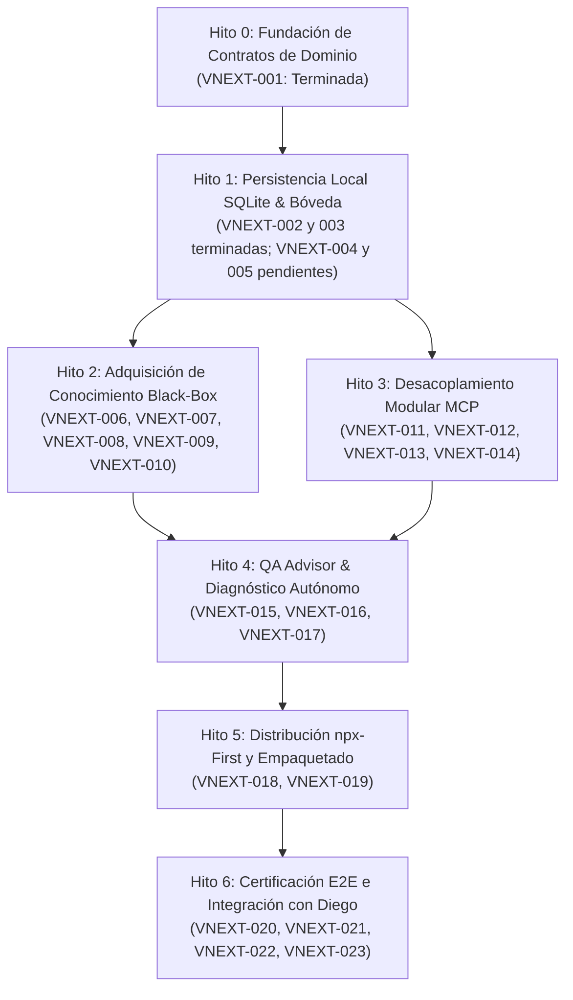

# QAMCP vNext — Backlog Preliminar y WBS Desglosado

- **Documento:** `04_BACKLOG_Y_WBS_PRELIMINAR.md`
- **Rama:** `feat/qap-vnext-architecture`
- **Autor / Rol:** Principal Software Architect y Teamwork Lead
- **Fecha:** Octubre 2026 (Revisión Arquitectónica Profunda — Etapa 0 Corregida)
- **Estado:** VNEXT-001 a VNEXT-003 terminadas por autorización expresa. VNEXT-004 y posteriores pendientes de autorización.
- **Referencias:** D-010 (Evolución documentada por etapas), D-001 a D-015.

---

## 1. Estructura General y Dependencias Reales entre Hitos

Conforme a la directiva **D-010** y la corrección de inconsistencias de numeración del WBS, el trabajo se organiza en **7 Hitos Secuenciales (Hito 0 a Hito 6)** numerados de forma estrictamente continua (**VNEXT-001 a VNEXT-023**).

> [!IMPORTANT]
> **Estado de Autorización:** La continuidad del 2026-10-28 autorizó VNEXT-003, implementada y verificada. VNEXT-004 y posteriores requieren autorización nueva. Continuidad: [STATE.md](STATE.md).

---

## 2. Catálogo Detallado de Micro-Tareas (WBS)

### Hito 0: Fundación de Contratos de Dominio

#### `VNEXT-001` — Definición del Modelo de Dominio y Contratos de Conocimiento en Validación Empírica
- **Estado:** Terminada previamente (commit base ffb5031); contratos canónicos presentes y 145 tests shared verificados durante VNEXT-002.
- **Paquetes afectados:** `@qap/shared`.
- **Dependencias:** Ninguna (Fundacional).
- **Riesgo:** Bajo.
- **Alcance:** Definir los contratos de dominio TypeScript y esquemas de validación necesarios para:
  1. Distinguir formalmente cuatro planos epistemológicos: `ApplicationObservation` (lo observado), `AgentInference` (lo inferido), `ExpectedRequirement` (el requisito esperado) y `ConformityAssessment` (la verificación de conformidad).
  2. Modelar dimensiones contextuales ricas: aplicaciones, entornos, roles y permisos (RBAC), prerrequisitos, sesiones activas, políticas de limpieza del navegador (`clean_cache`, `fresh_context`, `retain_session`) y evidencias multimodales enmascaradas.
  3. Prohibir la promoción automática de reglas de negocio a `confirmed` mediante sondas de aplicación.
  4. Admitir explícitamente resultados `indeterminate` / `inconclusive`.
  5. Soportar los escenarios reales de QA: Escenario A (App desconocida), Escenario B (Módulo nuevo) y Escenario C (Autenticación y caché).
- **Mecanismo de verificación:** `pnpm --filter @qap/shared test`, pruebas de contratos válidos, inválidos y contradictorios, compilación y pruebas de consumidores relevantes.
- **Criterios de aceptación:**
  - Tipos exportados formalmente en `@qap/shared` sin romper compatibilidad existente.
  - Cero dependencias nativas o binarias.

---

### Hito 1: Persistencia Local SQLite y Bóveda Criptográfica

#### `VNEXT-002` — Contrato Formal `IKnowledgeStore` y Puerto de Persistencia
- **Estado:** Terminada (2026-10-28); contrato y doble en memoria verificados, sin persistencia física.
- **Paquetes afectados:** `@qap/engine` (puerto y pruebas); reutiliza entidades de `@qap/shared` sin modificarlas.
- **Dependencias:** `VNEXT-001`.
- **Riesgo:** Bajo.
- **Alcance realizado:** `packages/engine/src/knowledge-store.port.ts`, exportado por Engine: lecturas tipadas, consultas paginadas, commit atómico con CAS, historial y referencias con revisiones, aislamiento y errores tipados. Se corrigió la ubicación para evitar `engine → knowledge → engine`. Búsqueda léxica (VNEXT-004), telemetría y snapshots se difieren; no existen métodos ficticios. [Decisión, límites y verificación](VNEXT-002_KNOWLEDGE_STORE.md).

#### `VNEXT-003` — Adaptador de Persistencia SQLite Local (`SqliteKnowledgeAdapter`)
- **Estado:** Terminada (2026-10-28), dentro de la autorización expresa de continuidad.
- **Paquetes afectados:** `@qap/knowledge`; extracción de suite de tests en `@qap/engine`, sin cambiar el puerto.
- **Dependencias:** `VNEXT-002` terminada.
- **Riesgo:** Medio; límites de plataforma/carga/E2E documentados.
- **Alcance realizado:** SQLite físico con WAL, FK diferidas, CAS, historial inmutable, sellado de referencias, transacciones y esquema v1 con migración segura solo desde base vacía. 24 contratos + 14 pruebas físicas pasan en Windows x64 con Node 22.13.1, 24.15.0 y 24.22.1. 523 tests relevantes y 10 compilaciones pasan; la suite global tiene fallos reproducidos en la base y un fallo de tiempo de route-scanner bajo carga. No se certifica E2E ni Linux/macOS. [DDL, decisiones, reproducción y límites](VNEXT-003_SQLITE_ADAPTER.md).

#### `VNEXT-004` — Motor de Búsqueda FTS5 de Selectores y Atributos UI
- **Estado:** Pendiente de autorización.
- **Paquetes afectados:** `@qap/knowledge`.
- **Dependencias:** `VNEXT-003`.
- **Riesgo:** Bajo.
- **Alcance:** Crear tabla virtual FTS5 (`action_targets_fts`) y métodos de consulta parametrizada por coincidencia léxica, atributo o etiqueta de accesibilidad.

#### `VNEXT-005` — Bóveda Criptográfica Escalonada de Credenciales (Tiered Vault)
- **Estado:** Pendiente de autorización (y sujeta a verificación empírica previa de headless CI).
- **Paquetes afectados:** `@qap/auth`.
- **Dependencias:** `VNEXT-001`.
- **Riesgo:** Medio.
- **Alcance:** Implementar `TieredCredentialVault` que gestiona secretos bajo tres niveles: Tier 1 (Keychain del SO vía keytar si está disponible), Tier 2 (Cifrado AES-256-GCM + PBKDF2 en `.qamcp/vault.enc`), y Tier 3 (Memoria efímera para sesiones ad-hoc npx). Desacoplamiento estricto de secretos respecto a la memoria de conocimiento.

---

### Hito 2: Adquisición de Conocimiento Black-Box First

#### `VNEXT-006` — Módulo de Reconocimiento Pasivo HTTP y Detección de Stack
- **Estado:** Pendiente de autorización.
- **Paquetes afectados:** `@qap/playwright-adapter`, `@qap/knowledge`.
- **Dependencias:** `VNEXT-001`, `VNEXT-003`.
- **Riesgo:** Bajo.
- **Alcance:** Implementar `ReconnaissanceService` para inspeccionar headers de seguridad, certificados SSL, tecnologías de frontend, rutas robots.txt y sitemap sin mutaciones en el servidor, produciendo `ApplicationObservation`.

#### `VNEXT-007` — Crawler Black-Box Dirigido con Playwright
- **Estado:** Pendiente de autorización.
- **Paquetes afectados:** `@qap/playwright-adapter`.
- **Dependencias:** `VNEXT-006`.
- **Riesgo:** Medio.
- **Alcance:** Construir `BlackBoxCrawler` capaz de navegar la aplicación en modo incógnito/perfil limpio, mapear rutas accesibles, menús, enlaces, formularios y botones sin mutaciones destructivas.

#### `VNEXT-008` — Interceptor de Tráfico de Red y Extracción de Endpoints
- **Estado:** Pendiente de autorización.
- **Paquetes afectados:** `@qap/playwright-adapter`.
- **Dependencias:** `VNEXT-007`.
- **Riesgo:** Bajo.
- **Alcance:** Capturar llamadas XHR/Fetch generadas por la UI durante la navegación pasiva, extrayendo endpoints, métodos HTTP, query params y códigos de respuesta típicos con enmascaramiento de PII.

#### `VNEXT-009` — Motor de Inferencia de Hipótesis y Asignación de Certeza
- **Estado:** Pendiente de autorización.
- **Paquetes afectados:** `@qap/knowledge`.
- **Dependencias:** `VNEXT-007`, `VNEXT-008`.
- **Riesgo:** Medio.
- **Alcance:** Algoritmo que procesa los datos extraídos por el crawler y genera entidades con estado `inferred`, calculando `confidence_score` empírico y vinculando la evidencia correspondiente.

#### `VNEXT-010` — Sondas de Observación Activa No Destructiva
- **Estado:** Pendiente de autorización.
- **Paquetes afectados:** `@qap/playwright-adapter`, `@qap/knowledge`.
- **Dependencias:** `VNEXT-009`.
- **Riesgo:** Medio.
- **Alcance:** Ejecutor de sondas seguras (ej. submit vacío para detonar mensajes de validación). **Regla D-011:** Comprueba reproducibilidad y consistencia observacional; no promueve reglas a `confirmed`.

---

### Hito 3: Desacoplamiento Modular del Servidor MCP

#### `VNEXT-011` — Arquitectura de Handlers Declarativos para MCP
- **Estado:** Pendiente de autorización.
- **Paquetes afectados:** `@qap/mcp`.
- **Dependencias:** `VNEXT-001`, `VNEXT-002`.
- **Riesgo:** Medio.
- **Alcance:** Crear infraestructura de despachador declarativo (`src/dispatcher.ts`) e interfaz `IMcpToolHandler`. Eliminar supresión de reglas ESLint en `@qap/mcp`.

#### `VNEXT-012` — Migración de Handlers de Información y Estado (`status`, `clean`, `context`)
- **Estado:** Pendiente de autorización.
- **Paquetes afectados:** `@qap/mcp`.
- **Dependencias:** `VNEXT-011`, `VNEXT-003`.
- **Riesgo:** Bajo.
- **Alcance:** Implementar `status.handler.ts`, `clean.handler.ts` y `context.handler.ts` conectándolos directamente al nuevo `IKnowledgeStore`.

#### `VNEXT-013` — Handler de Descubrimiento Autónomo (`discovery.handler.ts`)
- **Estado:** Pendiente de autorización.
- **Paquetes afectados:** `@qap/mcp`.
- **Dependencias:** `VNEXT-011`, `VNEXT-009`.
- **Riesgo:** Medio.
- **Alcance:** Conectar la tool `qap_discover` con el crawler black-box, devolviendo el resumen estructurado de hallazgos.

#### `VNEXT-014` — Conexión Real de `qap_plan` y `qap_test` (Eliminación de Mocks)
- **Estado:** Pendiente de autorización.
- **Paquetes afectados:** `@qap/mcp`, `@qap/playwright-runner`.
- **Dependencias:** `VNEXT-011`, `VNEXT-003`.
- **Riesgo:** Alto.
- **Alcance:** Eliminar las respuestas estáticas mockeadas (`estado: 'en_desarrollo'`). Conectar `qap_plan` con el planificador DAG y `qap_test` con `PlaywrightRunner`.

---

### Hito 4: QA Advisor y Diagnóstico Autónomo

#### `VNEXT-015` — Motor de Cálculo de Impacto y Blast Radius
- **Estado:** Pendiente de autorización.
- **Paquetes afectados:** `@qap/engine`, `@qap/knowledge`.
- **Dependencias:** `VNEXT-003`, `VNEXT-009`.
- **Riesgo:** Medio.
- **Alcance:** Construir `ImpactAnalyzer` para calcular módulos y flujos dependientes afectados en el DAG ante cambios.

#### `VNEXT-016` — Implementación del Asesor Interactivo de QA (`qap_advisor`)
- **Estado:** Pendiente de autorización.
- **Paquetes afectados:** `@qap/engine`, `@qap/mcp`.
- **Dependencias:** `VNEXT-015`.
- **Riesgo:** Medio.
- **Alcance:** Construir el servicio de consultoría interactiva (D-008) y exponer la tool `qap_advisor`. Presenta blast radius, sugiere alcances y formula preguntas estructuradas cuando sea necesario.

#### `VNEXT-017` — Clasificador Autónomo de Anomalías y Defectos con Soporte Indeterminado
- **Estado:** Pendiente de autorización.
- **Paquetes afectados:** `@qap/engine`.
- **Dependencias:** `VNEXT-014`.
- **Riesgo:** Medio.
- **Alcance:** Motor de diagnóstico (D-014) que clasifica incidentes en `product_bug`, `environment_error`, `automation_flakiness`, `blocked_flow` o `indeterminate`. Prohibido emitir diagnósticos concluyentes basados exclusivamente en HTTP status codes.

---

### Hito 5: Distribución `npx-First` y Portabilidad Cero-Config

#### `VNEXT-018` — Configuración de Empaquetado `tsup` Standalone
- **Estado:** Pendiente de autorización (sujeta a verificación de Node.js y Playwright).
- **Paquetes afectados:** `@hyouka73/qap-cli`, `@qap/mcp`.
- **Dependencias:** `VNEXT-014`, `VNEXT-005`.
- **Riesgo:** Medio.
- **Alcance:** Configurar bundle autocontenido con `tsup` que empaquete `@qap/*` dentro de `dist/entrypoint.js` para distribución npx sin dependencias nativas obligatorias.

#### `VNEXT-019` — Comando de Inicialización y Auto-Configuración MCP
- **Estado:** Pendiente de autorización.
- **Paquetes afectados:** `@hyouka73/qap-cli`.
- **Dependencias:** `VNEXT-018`.
- **Riesgo:** Bajo.
- **Alcance:** Implementar registro desatendido para Claude Desktop, Cursor y Antigravity.

---

### Hito 6: Certificación E2E e Integración con Diego

#### `VNEXT-020` — Suite de Pruebas E2E de Aceptación Black-Box
- **Estado:** Pendiente de autorización.
- **Paquetes afectados:** Monorepo completo.
- **Dependencias:** `VNEXT-014`, `VNEXT-016`, `VNEXT-019`.
- **Riesgo:** Medio.
- **Alcance:** Prueba integral de ciclo completo: descubrimiento -> inferencias -> asesoría QA -> ejecución autónoma -> reporte.

#### `VNEXT-021` — Documentación Técnica de vNext y Manual de Migración
- **Estado:** Pendiente de autorización.
- **Paquetes afectados:** `docs/vnext/`.
- **Dependencias:** `VNEXT-020`.
- **Riesgo:** Bajo.
- **Alcance:** Guía de uso CLI, manual MCP, contratos de datos y guía de contribución.

#### `VNEXT-022` — Sincronización y Validación Cruzada con `develop` (Diego)
- **Estado:** Pendiente de autorización.
- **Paquetes afectados:** Todos los paquetes compartidos.
- **Dependencias:** `VNEXT-020`.
- **Riesgo:** Alto.
- **Alcance:** Sesión formal de integración con Diego asegurando que las suites de prueba de ambas líneas se mantengan en verde.

#### `VNEXT-023` — Verificación de Release y Despliegue Piloto en NPM
- **Estado:** Pendiente de autorización.
- **Paquetes afectados:** `@hyouka73/qap-cli`, `@qap/mcp`.
- **Dependencias:** `VNEXT-022`.
- **Riesgo:** Medio.
- **Alcance:** Verificación final en máquina limpia vía `npx @hyouka73/qap-mcp`.
