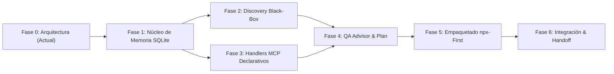

# QAMCP vNext — Backlog Preliminar y WBS Desglosado

- **Documento:** `04_BACKLOG_Y_WBS_PRELIMINAR.md`
- **Rama:** `feat/qap-vnext-architecture`
- **Autor / Rol:** Principal Software Architect y Teamwork Lead
- **Fecha:** Octubre 2026
- **Estado:** Plan de Trabajo Desglosado en Micro-Tareas (Etapa 0)
- **Referencias:** D-010 (Evolución documentada por etapas), D-001 a D-009.

---

## 1. Estructura General del Plan de Trabajo por Fases

Conforme a la directiva **D-010**, ninguna refactorización se ejecutará en bloque ni en un solo prompt masivo. El trabajo se descompone en **24 micro-tareas atómicas** agrupadas en 6 fases secuenciales e independientes. Cada tarea cuenta con su mecanismo de verificación objetiva y criterios de aceptación específicos.

---

## 2. Catálogo Detallado de Micro-Tareas (WBS)

### Fase 1: Núcleo de Memoria Relacional y Contratos (`@qap/shared` y `@qap/knowledge`)

#### `VNEXT-001` — Definición de Tipos y Esquemas de Conocimiento Unificado
- **Paquetes afectados:** `@qap/shared`.
- **Dependencias:** Ninguna (Base).
- **Riesgo:** Bajo. **Paralelizable:** Sí (Pista A).
- **Alcance:** Definir interfaces TypeScript y esquemas AJV para `CertaintyState`, `KnowledgeProvenance`, `Module`, `View`, `ActionTarget`, `BusinessRule`, `FlowScenario`, `DependencyEdge` y `Defect`.
- **Mecanismo de verificación:** `pnpm --filter @qap/shared test`. Validación de esquemas con datos sintéticos válidos e inválidos.
- **Criterios de aceptación:**
  - Tipos exportados en `@qap/shared`.
  - 100% de esquemas AJV compilando sin advertencias.
  - Cero dependencias nativas externas.

#### `VNEXT-002` — Contrato Formal `IKnowledgeStore` y Puerto de Persistencia
- **Paquetes afectados:** `@qap/knowledge`, `@qap/shared`.
- **Dependencias:** `VNEXT-001`.
- **Riesgo:** Bajo. **Paralelizable:** Sí (Pista A).
- **Alcance:** Crear la interfaz formal `IKnowledgeStore` en `@qap/knowledge/src/ports/knowledge-store.port.ts`, especificando métodos atómicos de lectura, escritura, transacciones y búsqueda.
- **Mecanismo de verificación:** Pruebas de contrato utilizando una implementación mock en memoria (`InMemoryKnowledgeStore.spec.ts`).
- **Criterios de aceptación:**
  - La interfaz cubre el 100% de operaciones CRUD de entidades, búsqueda FTS, cálculo de dependencias y registro de telemetría.
  - Firma agnóstica del motor (sin referencias a SQL ni a tipos de filesystem en la interfaz pública).

#### `VNEXT-003` — Adaptador de Persistencia SQLite Local (`SqliteKnowledgeAdapter`)
- **Paquetes afectados:** `@qap/knowledge`.
- **Dependencias:** `VNEXT-002`.
- **Riesgo:** Medio. **Paralelizable:** No (Ruta Crítica).
- **Alcance:** Implementar `SqliteKnowledgeAdapter` utilizando el módulo nativo `node:sqlite` (`DatabaseSync`). Configurar modo WAL, foreign keys y transacciones atómicas. Crear DDL de tablas e índices FTS5.
- **Mecanismo de verificación:** Suite de pruebas unitarias y de estrés en disco (`sqlite-knowledge-adapter.test.ts`): inserción, actualización, eliminación en cascada y benchmarks de lectura < 5 ms.
- **Criterios de aceptación:**
  - Operación exitosa en base de datos física (`.qamcp/knowledge.sqlite`) y en memoria (`:memory:`).
  - Cero dependencias nativas de npm (usa exclusivamente `node:sqlite`).
  - Resistencia a bloqueos y manejo de errores con rollbacks transaccionales garantizados.

#### `VNEXT-004` — Motor de Búsqueda FTS5 de Selectores y Atributos UI
- **Paquetes afectados:** `@qap/knowledge`.
- **Dependencias:** `VNEXT-003`.
- **Riesgo:** Bajo. **Paralelizable:** Sí (Pista A).
- **Alcance:** Crear tabla virtual FTS5 (`action_targets_fts`) y métodos de consulta parametrizada por coincidencia léxica, atributo o etiqueta de accesibilidad.
- **Mecanismo de verificación:** Test automatizado comparando búsqueda secuencial vs FTS5 con 500 selectores sintéticos.
- **Criterios de aceptación:**
  - Resolución de queries como `'submit button'` o `'checkout input'` en menos de 10 microsegundos.
  - Reducción del tamaño de respuesta a menos de 150 tokens por búsqueda.

#### `VNEXT-005` — Pipeline de Ingesta y Adaptador de Proyectos Legacy
- **Paquetes afectados:** `@qap/knowledge`.
- **Dependencias:** `VNEXT-003`.
- **Riesgo:** Bajo. **Paralelizable:** Sí (Pista A).
- **Alcance:** Crear `LegacyFilesystemImporter` para leer estructuras existentes de `.qa/` (`context.yaml`, `rules.yaml`, `selectors.json`) y cargarlas transparentemente en SQLite preservando hashes y procedencia.
- **Mecanismo de verificación:** Test de ingestión sobre un fixture con la estructura canónica de QAP v2.1.
- **Criterios de aceptación:**
  - Ingestión de 40 módulos completada en menos de 300 ms.
  - Cero modificaciones ni eliminaciones en los archivos fuente YAML originales.

---

### Fase 2: Adquisición de Conocimiento Black-Box First (`@qap/playwright-adapter`)

#### `VNEXT-006` — Módulo de Reconocimiento Pasivo HTTP y Detección de Stack
- **Paquetes afectados:** `@qap/playwright-adapter`, `@qap/knowledge`.
- **Dependencias:** `VNEXT-001`.
- **Riesgo:** Bajo. **Paralelizable:** Sí (Pista B).
- **Alcance:** Implementar `ReconnaissanceService` para inspeccionar headers de seguridad, certificados SSL, tecnologías de frontend (React, Angular, Vue, Next.js), rutas robots.txt y sitemap.
- **Mecanismo de verificación:** Test unitario simulando respuestas HTTP diversas.
- **Criterios de aceptación:**
  - Identifica correctamente tecnologías y genera entidad de entorno en memoria con `status: 'observed'`.

#### `VNEXT-007` — Crawler Black-Box Dirigido con Playwright
- **Paquetes afectados:** `@qap/playwright-adapter`.
- **Dependencias:** `VNEXT-006`.
- **Riesgo:** Medio. **Paralelizable:** Sí (Pista B).
- **Alcance:** Construir `BlackBoxCrawler` capaz de navegar la aplicación en modo incógnito/perfil limpio, mapear rutas accesibles, menús laterales, enlaces, formularios y botones interactivos sin ejecutar mutaciones destructivas.
- **Mecanismo de verificación:** Test con servidor web local mockeado conteniendo formularios, tablas y navegación SPA.
- **Criterios de aceptación:**
  - Extrae árbol de vistas y selectores deterministas sin lanzar excepciones no controladas.
  - Respeta políticas de entorno (`safe_domains`, `destructive_allowed: false`).

#### `VNEXT-008` — Interceptor de Tráfico de Red y Extracción de Endpoints
- **Paquetes afectados:** `@qap/playwright-adapter`.
- **Dependencias:** `VNEXT-007`.
- **Riesgo:** Bajo. **Paralelizable:** Sí (Pista B).
- **Alcance:** Capturar llamadas XHR/Fetch generadas por la UI durante la navegación pasiva, extrayendo endpoints, métodos HTTP, query params y códigos de respuesta típicos.
- **Mecanismo de verificación:** Test con llamadas Fetch interceptadas y parseadas a entidades de API en memoria.
- **Criterios de aceptación:**
  - Asocia automáticamente endpoints detectados a la vista activa correspondiente.
  - Enmascara tokens de autorización o passwords presentes en payloads.

#### `VNEXT-009` — Motor de Inferencia de Hipótesis y Asignación de Certeza
- **Paquetes afectados:** `@qap/knowledge`.
- **Dependencias:** `VNEXT-007`, `VNEXT-008`, `VNEXT-003`.
- **Riesgo:** Medio. **Paralelizable:** No (Ruta Crítica).
- **Alcance:** Algoritmo que procesa los datos extraídos por el crawler y genera entidades de Módulos, Vistas y Reglas con `certainty_state: 'inferred'`, calculando `confidence_score` empírico.
- **Mecanismo de verificación:** Test verificando la correcta asignación de scores (ej. 0.6 para elemento DOM visible, 0.85 si se correlaciona con endpoint de red).
- **Criterios de aceptación:**
  - Cada hipótesis queda vinculada a su evidencia técnica (procedencia, selector, captura o respuesta HTTP).

#### `VNEXT-010` — Sondas de Validación Activa No Destructiva
- **Paquetes afectados:** `@qap/playwright-adapter`, `@qap/knowledge`.
- **Dependencias:** `VNEXT-009`.
- **Riesgo:** Medio. **Paralelizable:** Sí (Pista B).
- **Alcance:** Ejecutor de sondas seguras (ej. presionar botón de envío con formulario vacío para disparar validaciones de campos requeridos; ingresar datos sintéticos inocuos en inputs de búsqueda).
- **Mecanismo de verificación:** Test funcional contra un formulario mock de login y registro.
- **Criterios de aceptación:**
  - Promueve hipótesis a `confidence_score >= 0.9` al corroborar mensajes de error esperados.
  - Aborta inmediatamente si detecta que la acción podría ser destructiva (D-003).

---

### Fase 3: Desacoplamiento Modular del Servidor MCP (`@qap/mcp`)

#### `VNEXT-011` — Arquitectura de Handlers Declarativos para MCP
- **Paquetes afectados:** `@qap/mcp`.
- **Dependencias:** `VNEXT-001`.
- **Riesgo:** Medio. **Paralelizable:** Sí (Pista C).
- **Alcance:** Crear infraestructura de despachador declarativo (`src/dispatcher.ts`) e interfaz `IMcpToolHandler`. Eliminar supresión de reglas ESLint en `@qap/mcp`.
- **Mecanismo de verificación:** Test de registro y despacho de herramientas mockeando el SDK de MCP.
- **Criterios de aceptación:**
  - Reemplaza el switch-case monolítico por un mapa desacoplado de handlers.
  - Validación de esquemas de entrada y salida mediante tipos fuertemente tipados.

#### `VNEXT-012` — Migración de Handlers de Información y Estado (`status`, `clean`, `context`)
- **Paquetes afectados:** `@qap/mcp`.
- **Dependencias:** `VNEXT-011`, `VNEXT-003`.
- **Riesgo:** Bajo. **Paralelizable:** Sí (Pista C).
- **Alcance:** Implementar `status.handler.ts`, `clean.handler.ts` y `context.handler.ts` conectándolos directamente al nuevo `IKnowledgeStore`.
- **Mecanismo de verificación:** Replicar y pasar los tests existentes de ciclo de vida del servidor MCP (`p4-4-auth-lifecycle.test.ts`, etc.).
- **Criterios de aceptación:**
  - Respuestas compatibles 100% con los clientes actuales de MCP.

#### `VNEXT-013` — Handler de Descubrimiento Autónomo (`discovery.handler.ts`)
- **Paquetes afectados:** `@qap/mcp`.
- **Dependencias:** `VNEXT-011`, `VNEXT-009`.
- **Riesgo:** Medio. **Paralelizable:** Sí (Pista C).
- **Alcance:** Conectar la tool `qap_discover` con el crawler black-box, permitiendo al cliente MCP ordenar la exploración de una URL y devolver el resumen estructurado de hallazgos.
- **Mecanismo de verificación:** Test de integración MCP Stdio ejecutando descubrimiento sobre un servidor local de prueba.
- **Criterios de aceptación:**
  - La herramienta devuelve módulos y vistas descubiertas con sus niveles de confianza y advertencias de validación pendiente.

#### `VNEXT-014` — Conexión Real de `qap_plan` y `qap_test` (Eliminación de Mocks)
- **Paquetes afectados:** `@qap/mcp`, `@qap/playwright-runner`.
- **Dependencias:** `VNEXT-011`, `VNEXT-003`.
- **Riesgo:** Alto. **Paralelizable:** No (Ruta Crítica).
- **Alcance:** Eliminar las respuestas estáticas mockeadas (`estado: 'en_desarrollo'`). Conectar `qap_plan` con el planificador DAG y `qap_test` con `PlaywrightRunner`.
- **Mecanismo de verificación:** Ejecución E2E de una prueba real a través de una llamada JSON-RPC a `qap_test`.
- **Criterios de aceptación:**
  - `qap_test` ejecuta el navegador de forma autónoma, devuelve telemetría real (duración, pasos aprobados, capturas de error) y persiste el resultado en la base de datos.

---

### Fase 4: QA Advisor, Estrategias de Prueba y Orquestación Híbrida (`@qap/engine`)

#### `VNEXT-015` — Motor de Cálculo de Impacto y Blast Radius
- **Paquetes afectados:** `@qap/engine`, `@qap/knowledge`.
- **Dependencias:** `VNEXT-003`.
- **Riesgo:** Medio. **Paralelizable:** Sí (Pista D).
- **Alcance:** Construir `ImpactAnalyzer` que, dado un cambio en una vista o módulo, recorra el DAG de dependencias para calcular el conjunto mínimo de pruebas afectadas aguas arriba y aguas abajo.
- **Mecanismo de verificación:** Test con grafo de 20 nodos y dependencias complejas verificando el ordenamiento topológico y aislamiento de componentes no impactados.
- **Criterios de aceptación:**
  - Retorna lista priorizada de flujos a ejecutar con justificación de impacto.

#### `VNEXT-016` — Implementación del QA Advisor (`qap_advisor`)
- **Paquetes afectados:** `@qap/engine`, `@qap/mcp`.
- **Dependencias:** `VNEXT-015`.
- **Riesgo:** Medio. **Paralelizable:** Sí (Pista D).
- **Alcance:** Construir el servicio de consultoría técnica (D-008) y exponer la tool `qap_advisor`. Ante cualquier solicitud, propone estrategias (Smoke, Regresión, Seguridad, Integral) y formula preguntas estructuradas cuando sea estrictamente necesario.
- **Mecanismo de verificación:** Test evaluando la generación de propuestas de prueba para tres escenarios: cambio menor de UI, nuevo endpoint de API y auditoría de regresión completa.
- **Criterios de aceptación:**
  - Propone estrategias adaptadas al nivel de riesgo sin emitir muros de texto.

#### `VNEXT-017` — Clasificador Autónomo de Anomalías y Defectos
- **Paquetes afectados:** `@qap/engine`.
- **Dependencias:** `VNEXT-014`.
- **Riesgo:** Medio. **Paralelizable:** Sí (Pista D).
- **Alcance:** Motor de diagnóstico que analiza capturas de fallo, logs de red y mensajes de consola Playwright para clasificar el incidente en: `product_bug`, `environment_error`, `automation_flakiness` o `blocked_flow`.
- **Mecanismo de verificación:** Test con 4 tipos de fallos reproducidos artificialmente (error 500, error de timeout de red, selector no visible temporal, prerrequisito fallido).
- **Criterios de aceptación:**
  - Clasificación correcta al 100% en los 4 casos de prueba canónicos.
  - Generación de informe de reproducción con evidencia estructurada.

---

### Fase 5: Distribución `npx-First` y Portabilidad Cero-Config (`@hyouka73/qap-cli`)

#### `VNEXT-018` — Bóveda Criptográfica Portable (`node:crypto` AES-256-GCM)
- **Paquetes afectados:** `@qap/auth`.
- **Dependencias:** `VNEXT-001`.
- **Riesgo:** Bajo. **Paralelizable:** Sí (Pista E).
- **Alcance:** Implementar `PortableCryptoVault` para cifrar credenciales y perfiles de sesión sin depender de `keytar`. Clave derivada de variable de entorno (`QAP_MASTER_KEY`) o hash de máquina local.
- **Mecanismo de verificación:** Test de cifrado y descifrado de credenciales en Linux, macOS y Windows.
- **Criterios de aceptación:**
  - 100% libre de binarios nativos C++.
  - Si `keytar` está presente en el sistema, lo usa opcionalmente; si no, opera de forma transparente sin fallar.

#### `VNEXT-019` — Configuración de Empaquetado `tsup` Standalone
- **Paquetes afectados:** `@hyouka73/qap-cli`, `@qap/mcp`.
- **Dependencias:** `VNEXT-014`, `VNEXT-018`.
- **Riesgo:** Medio. **Paralelizable:** Sí (Pista E).
- **Alcance:** Configurar script de bundle con `tsup` que empaquete `@qap/*` dentro de un único artefacto ejecutable `dist/entrypoint.js`, listo para publicarse en npm.
- **Mecanismo de verificación:** Ejecución de `node dist/entrypoint.js --version` en un entorno sin carpetas de monorepo ni `node_modules` de desarrollo.
- **Criterios de aceptación:**
  - Bundle autocontenido sin resolución fallida de paquetes internos `workspace:*`.
  - Peso del bundle comprimido menor a 10 MB.

#### `VNEXT-020` — Comando de Inicialización y Auto-Configuración MCP
- **Paquetes afectados:** `@hyouka73/qap-cli`.
- **Dependencias:** `VNEXT-019`.
- **Riesgo:** Bajo. **Paralelizable:** Sí (Pista E).
- **Alcance:** Implementar `qap mcp register` / `npx @hyouka73/qap-mcp --register` para autodetectar clientes instalados (Claude Desktop, Cursor, Antigravity) y registrar la configuración MCP con cero intervención manual.
- **Mecanismo de verificación:** Test simulando archivos de configuración de Claude y Cursor.
- **Criterios de aceptación:**
  - Actualización limpia del JSON del cliente sin corromper configuraciones preexistentes.

---

### Fase 6: Certificación E2E, Handoff e Integración con Diego

#### `VNEXT-021` — Suite de Pruebas E2E de Aceptación Black-Box
- **Paquetes afectados:** Monorepo completo.
- **Dependencias:** `VNEXT-014`, `VNEXT-016`, `VNEXT-020`.
- **Riesgo:** Medio. **Paralelizable:** No.
- **Alcance:** Prueba integral de ciclo completo: descubrimiento de una app web local de prueba -> inferencia de hipótesis -> confirmación de reglas -> ejecución de test autónomo -> reporte de defecto.
- **Mecanismo de verificación:** Ejecución desatendida del flujo completo vía protocolo MCP.
- **Criterios de aceptación:**
  - Flujo completado de inicio a fin sin intervención manual obligatoria en rutas estándar.

#### `VNEXT-022` — Documentación Técnica de vNext y Manual de Migración
- **Paquetes afectados:** `docs/vnext/`.
- **Dependencias:** `VNEXT-021`.
- **Riesgo:** Bajo. **Paralelizable:** Sí.
- **Alcance:** Guía de uso de la CLI, manual de integración para agentes LLM, especificación de contratos de bases de datos y manual de contribución para desarrolladores.
- **Criterios de aceptación:** Documentación exhaustiva en Markdown validada.

#### `VNEXT-023` — Sincronización y Validación Cruzada con `develop` (Diego)
- **Paquetes afectados:** Todos los paquetes compartidos.
- **Dependencias:** `VNEXT-021`.
- **Riesgo:** Alto. **Paralelizable:** No.
- **Alcance:** Sesión de integración coordinada con Diego para fusionar avances de `develop` (rollback con SHA-256, inyección de storageState en PlaywrightRunner) asegurando que los 512 tests históricos continúen verdes.
- **Criterios de aceptación:** Cero regresiones en la suite unitaria de `develop`.

#### `VNEXT-024` — Verificación de Release y Despliegue Piloto en NPM
- **Paquetes afectados:** `@hyouka73/qap-cli`, `@qap/mcp`.
- **Dependencias:** `VNEXT-023`.
- **Riesgo:** Medio. **Paralelizable:** No.
- **Alcance:** Ejecución de `pnpm release:check`, validación de tags y prueba de ejecución limpia mediante `npx` en una máquina virtual limpia.
- **Criterios de aceptación:** `npx @hyouka73/qap-mcp --help` y handshake MCP responden en menos de 1 segundo.
