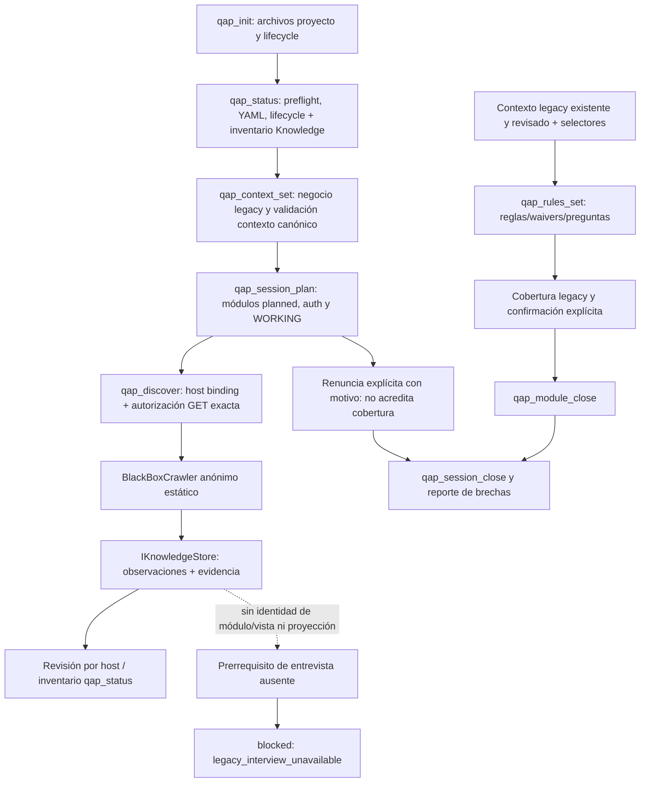

# VNEXT-013-R1 — Estabilización de contratos e integración MCP

Fecha: 2026-10-30. Base exacta: c2078213236a50b540d8fa29fe891e5dff998416.
Rama exclusiva: feat/qap-vnext-architecture. Un agente principal; no VNEXT-014.

## 1. Objetivo y dictamen

Reconciliar el descubrimiento canónico con sus consumidores sin inventar módulos,
reglas, cobertura o transiciones. **Completada con limitaciones; estabilización
funcional del recorrido completo INCOMPLETA. No apto para iniciar VNEXT-014 sobre
la premisa de que discovery alimenta las entrevistas.** VNEXT-014 no se autoriza
ni se inicia. La adquisición y la convivencia segura se verifican por separado.

## 2. Estado heredado y reproducción

Se verificaron rama, HEAD y working tree antes de editar. Único cambio previo:
sesión protegida packages/playwright-runner/.qa/cache/sessions/admin-user.json,
sin lectura, uso, hash, staging ni modificación por esta intervención.
Se leyeron STATE, WBS 012/013/014 y documentos de cierre 012/013.
No auditoría completa del monorepo; se examinaron consumidores, fixtures y fuentes
retiradas mediante Git, sin reactivar sus implementaciones.

El histórico VNEXT-013 permanece **181/241**. La reproducción anterior a la
corrección volvió a ejecutar **241 casos: 181 pasan, 60 fallan, ocho archivos**
(103.41 s, Node 24.15.0, Windows, Chrome real). El log completo de esa ejecución
es node_modules/vnext013r1-before-elevated.log. Dos intentos restringidos previos
no constituyen la línea base: uno produjo 170/241, con 11 fallos adicionales de
browser/auth/junction. Su JSON compartió destino con el intento autorizado y
sobrescribió el resumen; para la línea base se usa el log completo autorizado.
El inventario cruza sus casos con el JSON histórico, exclusivamente para identidad
y orden de los nombres; el resultado actual se obtiene del log reproducido.
Los reportes finales usan destinos exclusivos. No se clasifican esos once fallos
de infraestructura como regresiones del producto ni se atribuyen a los 60 originales.

## 3. Contratos y clasificación individual

- **D1**: switch antiguo de qap_discover, PlaywrightAdapter, sesión autenticada,
  .qa/modules, view context/selectors, hipótesis rules.yaml, preguntas y transición
  planned → observed → interviewing. Fuente: server.ts de 8ed569d y fixtures legacy.
- **D2**: DiscoveryHandler/BlackBoxCrawler VNEXT-013: binding y consentimiento exacto
  del host, contexto anónimo nuevo, JS deshabilitado, ApplicationObservation y
  evidencia en store; sin YAML, entrevista, requisitos ni avance lifecycle.
  Sin binding: blocked/knowledge_unbound; headed=true: headed_not_supported.
- **L1**: consumidores legacy suponen efectos D1 después de llamar discovery sin
  binding. Su propósito de negocio sigue vigente aunque el setup ya no lo alcanza.
- **L2**: consumidores requieren contexto legacy propio y estado válido; memoria
  canónica no lo sustituye. Esta intervención agrega legacy_interview_unavailable
  cuando falta ese prerrequisito. No restaura la transición ni simula cobertura.
- **F1**: qap_plan y qap_test continúan en_desarrollo; conectar DAG/runner pertenece
  a VNEXT-014. Auth black-box y ejecución exhaustiva JS requieren otro alcance.

Categorías A–F se aplican al primer fallo concreto y al propósito del caso, no al
archivo entero. Totales originales: A=23, B=32, C=0, D=5, E=0, F=0.
Las regresiones C adicionales encontradas por R1 se documentan aparte con pruebas
rojas/verdes. No se confunde una clasificación B con una aserción descartable.
La columna de esperado conserva el nombre histórico completo del caso; las
aserciones concretas y las líneas son verificables en el archivo indicado, bajo
packages/mcp/src/__tests__. Las líneas corresponden a la revisión R1.

| ID | Archivo y prueba histórica | Resultado anterior esperado | Resultado actual reproducido | Clase | Productor de diferencia | Contrato anterior → vigente | Efecto eliminado | ¿Regresión involuntaria? | Riesgo | Corrección correspondiente |
| --- | --- | --- | --- | --- | --- | --- | --- | --- | --- | --- |
| R01 | lifecycle-v3-e2e.test.ts:133 — E0a: qap_status en WORKING para módulo con cobertura incompleta devuelve module, view y preguntas no vacías idénticas a qap_rules_set | E0a: qap_status en WORKING para módulo con cobertura incompleta devuelve module, view y preguntas no vacías idénticas a qap_rules_set | AssertionError: expected 'trabajo' to be 'entrevista_vista' // Object.is equality | B | Consumidor legacy: status/rules/close o su fixture | L1 → D2 + L2 | Sí | Sí: integración de usuario desconectada; no evidencia de pérdida del algoritmo aislado | Entrevista/cierre inaccesibles; cobertura de negocio no alcanzada | Bloqueo explícito en producción; conservar caso activo hasta reconciliar su fixture/contrato con evidencia |
| R02 | lifecycle-v3-e2e.test.ts:240 — E1: regresión consolidated -> interviewing tras re-discover y política de waivers | E1: regresión consolidated -> interviewing tras re-discover y política de waivers | AssertionError: expected undefined to be true // Object.is equality | B | Consumidor legacy: status/rules/close o su fixture | L1 → D2 + L2 | Sí | Sí: integración de usuario desconectada; no evidencia de pérdida del algoritmo aislado | Entrevista/cierre inaccesibles; cobertura de negocio no alcanzada | Bloqueo explícito en producción; conservar caso activo hasta reconciliar su fixture/contrato con evidencia |
| R03 | lifecycle-v3-e2e.test.ts:320 — E2: qap_module_close validaciones, compuertas y transiciones | E2: qap_module_close validaciones, compuertas y transiciones | Error: ENOENT: no such file or directory, open '<TEMP>/archivo' | B | Consumidor legacy: status/rules/close o su fixture | L1 → D2 + L2 | Sí | Sí: integración de usuario desconectada; no evidencia de pérdida del algoritmo aislado | Entrevista/cierre inaccesibles; cobertura de negocio no alcanzada | Bloqueo explícito en producción; conservar caso activo hasta reconciliar su fixture/contrato con evidencia |
| R04 | lifecycle-v3-e2e.test.ts:394 — E3: canExitWorking, qap_session_close, reporte de brechas y nueva sesión desde WRAP_UP | E3: canExitWorking, qap_session_close, reporte de brechas y nueva sesión desde WRAP_UP | Error: ENOENT: no such file or directory, open '<TEMP>/archivo' | B | Consumidor legacy: status/rules/close o su fixture | L1 → D2 + L2 | Sí | Sí: integración de usuario desconectada; no evidencia de pérdida del algoritmo aislado | Entrevista/cierre inaccesibles; cobertura de negocio no alcanzada | Bloqueo explícito en producción; conservar caso activo hasta reconciliar su fixture/contrato con evidencia |
| R05 | lifecycle-v3-e2e.test.ts:502 — Criterio 9: E2E completo: init -> onboarding -> scoping -> working -> discover A -> rules_set parcial -> status (reanuda) -> rules_set completa -> module_close A -> discover B -> module_close waive B -> session_close -> status WRAP_UP -> session_plan nueva sesión | Criterio 9: E2E completo: init -> onboarding -> scoping -> working -> discover A -> rules_set parcial -> status (reanuda) -> rules_set completa -> module_close A -> discover B -> module_close waive B -> session_close -> status WRAP_UP -> session_plan nueva sesión | AssertionError: expected 'blocked' to be 'success' // Object.is equality | B | Consumidor legacy: status/rules/close o su fixture | L1 → D2 + L2 | Sí | Sí: integración de usuario desconectada; no evidencia de pérdida del algoritmo aislado | Entrevista/cierre inaccesibles; cobertura de negocio no alcanzada | Bloqueo explícito en producción; conservar caso activo hasta reconciliar su fixture/contrato con evidencia |
| R06 | p3-verification.test.ts:277 — T6: qap_discover éxito: no contiene "Descubrir otro módulo", "pregunta_doc" ni "opciones_doc"; siguiente_accion tipo entrevista_vista (<= 5 preguntas) con tool qap_rules_set, categorias_aplicables y rutas_detectadas_fuera_del_plan | T6: qap_discover éxito: no contiene "Descubrir otro módulo", "pregunta_doc" ni "opciones_doc"; siguiente_accion tipo entrevista_vista (<= 5 preguntas) con tool qap_rules_set, categorias_aplicables y rutas_detectadas_fuera_del_plan | TypeError: Cannot read properties of undefined (reading 'tipo') | A | DiscoveryHandler / precondiciones host | D1 → D2 | Sí | No: efecto retirado explícitamente en VNEXT-013 | Expectativa de navegación/archivos/transición que ya no existe | Reespecificar el caso conservando su propósito; no recuperar efectos retirados |
| R07 | p3-verification.test.ts:303 — T7: rules.yaml tras discover: reglas inferred/dom con ids deterministas; re-discover idempotente (sin duplicados, reglas confirmadas intactas) | T7: rules.yaml tras discover: reglas inferred/dom con ids deterministas; re-discover idempotente (sin duplicados, reglas confirmadas intactas) | AssertionError: expected false to be true // Object.is equality | A | DiscoveryHandler / precondiciones host | D1 → D2 | Sí | No: efecto retirado explícitamente en VNEXT-013 | Expectativa de navegación/archivos/transición que ya no existe | Reespecificar el caso conservando su propósito; no recuperar efectos retirados |
| R08 | p3-verification.test.ts:353 — T8: rules.yaml con manually_edited: true: discover no inserta reglas y lo indica | T8: rules.yaml con manually_edited: true: discover no inserta reglas y lo indica | AssertionError: expected '{\n  "status": "blocked",\n  "code": …' to contain 'manually_edited' | A | DiscoveryHandler / precondiciones host | D1 → D2 | Sí | No: efecto retirado explícitamente en VNEXT-013 | Expectativa de navegación/archivos/transición que ya no existe | Reespecificar el caso conservando su propósito; no recuperar efectos retirados |
| R09 | p3-verification.test.ts:386 — T9: Fallo de Playwright: no inserta reglas; siguiente_accion tipo decision | T9: Fallo de Playwright: no inserta reglas; siguiente_accion tipo decision | TypeError: Cannot read properties of undefined (reading 'tipo') | A | DiscoveryHandler / precondiciones host | D1 → D2 | Sí | No: efecto retirado explícitamente en VNEXT-013 | Expectativa de navegación/archivos/transición que ya no existe | Reespecificar el caso conservando su propósito; no recuperar efectos retirados |
| R10 | p3-verification.test.ts:451 — T11: Primera llamada exitosa: observed -> interviewing; ids R-001, R-002... secuenciales por módulo | T11: Primera llamada exitosa: observed -> interviewing; ids R-001, R-002... secuenciales por módulo | AssertionError: expected 'blocked' to be 'success' // Object.is equality | B | Consumidor legacy: status/rules/close o su fixture | L1 → D2 + L2 | Sí | Sí: integración de usuario desconectada; no evidencia de pérdida del algoritmo aislado | Entrevista/cierre inaccesibles; cobertura de negocio no alcanzada | Bloqueo explícito en producción; conservar caso activo hasta reconciliar su fixture/contrato con evidencia |
| R11 | p3-verification.test.ts:480 — T12: No-downgrade: regla source user confirmed no se sobrescribe con source dom/prd; waivers solo source user y reason no vacío; lote con regla inválida se rechaza completo | T12: No-downgrade: regla source user confirmed no se sobrescribe con source dom/prd; waivers solo source user y reason no vacío; lote con regla inválida se rechaza completo | AssertionError: Target cannot be null or undefined. | B | Consumidor legacy: status/rules/close o su fixture | L1 → D2 + L2 | Sí | Sí: integración de usuario desconectada; no evidencia de pérdida del algoritmo aislado | Entrevista/cierre inaccesibles; cobertura de negocio no alcanzada | Bloqueo explícito en producción; conservar caso activo hasta reconciliar su fixture/contrato con evidencia |
| R12 | p3-verification.test.ts:545 — T13: Dos llamadas concurrentes a qap_rules_set sin pérdida de actualización | T13: Dos llamadas concurrentes a qap_rules_set sin pérdida de actualización | AssertionError: expected 'blocked' to be 'success' // Object.is equality | B | Consumidor legacy: status/rules/close o su fixture | L1 → D2 + L2 | Sí | Sí: integración de usuario desconectada; no evidencia de pérdida del algoritmo aislado | Entrevista/cierre inaccesibles; cobertura de negocio no alcanzada | Bloqueo explícito en producción; conservar caso activo hasta reconciliar su fixture/contrato con evidencia |
| R13 | p3-verification.test.ts:572 — T14: qap_status WORKING: (a) observed con hipótesis reanuda entrevista; (b) interviewing incompleto reanuda; (c) planned elige high > medium > low luego orden; (d) todos completos tipo decision | T14: qap_status WORKING: (a) observed con hipótesis reanuda entrevista; (b) interviewing incompleto reanuda; (c) planned elige high > medium > low luego orden; (d) todos completos tipo decision | AssertionError: expected 'trabajo' to be 'entrevista_vista' // Object.is equality | B | Consumidor legacy: status/rules/close o su fixture | L1 → D2 + L2 | Sí | Sí: integración de usuario desconectada; no evidencia de pérdida del algoritmo aislado | Entrevista/cierre inaccesibles; cobertura de negocio no alcanzada | Bloqueo explícito en producción; conservar caso activo hasta reconciliar su fixture/contrato con evidencia |
| R14 | p3-verification.test.ts:653 — T15: E2E: flujo de P2 hasta WORKING -> discover A -> rules_set parcial -> status (reanuda A) -> rules_set completa cobertura -> status (propone B) -> discover B; ninguna respuesta del flujo contiene texto del bucle | T15: E2E: flujo de P2 hasta WORKING -> discover A -> rules_set parcial -> status (reanuda A) -> rules_set completa cobertura -> status (propone B) -> discover B; ninguna respuesta del flujo contiene texto del bucle | AssertionError: expected 'trabajo' to be 'entrevista_vista' // Object.is equality | B | Consumidor legacy: status/rules/close o su fixture | L1 → D2 + L2 | Sí | Sí: integración de usuario desconectada; no evidencia de pérdida del algoritmo aislado | Entrevista/cierre inaccesibles; cobertura de negocio no alcanzada | Bloqueo explícito en producción; conservar caso activo hasta reconciliar su fixture/contrato con evidencia |
| R15 | p4-2-pregunta-contract.test.ts:185 — Criterio 4.4: Ninguna respuesta con siguiente_accion trae preguntas como cadenas ni pregunta aplanada | Criterio 4.4: Ninguna respuesta con siguiente_accion trae preguntas como cadenas ni pregunta aplanada | AssertionError: expected true to be falsy | B | Consumidor legacy: status/rules/close o su fixture | L1 → D2 + L2 | Sí | Sí: integración de usuario desconectada; no evidencia de pérdida del algoritmo aislado | Entrevista/cierre inaccesibles; cobertura de negocio no alcanzada | Bloqueo explícito en producción; conservar caso activo hasta reconciliar su fixture/contrato con evidencia |
| R16 | p4-2-pregunta-contract.test.ts:243 — Criterio 6: E2E Completo donde TODA siguiente_accion de tipo entrevista, entrevista_vista o decision trae Pregunta válida | Criterio 6: E2E Completo donde TODA siguiente_accion de tipo entrevista, entrevista_vista o decision trae Pregunta válida | AssertionError: expected true to be falsy | B | Consumidor legacy: status/rules/close o su fixture | L1 → D2 + L2 | Sí | Sí: integración de usuario desconectada; no evidencia de pérdida del algoritmo aislado | Entrevista/cierre inaccesibles; cobertura de negocio no alcanzada | Bloqueo explícito en producción; conservar caso activo hasta reconciliar su fixture/contrato con evidencia |
| R17 | p4-3-1-b-block.test.ts:195 — B6: ninguna siguiente_accion tipo trabajo apunta a herramientas que exigen confirmación (qap_module_close, qap_session_close); constante <= 600 caracteres | B6: ninguna siguiente_accion tipo trabajo apunta a herramientas que exigen confirmación (qap_module_close, qap_session_close); constante <= 600 caracteres | AssertionError: expected true to be falsy | A | DiscoveryHandler / precondiciones host | D1 → D2 | Sí | No: efecto retirado explícitamente en VNEXT-013 | Expectativa de navegación/archivos/transición que ya no existe | Reespecificar el caso conservando su propósito; no recuperar efectos retirados |
| R18 | p4-4-auth-lifecycle.test.ts:152 — 1. qap_discover protegido sin perfil: blocked auth_required y cero escrituras en disco | 1. qap_discover protegido sin perfil: blocked auth_required y cero escrituras en disco | AssertionError: expected undefined to be 'auth_required' // Object.is equality | A | DiscoveryHandler / precondiciones host | D1 → D2 | Sí | No: efecto retirado explícitamente en VNEXT-013 | Expectativa de navegación/archivos/transición que ya no existe | Reespecificar el caso conservando su propósito; no recuperar efectos retirados |
| R19 | p4-4-auth-lifecycle.test.ts:191 — 2. qap_discover con redirección HTTP 302 a login: detecta auth_wall determinista y bloquea sin escribir | 2. qap_discover con redirección HTTP 302 a login: detecta auth_wall determinista y bloquea sin escribir | AssertionError: expected undefined to be 'auth_required' // Object.is equality | A | DiscoveryHandler / precondiciones host | D1 → D2 | Sí | No: efecto retirado explícitamente en VNEXT-013 | Expectativa de navegación/archivos/transición que ya no existe | Reespecificar el caso conservando su propósito; no recuperar efectos retirados |
| R20 | p4-4-auth-lifecycle.test.ts:213 — 3. qap_discover con login embebido en ruta no-acceso: bloquea como auth_required sin persistir | 3. qap_discover con login embebido en ruta no-acceso: bloquea como auth_required sin persistir | AssertionError: expected undefined to be 'auth_required' // Object.is equality | A | DiscoveryHandler / precondiciones host | D1 → D2 | Sí | No: efecto retirado explícitamente en VNEXT-013 | Expectativa de navegación/archivos/transición que ya no existe | Reespecificar el caso conservando su propósito; no recuperar efectos retirados |
| R21 | p4-4-auth-lifecycle.test.ts:233 — 4. qap_discover con sesión expirada: blocked session_invalid y desverifica el perfil | 4. qap_discover con sesión expirada: blocked session_invalid y desverifica el perfil | AssertionError: expected undefined to be 'session_invalid' // Object.is equality | D | Contrato de discovery restringido / capacidad futura | D1 autenticado / plan-test → D2 / F1 | Sí | No adjudicar éxito a una capacidad no disponible | Usar sesión o atribuir ejecución/JS que no ocurre | Mantener pendiente; requiere autorización específica, sin implementar VNEXT-014 ni autenticación |
| R22 | p4-4-auth-lifecycle.test.ts:306 — 5. qap_discover con perfil verificado y storageState válido: devuelve app y transiciona a observed | 5. qap_discover con perfil verificado y storageState válido: devuelve app y transiciona a observed | AssertionError: expected 'blocked' to be 'success' // Object.is equality | D | Contrato de discovery restringido / capacidad futura | D1 autenticado / plan-test → D2 / F1 | Sí | No adjudicar éxito a una capacidad no disponible | Usar sesión o atribuir ejecución/JS que no ocurre | Mantener pendiente; requiere autorización específica, sin implementar VNEXT-014 ni autenticación |
| R23 | p4-4-auth-lifecycle.test.ts:381 — 6. qap_discover en módulo de acceso: selectors.json incluye auth_selectors y omite valores y atributos sensibles de password | 6. qap_discover en módulo de acceso: selectors.json incluye auth_selectors y omite valores y atributos sensibles de password | AssertionError: expected 'blocked' to be 'success' // Object.is equality | A | DiscoveryHandler / precondiciones host | D1 → D2 | Sí | No: efecto retirado explícitamente en VNEXT-013 | Expectativa de navegación/archivos/transición que ya no existe | Reespecificar el caso conservando su propósito; no recuperar efectos retirados |
| R24 | p4-4-auth-lifecycle.test.ts:833 — 15. Guard de cliente asíncrono lento (~1200ms) en qap_discover: responde blocked auth_required y cero escrituras en .qa/modules (C3c) | 15. Guard de cliente asíncrono lento (~1200ms) en qap_discover: responde blocked auth_required y cero escrituras en .qa/modules (C3c) | AssertionError: expected undefined to be 'auth_required' // Object.is equality | D | Contrato de discovery restringido / capacidad futura | D1 autenticado / plan-test → D2 / F1 | Sí | No adjudicar éxito a una capacidad no disponible | Usar sesión o atribuir ejecución/JS que no ocurre | Mantener pendiente; requiere autorización específica, sin implementar VNEXT-014 ni autenticación |
| R25 | p4-5a-integrity.test.ts:150 — Criterio 2: regla redactada por agente sin user_text ni from_option se guarda como inferred/agent y no cuenta en cobertura | Criterio 2: regla redactada por agente sin user_text ni from_option se guarda como inferred/agent y no cuenta en cobertura | AssertionError: expected 'blocked' to be 'success' // Object.is equality | B | Consumidor legacy: status/rules/close o su fixture | L1 → D2 + L2 | Sí | Sí: integración de usuario desconectada; no evidencia de pérdida del algoritmo aislado | Entrevista/cierre inaccesibles; cobertura de negocio no alcanzada | Bloqueo explícito en producción; conservar caso activo hasta reconciliar su fixture/contrato con evidencia |
| R26 | p4-5a-integrity.test.ts:186 — Criterio 3: una etiqueta de opción predefinida del motor NO cubre una categoría | Criterio 3: una etiqueta de opción predefinida del motor NO cubre una categoría | AssertionError: expected 'blocked' to be 'success' // Object.is equality | B | Consumidor legacy: status/rules/close o su fixture | L1 → D2 + L2 | Sí | Sí: integración de usuario desconectada; no evidencia de pérdida del algoritmo aislado | Entrevista/cierre inaccesibles; cobertura de negocio no alcanzada | Bloqueo explícito en producción; conservar caso activo hasta reconciliar su fixture/contrato con evidencia |
| R27 | p4-5a-integrity.test.ts:209 — Criterio 4: un módulo con 2 reglas de 7 categorías no cierra sin accept_gaps, y cierra con él dejando registro | Criterio 4: un módulo con 2 reglas de 7 categorías no cierra sin accept_gaps, y cierra con él dejando registro | AssertionError: expected 'El módulo \'auditorias\' está en esta…' to be 'cobertura_insuficiente' // Object.is equality | B | Consumidor legacy: status/rules/close o su fixture | L1 → D2 + L2 | Sí | Sí: integración de usuario desconectada; no evidencia de pérdida del algoritmo aislado | Entrevista/cierre inaccesibles; cobertura de negocio no alcanzada | Bloqueo explícito en producción; conservar caso activo hasta reconciliar su fixture/contrato con evidencia |
| R28 | p4-5a-integrity.test.ts:262 — C9a: blocked de qap_discover con auth_required incluye razon auth_required y directorio_objetivo, con claves alineadas a session_invalid | C9a: blocked de qap_discover con auth_required incluye razon auth_required y directorio_objetivo, con claves alineadas a session_invalid | AssertionError: expected undefined to be 'auth_required' // Object.is equality | A | DiscoveryHandler / precondiciones host | D1 → D2 | Sí | No: efecto retirado explícitamente en VNEXT-013 | Expectativa de navegación/archivos/transición que ya no existe | Reespecificar el caso conservando su propósito; no recuperar efectos retirados |
| R29 | p4-5a-integrity.test.ts:417 — C4-a: from_option con pregunta_id inexistente, opcion_id inexistente o sin texto sustantivo (rechazo o degradación a agent/inferred) | C4-a: from_option con pregunta_id inexistente, opcion_id inexistente o sin texto sustantivo (rechazo o degradación a agent/inferred) | AssertionError: expected 'blocked' to be 'error' // Object.is equality | B | Consumidor legacy: status/rules/close o su fixture | L1 → D2 + L2 | Sí | Sí: integración de usuario desconectada; no evidencia de pérdida del algoritmo aislado | Entrevista/cierre inaccesibles; cobertura de negocio no alcanzada | Bloqueo explícito en producción; conservar caso activo hasta reconciliar su fixture/contrato con evidencia |
| R30 | p4-5a-integrity.test.ts:506 — C4-b: límites de sustantividad (2 palabras o 19 caracteres no cubren; 3 palabras y 20 caracteres sí) | C4-b: límites de sustantividad (2 palabras o 19 caracteres no cubren; 3 palabras y 20 caracteres sí) | Error: ENOENT: no such file or directory, open '<TEMP>/archivo' | B | Consumidor legacy: status/rules/close o su fixture | L1 → D2 + L2 | Sí | Sí: integración de usuario desconectada; no evidencia de pérdida del algoritmo aislado | Entrevista/cierre inaccesibles; cobertura de negocio no alcanzada | Bloqueo explícito en producción; conservar caso activo hasta reconciliar su fixture/contrato con evidencia |
| R31 | p4-5a-integrity.test.ts:562 — C4-c: accept_gaps con razón de 14 caracteres bloquea y con 15 cierra y deja el registro | C4-c: accept_gaps con razón de 14 caracteres bloquea y con 15 cierra y deja el registro | AssertionError: expected 'planned' to be 'closed' // Object.is equality | B | Consumidor legacy: status/rules/close o su fixture | L1 → D2 + L2 | Sí | Sí: integración de usuario desconectada; no evidencia de pérdida del algoritmo aislado | Entrevista/cierre inaccesibles; cobertura de negocio no alcanzada | Bloqueo explícito en producción; conservar caso activo hasta reconciliar su fixture/contrato con evidencia |
| R32 | p4-5a-integrity.test.ts:609 — C4-d: plan con auth.required true sin roles queda bloqueado con pregunta de roles y bloquea discover (V4) | C4-d: plan con auth.required true sin roles queda bloqueado con pregunta de roles y bloquea discover (V4) | TypeError: .toMatch() expects to receive a string, but got undefined | A | DiscoveryHandler / precondiciones host | D1 → D2 | Sí | No: efecto retirado explícitamente en VNEXT-013 | Expectativa de navegación/archivos/transición que ya no existe | Reespecificar el caso conservando su propósito; no recuperar efectos retirados |
| R33 | p4-5a-integrity.test.ts:635 — C1: campos honestos en bloqueos previos a navegar y navegación real | C1: campos honestos en bloqueos previos a navegar y navegación real | AssertionError: expected undefined to be 'auth_required' // Object.is equality | A | DiscoveryHandler / precondiciones host | D1 → D2 | Sí | No: efecto retirado explícitamente en VNEXT-013 | Expectativa de navegación/archivos/transición que ya no existe | Reespecificar el caso conservando su propósito; no recuperar efectos retirados |
| R34 | p4-5a-integrity.test.ts:691 — C3: flujo real de preguntas de categoría, formato una_opcion, persistencia y respuestas user_text y deferred | C3: flujo real de preguntas de categoría, formato una_opcion, persistencia y respuestas user_text y deferred | AssertionError: expected 'blocked' to be 'success' // Object.is equality | B | Consumidor legacy: status/rules/close o su fixture | L1 → D2 + L2 | Sí | Sí: integración de usuario desconectada; no evidencia de pérdida del algoritmo aislado | Entrevista/cierre inaccesibles; cobertura de negocio no alcanzada | Bloqueo explícito en producción; conservar caso activo hasta reconciliar su fixture/contrato con evidencia |
| R35 | p4-5a2-integrity.test.ts:114 — C1-a: módulo de acceso pedido en login sin redirección NO se bloquea (page_kind login, success) | C1-a: módulo de acceso pedido en login sin redirección NO se bloquea (page_kind login, success) | AssertionError: expected 'blocked' to be 'success' // Object.is equality | A | DiscoveryHandler / precondiciones host | D1 → D2 | Sí | No: efecto retirado explícitamente en VNEXT-013 | Expectativa de navegación/archivos/transición que ya no existe | Reespecificar el caso conservando su propósito; no recuperar efectos retirados |
| R36 | p4-5a2-integrity.test.ts:130 — C1-b: ruta protegida con redirección HTTP 302 a /login detecta auth_wall determinista y bloquea | C1-b: ruta protegida con redirección HTTP 302 a /login detecta auth_wall determinista y bloquea | AssertionError: expected undefined to be 'auth_required' // Object.is equality | A | DiscoveryHandler / precondiciones host | D1 → D2 | Sí | No: efecto retirado explícitamente en VNEXT-013 | Expectativa de navegación/archivos/transición que ya no existe | Reespecificar el caso conservando su propósito; no recuperar efectos retirados |
| R37 | p4-5a2-integrity.test.ts:147 — C1-c: ruta protegida con guard del lado del cliente detecta auth_wall con redirección al login | C1-c: ruta protegida con guard del lado del cliente detecta auth_wall con redirección al login | AssertionError: expected undefined to be 'auth_required' // Object.is equality | D | Contrato de discovery restringido / capacidad futura | D1 autenticado / plan-test → D2 / F1 | Sí | No adjudicar éxito a una capacidad no disponible | Usar sesión o atribuir ejecución/JS que no ocurre | Mantener pendiente; requiere autorización específica, sin implementar VNEXT-014 ni autenticación |
| R38 | p4-5a2-integrity.test.ts:244 — C3-a: la categoría de from_option se toma siempre de la pregunta pendiente persistida | C3-a: la categoría de from_option se toma siempre de la pregunta pendiente persistida | AssertionError: expected 'blocked' to be 'success' // Object.is equality | B | Consumidor legacy: status/rules/close o su fixture | L1 → D2 + L2 | Sí | Sí: integración de usuario desconectada; no evidencia de pérdida del algoritmo aislado | Entrevista/cierre inaccesibles; cobertura de negocio no alcanzada | Bloqueo explícito en producción; conservar caso activo hasta reconciliar su fixture/contrato con evidencia |
| R39 | p4-5a2-integrity.test.ts:293 — C3-b: si la petición declara una categoría distinta a la de la pregunta pendiente se rechaza con blocked | C3-b: si la petición declara una categoría distinta a la de la pregunta pendiente se rechaza con blocked | AssertionError: the given combination of arguments (undefined and string) is invalid for this assertion. You can use an array, a map, an object, a set, a string, or a weakset instead of a string | B | Consumidor legacy: status/rules/close o su fixture | L1 → D2 + L2 | Sí | Sí: integración de usuario desconectada; no evidencia de pérdida del algoritmo aislado | Entrevista/cierre inaccesibles; cobertura de negocio no alcanzada | Bloqueo explícito en producción; conservar caso activo hasta reconciliar su fixture/contrato con evidencia |
| R40 | p4-5a2-integrity.test.ts:366 — C4-a: respuesta corta se guarda como borrador (status inferred, source user_text, borrador true) y no cubre | C4-a: respuesta corta se guarda como borrador (status inferred, source user_text, borrador true) y no cubre | AssertionError: expected 'blocked' to be 'success' // Object.is equality | B | Consumidor legacy: status/rules/close o su fixture | L1 → D2 + L2 | Sí | Sí: integración de usuario desconectada; no evidencia de pérdida del algoritmo aislado | Entrevista/cierre inaccesibles; cobertura de negocio no alcanzada | Bloqueo explícito en producción; conservar caso activo hasta reconciliar su fixture/contrato con evidencia |
| R41 | p4-5a2-integrity.test.ts:394 — C4-b: derivación determinista en categoría actor que nombra roles emite Pregunta una_opcion directamente | C4-b: derivación determinista en categoría actor que nombra roles emite Pregunta una_opcion directamente | AssertionError: expected 'blocked' to be 'success' // Object.is equality | B | Consumidor legacy: status/rules/close o su fixture | L1 → D2 + L2 | Sí | Sí: integración de usuario desconectada; no evidencia de pérdida del algoritmo aislado | Entrevista/cierre inaccesibles; cobertura de negocio no alcanzada | Bloqueo explícito en producción; conservar caso activo hasta reconciliar su fixture/contrato con evidencia |
| R42 | p4-5a2-integrity.test.ts:424 — C4-c: envío de propuesta_enunciado válida para un borrador emite Pregunta una_opcion con las 3 opciones | C4-c: envío de propuesta_enunciado válida para un borrador emite Pregunta una_opcion con las 3 opciones | AssertionError: expected 'blocked' to be 'success' // Object.is equality | B | Consumidor legacy: status/rules/close o su fixture | L1 → D2 + L2 | Sí | Sí: integración de usuario desconectada; no evidencia de pérdida del algoritmo aislado | Entrevista/cierre inaccesibles; cobertura de negocio no alcanzada | Bloqueo explícito en producción; conservar caso activo hasta reconciliar su fixture/contrato con evidencia |
| R43 | p4-5a2-integrity.test.ts:456 — C4-d: resolver con "Es correcto" guarda regla confirmed user_confirmed con enunciado exacto y cubre | C4-d: resolver con "Es correcto" guarda regla confirmed user_confirmed con enunciado exacto y cubre | TypeError: Cannot read properties of undefined (reading 'id') | B | Consumidor legacy: status/rules/close o su fixture | L1 → D2 + L2 | Sí | Sí: integración de usuario desconectada; no evidencia de pérdida del algoritmo aislado | Entrevista/cierre inaccesibles; cobertura de negocio no alcanzada | Bloqueo explícito en producción; conservar caso activo hasta reconciliar su fixture/contrato con evidencia |
| R44 | p4-5a2-integrity.test.ts:503 — C4-e: resolver con "Lo defino después" guarda regla deferred y no cubre | C4-e: resolver con "Lo defino después" guarda regla deferred y no cubre | TypeError: Cannot read properties of undefined (reading 'id') | B | Consumidor legacy: status/rules/close o su fixture | L1 → D2 + L2 | Sí | Sí: integración de usuario desconectada; no evidencia de pérdida del algoritmo aislado | Entrevista/cierre inaccesibles; cobertura de negocio no alcanzada | Bloqueo explícito en producción; conservar caso activo hasta reconciliar su fixture/contrato con evidencia |
| R45 | p4-5a2-integrity.test.ts:543 — C4-f: propuesta_enunciado corta o genérica es rechazada con status error | C4-f: propuesta_enunciado corta o genérica es rechazada con status error | AssertionError: expected 'blocked' to be 'error' // Object.is equality | B | Consumidor legacy: status/rules/close o su fixture | L1 → D2 + L2 | Sí | Sí: integración de usuario desconectada; no evidencia de pérdida del algoritmo aislado | Entrevista/cierre inaccesibles; cobertura de negocio no alcanzada | Bloqueo explícito en producción; conservar caso activo hasta reconciliar su fixture/contrato con evidencia |
| R46 | p4-5a2-integrity.test.ts:719 — C10-a: página app/login sin elementos interactivos genera advertencia extraccion_vacia y trabajo | C10-a: página app/login sin elementos interactivos genera advertencia extraccion_vacia y trabajo | AssertionError: expected 'blocked' to be 'success' // Object.is equality | A | DiscoveryHandler / precondiciones host | D1 → D2 | Sí | No: efecto retirado explícitamente en VNEXT-013 | Expectativa de navegación/archivos/transición que ya no existe | Reespecificar el caso conservando su propósito; no recuperar efectos retirados |
| R47 | p4-5a2-integrity.test.ts:741 — C10-b: página con al menos un elemento interactivo no genera advertencia extraccion_vacia | C10-b: página con al menos un elemento interactivo no genera advertencia extraccion_vacia | AssertionError: expected 'blocked' to be 'success' // Object.is equality | A | DiscoveryHandler / precondiciones host | D1 → D2 | Sí | No: efecto retirado explícitamente en VNEXT-013 | Expectativa de navegación/archivos/transición que ya no existe | Reespecificar el caso conservando su propósito; no recuperar efectos retirados |
| R48 | p4-5a2-integrity.test.ts:757 — C10-c: la advertencia extraccion_vacia es agnóstica de la aplicación | C10-c: la advertencia extraccion_vacia es agnóstica de la aplicación | AssertionError: expected 'blocked' to be 'success' // Object.is equality | A | DiscoveryHandler / precondiciones host | D1 → D2 | Sí | No: efecto retirado explícitamente en VNEXT-013 | Expectativa de navegación/archivos/transición que ya no existe | Reespecificar el caso conservando su propósito; no recuperar efectos retirados |
| R49 | p4-5a2-integrity.test.ts:817 — C1-c: módulo con tilde preserva nombre en lifecycle, crea directorio y normaliza pending_questions con transliteración NFD | C1-c: módulo con tilde preserva nombre en lifecycle, crea directorio y normaliza pending_questions con transliteración NFD | AssertionError: expected false to be true // Object.is equality | B | Consumidor legacy: status/rules/close o su fixture | L1 → D2 + L2 | Sí | Sí: integración de usuario desconectada; no evidencia de pérdida del algoritmo aislado | Entrevista/cierre inaccesibles; cobertura de negocio no alcanzada | Bloqueo explícito en producción; conservar caso activo hasta reconciliar su fixture/contrato con evidencia |
| R50 | p4-5a2-integrity.test.ts:849 — C2-seguimiento: selección de "Corregir" emite pregunta de seguimiento y no persiste regla espuria en rules.yaml | C2-seguimiento: selección de "Corregir" emite pregunta de seguimiento y no persiste regla espuria en rules.yaml | AssertionError: expected undefined to be defined | B | Consumidor legacy: status/rules/close o su fixture | L1 → D2 + L2 | Sí | Sí: integración de usuario desconectada; no evidencia de pérdida del algoritmo aislado | Entrevista/cierre inaccesibles; cobertura de negocio no alcanzada | Bloqueo explícito en producción; conservar caso activo hasta reconciliar su fixture/contrato con evidencia |
| R51 | server.test.ts:212 — debe descubrir modulos y responder en desarrollo para qap_plan y qap_test | debe descubrir modulos y responder en desarrollo para qap_plan y qap_test | AssertionError: expected true to be falsy | D | Contrato de discovery restringido / capacidad futura | D1 autenticado / plan-test → D2 / F1 | Sí | No adjudicar éxito a una capacidad no disponible | Usar sesión o atribuir ejecución/JS que no ocurre | Mantener pendiente; requiere autorización específica, sin implementar VNEXT-014 ni autenticación |
| R52 | server.test.ts:586 — el contexto de vista generado por qap_discover debe validar contra module-view.schema.json (Criterio 4) | el contexto de vista generado por qap_discover debe validar contra module-view.schema.json (Criterio 4) | AssertionError: expected true to be falsy | A | DiscoveryHandler / precondiciones host | D1 → D2 | Sí | No: efecto retirado explícitamente en VNEXT-013 | Expectativa de navegación/archivos/transición que ya no existe | Reespecificar el caso conservando su propósito; no recuperar efectos retirados |
| R53 | server.test.ts:655 — qap_discover con contexto de vista inválido no debe escribir archivos y debe retornar error (Criterio 4) | qap_discover con contexto de vista inválido no debe escribir archivos y debe retornar error (Criterio 4) | AssertionError: expected 'blocked' to be 'error' // Object.is equality | A | DiscoveryHandler / precondiciones host | D1 → D2 | Sí | No: efecto retirado explícitamente en VNEXT-013 | Expectativa de navegación/archivos/transición que ya no existe | Reespecificar el caso conservando su propósito; no recuperar efectos retirados |
| R54 | server.test.ts:736 — E0a: qap_discover valida contra module-view.schema.json en camino de fallo de Playwright | E0a: qap_discover valida contra module-view.schema.json en camino de fallo de Playwright | AssertionError: expected true to be falsy | A | DiscoveryHandler / precondiciones host | D1 → D2 | Sí | No: efecto retirado explícitamente en VNEXT-013 | Expectativa de navegación/archivos/transición que ya no existe | Reespecificar el caso conservando su propósito; no recuperar efectos retirados |
| R55 | server.test.ts:800 — E0b: qap_discover valida contra module-view.schema.json en vista de autenticacion con session_saved true | E0b: qap_discover valida contra module-view.schema.json en vista de autenticacion con session_saved true | AssertionError: expected true to be falsy | A | DiscoveryHandler / precondiciones host | D1 → D2 | Sí | No: efecto retirado explícitamente en VNEXT-013 | Expectativa de navegación/archivos/transición que ya no existe | Reespecificar el caso conservando su propósito; no recuperar efectos retirados |
| R56 | server.test.ts:864 — E0c: qap_discover valida contra module-view.schema.json en vista con routes_found vacio | E0c: qap_discover valida contra module-view.schema.json en vista con routes_found vacio | AssertionError: expected true to be falsy | A | DiscoveryHandler / precondiciones host | D1 → D2 | Sí | No: efecto retirado explícitamente en VNEXT-013 | Expectativa de navegación/archivos/transición que ya no existe | Reespecificar el caso conservando su propósito; no recuperar efectos retirados |
| R57 | server.test.ts:1245 — qap_discover: gating por fase y estado de modulo, actualizacion planned -> observed | qap_discover: gating por fase y estado de modulo, actualizacion planned -> observed | AssertionError: expected undefined to be 'ONBOARDING' // Object.is equality | A | DiscoveryHandler / precondiciones host | D1 → D2 | Sí | No: efecto retirado explícitamente en VNEXT-013 | Expectativa de navegación/archivos/transición que ya no existe | Reespecificar el caso conservando su propósito; no recuperar efectos retirados |
| R58 | server.test.ts:1348 — Criterio 7: Proyecto legacy sin campos de negocio valida contra el schema y qap_status responde con fase WORKING derivada | Criterio 7: Proyecto legacy sin campos de negocio valida contra el schema y qap_status responde con fase WORKING derivada | AssertionError: expected 'blocked' to be 'success' // Object.is equality | B | Consumidor legacy: status/rules/close o su fixture | L1 → D2 + L2 | Sí | Sí: integración de usuario desconectada; no evidencia de pérdida del algoritmo aislado | Entrevista/cierre inaccesibles; cobertura de negocio no alcanzada | Bloqueo explícito en producción; conservar caso activo hasta reconciliar su fixture/contrato con evidencia |
| R59 | server.test.ts:1414 — Criterio 8 (E2E): init -> status (entrevista) -> ingest -> context_set compuerta -> auto-SCOPING -> session_plan -> auto-WORKING -> discover | Criterio 8 (E2E): init -> status (entrevista) -> ingest -> context_set compuerta -> auto-SCOPING -> session_plan -> auto-WORKING -> discover | AssertionError: expected undefined to be 'ONBOARDING' // Object.is equality | B | Consumidor legacy: status/rules/close o su fixture | L1 → D2 + L2 | Sí | Sí: integración de usuario desconectada; no evidencia de pérdida del algoritmo aislado | Entrevista/cierre inaccesibles; cobertura de negocio no alcanzada | Bloqueo explícito en producción; conservar caso activo hasta reconciliar su fixture/contrato con evidencia |
| R60 | server.test.ts:1546 — qap_rules_set: actualiza reglas, transiciona observed -> interviewing, recalcula cobertura y actualiza guidance | qap_rules_set: actualiza reglas, transiciona observed -> interviewing, recalcula cobertura y actualiza guidance | AssertionError: expected 'planned' to be 'observed' // Object.is equality | B | Consumidor legacy: status/rules/close o su fixture | L1 → D2 + L2 | Sí | Sí: integración de usuario desconectada; no evidencia de pérdida del algoritmo aislado | Entrevista/cierre inaccesibles; cobertura de negocio no alcanzada | Bloqueo explícito en producción; conservar caso activo hasta reconciliar su fixture/contrato con evidencia |

## 4. Consumidores reales y grafo



| Artefacto / entidad | Productor vigente | Consumidores comprobados y límites |
| --- | --- | --- |
| .qa/modules/ | Datos legacy preexistentes / edición de reglas solo con prerrequisitos | FileSystemStorage.listModules/index, StatusHandler, rules_set, module_close/session_close; reporter/viewer, backup/hasher/prereqs. Discovery no escribe aquí. |
| module.yaml / view.yaml | No son los nombres consumidos por este recorrido | La búsqueda en fuentes TypeScript no encontró lectores literales de esos nombres. Los archivos reales son context.yaml (proyecto/módulo/vista), summary.json, selectors.json y rules.yaml. No crear aliases ficticios. |
| views/default/context.yaml y contexto plano de módulo | Contrato legacy previo | getModuleContext admite fallback plano; buildViewDiscoveryContext lee contexto granular. Su existencia es prerrequisito estructural, nunca prueba de cobertura ni de revisión humana. |
| selectors.json | Legacy previo; crawler no materializa este archivo | buildViewDiscoveryContext, rules_set, FileSystemStorage.getModuleSelectors, semantic-hasher/backup. Selectores estructurales del crawler no equivalen a selectores ejecutables certificados. |
| rules.yaml | rules_set, confirmación/waivers legacy | status/interview, coverage, module_close, session gap report, plan backups. Inferencias no se convierten en reglas confirmadas. |
| ApplicationObservation | BlackBoxCrawler y otros servicios ya existentes | StatusHandler vía knowledgeStatus consulta una página/inventario; KnowledgeInferenceEngine consume observaciones cuando el host lo invoca explícitamente. tools legacy de reglas/cierre no consultan esta entidad. |
| AgentInference | KnowledgeInferenceEngine (sin invocación automática MCP) | status inventaría inferencias; discovery/rules/close no las promueven ni las usan para acreditar cobertura. |
| lifecycle.json | init/context/session_plan y transiciones legacy explícitas | guidance/status/rules/module_close/session_close. Discovery lo consulta como compuerta, no lo modifica. |
| auth profiles / sesión | qap_auth_add y AuthManager independientes | session_plan valida perfiles para salir de SCOPING cuando se requiere auth; auth_add verifica con navegador. Discovery rechaza perfiles, cookies, storageState y planes autenticados; no lee la sesión protegida. |

Después de discovery anónimo, WORKING/planned puede coexistir legítimamente con
observaciones persistidas, rutas candidatas/visitadas/bloqueadas, partial/completed
de adquisición y revisión unreviewed. completed se refiere al presupuesto estático,
no al módulo, entrevista, SPA, conformidad ni cobertura. Un HTTP 200 es observación,
no pass. No hay asociación persistida entre requested_module y cada observación:
no es legítimo reconstruir una entrevista por nombre del módulo, por URL base o por
proximidad temporal. Tampoco la ausencia de YAML demuestra ausencia de observaciones.
No se adopta una proyección estructural sin identidad/procedencia suficientes.

El recorrido init → status → context → session_plan → discovery funciona con
binding/política previamente creados por el host. La revisión detallada requiere
el store del host; no existe una nueva tool pública de revisión. El salto a reglas
y cierre sobre esos datos continúa bloqueado. La renuncia explícita permite
abandonar un módulo con motivo; no constituye recuperación de su cobertura.

## 5. Correcciones implementadas y pruebas rojas/verdes

1. **C adicional: recomendación circular de rules_set.** Antes, un módulo planned
   sin contexto respondía que se repitiera qap_discover para poder entrevistar.
   El discovery actual nunca genera ese contexto. Ahora responde blocked,
   legacy_interview_unavailable, persistence=not_attempted, con inventario/revisión
   y prerrequisito real: contexto legacy previamente revisado o integración futura
   autorizada. Repetir discovery no es una acción de desbloqueo.
2. **C adicional: escritura sobre estado legacy inconsistente.** Con estado observed
   o consolidated y sin contexto, rules_set podía devolver success y materializar
   rules.yaml. Se agrega guard estructural previo. Cierre confirmado también se
   bloquea sin contexto, incluso con accept_gaps; no se permite que cobertura
   calculada sobre defaults suplante una vista faltante. Confirmación y renuncia
   conservan sus compuertas originales.
3. Status y resultado discovery explicitan los límites de integración, ausencia
   de asociación persistida y de transición automática. Status evita generar una
   entrevista sobre observed/interviewing ni acreditar consolidated sin contexto. Una prueba
   específica reprodujo la recomendación falsa de cierre antes de corregirla. No se añade estado nuevo
   a la máquina ni escritura YAML/SQLite dual.

Las dos pruebas iniciales R1 fallaron antes del cambio (2/2) y pasaron después
(2/2); log red/green local. Se amplió el caso de estado inconsistente a observed
y consolidated. Otras nuevas verifican reglas con fixture legacy explícito válido
contra schema y mantenimiento de source=agent/status=inferred, y renuncia explícita
sin observaciones ni módulo ficticio. La integración completa usa Client/Server
MCP real, Chrome, MPA local y SQLite físico; verifica ausencia de requisitos,
ausencia de archivos, lifecycle intacto y bloqueo de cierre de sesión.

La comprobación de existencia de contexto es un mínimo estructural; no certifica
validez semántica, cobertura o revisión. No se reescriben algoritmos legacy de
entrevista/cobertura ni se declara resuelta toda su validación de datos corruptos.

## 6. Cambios contractuales deliberados y pruebas modificadas

No cambia puerto Knowledge v1, esquema SQLite, catálogo de 18 herramientas,
cuatro handlers declarativos ni catorce legacy. No fallback PlaywrightAdapter.
Las respuestas nuevas añaden integration; ausencia de contexto produce error
MCP explícito con status=blocked. Los clientes deben comprobar ambos campos.

Solo dos casos históricos cambian aserciones:

- **p3-verification T8** mantiene su identidad y propósito: no sobrescribir reglas
  humanas. Retira la exigencia de que discovery informe manually_edited, porque
  ya no abre rules.yaml. Sustituye por bloqueo exacto sin binding, ninguna escritura
  y comparación byte a byte de rules.yaml, además del contenido previamente revisado.
- **p4-3-1-b-block B6** conserva la directiva sobre confirmación, la longitud de
  la constante y las comprobaciones de todas las fases. La llamada discovery se
  verifica como blocked/knowledge_unbound con isError=true y ausencia de archivos,
  en vez de pasar por el helper que exigía éxito para toda llamada.

Ningún caso se elimina, se marca skip/todo ni se acepta como exitoso un flujo no
implementado. Los -t usados en rojo/verde son selección focalizada; la ejecución
final vuelve a incluir todos los casos. Los restantes casos B conservan sus
aserciones para no perder garantías de concurrencia, confirmación, no-downgrade,
waivers, preguntas y cobertura. No se sustituyen masivamente sus fixtures por
estados inventados. La prueba independiente de reglas usa contexto legacy explícito,
validado contra schema, y no se presenta como producto de discovery.

## 7. Matriz de integración y persistencia

| Área | Evidencia |
| --- | --- |
| A. Inicio hasta discovery | Nueva R1: init, status ONBOARDING, context, plan, Chrome discovery, WORKING sin promoción; llamadas con targetPath absoluto |
| B. Discovery canónico | 37 casos originales, MPA real, SQLite físico, seis observaciones/tres evidencias en fixture; crawler separado |
| C. Consumidores | Nuevos bloqueos verificables rules/close/session; reglas con contexto legacy válido; renuncia con motivo |
| D. Auth | Pruebas auth_add/hand-off/no-filtración intactas; siete rechazos explícitos de credenciales/perfiles/session en discovery intactos |
| E. Lifecycle | Ningún avance por observación; observed/consolidated inconsistentes no escriben; módulos terminales intactos |
| F. Persistencia | Reapertura/historia/referencias/aislamiento/rollback atómico de suite discovery original; no nuevas entidades ni esquema; nuevos tests sin requisitos |
| G. Clean | Caso actualizado histórico intacto y suite state-handlers: force no borra memoria |
| H. Privacidad | Canarios sintéticos en HTML/URL/args/errores/DB-WAL-SHM intactos; no nuevas adquisiciones ni payload libre en integration |
| I. Regresión MCP | Suite completa original más casos R1; todos los fallos finales enlazados al inventario |

## 8. Seguridad, privacidad y revisión de c207821

Se inspeccionó el conjunto publicado de doce archivos y sus adiciones, con
énfasis en handler, pruebas y server retirado. Los valores con apariencia de
secreto en discovery-handler.test.ts son canarios y literales sintéticos que el
fixture HTTP/SQLite genera; sirven para demostrar ausencia en respuestas y DB.
Las URLs loopback y dominios .test son de pruebas, no credenciales remotas.
Las rutas de workspace documentadas identifican una cuenta/directorio local y
son datos privados de entorno; no son secretos de autenticación. No se reproducen
valores sensibles completos en este informe. No se identificó un secreto real
en los archivos revisados; esto no certifica ausencia universal ni sustituye una
rotación si aparece evidencia posterior. No se accedió al contenido de la sesión
protegida. No se usaron perfiles/sesiones personales.

Logs y bases generados en node_modules son locales, ignorados y excluidos de
publicación. No se dispone del contenido de una revisión automática histórica
que hubiera bloqueado c207821; no se infiere de una confirmación humana una
certificación de ausencia de secretos. No se reescribe historia Git.

Sin ampliar URLs/IPs/GET, autenticación implícita, creación automática de bases,
borrado de memoria, desactivación de clean o relajación de validación. Los errores
de integración son cadenas fijas; no reflejan argumentos, URLs, DOM ni errores
internos. No se conectan qap_plan/DAG, qap_test/runner, Advisor o autenticación
black-box. Los stores siguen siendo propiedad del host.

## 9. Resultados, deuda, builds y publicación

| Verificación | Antes | Final R1 |
| --- | ---: | ---: |
| MCP completo | 181/241 | **188/246**, 58 fallos activos, sin skips/todos |
| Casos originales | 181/241 | **183/241**, se recuperan T8 y B6 |
| Nuevos R1 | — | **5/5** |
| Discovery completo | 37/37 | **42/42** (37 conservados + 5 R1) |
| Dispatcher + SDK | 38 + 8 | **46/46** |
| State handlers | 21/21 | **21/21** |
| Crawler | 30/30 | **30/30** |
| Knowledge | 258/258 | **258/258** |
| Engine | 168/168 | **168/168** |
| Shared | 146/146 | **146/146** |
| ESLint server --no-inline-config | 513 | **513**, sin nuevos |
| TypeScript amplio MCP | 48 | **47**, sin nuevos |

Resultado final por archivo (16 archivos ejecutados):

| Archivo | Pasa/total | Fallos |
| --- | ---: | ---: |
| discovery-handler.test.ts | 42/42 | 0 |
| dispatcher-integration.test.ts | 8/8 | 0 |
| dispatcher.test.ts | 38/38 | 0 |
| e0-investigation.test.ts | 4/4 | 0 |
| guidance.test.ts | 7/7 | 0 |
| lifecycle-v3-e2e.test.ts | 2/7 | 5 |
| p3-verification.test.ts | 5/13 | 8 |
| p4-2-pregunta-contract.test.ts | 4/6 | 2 |
| p4-3-1-b-block.test.ts | 7/7 | 0 |
| p4-3-investigate-before-ask.test.ts | 8/8 | 0 |
| p4-4-auth-lifecycle.test.ts | 8/15 | 7 |
| p4-5a-integrity.test.ts | 2/12 | 10 |
| p4-5a2-integrity.test.ts | 10/26 | 16 |
| p4-5s1-browser-candidates.test.ts | 11/11 | 0 |
| server.test.ts | 11/21 | 10 |
| state-handlers.test.ts | 21/21 | 0 |

Todos los fallos finales son casos del inventario original: R01, R02, R03, R04, R05, R06, R07, R09, R10, R11, R12, R13, R14, R15, R16, R18, R19, R20, R21, R22, R23, R24, R25, R26, R27, R28, R29, R30, R31, R32, R33, R34, R35, R36, R37, R38, R39, R40, R41, R42, R43, R44, R45, R46, R47, R48, R49, R50, R51, R52, R53, R54, R55, R56, R57, R58, R59, R60.
No hay fallos nuevos, F ni casos sin clasificación. Permanecen 21 A, 32 B y 5 D.
Los A pendientes combinan efectos retirados y comprobaciones todavía no
reexpresadas con un fixture canónico autorizado; no se validan reemplazándolos
por un bloqueo genérico, pues perderían su verificación original (schemas,
extracción o seguridad). Los B no alcanzan sus aserciones de negocio por falta
de prerrequisitos; no se declara aprobada esa cobertura. Los D requieren otro
alcance. T8 y B6 se recuperaron sin eliminar su propósito ni sus comprobaciones.

El primer recorrido posterior fue 187/246 con 59 fallos: T10 detectó que el nuevo
bloqueo omitía comunicar planned. Se conservó ese motivo sin restaurar la
recomendación circular de discovery. La última ejecución completa, tras corregir
también la recomendación de status para consolidated sin contexto, fue 188/246,
111.64 s. El caso nuevo de status falló antes (consolidated proponía cierre) y
pasó en ese recorrido final. No se usa un resultado intermedio como resultado de entrega.

Deuda: la comparación de diagnósticos normalizó únicamente coordenadas de línea,
sin ocultar mensajes ni códigos. Única desaparición TypeScript: TS6133 por parsed
sin usar en T8; ahora se comprueba. ESLint de producción afectada y pruebas nuevas:
cero errores/warnings. Tests históricos modificados: p3 mantiene tres warnings,
B6 mantiene siete; comparación con contenido exacto c207821 mediante lintText,
cero nuevos. No se cambiaron configuraciones ni se añadieron supresiones.

**Builds: 10/10 aprobados** en orden shared, auth, engine, knowledge,
playwright-adapter, git-adapter, playwright-runner, reporter, mcp y cli. Se usó
node node_modules/tsup/dist/cli-default.js desde cada paquete; los ocho primeros
con src/index.ts --format esm --dts, MCP/CLI con su configuración existente.
Sin descarga, cambios de dependencias/lockfile ni inclusión de dist en Git.

Reproducción desde raíz con binarios locales, sin instalar dependencias:

```powershell
$env:TEMP = (Resolve-Path node_modules/.tmp-vnext).Path
$env:TMP = $env:TEMP
node packages/mcp/node_modules/vitest/vitest.mjs run packages/mcp/src/__tests__ --fileParallelism=false --reporter=default --reporter=json --outputFile.json=node_modules/vnext013r1-release-tests.json
node packages/playwright-adapter/node_modules/vitest/vitest.mjs run packages/playwright-adapter/src/__tests__/blackbox-crawler.test.ts --fileParallelism=false
node packages/knowledge/node_modules/vitest/vitest.mjs run packages/knowledge/test packages/knowledge/src/__tests__ --fileParallelism=false
node packages/engine/node_modules/vitest/vitest.mjs run packages/engine/src/__tests__ --fileParallelism=false
node packages/shared/node_modules/vitest/vitest.mjs run packages/shared/src/__tests__ --fileParallelism=false
node node_modules/typescript/bin/tsc --noEmit -p packages/mcp/tsconfig.json
node node_modules/eslint/bin/eslint.js packages/mcp/src/server.ts --no-inline-config
```

MCP termina con error por los 58 casos clasificados; tsc/lint sin supresiones por
deuda indicada. HTTP/Chrome/junction necesitan permisos del entorno. Logs,
reporte JSON, comparaciones y bases locales quedan en node_modules/vnext013r1-* y
node_modules/.tmp-vnext, fuera de Git. El inventario y la evidencia resumida quedan
versionados en este documento; no se publican logs con rutas privadas.

Publicación exclusivamente en feat/qap-vnext-architecture, sin merge/rebase/reset
ni force. HEAD remoto previo comprobado: c2078213236a50b540d8fa29fe891e5dff998416.
Entrega identificable mediante git log --oneline c207821..HEAD; commit y HEAD remoto
final se informan al entregar. Solo código/tests/docs enumerados en el diff;
sesión protegida, SQLite/WAL/SHM, fixtures, logs y dist excluidos.


## 10. Limitaciones y preparación para VNEXT-014

La frontera observaciones → identidad de módulo/vista → entrevista/requisitos
confirmados sigue sin contrato autorizado. Un consumidor crítico del recorrido
solicitado permanece inaccesible sobre descubrimiento nuevo, aunque ahora falla
de forma explícita y segura. Los casos B activos no se consideran deuda descartable.
No se certifica el recorrido completo ni se autoriza VNEXT-014. Se requiere decidir
contractualmente esa integración y reconciliar cada caso de negocio conservando
sus garantías antes de usar sus resultados como precondición de planificación/tests.
No basta con sembrar YAML, cambiar planned a observed o aceptar cobertura parcial.

Se mantienen límites heredados: contexto leído sin CAS transversal, cancelación
cooperativa, SQLite síncrono, Chrome/Windows/Node de esta matriz, inventario parcial,
JS estático y sin autenticación. No se certifica suite global del monorepo.
La intervención termina al publicar lo verificado; no inicia tareas posteriores.
