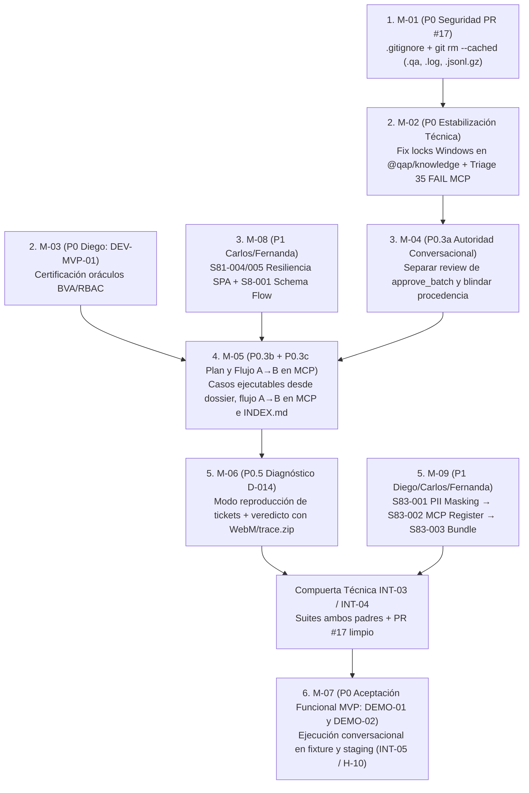

# Auditoría 05 — Matriz Maestra Reconciliada y Ruta Crítica hacia el MVP (20 de noviembre)

- **Repositorio:** `Hyouka73/QAMCP` (`QAMCP/`)
- **Rama base y SHA auditado:** `feat/qap-vnext-architecture` @ `fd47b84b7346b183c510b0a8278fafd0853a88fb`
- **Fecha de corte:** 2026-11-14
- **Documentos base consolidados:**
  1. [01_CICLO_VIDA_QA.md](./01_CICLO_VIDA_QA.md)
  2. [02_AUDITORIA_TOOLS_MCP.md](./02_AUDITORIA_TOOLS_MCP.md)
  3. [03_WBS_Y_RESPONSABILIDADES.md](./03_WBS_Y_RESPONSABILIDADES.md)
  4. [04_SEGURIDAD_PR17.md](./04_SEGURIDAD_PR17.md)
- **Contratos y planes contrastados:** [REQUISITOS_QA_MVP_OPERATIVO.md](../../REQUISITOS_QA_MVP_OPERATIVO.md), [PLAN_ONE_SHOT_Y_MERGE.md](../../PLAN_ONE_SHOT_Y_MERGE.md), [08_WBS_MICROTAREAS_Y_COMPUERTAS.md](../../08_WBS_MICROTAREAS_Y_COMPUERTAS.md) y [09_CONTRATO_EXPERIENCIA_OPERATIVA_MVP_2026-11-09.md](../../09_CONTRATO_EXPERIENCIA_OPERATIVA_MVP_2026-11-09.md).

---

## 1. Reconciliación de Contradicciones entre las Cuatro Auditorías

Al contrastar los cuatro informes de Fase A con el código fuente en `fd47b84` y los contratos del proyecto, se fijan cuatro dictámenes vinculantes:

### 1.1 Provisión de Credenciales (`qap_auth_provision`) ≠ Autenticación Efectiva (`qap_auth_add` / `qap_start`)
- **Divergencia detectada:** La Auditoría 02 describió `qap_auth_provision` como una herramienta que *"ejecuta flujo de login/browser y persiste `storageState`"*, mientras la Auditoría 01 agrupó ambas en el paso de autenticación inicial.
- **Resolución contra el código:**
  - `qap_auth_provision` ([tool-catalog.ts](../../../../packages/mcp/src/tool-catalog.ts#L192-L204), [server.ts](../../../../packages/mcp/src/server.ts#L716-L728)) únicamente abre el diálogo interactivo del host local en Windows (`provisionAccess.provision`) para almacenar un secreto en el `keychain` local de una raíz autorizada, sin pasar la contraseña por el modelo de lenguaje. **No lanza navegador ni verifica sesión.**
  - `qap_auth_add` ([scoped-password.ts](../../../../packages/mcp/src/scoped-password.ts), [server.ts](../../../../packages/mcp/src/server.ts#L900-L909)) y `qap_start(credentials)` ([server.ts](../../../../packages/mcp/src/server.ts#L939-L1009)) son quienes ejecutan la **autenticación real y verificación de sesión** en Chromium (`captureVerifiedPassword`, `captureVerifiedAuto`, `captureVerifiedHandoff` en [verified-handoff.ts](../../../../packages/mcp/src/verified-handoff.ts)), validando ruta post-login y selector visible antes de marcar `verified: true` y persistir `storageState` aislado por origen.

### 1.2 Implementación en Código ≠ Aceptación Funcional de Producto
- **Divergencia detectada:** La Auditoría 01 clasificó las Etapas 1, 2, 3, 7 y 8 como **"Implementado"**, y en el WBS operativo figuran tareas (`S81-001..003`, `S82-001..005`, `S8-004`) como `✅ Completado`.
- **Resolución contra los contratos:**
  - Como establecen la Auditoría 03 y [PLAN_ONE_SHOT_Y_MERGE.md](../../PLAN_ONE_SHOT_Y_MERGE.md#L3-L17), tener el código compilando o pasando tests unitarios/arneses técnicos (`DEV-MVP-02_FLUJO_FUNCIONAL.md`, explícitamente marcado `NOT-human-acceptance`) **no equivale a certificación funcional**:
    1. `DEV-MVP-01` sigue `▶️ En ejecución` (Diego) para certificar oráculos BVA/RBAC.
    2. `H-09` (Demo Sprint 8.2) y las dos demos conversacionales del MVP (`DEMO-01` y `DEMO-02` en `DEV-MVP-02` / `P0.6`) siguen en **0 de 2 demos completas**.
    3. En la Etapa 6, `qap_validate` solo valida esquemas estáticos en `.qa/definitions` y `isInternallyConsistentExecution` ([execution-evidence.ts](../../../../packages/mcp/src/handlers/execution-evidence.ts)) solo comprueba sumas aritméticas del `summary`; falta integrar el diagnóstico conservador D-014 (`P0.5`) para reproducción de tickets.
    4. En la Etapa 7, aunque `97e7ce6` ya implementó en [runner.ts](../../../../packages/playwright-runner/src/runner.ts) y [evidence-artifacts.ts](../../../../packages/playwright-runner/src/evidence-artifacts.ts) la captura de WebM, `trace.zip`, timeline y sanitización CSS/DOM por intento (`P0.4`), esto es independiente de la tarea `S83-001` de Diego en `screenshot.ts` (enmascaramiento `#FF00FF`) y aún requiere validación E2E en `DEMO-01`/`DEMO-02`.

### 1.3 Propuesta de Reducir Herramientas (21 → 9) ≠ Autorización para Retirarlas
- **Divergencia detectada:** La Auditoría 02 propuso reducir el catálogo de 21 a 9 herramientas y retirar `qap_start`, `qap_init`, `qap_auth_provision`, `qap_validate`, `qap_prune` y `qap_server`.
- **Resolución contra el código y el WBS:**
  - En `fd47b84` ([server.ts](../../../../packages/mcp/src/server.ts#L910-L1103)), `qap_start` es el punto de entrada conversacional activo que encadena sesión, contexto y `discovery_inicial` en una sola llamada para cumplir el requisito de *"cero comandos técnicos y cero diálogos rutinarios"* ([REQUISITOS_QA_MVP_OPERATIVO.md](../../REQUISITOS_QA_MVP_OPERATIVO.md#L11)).
  - Además, `guidance.ts`, cientos de tests en `packages/mcp/src/__tests__/` y la tarea `S83-002` de Diego (`sync-mcp-schemas.mjs`, `qap mcp register`) dependen de los nombres actuales del catálogo.
  - **Dictamen:** Queda **prohibido retirar o renombrar herramientas MCP antes del 20 de noviembre**. La propuesta de 9 herramientas se registra como diseño post-MVP (`P2`).

---

## 2. Separación entre Compuertas de Integración Técnica y Aceptación Completa del MVP

Para evitar bloqueos cruzados o atribuir cierres prematuros ([08_WBS_MICROTAREAS_Y_COMPUERTAS.md](../../08_WBS_MICROTAREAS_Y_COMPUERTAS.md#L124-L145)), el cierre hacia el 20 de noviembre se divide en dos planos independientes:

| Plano | Compuertas WBS | Qué evalúa objetivamente | Condición de paso (GO) |
| :--- | :--- | :--- | :--- |
| **Plano 1: Compuertas de Integración Técnica** (`vNext` ↔ `develop`, PR #17) | `INT-01` (Contratos) `INT-02` (`VNEXT-014` / Estabilidad) `INT-03` (Ensayo combinado) `INT-04` (Seguridad y Doble Revisión para Merge) | 1. Árbol Git e índice limpios en PR #17 (sin `admin-user.json` modificado, sin `.qa/` de subpaquetes, sin `.log` ni `.jsonl.gz`). 2. `pnpm build` (10 paquetes) y `pnpm -r test` sin abortar en `@qap/knowledge` (`replace-gate.test.ts`, `lock-manager.test.ts`). 3. Conciliación por identidad de los 35 fallos de `@qap/mcp` en serial vs. baseline histórico. 4. Compatibilidad de exportaciones (`generateBvaCases` + `SqliteKnowledgeAdapter`), schemas `TCCase` y puerto `IFlowStateStore` sin regresiones en suites de ambos padres. | **Habilita el merge técnico de PR #17 a `develop`**, pero **NO** certifica el producto QA ni cierra el MVP. |
| **Plano 2: Aceptación Funcional Completa del MVP** (Producto QA Operativo) | `DEV-MVP-01` (Oráculos BVA/RBAC) `H-09` (Demo Flujos S8.2) `DEV-MVP-02` (`DEMO-01` y `DEMO-02`) `S8-005` / `INT-05` / `H-10` (Entrega 20/11) | 1. **DEMO-01:** Desde chat limpio, Discovery documentado (`INDEX.md`), reglas acreditadas por alcance, plan ejecutable con flujo A→B y dato compartido en Chromium, reporte y reejecución tras reinicio con cero comandos técnicos. 2. **DEMO-02:** Desde ticket parcial, reproducción con diagnóstico D-014 (`REPRODUCIDO` / `NO REPRODUCIDO` / `BLOQUEADO`), esperado vs. observado, video WebM y `trace.zip` navegables tras reinicio. 3. Verificación primero en fixture controlado y después en recorrido autorizado de staging (`P0.6`). | **Certifica la aceptación del MVP operativo del 20 de noviembre (`H-10`).** |

---

## 3. Matriz Maestra de Brechas, Riesgos y Plan de Ejecución

| ID | Brecha o riesgo | Prioridad | Evidencia disponible y nivel de confianza | Componente responsable | Responsable según WBS | Dependencias | Riesgo de interferencia con Diego | Acción mínima necesaria | Criterio objetivo de aceptación | Orden de ejecución | Posibilidad de trabajo en paralelo |
| :--- | :--- | :---: | :--- | :--- | :--- | :--- | :---: | :--- | :--- | :---: | :--- |
| **M-01** | **Exposición de sesión protegida (`admin-user.json`), falla de `.gitignore` en subpaquetes (`packages/*/.qa/`) y 32.92 MB de logs/trazas (`.log`, `.jsonl.gz`) en el PR #17.** | **P0** *(Compuerta Técnica INT-04)* | **Confianza ALTA.** Verificado en [04_SEGURIDAD_PR17.md](./04_SEGURIDAD_PR17.md): `admin-user.json` modificado en `47f17ce`; `.gitignore` ancla `.qa/*` solo a la raíz; `179` `.log` y `99` `.jsonl.gz` indexados. | Configuración Git raíz ([.gitignore](../../../../.gitignore)) e índice del repositorio en `feat/qap-vnext-architecture`. | Responsable vNext (`Hyouka73`) / Auditoría de Integración. | Ninguna (puede ejecutarse de inmediato sobre `HEAD` de vNext). | **BAJO** (usa `git rm --cached` sin borrar archivos locales en disco; solo avisar a Diego para no re-indexar `packages/*/.qa/`). | Actualizar `.gitignore` (`**/.qa/*`, `!**/.qa/definitions/`, `*.jsonl.gz`, `*.sqlite*`, `*.db`) y desindexar con `git rm --cached` los artefactos `.qa/` de paquetes, `.playwright-mcp/`, `.log` y `.jsonl.gz` de `docs/vnext/**/evidencia/`. Rotar credenciales expuestas históricamente. | `git ls-tree -r --name-only HEAD` retorna `0` coincidencias para `.qa/cache/`, `.qa/reports/`, `*.log` y `*.jsonl.gz`; `git check-ignore -v packages/playwright-runner/.qa/cache/sessions/admin-user.json` confirma exclusión; archivos locales siguen intactos en disco. | **1** | **Sí.** Totalmente paralelo al trabajo de código de Diego en `DEV-MVP-01` y `H-09`. |
| **M-02** | **Suite `pnpm -r test` aborta en `@qap/knowledge` por fallos de concurrencia/locks en Windows (`replace-gate.test.ts`, `lock-manager.test.ts`) y quedan 35 fallos de `@qap/mcp` por conciliar (`P0.1`).** | **P0** *(Compuerta Técnica INT-02)* | **Confianza ALTA.** Verificado en [01_CICLO_VIDA_QA.md](./01_CICLO_VIDA_QA.md) (`4` archivos / `5` tests fallidos con `ENOENT`/`ECOMPROMISED` en Windows) y en [PLAN_ONE_SHOT_Y_MERGE.md](../../PLAN_ONE_SHOT_Y_MERGE.md#L23) (`616` PASS / `35` FAIL en MCP serial en `a416e23`). | `@qap/knowledge` (`FileSystemStorage`, `LockManager` en `packages/knowledge/src/storage/`) y `@qap/mcp` (`packages/mcp/src/`). | Responsable vNext (`Hyouka73` / Codex). | **M-01** (árbol limpio para registrar evidencia sin indexar logs). | **BAJO** (Diego trabaja en `packages/knowledge/src/plan/` y `flow-state-store.ts`, no en `file-storage.ts` ni `lock-manager.ts`). | Estabilizar la coordinación de lectura/reemplazo atómico y liberación de directorios temporales en Windows en `@qap/knowledge`; ejecutar suite `@qap/mcp` serial y cotejar por identidad los fallos frente a `fffa201` y `develop`, corrigiendo regresiones reales de autorización/autenticación sin degradar tests. | `pnpm --filter @qap/knowledge test` pasa al `100%` en Windows sin `ENOENT`/`ECOMPROMISED`; `pnpm -r test` ejecuta hasta el final todos los paquetes (`reporter`, `mcp`); matriz de identidades MCP documentada con `0` regresiones P0/P1. | **2** | **Sí.** Paralelo a `DEV-MVP-01` de Diego (archivos disjuntos dentro de `packages/knowledge`). |
| **M-03** | **Certificación de oráculos positivos/negativos/ausentes en generadores BVA y RBAC (`DEV-MVP-01` / `COMP-01`).** | **P0** *(Compuerta Técnica INT-01 / Funcional)* | **Confianza ALTA.** Verificado en [03_WBS_Y_RESPONSABILIDADES.md](./03_WBS_Y_RESPONSABILIDADES.md) y [08_WBS_MICROTAREAS_Y_COMPUERTAS.md](../../08_WBS_MICROTAREAS_Y_COMPUERTAS.md#L113): `S81-001/002/003` existen en código, pero `DEV-MVP-01` sigue en ejecución para evitar oráculos fabricados (`not_visible` o min/max inventados). | `@qap/knowledge` (`packages/knowledge/src/plan/bva-generator.ts`, `rbac-generator.ts`) y `@qap/shared` (`SchemaValidator`). | **Diego** (`DEV-MVP-01`). | `S81-001`, `S81-002`, `S81-003`, `S81-006`. | **ALTO** si el equipo vNext edita `packages/knowledge/src/plan/`. **NULO** si vNext respeta la veda sobre esos archivos. | Que Diego complete `DEV-MVP-01` garantizando que casos BVA/RBAC sin requisito confirmado queden como `candidate`/bloqueados y preserven ediciones manuales (`manually_edited`). | Suites `bva-generator.test.ts`, `rbac-generator.test.ts` y `generator-oracle-safety.test.ts` en `PASS`, sin promover casos sin oráculo humano a ejecutables confirmados. | **2** *(En paralelo con M-02)* | **Sí (por Diego).** Nuestro equipo no toca `bva-generator.ts` ni `rbac-generator.ts`. |
| **M-04** | **Endurecimiento de autoridad conversacional en propuestas y revisión de casos (`P0.3a`): separar `review` (solo lectura) de `approve_batch` y exigir procedencia acreditada.** | **P0** *(Funcional MVP — Etapa 3 y 4)* | **Confianza ALTA.** Verificado en [PLAN_ONE_SHOT_Y_MERGE.md](../../PLAN_ONE_SHOT_Y_MERGE.md#L15) y `#L38`, más commit `f277487`: `review` compartía escritura o permitía atribuir texto al usuario por defecto en propuestas directas. | `@qap/mcp` (`conversational-case-workflow.ts`, `rule-resolution-handler.ts`, `scoped-rule-resolver.ts`). | Responsable vNext (`Hyouka73`). | **M-02** (baseline MCP establecido). | **NULO** (archivos exclusivos de `packages/mcp/src/handlers/` y `application/`). | Completar y verificar `P0.3a`: asegurar que `review` deje el estado y los YAML intactos, que un texto inventado por el agente o fuente contradicha permanezca pendiente, y que solo una confirmación genuina con alcance cree revisión nueva. | `p0-3a-rule-authority-review.test.ts` y pruebas negativas de autoridad en `PASS`: `0` mutaciones en modo `review` y bloqueo efectivo de casos sin requisito confirmado. | **3** | **Sí.** Totalmente aislado en `packages/mcp/`. |
| **M-05** | **Brecha de casos ejecutables, linaje de alcance (dossier/regla/tenant/perfil) y composición del flujo multi-módulo A→B desde MCP (`P0.3b` y `P0.3c`).** | **P0** *(Funcional MVP — Etapa 4, 5 y 8)* | **Confianza ALTA.** Verificado en [01_CICLO_VIDA_QA.md](./01_CICLO_VIDA_QA.md), [PLAN_ONE_SHOT_Y_MERGE.md](../../PLAN_ONE_SHOT_Y_MERGE.md#L14-L15) y `#L39-L40`: `FlowOrchestrator` funciona en CLI (`qap flow`), pero `qap_plan` / `qap_test` en MCP aún operan por módulo individual y requieren fijar digest de dossier/regla/tenant y memoria recuperable en `INDEX.md`. | `@qap/mcp` ([plan.handler.ts](../../../../packages/mcp/src/handlers/plan.handler.ts), [test.handler.ts](../../../../packages/mcp/src/handlers/test.handler.ts), `discovery-dossier.ts`) consumiendo `@qap/engine` (`FlowOrchestrator` vía puerto `IFlowStateStore`). | Responsable vNext (`Hyouka73`) en coordinación de interfaz con Diego (`S82-001..004`). | **M-04** (`P0.3a`), y cierre de interfaz de `FlowOrchestrator` por Diego (`H-09`). | **MEDIO** (si se tocara `flow-orchestrator.ts`). **BAJO** si vNext consume únicamente el puerto `IFlowStateStore` (`22ce768`) desde `packages/mcp/`. | Materializar pasos funcionales tipados y aserciones desde el dossier acreditado; persistir IDs/revisiones de dossier, regla, entorno, tenant y perfil en el plan e intento; conectar la ejecución A→B desde MCP y enlazar decisiones/planes/resultados en `INDEX.md` (`P0.3c`). | Ejecución en Chromium desde MCP de caso positivo y negativo con transferencia de dato A→B; invalidación automática del plan si cambia una regla; recuperación del estado exacto y enlaces en otro chat tras reiniciar el servidor MCP. | **4** | **Parcial.** El contrato en `packages/mcp/` puede avanzar en paralelo a Diego siempre que no se edite `flow-orchestrator.ts` ni `flow-state-store.ts`. |
| **M-06** | **Falta el modo de reproducción de tickets y clasificador conservador de defectos D-014 (`P0.5`: `REPRODUCIDO`, `NO REPRODUCIDO`, `BLOQUEADO`, `indeterminate`).** | **P0** *(Funcional MVP — Etapa 6 / DEMO-02)* | **Confianza ALTA.** Verificado en [01_CICLO_VIDA_QA.md](./01_CICLO_VIDA_QA.md) (Etapa 6), [execution-evidence.ts](../../../../packages/mcp/src/handlers/execution-evidence.ts) (solo valida sumas del `summary`) y [PLAN_ONE_SHOT_Y_MERGE.md](../../PLAN_ONE_SHOT_Y_MERGE.md#L42): falta aplicar D-014 sobre la evidencia física del intento (`P0.4`, ya integrada en `97e7ce6`). | `@qap/engine` (contratos de diagnóstico) y `@qap/mcp` ([test.handler.ts](../../../../packages/mcp/src/handlers/test.handler.ts), [report.handler.ts](../../../../packages/mcp/src/handlers/report.handler.ts)). | Responsable vNext (`Hyouka73`). | **M-05** (`P0.3b`) y evidencia por intento `P0.4` (`97e7ce6`). | **BAJO** (se compone sobre los resultados e intentos de MCP sin alterar las acciones internas de `runner.ts` de Diego). | Componer el modo de reproducción sobre caso fijado, esperado citado y evidencia del intento (WebM, `trace.zip`, captura), persistiendo el veredicto (`REPRODUCIDO`, `NO REPRODUCIDO`, `BLOQUEADO`) separado de la causa (`product_bug` corroborado vs. `auth_failed`, `selector_not_found`, `network_error`, `indeterminate`). | Prueba en fixture con defecto sembrado (`REPRODUCIDO` + `product_bug`), versión corregida (`NO REPRODUCIDO`), sesión caducada (`BLOQUEADO`) y selector roto/HTTP 500 aislado (`indeterminate` / fallo técnico sin falsos positivos de bug de producto). | **5** | **Sí.** Paralelo a `S83-001` de Diego. |
| **M-07** | **Ejecución y certificación de las 2 Demos de Aceptación del MVP (`DEMO-01` y `DEMO-02` / `DEV-MVP-02` / `P0.6`) primero en fixture desde chat limpio y luego en staging autorizado.** | **P0** *(Aceptación Funcional MVP — INT-05 / H-10)* | **Confianza ALTA.** Verificado en [01_CICLO_VIDA_QA.md](./01_CICLO_VIDA_QA.md), [03_WBS_Y_RESPONSABILIDADES.md](./03_WBS_Y_RESPONSABILIDADES.md) y [PLAN_ONE_SHOT_Y_MERGE.md](../../PLAN_ONE_SHOT_Y_MERGE.md#L3): **0 de 2 demos completas** actualmente. | Sistema completo (`@qap/mcp`, `@qap/playwright-adapter`, `@qap/playwright-runner`, `@qap/reporter`, `@qap/knowledge`). | **Diego** (`DEV-MVP-02`) + Responsable vNext (`Hyouka73` / `P0.6`). | **M-01, M-02, M-03, M-04, M-05, M-06**. | **ALTO (Requiere ejecución coordinada).** Es el punto de convergencia entre el trabajo de Diego y vNext. | Ejecutar `DEMO-01` (objetivo → discovery → plan con regla acreditada → ejecución A→B → reporte → reejecución en otro chat) y `DEMO-02` (ticket parcial → reproducción D-014 con WebM y traza → reejecución en versión corregida y ante bloqueo) en fixture y luego en el entorno staging acordado. | Bitácora verificable con SHA, `conversation_id`, enlaces a `.qa/discovery/INDEX.md`, reportes, video WebM y `trace.zip` abribles tras reinicio, `0` comandos de terminal pedidos al QA y `0` diálogos rutinarios por ruta. | **6** | **No.** Es secuencial y requiere que las entregas previas estén integradas. |
| **M-08** | **Resiliencia SPA (`S81-004` `auth-wall-detector.ts`, `S81-005` `hydration-resilience.ts`) y Cierre de Schema AJV de Flujos (`S8-001`).** | **P1** *(Estabilidad de Ejecución en Staging)* | **Confianza ALTA.** Verificado en [03_WBS_Y_RESPONSABILIDADES.md](./03_WBS_Y_RESPONSABILIDADES.md): figuran como `⬜ Pendiente` en el WBS para Carlos Eduardo y Fernanda. | `@qap/playwright-runner` (`auth-wall-detector.ts`, `hydration-resilience.ts`) y `@qap/shared` (`flow.schema.json`). | **Carlos Eduardo** (`S81-004`, `S81-005`) y **Fernanda** (`S8-001`). | `H-08`, alineación con `FlowOrchestrator` (`S82-001`). | **MEDIO** en `runner.ts` si se edita sin avisar a Diego; **BAJO** si se desarrollan como módulos aislados y se coordina el hook. | Implementar ambos detectores en archivos independientes dentro de `packages/playwright-runner/src/` y cerrar la validación AJV de `flow.schema.json` alineada con `FlowOrchestrator`. | Tests unitarios de detección de muro de login y espera de hidratación SPA en `PASS`; validación AJV de `.qa/flows/*.yaml` en `PASS` sin romper `flow-integration.test.ts`. | **3** *(Paralelo a M-04)* | **Sí.** Carlos Eduardo y Fernanda pueden ejecutarlo en paralelo a M-02/M-03/M-04. |
| **M-09** | **Enmascaramiento PII en capturas legacy (`S83-001`), registro CLI MCP / sincronización de schemas (`S83-002`) y empaquetado/release (`S83-003`, `S8-006`, `S8-005`, `S8-007`).** | **P1** *(Cierre Operativo WBS 16/11 → 20/11)* | **Confianza ALTA.** Verificado en [03_WBS_Y_RESPONSABILIDADES.md](./03_WBS_Y_RESPONSABILIDADES.md): tareas programadas en la última semana previa al 20 de noviembre. | `@qap/playwright-runner` (`screenshot.ts`), `@qap/cli` (`qap mcp register`, `tsup`), `@qap/mcp` (`sync-mcp-schemas.mjs`), `docs/`. | **Diego** (`S83-001`, `S83-002`), **Carlos Eduardo** (`S83-003`, `S8-007`), **Fernanda** (`S8-006`). | `H-09` → `S83-001` → `S83-002` → `S83-003` → `S8-005` / `H-10`. | **ALTO** en `S83-002` si vNext modifica `tool-catalog.ts` al mismo tiempo. Se mitiga congelando los 21 nombres de tools en vNext. | Que Diego ejecute `S83-001` y `S83-002` sobre el catálogo congelado; que Fernanda documente `S8-006` y Carlos Eduardo ejecute `release-check.mjs` (`S83-003`) antes del dogfooding final (`S8-005`). | `captureScreenshot()` aplica PII masking; `sync-mcp-schemas.mjs` y `npm pack --dry-run` pasan sin errores ni secretos incluidos en el tarball. | **5 a 7** | **Parcial.** `S8-006` (docs) y preparación de `S83-003` son paralelos; la ejecución de `S83-002` → `S83-003` → `S8-005` es secuencial. |
| **M-10** | **Sobrecosto de contexto del catálogo MCP (~10,000–11,500 tokens por turno en 21 herramientas) y exposición de parámetros técnicos (`module`, `case_ids`, `discovery_revision_id`) en `qap_plan` / `qap_test`.** | **P2** *(Evolución Post-MVP / Optimización No Disruptiva)* | **Confianza ALTA.** Medido exactamente en [02_AUDITORIA_TOOLS_MCP.md](./02_AUDITORIA_TOOLS_MCP.md) (`42,985` bytes en `tool-catalog.ts`) y [01_CICLO_VIDA_QA.md](./01_CICLO_VIDA_QA.md). | `@qap/mcp` ([tool-catalog.ts](../../../../packages/mcp/src/tool-catalog.ts), [server.ts](../../../../packages/mcp/src/server.ts), [guidance.ts](../../../../packages/mcp/src/guidance.ts)). | Responsable vNext (`Hyouka73`). | Posterior a `H-10` (20 de noviembre) para cualquier retiro/fusión de tools. | **ALTO** si se retiran herramientas antes del 20/11 (rompe `S83-002` y tests). **NULO** si se pospone el rediseño de 9 tools a post-MVP. | **Antes del 20/11:** No retirar ni renombrar ninguna de las 21 herramientas; resolver valores por defecto (`module`, `discovery_revision_id`) desde el estado activo cuando el LLM los omita. **Post-20/11:** Evaluar RFC de consolidación a 9 herramientas con fase de alias/deprecación. | Catálogo de 21 herramientas intacto para el MVP; invocaciones de `qap_plan`/`qap_test` resuelven ámbito por defecto desde la sesión activa cuando existe un único módulo/revisión en curso. | **Post-MVP** *(Resolución por defecto opcional en Orden 4)* | **Sí (como diseño documental post-MVP).** |

---

## 4. Ruta Crítica y Secuencia de Ejecución (14 al 20 de Noviembre de 2026)

### Resumen Ejecutivo de Coordinación Inmediata
1. **Primera acción obligatoria en `feat/qap-vnext-architecture` (`M-01`):** Saneamiento de `.gitignore` y desindexación (`git rm --cached`) de `packages/playwright-runner/.qa/` (incluido `admin-user.json` sin abrirlo ni borrarlo del disco), `.playwright-mcp/`, y los `32.92 MB` de `.log` y `.jsonl.gz` en `docs/vnext/**/evidencia/`. No depende de ninguna otra tarea, elimina el bloqueo de seguridad P0 del PR #17 y deja el árbol limpio para que las siguientes corridas de pruebas (`M-02`) no contaminen el repositorio.
2. **Siguiente paso técnico en `vNext` (`M-02` → `M-04` → `M-05` → `M-06`):** Resolver los fallos de `replace-gate.test.ts` y `lock-manager.test.ts` en `@qap/knowledge` en Windows para desbloquear `pnpm -r test`, cerrar `P0.3a` (autoridad de reglas y `review` read-only), conectar `P0.3b`/`P0.3c` (plan ejecutable y flujo A→B desde MCP usando `IFlowStateStore`) y acoplar `P0.5` (diagnóstico D-014 con la evidencia WebM/`trace.zip` ya disponible de `P0.4`).
3. **Trabajo de Diego en paralelo sin conflictos:** Diego puede continuar y cerrar sin interferencia **`DEV-MVP-01`** (`bva-generator.ts`, `rbac-generator.ts`), la demostración de flujos **`H-09`** (`flow-orchestrator.ts`, `flow-state-store.ts`, `qap flow`), **`S83-001`** (`screenshot.ts`) y posteriormente **`S83-002`** (`sync-mcp-schemas.mjs`, `DiscoverSessionStore`), dado que `vNext` mantiene congelados los nombres de las 21 herramientas MCP y respeta el límite del puerto `IFlowStateStore`.
